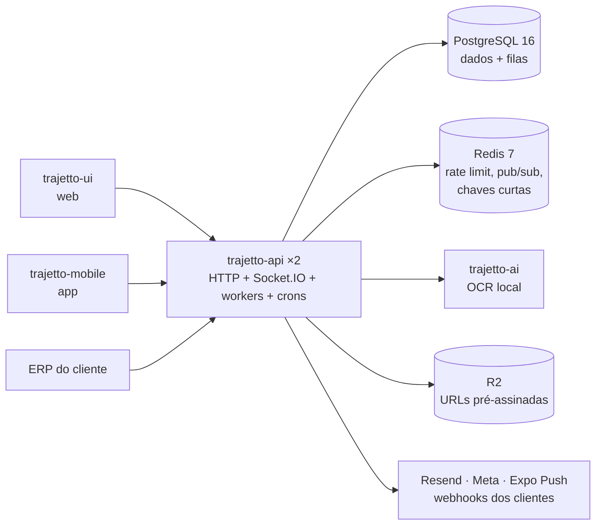

# Trajetto — API

<p align="center">
  
  
  
  
  
  
  
  
  
  
  
  
  
  
</p>

Back-end do Trajetto: a API HTTP, o tempo real (Socket.IO) e os processos de
fundo (filas e crons) que atendem o painel web (`trajetto-ui`), o aplicativo do
motorista (`trajetto-mobile`) e os sistemas dos clientes que se integram pela
API pública. Inclui também o serviço de IA local (`infra/ai-ocr`), publicado
como imagem própria.

> Software proprietário. Leia [Licença](#licença) antes de copiar qualquer coisa
> deste repositório.

## Sumário

- [O Trajetto em 1 minuto](#o-trajetto-em-1-minuto)
- [O que este repositório é (e o que não é)](#o-que-este-repositório-é-e-o-que-não-é)
- [Documentação](#documentação)
- [Arquitetura em resumo](#arquitetura-em-resumo)
- [Stack e por que cada peça](#stack-e-por-que-cada-peça)
- [Como o código está organizado](#como-o-código-está-organizado)
- [Rodando localmente](#rodando-localmente)
- [Variáveis de ambiente](#variáveis-de-ambiente)
- [Scripts](#scripts)
- [Sessão, empresa e acesso](#sessão-empresa-e-acesso)
- [Integrações](#integrações)
- [Padrões para escrever código](#padrões-para-escrever-código)
- [Testes](#testes)
- [Depuração](#depuração)
- [Documentação das rotas](#documentação-das-rotas)
- [Build, imagem e deploy](#build-imagem-e-deploy)
- [Desenvolvimento, staging e produção](#desenvolvimento-staging-e-produção)
- [Operação e saúde](#operação-e-saúde)
- [Solução de problemas](#solução-de-problemas)
- [Decisões e limites conhecidos](#decisões-e-limites-conhecidos)
- [Licença](#licença)

## O Trajetto em 1 minuto

O Trajetto é uma plataforma B2B (SaaS multiempresa) para transportadoras, com
dois módulos vendidos separadamente por empresa:

- **Frotas** (`FLEET`): veículos, motoristas, abastecimentos com foto do
  odômetro, checklists veiculares, ordens de serviço, peças, fornecedores,
  multas, contas a pagar, filiais e um quadro Kanban.
- **Entregas** (`DELIVERIES`): documentos de entrega (manual, planilha ou XML
  de NF-e), embarcadores, rotas, torre de controle, monitoramento, ocorrências
  com formulário e autorização da torre, pausas do motorista, comprovante em
  PDF assinado, atendimento por ticket (chat), mensagens ao cliente final e a
  API pública com webhooks.

| Repositório no GitHub (pasta local)                               | O que é                                                           | Tecnologia                                          | Onde roda                                                                                                     |
| ----------------------------------------------------------------- | ----------------------------------------------------------------- | --------------------------------------------------- | ------------------------------------------------------------------------------------------------------------- |
| `Trajetto-Organization/trajetto-api` (este, pasta `trajetto-api`) | API, tempo real, filas, crons, IA local                           | Node.js 22, Fastify, Prisma, PostgreSQL 16, Redis 7 | Dokploy: Applications `trajetto-api` e `trajetto-ai` e Databases PostgreSQL (com o backup do Dokploy) e Redis |
| `Trajetto-Organization/trajetto-ui` (pasta `trajetto-ui`)         | painel web (`/dashboard`, `/admin`), site público, portal `/docs` | Next.js 14 (App Router)                             | Dokploy, Application `trajetto-ui`                                                                            |
| `Trajetto-Organization/trajetto-mobile` (pasta `trajetto-mobile`) | aplicativo de campo do motorista, só Android                      | Expo / React Native                                 | EAS (APK interno e Play Store)                                                                                |

## O que este repositório é (e o que não é)

**É** o juiz de todas as regras: autenticação, permissões, módulos
contratados, isolamento entre empresas, validação, filas, notificações,
webhooks, leitura de fotos e o PDF do comprovante. A web e o app só escondem
ou desabilitam o que a API vai recusar.

**Não é**:

- interface: as telas estão na `trajetto-ui` e na `trajetto-mobile`;
- um provedor de IA externo: a leitura de fotos roda no serviço próprio
  `trajetto-ai`, sem chamar terceiros;
- um serviço de backup: o backup do banco é o do próprio Dokploy (aba
  _Backups_ do Database PostgreSQL, diário, para o Cloudflare R2); os scripts
  de `infra/scripts/` servem só para dump manual e ensaio;
- um broker de mensagens: as filas são tabelas do Postgres (o RabbitMQ saiu em
  09/2026).

## Documentação

| Documento                                                          | Para quê                                                                                                                                                                                                                                                                   |
| ------------------------------------------------------------------ | -------------------------------------------------------------------------------------------------------------------------------------------------------------------------------------------------------------------------------------------------------------------------- |
| [`docs/arquitetura.md`](./docs/arquitetura.md)                     | o mapa navegável da plataforma, a estrutura do código, a anatomia de um módulo e como criar uma feature, processos, filas, tempo real, IA, comprovante, regras de migration, compatibilidade com o app, unicidade por empresa, o resumo dos ADRs                           |
| [`docs/arquitetura-tour.md`](./docs/arquitetura-tour.md)           | o tour pela arquitetura, passo a passo: o mesmo mapa em onze passos (requisição, sessão, tenant, arquivos, filas, notificações, tempo real, IA, importações, deploy e saúde), com ◀ Anterior · Índice · Próximo ▶                                                        |
| [`docs/adr/`](./docs/adr/README.md)                                | as decisões de arquitetura (ADRs), uma por arquivo, com o índice                                                                                                                                                                                                           |
| [`docs/deploy.md`](./docs/deploy.md)                               | o caminho até a produção: branches, workflows, GHCR, Dokploy do zero (cada Application e Database, clique a clique, staging e produção), IA, Postgres e Redis, borda, migrations, rollback, backup e restore, alertas, cadeia de suprimentos, checklist do primeiro deploy |
| [`docs/variaveis-de-ambiente.md`](./docs/variaveis-de-ambiente.md) | cada variável: para que serve, obrigatoriedade, segredo, formato, valor em dev/staging/produção e onde mora                                                                                                                                                                |
| [`docs/testes.md`](./docs/testes.md)                               | as suítes, como rodar, o que cada uma prova, cobertura, mutação e as regras para escrever testes                                                                                                                                                                           |
| [`CLAUDE.md`](./CLAUDE.md) / [`AGENTS.md`](./AGENTS.md)            | o guia de trabalho para agentes de código (e um bom resumo para quem chega)                                                                                                                                                                                                |
| [`infra/traefik/README.md`](./infra/traefik/README.md)             | a configuração estática do Traefik do Dokploy                                                                                                                                                                                                                              |
| [`tests/load/README.md`](./tests/load/README.md)                   | o harness de carga e o que ele mediu                                                                                                                                                                                                                                       |

## Arquitetura em resumo



O mapa completo, com Cloudflare, Traefik, Dokploy, GHCR, EAS, a tabela de
relações conferidas no código e os fluxos (sessão, upload, filas, tempo real e
deploy) em blocos que se expandem, está em
[`docs/arquitetura.md` → Visão de componentes](./docs/arquitetura.md#visão-de-componentes).
Para avançar por ele em ordem, um assunto por vez, use o
[Tour pela arquitetura, passo a passo](./docs/arquitetura-tour.md).

- **Postgres é a fila**: outbox transacional e filas em tabelas com
  `FOR UPDATE SKIP LOCKED` e lease; não há broker.
- **Redis é descartável**: rate limit, o pub/sub do Socket.IO entre réplicas,
  os tickets de socket de 30 s, o intervalo de 60 s do "esqueci minha senha" e
  fotos curtas (5–60 s) das leituras da plataforma que só o MASTER vê. Nenhum
  dado de empresa fica em cache, e sem Redis a API segue funcionando.
- **IA local**: o serviço `trajetto-ai` (RapidOCR em CPU) só transcreve; a API
  decide. Nenhum provedor externo.
- **Arquivos** nunca passam pela API: o cliente envia ao R2 por URL
  pré-assinada e a API confere a chave.
- **Comprovante** em PDF assinado com o A1 ICP-Brasil quando configurado.

## Stack e por que cada peça

Versões fixadas no `package.json` (sem `^`) e no `yarn.lock`.

| Peça                                          | Versão                                               | Por que está aqui                                                                                                         |
| --------------------------------------------- | ---------------------------------------------------- | ------------------------------------------------------------------------------------------------------------------------- |
| Node.js                                       | 22 (imagem `node:22.21.1-alpine`, fixada por digest) | runtime da API, dos workers e dos crons                                                                                   |
| TypeScript                                    | 5.7.2 (`strict`)                                     | tipos de ponta a ponta, do schema zod ao repositório                                                                      |
| Fastify + `fastify-type-provider-zod`         | 5.2.0 / 4.0.2                                        | HTTP rápido com schema por rota; o mesmo schema valida a entrada e gera o OpenAPI (`@fastify/swagger` 9.4.2)              |
| Prisma (`prisma`, `@prisma/client`)           | 6.1.0                                                | acesso tipado ao Postgres e migrations SQL versionadas (expandir/contrair)                                                |
| PostgreSQL                                    | 16                                                   | dados de todas as empresas **e** as filas (outbox, notificações, webhooks, IA) e os leases dos crons                      |
| Redis via `ioredis`                           | 7 / 5.10.1                                           | rate limit, pub/sub do Socket.IO, tickets de socket, intervalo do "esqueci minha senha", fotos do MASTER; descartável     |
| Socket.IO + `@socket.io/redis-adapter`        | 4.8.3 / 8.3.0                                        | tempo real para a web e o app, entre réplicas                                                                             |
| tsyringe                                      | 4.8.0                                                | injeção de dependência: o usecase recebe o repositório pela interface, e o teste troca pelo gêmeo in-memory               |
| zod                                           | 3.25.1                                               | validação de entrada (`src/schemas/`) e do ambiente no boot (`src/schemas/env-schema/`)                                   |
| pino                                          | 9.14.0                                               | log JSON, uma linha por requisição, com censura de segredos                                                               |
| `@aws-sdk/client-s3` + `s3-request-presigner` | 3.1107.0                                             | Cloudflare R2 (API S3): URLs pré-assinadas de PUT e GET e conferência com `HeadObject`                                    |
| nodemailer + handlebars                       | 6.9.16 / 4.7.10                                      | e-mail pelo SMTP da Resend (em desenvolvimento, conta de teste Ethereal) e os templates                                   |
| pdfkit + `@signpdf/*` + node-forge + qrcode   | 0.15.1 / 3.3.0 / 1.4.0 / 1.5.4                       | PDF do comprovante, assinatura PAdES com o A1 e o QR de conferência                                                       |
| exceljs, fast-xml-parser                      | 4.4.0 / 5.11.0                                       | importação de planilha e de XML de NF-e; exportação CSV/Excel                                                             |
| node-cron                                     | 4.2.1                                                | agenda dos crons (a exclusão mútua entre réplicas é um lease no Postgres)                                                 |
| undici                                        | 7.29.0                                               | cliente HTTP dos webhooks dos clientes                                                                                    |
| bcrypt, jsonwebtoken                          | 6.0.0 / 9.0.2                                        | senhas e tokens de acesso e refresh                                                                                       |
| Vitest + supertest, Stryker                   | 1.6.0 + 7.0.0, 8.7.1                                 | testes unitários, E2E HTTP e mutação                                                                                      |
| tsup, tsx                                     | 8.3.5, 4.19.2                                        | build da imagem e execução em desenvolvimento                                                                             |
| Python (serviço `trajetto-ai`)                | 3.12 (`python:3.12-slim`)                            | RapidOCR 3.9.2 sobre ONNX Runtime 1.30.0, em CPU; servidor HTTP da biblioteca padrão; dependências com `--require-hashes` |
| Yarn                                          | 1 (`yarn.lock`)                                      | gerenciador de pacotes; nunca npm                                                                                         |

## Como o código está organizado

```
src/server.ts                 boot (HTTP + Socket.IO + workers) e desligamento ordenado
src/http.ts                   instância Fastify, plugins, hooks, tratamento de erro, registro das rotas
src/websocket.ts              Socket.IO, salas, emissores (sendCatalogChangedEvent…)
src/env/index.ts              carrega o .env e valida com src/schemas/env-schema/index.ts
src/config/                   auth, CORS, rate limit, borda confiável (faixas da Cloudflare), upload, permissões
src/routes/<área>-routes.ts   rotas com guards e schema OpenAPI; routes.ts registra com o prefixo
src/schemas/<nome>-schema/    schemas zod de entrada
src/modules/<domínio>/        dtos/, repositories/ (interface, Prisma, in-memory/), usecases/<caso>/ (controller + usecase), errors
src/modules/middlewares/      ensure-authenticated, verify-permission, verify-tenant-active, verify-module-enabled, tenant-authorization…
src/shared/                   código transversal (ai, delivery, notifications, integration, health, http, security, time, providers…)
src/shared/index.ts           registro dos repositórios e serviços no container do tsyringe
src/jobs/cron/                crons (index.ts registra)
src/workers/index.ts          pipelines de notificação e de IA e o dispatcher de webhooks
prisma/schema.prisma          modelo de dados; prisma/migrations/ (SQL, expandir/contrair)
infra/scripts/                entrypoint da imagem, migrations como job, seeds, backup/restore manuais
infra/ai-ocr/                 serviço trajetto-ai (Python)
tests/                        unitaires/, E2E/, contract/, ai-local/, load/
```

Convenções que valem para todo o código (detalhes no [`CLAUDE.md`](./CLAUDE.md)):
comentários no código em inglês; mensagens ao usuário, erros, descrições do
OpenAPI e documentação em pt-BR com acentos; aliases `@/*` → `src/*` e
`infra/*` → `infra/*`; formatação pelo Prettier (`.prettierrc`).

## Rodando localmente

### Pré-requisitos

- Node.js 22 (a imagem usa `node:22.21.1-alpine`);
- Yarn 1 (o repositório usa `yarn.lock`);
- Docker com Docker Compose (Postgres, Redis e, opcional, a IA de
  desenvolvimento).

### Passo a passo

```bash
# 1. Dependências
yarn install

# 2. Variáveis: a API lê SÓ o .env da raiz
cp .env.example .env
#    preencha pelo menos JWT_SECRET, JWT_SECRET_REFRESH_TOKEN,
#    MASTER_USER_EMAIL, MASTER_USER_INITIAL_PASSWORD e POSTGRES_PASSWORD

# 3. Tudo de uma vez
yarn dev
```

`yarn dev` faz, em ordem:

1. sobe o Postgres e o Redis do `compose.development.yaml`
   (`database:dev:up`, `redis:dev:up`), em `127.0.0.1:5432` e `127.0.0.1:6379`;
2. espera o Postgres responder (`wait-for-postgres`);
3. gera o cliente Prisma e aplica as migrations (`prisma:migrate:deploy`);
4. no `postdev`: cria o usuário master (`seed`), importa a tabela de infrações
   do RENAINF (`seed:infringement`) e sobe o servidor com recarga
   (`dev:server`, porta `3333`).

Para rodar só o servidor depois que o banco já existe: `yarn dev:server`. Com
a API no ar, a web (`trajetto-ui`) e o app (`trajetto-mobile`) apontam para
`http://localhost:3333`; o login é o do usuário master do seed. Em
desenvolvimento os e-mails vão para uma conta de teste Ethereal (o link de
cada mensagem sai no log), não para a Resend.

### Serviço de IA (opcional)

```bash
# ~1 GiB de RAM. Sem ele, os pedidos de IA ficam PENDING e o resto funciona.
docker compose -f compose.development.yaml --profile ai up -d trajetto-ai
```

O `.env.example` já aponta `AI_LOCAL_URL=http://127.0.0.1:18080` com o token
de desenvolvimento do compose.

### Criando uma migration

```bash
# edite prisma/schema.prisma, depois:
yarn prisma:migrate:dev     # só CRIA o arquivo (--create-only); revise o SQL
yarn prisma:migrate:deploy  # aplica
```

As migrations seguem expandir/contrair: uma versão nova nunca remove o que a
versão anterior ainda lê, e uma migration aplicada nunca é editada (regras em
[`docs/arquitetura.md`](./docs/arquitetura.md#migrations-expandir-e-contrair)).

## Variáveis de ambiente

O modelo comentado é o `.env.example`; a referência completa, com o valor de
cada ambiente, é [`docs/variaveis-de-ambiente.md`](./docs/variaveis-de-ambiente.md).
A validação acontece no boot (`src/schemas/env-schema/index.ts`): valor
faltando ou inválido derruba o processo com a lista do que corrigir. Vazio
conta como ausente. `DATABASE_URL`, `MIGRATION_DATABASE_URL`,
`RUN_MIGRATIONS_ON_BOOT` e `ALLOW_EMPTY_DATABASE_BOOTSTRAP` ficam fora desse
schema: quem as lê é o Prisma e o entrypoint da imagem
(`infra/scripts/docker-entrypoint.sh`).

| Onde               | O que vai lá                                                                                       |
| ------------------ | -------------------------------------------------------------------------------------------------- |
| desenvolvimento    | `.env` na raiz (o único arquivo lido; `.env.development` e afins não são lidos por nada)           |
| staging e produção | a aba _Environment_ de cada Application no Dokploy (`trajetto-api`, `trajetto-ai`), digitada à mão |
| CI                 | os environments `staging` e `production` e as variáveis do repositório no GitHub                   |

Os grupos principais (só nomes; os valores de exemplo do `.env.example` são
fictícios):

| Grupo               | Variáveis                                                                                                                                              |
| ------------------- | ------------------------------------------------------------------------------------------------------------------------------------------------------ |
| processo            | `NODE_ENV`, `APP_ENV` (`development`, `staging` ou `production`), `PORT`, `LOG_LEVEL`, `WORKERS_ENABLED`                                               |
| banco               | `DATABASE_URL`, `MIGRATION_DATABASE_URL`, `POSTGRES_*` (só desenvolvimento), `RUN_MIGRATIONS_ON_BOOT`, `ALLOW_EMPTY_DATABASE_BOOTSTRAP`                |
| Redis e tempo real  | `REDIS_URL`, `SOCKET_ADAPTER_KEY`, `SOCKET_REVALIDATE_MS`                                                                                              |
| URLs e sessão       | `HTTP_REQUEST` (origem da **web**: CORS, Socket.IO e links), `API_HTTP_REQUEST` (URL pública da própria API), `JWT_SECRET`, `JWT_SECRET_REFRESH_TOKEN` |
| usuário master      | `MASTER_USER_EMAIL`, `MASTER_USER_INITIAL_PASSWORD`                                                                                                    |
| borda e anti-bot    | `RATE_LIMIT_TRUSTED_PROXY`, `RATE_LIMIT_EDGE_SECRET`, `RATE_LIMIT_FORWARDER_SECRET` (o mesmo da web), `TURNSTILE_SECRET_KEY`                           |
| arquivos            | `UPLOAD_STORAGE_TYPE` (`local` ou `r2`), `UPLOAD_LOCAL_PATH`, `UPLOAD_SIGNED_URL_TTL_SECONDS`, `UPLOAD_ORPHAN_GC`, `R2_*`                              |
| e-mail e WhatsApp   | `RESEND_*`, `META_WHATSAPP_*`                                                                                                                          |
| IA local            | `AI_PROVIDER` (`local` ou `none`), `AI_LOCAL_URL`, `AI_LOCAL_TOKEN` (= `AI_TOKEN` da `trajetto-ai`), `AI_LOCAL_TIMEOUT_MS`, `AI_LOCAL_MAX_CONCURRENCY` |
| comprovante         | `PROOF_*`, `REVERSE_GEOCODER_*`                                                                                                                        |
| app, docs, webhooks | `MIN_MOBILE_CONTRACT`, `MOBILE_STORE_URL`, `DOCS_USER`, `DOCS_PASSWORD`, `WEBHOOK_SECRETS_KEY`, `ACTIVITY_RETENTION_DAYS`                              |
| monitoramento       | `HEALTHCHECK_PING_URL`, `HEALTHCHECK_FAIL_URL`                                                                                                         |

Obrigatórias sempre: `DATABASE_URL`, `REDIS_URL`, `HTTP_REQUEST`, `JWT_SECRET`,
`JWT_SECRET_REFRESH_TOKEN`, `MASTER_USER_EMAIL`, `MASTER_USER_INITIAL_PASSWORD`.
Em produção também: `UPLOAD_STORAGE_TYPE=r2` com as quatro `R2_*` e
`RATE_LIMIT_TRUSTED_PROXY`. Variável nova entra no env-schema, no
`.env.example`, no `docs/variaveis-de-ambiente.md` e, se for segredo, na
censura do logger. Segredos nunca vão para o repositório nem para o log.

## Scripts

Todos conferidos no `package.json`.

| Script                                     | O que faz                                                                                                           |
| ------------------------------------------ | ------------------------------------------------------------------------------------------------------------------- |
| `yarn dev`                                 | sobe Postgres e Redis, migra, roda os seeds e o servidor com recarga                                                |
| `yarn dev:server`                          | só o servidor com recarga (`tsx watch src/server.ts`)                                                               |
| `yarn start:dev`                           | o servidor sem recarga                                                                                              |
| `yarn build`                               | compila com `tsup` (é o build da imagem; não rode localmente sem necessidade)                                       |
| `yarn start`                               | o entrypoint da imagem (`infra/scripts/docker-entrypoint.sh`)                                                       |
| `yarn migrate:release`                     | o passo de release: migrations e seeds, sem subir o servidor                                                        |
| `yarn services:dev:up` / `:down` / `:stop` | todos os serviços do `compose.development.yaml`                                                                     |
| `yarn database:dev:up` / `:down` / `:stop` | só o Postgres de desenvolvimento                                                                                    |
| `yarn redis:dev:up` / `:down` / `:stop`    | só o Redis de desenvolvimento                                                                                       |
| `yarn wait-for-postgres`                   | espera o banco responder                                                                                            |
| `yarn prisma:generate`                     | gera o cliente Prisma (antes do typecheck)                                                                          |
| `yarn prisma:migrate:dev`                  | cria uma migration sem aplicar (`--create-only`)                                                                    |
| `yarn prisma:migrate:deploy`               | aplica as migrations pendentes                                                                                      |
| `yarn prisma:migrate:reset`                | recria o banco local do zero (apaga os dados)                                                                       |
| `yarn prisma:studio`                       | abre o Prisma Studio                                                                                                |
| `yarn seed`                                | cria o usuário master                                                                                               |
| `yarn seed:infringement`                   | importa os códigos de infração do RENAINF                                                                           |
| `yarn webhooks:seal`                       | cifra os segredos de webhook já gravados com `WEBHOOK_SECRETS_KEY`                                                  |
| `yarn test`                                | testes unitários (`tests/unitaires`)                                                                                |
| `yarn test:watch`                          | unitários em modo watch                                                                                             |
| `yarn test:e2e`                            | testes E2E contra Postgres e Redis reais (`tests/E2E`)                                                              |
| `yarn test:e2e:watch`                      | E2E em modo watch                                                                                                   |
| `yarn test:coverage`                       | cobertura dos unitários (`coverage/unit`), com piso (statements e linhas 70,8 %, branches 82,57 %, funções 57,62 %) |
| `yarn test:coverage:e2e`                   | cobertura do E2E em lotes, juntada em `coverage/all`                                                                |
| `yarn test:mutation`                       | teste de mutação (Stryker) nas regras críticas                                                                      |
| `yarn test:ui`                             | interface do Vitest                                                                                                 |
| `yarn typecheck`                           | `tsc --noEmit`                                                                                                      |
| `yarn validate`                            | gera o Prisma, typecheck e unitários                                                                                |
| `yarn lint:check` / `yarn lint:fix`        | Prettier (o CI roda o `lint:check`)                                                                                 |
| `yarn ci`                                  | `yarn install --frozen-lockfile`                                                                                    |

Antes de entregar uma mudança: `yarn prisma:generate && yarn typecheck` e os
testes que tocam o que mudou.

## Sessão, empresa e acesso

- **Login** em `POST /user/session` (e-mail e senha); se a conta exige, o
  segundo fator vem por e-mail e é confirmado em
  `POST /user/two-factor-verification`. A resposta traz um token de acesso e
  um refresh token (JWT, `JWT_SECRET` e `JWT_SECRET_REFRESH_TOKEN`);
  `POST /user/refresh-token` renova e `POST /user/logout` encerra. A web
  guarda os dois em cookies `httpOnly`; o app, no SecureStore.
- **Toda rota autenticada** passa por `ensureAuthenticated` (`onRequest`) e,
  no `preHandler`, por `verifyBusinessActive`, `verifyModuleEnabled` (com
  `FLEET` ou `DELIVERIES`) e `verifyPermission("<chave>", "read")` ou
  `"write"` (chaves em `src/config/permissions.ts`; o motorista tem uma tabela
  fixa).
- **Empresa (tenant)**: o usuário de uma transportadora só enxerga a empresa
  do próprio token. O `MASTER` não tem empresa: escolhe uma no `/admin` da web
  (ou na tela `select-business` do app) e a envia como `businessId`; só ele
  pode pedir outra empresa (`src/modules/middlewares/tenant-authorization.ts`).
  Um id de outra empresa recebe o mesmo 404 de um id inexistente, e um campo
  de empresa no corpo que não pode mudar é recusado. O guard de tenant roda em
  `preHandler`, porque no `onRequest` o corpo ainda não foi lido.
- **Socket.IO**: o app conecta com o token; a web conecta com um ticket de uso
  único (`POST /user/socket-ticket`, 30 s), para o token nunca chegar ao
  JavaScript da página. A autorização é relida a cada inscrição e revalidada
  periodicamente.
- Trocar o papel ou a empresa de um usuário encerra as sessões dele.

Papéis (`MASTER`, `BUSINESS_ADMIN`, `BUSINESS_USER`, motorista) e a tabela de
módulos e prefixos: [`docs/arquitetura.md`](./docs/arquitetura.md#papéis-permissões-e-módulos).

## Integrações

Só o que existe no código:

| Integração                  | Para quê                                                   | Onde                                                                    |
| --------------------------- | ---------------------------------------------------------- | ----------------------------------------------------------------------- |
| Cloudflare R2               | fotos, assinaturas e PDFs, por URL pré-assinada            | `src/shared/services/upload-service.ts`, rotas `/uploads`               |
| Resend                      | e-mail (SMTP) e recibos de entrega (`/webhooks/resend`)    | `src/shared/providers/mail-provider/`                                   |
| Meta WhatsApp Cloud API     | notificações e mensagens ao cliente final por template     | `src/shared/providers/whatsapp-provider/`, `/webhooks/whatsapp`         |
| Expo Push API (→ FCM)       | push no app Android                                        | `src/shared/notifications/push-provider.ts`, cron `check-push-receipts` |
| `trajetto-ai`               | leitura de canhoto e odômetro (OCR local)                  | `src/shared/ai/`, `infra/ai-ocr/`                                       |
| Cloudflare Turnstile        | captcha do formulário público de orçamento                 | `src/shared/security/turnstile.ts`                                      |
| Webhooks dos clientes       | eventos `delivery.*`, `occurrence.*`, `proof.*`, `route.*` | `src/shared/integration/webhook-dispatch-service.ts`                    |
| Monitor externo (heartbeat) | dead man's switch a cada minuto                            | `src/jobs/cron/ops-heartbeat-job.ts`                                    |
| tiles e geocodificação      | mapa e endereço no PDF do comprovante (opcionais)          | `PROOF_MAP_TILE_URL`, `REVERSE_GEOCODER_URL`                            |

Cada uma aparece em `GET /health/providers` (só MASTER) sem enviar nada.

## Padrões para escrever código

- **Endpoint novo**: siga a anatomia de `src/modules/shipper/` — schema zod
  em `src/schemas/`, usecase `@injectable()` com as regras, controller fino
  que só faz parse, repositório por interface com o gêmeo in-memory de mesma
  semântica, rota com guards e schema OpenAPI completo, registro em
  `src/shared/index.ts` e `src/routes/routes.ts`. Passo a passo em
  [`docs/arquitetura.md`](./docs/arquitetura.md#anatomia-de-um-módulo-e-como-criar-uma-feature).
- **Validação**: zod na entrada (mensagens em pt-BR); o mesmo schema vira o
  OpenAPI. A web e o app espelham esses schemas.
- **Erros**: `AppError` e as classes de `usecases/errors/`, sempre com `code`
  estável e mensagem em pt-BR. Unicidade é 409 com `code` e a mensagem "nesta
  empresa" (trate o P2002 do índice). Banco indisponível vira 503 com
  `Retry-After`.
- **Efeitos depois do commit**: publique no outbox dentro da transação do dado
  (`OutboxService.publish(tx, …)`); emita o evento de tempo real
  (`sendCatalogChangedEvent` e afins) depois do commit. Nunca anuncie o que não
  foi gravado.
- **Idempotência**: escritas do app e da API pública aceitam
  `Idempotency-Key` ou `client_submission_id`.
- **Cache**: nenhum dado de empresa fica em cache na API nem no Redis. A
  única exceção são as fotos de 5–60 s das leituras da plataforma que só o
  MASTER vê (`src/shared/cache/snapshot-cache.ts`,
  [ADR 0002](./docs/adr/0002-redis-descartavel.md)). As listagens do painel
  são NDJSON com offset e uma linha final `meta`; os seletores usam cursor.
- **Uploads**: o cliente pede `POST /uploads/presign/:businessId` (ou
  `/uploads/avatar/presign`), envia o arquivo por PUT direto ao R2 e manda só a
  chave; a API confere dono, tamanho e existência. Em desenvolvimento,
  `UPLOAD_STORAGE_TYPE=local` grava em `./tmp`. O adaptador multipart que ainda
  existe (abastecimento e checklist) é temporário, para o binário antigo do
  app.
- **Exportações**: rotas `export-*` (veículos, motoristas, abastecimentos,
  checklists, ordens de serviço, multas, contas a pagar, entregas e
  ocorrências) geram CSV ou Excel (exceljs) com os mesmos filtros da listagem;
  a de entregas lê as linhas do banco em blocos por cursor. Exportar exige a
  permissão de escrita da área (`verifyPermission(…, "write")`).
- **Datas**: todo "hoje" passa por `src/shared/time/business-day.ts` (fuso da
  empresa); o contêiner roda em UTC, sem `TZ`.
- **Buscas sem diferenciar maiúsculas**: `insensitiveEquals`
  (`src/shared/utils/like-pattern.ts`), nunca `{ mode: "insensitive" }`.

## Testes

| Suíte                                      | Onde                 | Como rodar                                     | Precisa de                                             |
| ------------------------------------------ | -------------------- | ---------------------------------------------- | ------------------------------------------------------ |
| Unitários                                  | `tests/unitaires`    | `yarn test`                                    | Node (e um Redis para o teste do adapter do Socket.IO) |
| E2E (HTTP, repositórios, SQL, autorização) | `tests/E2E`          | `yarn test:e2e`                                | Postgres e Redis reais (um banco por arquivo)          |
| Contrato de repositório                    | `tests/contract`     | junto com o E2E                                | Postgres                                               |
| Serviço de IA (Python)                     | `infra/ai-ocr/tests` | `docker build --target test infra/ai-ocr`      | Docker                                                 |
| Contrato com a IA real                     | `tests/ai-local`     | `AI_LOCAL_E2E=1 npx vitest run tests/ai-local` | Docker                                                 |
| Carga                                      | `tests/load`         | `tests/load/README.md`                         | Docker e k6                                            |
| Mutação                                    | `stryker.config.mjs` | `yarn test:mutation`                           | Postgres e Redis de teste                              |
| Documentação, tour e badges                | `tests/unitaires`    | `npx vitest run tests/unitaires/docs`          | nada (lê os arquivos; roda no `yarn test`)             |

O E2E cria e apaga um banco por arquivo no servidor de `TEST_DATABASE_URL` (ou
`DATABASE_URL`): aponte para um Postgres **descartável**, nunca o de
desenvolvimento. Um arquivo só:

```bash
DATABASE_URL="postgresql://<usuário>:<senha>@127.0.0.1:<porta>/<banco>?schema=public" \
REDIS_URL="redis://127.0.0.1:<porta>" \
npx vitest run tests/E2E/<arquivo>.test.ts
```

Um unitário só: `npx vitest run tests/unitaires/<arquivo>.test.ts`.
No Windows, rode no máximo 8 arquivos E2E por vez (o engine do Prisma pode cair
com um _napi panic_). As suítes de navegador da web e o E2E do app usam o seed
de `tests/load/`. Tudo — o que cada suíte prova, cobertura, mutação e as
regras para escrever testes — em [`docs/testes.md`](./docs/testes.md).

## Depuração

### Depurador do Node

```bash
# O mesmo servidor do `yarn dev:server`, com o inspetor em 127.0.0.1:9229
npx tsx watch --inspect src/server.ts

# Parar antes da primeira linha, para depurar o boot
npx tsx --inspect-brk src/server.ts

# Um arquivo de teste, num processo só, parado no começo
npx vitest run tests/unitaires/<arquivo>.test.ts --inspect-brk --no-file-parallelism
```

- O `tsx` 4.19.2 repassa `--inspect` ao processo que roda o servidor.
  **Não** use `NODE_OPTIONS=--inspect`: o processo do próprio `tsx` pega a
  porta antes, e o servidor sobe sem inspetor ("address already in use").
  Nem `yarn dev:server --inspect`: o Yarn põe a flag depois de
  `src/server.ts`, e ela chega ao servidor como argumento, não ao Node.
- **VS Code**: _Run and Debug → Attach to Node Process_, ou esta
  configuração num `.vscode/launch.json` local (a pasta está no
  `.gitignore`). `"restart": true` reconecta quando o `tsx watch` reinicia o
  servidor depois de uma edição.

  ```json
  {
    "type": "node",
    "request": "attach",
    "name": "API (tsx watch)",
    "port": 9229,
    "restart": true,
    "skipFiles": ["<node_internals>/**"]
  }
  ```

- **Chrome**: `chrome://inspect` → _Open dedicated DevTools for Node_.

### Logs e id de correlação

- Os logs são JSON (pino), uma linha por pedido. `LOG_LEVEL` aceita `fatal`,
  `error`, `warn`, `info` (padrão), `debug`, `trace` e `silent`; `debug`
  acrescenta as linhas de conexão e desconexão de cada socket. Em
  desenvolvimento: `LOG_LEVEL=debug yarn dev:server`.
- Todo pedido ganha um id (uuid v7), devolvido no cabeçalho `x-request-id` de
  **toda** resposta, inclusive das recusas, e gravado como `reqId` em cada
  linha de log do pedido. Um `x-request-id` bem formado enviado pelo cliente
  (8 a 64 letras, dígitos, `-` ou `_`) é mantido. O 500 traz o mesmo valor em
  `requestId`. Na web, o relay devolve o cabeçalho ao navegador: copie-o da
  aba _Network_ do DevTools e procure nos logs da API.
- O id também vai para o outbox como id de correlação: em
  `GET /health/dead-letter`, o `correlationId` de uma entrega que falhou leva
  ao pedido que a publicou.
- Credenciais saem censuradas por nome (`src/shared/logging/logger.ts`), e o
  log mostra o padrão da rota, não a URL crua: token de link e URL assinada
  não aparecem.

### Saúde: o que cada estado quer dizer

Sem autenticação, para conferir uma réplica:

```bash
curl -s http://localhost:3333/health/liveness   # {"status":"alive","version":"dev","commit":null}
curl -s http://localhost:3333/health/readiness  # {"status":"ready","ready":true}
curl -s http://localhost:3333/health            # banco e Redis, com a latência
```

| Rota                                | Estados                                                                                                                                                                                                                                                                                                                                                                             | O que fazer                                                                                                                                                                |
| ----------------------------------- | ----------------------------------------------------------------------------------------------------------------------------------------------------------------------------------------------------------------------------------------------------------------------------------------------------------------------------------------------------------------------------------- | -------------------------------------------------------------------------------------------------------------------------------------------------------------------------- |
| `GET /health/liveness`              | `alive` (200), com `version` e `commit` do build (`dev` e `null` em desenvolvimento). Não toca dependência nenhuma                                                                                                                                                                                                                                                                  | sem resposta, o processo travou e o Swarm o reinicia; um `commit` antigo depois de um deploy quer dizer que a réplica nova não subiu                                       |
| `GET /health/readiness`             | `ready` (200); `not ready` (503: o banco não respondeu em até 3 s, numa conexão própria); `draining` (503: a réplica recebeu SIGTERM e está saindo do balanceamento). O Redis fica de fora de propósito                                                                                                                                                                             | `not ready`: confira `DATABASE_URL` e o Postgres; `draining` é normal durante um deploy                                                                                    |
| `GET /health`                       | `healthy`; `degraded` (200: o Redis caiu e a API serve sem rate limit e sem tempo real entre réplicas); `unhealthy` (503: o banco caiu)                                                                                                                                                                                                                                             | `degraded`: confira `REDIS_URL` e o Redis; a causa vai para o log (`health probe failed`), nunca para a resposta                                                           |
| `GET /health/providers` (MASTER)    | por provedor: `ok`; `warning` (funciona com ressalva; com `transient: true`, instabilidade passageira); `error` (configurado e quebrado); `not_configured` (faltam as variáveis de `missing_env`); `disabled` (desligado de propósito ou fora de produção). `attempts` e `failure_kind` (`timeout`, `network`, `http_5xx`, `throttled`, `invalid_response`) dizem o que a sonda viu | leia `message`; `refresh=true` sonda de novo (no máximo a cada 5 s); as linhas `provider probe attempt failed` do log trazem o código de rede (`EAI_AGAIN`, `ECONNRESET`…) |
| `GET /health/metrics` (MASTER)      | números, não estados: filas e atraso do outbox, workers, crons, pool, sockets, Redis, certificado                                                                                                                                                                                                                                                                                   | backlog que só cresce aponta a fila parada; `runtime.prisma_pool.waiting` acima de 0 é pool esgotado                                                                       |
| `GET /health/dead-letter*` (MASTER) | o que esgotou as tentativas                                                                                                                                                                                                                                                                                                                                                         | leia `lastError`; reenvie por id (`POST /health/dead-letter/replay` e `POST /health/dead-letter/events/replay`)                                                            |

A aba Sistema do `/admin` mostra os mesmos provedores com nomes de estado em
português (Operacional, Instável, Atenção, Com erro, Não configurado,
Desligado e Não verificado). O caminho de um pedido, da borda ao banco, está
no [passo 1 do tour](./docs/arquitetura-tour.md#passo-1-de-11--o-caminho-de-uma-requisição).

## Documentação das rotas

| Endereço              | Para quem                                                                   | Acesso                                                                                             |
| --------------------- | --------------------------------------------------------------------------- | -------------------------------------------------------------------------------------------------- |
| `/docs`               | equipe Trajetto: referência interna de **todas** as rotas, em pt-BR         | aberto fora de produção; em produção, só com `DOCS_USER` e `DOCS_PASSWORD` (HTTP Basic), senão 404 |
| `/integration/docs`   | clientes: console interativo (Scalar) só com o que uma chave de API alcança | aberto                                                                                             |
| portal `/docs` da web | clientes: guias e a referência gerada a partir do mesmo OpenAPI público     | aberto                                                                                             |

O OpenAPI gerado pelo Fastify é a única fonte: cada rota declara os esquemas de
requisição e de resposta, incluindo 400/401/403/404/409/429.

## Build, imagem e deploy

```
branch de trabalho ─push─▶ ci.yml (lint, typecheck, unitários + cobertura, audit, gitleaks, IA)
staging ─push─▶ deploy.yml: validação completa (+ E2E) ─▶ build ÚNICO das 2 imagens (GHCR sha-<sha>;
                            a IA reaproveitada se infra/ai-ocr não mudou)
                            ─▶ tag `staging` por digest ─▶ Dokploy staging (IA, se mudou → API)
                            ─▶ a liveness pública responde o commit novo ─▶ marcador staged-<sha>
PR staging → main ─▶ a mesma validação + "o staging rodou o head do PR?" (staged-<sha>)
merge em main ─▶ promoção (sem build): migrations ─▶ tag `stable` por digest ─▶ Dokploy produção (IA → API)
                 ─▶ convergência ─▶ release        [aprovação do environment production]
Run workflow na main ─▶ a mesma promoção com uma tag antiga (rollback)
Run workflow na staging ─▶ o caminho de staging de novo (force_ai_build reconstrói a IA)
```

- **Imagens**: `Dockerfile` (multi-stage sobre `node:22.21.1-alpine`, fixada
  por digest; o entrypoint espera o Postgres, recusa banco vazio em produção,
  migra se `RUN_MIGRATIONS_ON_BOOT=true` e sobe o servidor) e
  `infra/ai-ocr/Dockerfile` (com o stage `test`). Publicadas como
  `trajetto-api` e `trajetto-ai` em `ghcr.io/trajetto-organization/`, com SBOM,
  proveniência e Trivy.
- **Uma imagem para os dois ambientes**, construída uma vez em `staging` e
  promovida por digest; staging e produção mudam só o Environment das
  Applications no Dokploy.
- **Dokploy** (Docker Swarm + Traefik): em cada environment (`staging` e
  `production`), o projeto `trajetto-api` tem as Applications `trajetto-api`
  (2 réplicas, com domínio) e `trajetto-ai` (sem domínio), com provider
  Docker puxando do GHCR, e os Databases PostgreSQL e Redis. Sem Compose nem
  template.
- O pipeline chama a API do Dokploy (`application.deploy`, em
  `.github/scripts/dokploy-deploy.mjs`), uma Application por vez, na ordem
  IA → API. Sem os secrets do Dokploy, os jobs movem as tags e pulam o deploy
  com aviso.
- **Merge em `main` sempre com merge commit** (nunca squash/rebase): a
  promoção usa o 2º pai do merge para achar o build de staging.
- **Backup do banco**: só o do próprio Dokploy (aba _Backups_ do Database
  PostgreSQL): uma cópia por dia para o Cloudflare R2, 30 cópias guardadas.
- Ordem de cada release: **API → web → app**.

O passo a passo completo (servidor, Dokploy, GitHub, IA, banco, migrations,
rollback, backup, alertas e o checklist do primeiro deploy) está em
[`docs/deploy.md`](./docs/deploy.md). A seção "Os três repositórios juntos"
dele (igual nos três repositórios) traz a ordem do primeiro deploy, a ordem de
cada release, os endereços e os valores que precisam casar entre a API, a web
e o app.

## Desenvolvimento, staging e produção

|                                | Desenvolvimento                                                                     | Staging                                                               | Produção                                                                    |
| ------------------------------ | ----------------------------------------------------------------------------------- | --------------------------------------------------------------------- | --------------------------------------------------------------------------- |
| endereço da API                | `http://localhost:3333`                                                             | `https://api-staging.intrajetto.com`                                  | a definir (previsto `https://api.intrajetto.com`)                           |
| `HTTP_REQUEST` (origem da web) | `http://localhost:3000`                                                             | `https://staging.intrajetto.com`                                      | `https://www.intrajetto.com`                                                |
| `NODE_ENV` / `APP_ENV`         | `development` / `development`                                                       | `production` / `staging`                                              | `production` / `production`                                                 |
| imagem                         | — (`tsx watch`)                                                                     | `:staging`                                                            | `:stable` (o mesmo digest, promovido)                                       |
| e-mail                         | Ethereal (conta de teste)                                                           | Resend de teste                                                       | Resend                                                                      |
| WhatsApp                       | sem `META_WHATSAPP_*`, a entrega falha sem retentativa ("WhatsApp não configurado") | Meta de teste                                                         | Meta                                                                        |
| arquivos                       | `UPLOAD_STORAGE_TYPE=local` (`./tmp`)                                               | R2, bucket de staging                                                 | R2, bucket de produção (`local` é recusado)                                 |
| `/docs` interno                | aberto                                                                              | como em produção (a regra segue o `NODE_ENV`)                         | só com `DOCS_USER` e `DOCS_PASSWORD`, senão 404                             |
| travas de produção             | desligadas                                                                          | as mesmas da produção (`APP_ENV=staging` exige `NODE_ENV=production`) | segredos de 32+ caracteres, R2, `RATE_LIMIT_TRUSTED_PROXY`, sem OSM público |

Segredos, buckets e bancos nunca são compartilhados entre staging e
produção. A matriz completa está em
[`docs/variaveis-de-ambiente.md`](./docs/variaveis-de-ambiente.md#matriz-produção--staging).
A API não serve páginas, então não há `robots.txt` nem `noindex` aqui: isso é
da web.

## Operação e saúde

| Rota                                                                                       | Para quê                                                                                        |
| ------------------------------------------------------------------------------------------ | ----------------------------------------------------------------------------------------------- |
| `GET /health`                                                                              | banco e Redis: `healthy`, `degraded` (Redis fora, 200) ou `unhealthy` (banco fora, 503)         |
| `GET /health/liveness`                                                                     | o processo está vivo (sonda do Swarm), com o commit do build                                    |
| `GET /health/readiness`                                                                    | pode receber tráfego (sonda dos monitores; vira 503 durante o desligamento)                     |
| `GET /health/metrics`                                                                      | filas, workers, crons, pool, provedores, sockets, Redis, certificado do comprovante (só MASTER) |
| `GET /health/providers`                                                                    | prontidão de cada provedor, sem enviar nada (só MASTER)                                         |
| `GET /health/dead-letter`, `/health/dead-letter/events`, `POST /health/dead-letter/replay` | o que esgotou as tentativas, e o reenvio por id (eventos: `POST …/events/replay`); só MASTER    |

O que cada estado quer dizer está em [Depuração](#depuração). A aba
"Sistema" do `/admin` na web mostra esses números. O heartbeat de
operações avisa o monitor externo a cada minuto; o silêncio dele é o alerta
([`docs/deploy.md`](./docs/deploy.md#20-alertas-e-monitoramento)). Os logs são
JSON (pino), uma linha por requisição com `reqId`, `userId`, `businessId` e a
versão do cliente, sem segredo e sem URL assinada.

## Solução de problemas

| Sintoma                                           | Causa provável                                                                | O que fazer                                                                                                                                 |
| ------------------------------------------------- | ----------------------------------------------------------------------------- | ------------------------------------------------------------------------------------------------------------------------------------------- |
| `Invalid enviroment variables` no boot            | variável obrigatória faltando ou inválida                                     | leia a lista impressa e compare com `docs/variaveis-de-ambiente.md`                                                                         |
| `wait-for-postgres` desiste                       | Postgres não subiu ou a porta 5432 está ocupada                               | `yarn database:dev:up` e `docker ps`; pare outro Postgres local                                                                             |
| `P1001` / conexão recusada                        | `DATABASE_URL` aponta para host ou porta errados                              | em dev, confira `POSTGRES_HOST`/`POSTGRES_PORT`; no Dokploy, o host é o App Name do Database PostgreSQL                                     |
| `P1008` / `P2024` sob carga                       | pool esgotado ou conexão presa                                                | `docs/arquitetura.md` (Conexão com o Postgres)                                                                                              |
| Pedidos de IA parados em `PENDING`                | `trajetto-ai` fora do ar, `AI_LOCAL_URL` ausente/errada ou `AI_PROVIDER=none` | em dev, suba o serviço com `--profile ai`; no Dokploy, `AI_LOCAL_URL=http://<App Name da IA>:8080`                                          |
| Toda leitura de IA falha com `401`                | `AI_LOCAL_TOKEN` (API) diferente do `AI_TOKEN` (serviço)                      | use o mesmo valor nos dois e faça Deploy das duas Applications                                                                              |
| Rota responde 403/404 inesperado                  | permissão, módulo não contratado ou id de outra empresa                       | `src/modules/middlewares/`, `src/config/permissions.ts`; o `code` do erro diz qual                                                          |
| Login respondendo 429 para todo mundo em produção | `RATE_LIMIT_TRUSTED_PROXY` errado atrás da Cloudflare                         | use `cloudflare` (`docs/deploy.md`, "Domínios, TLS e a borda")                                                                              |
| Tempo real não chega entre réplicas               | Redis fora ou `SOCKET_ADAPTER_KEY` diferente entre réplicas                   | confira o Redis; o resto da API segue funcionando                                                                                           |
| Notificação não chegou                            | provedor recusou ou a entrega esgotou as tentativas                           | `GET /health/dead-letter` e `src/shared/notifications/`                                                                                     |
| `/docs` responde 404 em produção                  | sem `DOCS_USER`/`DOCS_PASSWORD` (ou senha com menos de 20 caracteres)         | defina as duas                                                                                                                              |
| PDF do comprovante sem assinatura                 | certificado ausente, vencido ou senha errada                                  | veja o estado em `/health/metrics` e o log do boot                                                                                          |
| E2E cai com _napi panic_ no Windows               | muitos arquivos E2E na mesma execução                                         | rode em lotes de até 8 arquivos                                                                                                             |
| Boot de produção recusa banco vazio               | Database novo sem migrations                                                  | instalação nova: `ALLOW_EMPTY_DATABASE_BOOTSTRAP=true` uma única vez; com dados, restaure o dump (`docs/deploy.md`, "Backup e restauração") |
| Depurador não conecta (porta 9229 ocupada)        | `NODE_OPTIONS=--inspect` com o `tsx`, ou outro processo na porta              | `npx tsx watch --inspect src/server.ts` (veja [Depuração](#depuração)); outra porta: `--inspect=9230`                                       |
| Usuário relata um erro com `requestId`            | o `requestId` é o `x-request-id` do pedido                                    | procure o valor nos logs: toda linha do pedido tem o mesmo `reqId`                                                                          |
| Promoção falha com "não existe" no GHCR           | o commit não passou pelo staging, ou o merge foi squash/rebase                | leve o commit a `staging`, espere o verde e faça merge commit                                                                               |
| Deploy "pulado" no resumo do run                  | o environment do GitHub ainda não tem os secrets do Dokploy                   | `docs/deploy.md`, "Configurar o GitHub"                                                                                                     |

## Decisões e limites conhecidos

- **Sem broker** ([ADR 0001](./docs/adr/0001-filas-e-mensageria.md)): Postgres
  é a fila; broker só por gatilho medido em `/health/metrics`.
- **Redis descartável** ([ADR 0002](./docs/adr/0002-redis-descartavel.md)):
  sem sessão, lock nem fila nele; cache só das fotos curtas de plataforma do
  MASTER.
- **Workers no mesmo processo**
  ([ADR 0004](./docs/adr/0004-workers-no-mesmo-processo.md)), separáveis com a
  mesma imagem (`WORKERS_ENABLED=false`) só por gatilho medido.
- **Tempo real _at-most-once_**
  ([ADR 0007](./docs/adr/0007-tempo-real-at-most-once.md)): a verdade está no
  banco.
- **IA sem provedor externo** ([ADR 0010](./docs/adr/0010-ia-local.md)):
  `AI_PROVIDER=anthropic` impede o boot.
- **Prisma 6.1 por enquanto** ([ADR 0011](./docs/adr/0011-orm-prisma-6-7-8.md)):
  o 7.10.1 passou nos gates na segunda tentativa e entra numa publicação
  separada; o 8 ainda não saiu; o 6 sai do suporte de segurança em 19/11/2026.
- **Sem Turnstile na API**, exceto no formulário público: exigir no login
  quebraria o app.
- **Sem Compose nem template no Dokploy** para staging e produção; o
  `compose.development.yaml` é só para desenvolvimento.
- **Produção no Dokploy ainda não montada**: o host público da API de produção
  está a definir (previsto `api.intrajetto.com`).
- **Adaptador multipart temporário** para o binário antigo do app (remover
  quando a linha de contrato antigo ficar 14 dias sem aparecer).
- Cada ADR tem o seu arquivo em [`docs/adr/`](./docs/adr/README.md), com o
  índice; o resumo também está em
  [`docs/arquitetura.md`](./docs/arquitetura.md#decisões-adrs).

## Licença

Software proprietário da Trajetto, com todos os direitos reservados. O uso, a
cópia, a modificação e a distribuição dependem de autorização por escrito. Os
termos completos estão em [`LICENSE`](./LICENSE). O `package.json` declara
`"license": "UNLICENSED"` e `"private": true` para impedir publicação acidental
em registro público.
