# Tour pela arquitetura, passo a passo

> Onze paradas pela plataforma do Trajetto como ela está no código hoje: do
> pedido que entra pela Cloudflare até o deploy e a operação. Cada passo
> redesenha o mesmo mapa de [`arquitetura.md` → Visão de
> componentes](./arquitetura.md#visão-de-componentes) e acende só as peças
> daquele assunto.

## Como navegar

- **Avance e volte** pelos links ◀ Anterior · Índice · Próximo ▶, no começo e
  no fim de cada passo. Eles são âncoras comuns de Markdown e funcionam em
  qualquer visualizador.
- **Leia o mapa:** caixa rosa é o assunto do passo, caixa cinza é contexto;
  seta rosa é o caminho que o passo explica. Linha cheia é chamada síncrona;
  tracejada é assíncrona ou de volta.
- **No GitHub**, cada diagrama tem os controles de zoom e de deslocamento, e
  cada caixa tem o mesmo link (`click` do Mermaid) do mapa principal. Se o seu
  visualizador ignorar o clique, a tabela [Componentes e
  relações](./arquitetura.md#componentes-e-relações) tem os mesmos destinos.
- **Os caminhos citados existem:** os arquivos deste repositório aparecem pelo
  caminho a partir da raiz; os da web e do app levam o nome do repositório na
  frente (`trajetto-ui/…`, `trajetto-mobile/…`).
- **De onde veio a ideia:** a `main` antiga nunca teve um visualizador
  dedicado. As "setas" de lá eram os controles de zoom e deslocamento que o
  GitHub desenha sobre os diagramas Mermaid (o "Fluxo de Dados" do README da
  API, `origin/main:README.md`) e o tour de produto da landing da web
  (`origin/main:src/components/home/interactive-demo/` da `trajetto-ui`,
  removido no commit `0ee8418`), que mostrava o painel, não a arquitetura. Este
  tour junta as duas coisas: o mapa navegável e o avanço passo a passo.

## Índice

1. [Passo 1 de 11 — O caminho de uma requisição](#passo-1-de-11--o-caminho-de-uma-requisição)
2. [Passo 2 de 11 — Sessão e login](#passo-2-de-11--sessão-e-login)
3. [Passo 3 de 11 — Isolamento por empresa](#passo-3-de-11--isolamento-por-empresa)
4. [Passo 4 de 11 — Arquivos por URL pré-assinada](#passo-4-de-11--arquivos-por-url-pré-assinada)
5. [Passo 5 de 11 — Outbox e filas no Postgres](#passo-5-de-11--outbox-e-filas-no-postgres)
6. [Passo 6 de 11 — Notificações e webhooks](#passo-6-de-11--notificações-e-webhooks)
7. [Passo 7 de 11 — Tempo real](#passo-7-de-11--tempo-real)
8. [Passo 8 de 11 — IA local](#passo-8-de-11--ia-local)
9. [Passo 9 de 11 — Importações](#passo-9-de-11--importações)
10. [Passo 10 de 11 — Do commit ao ar: deploy e rollout](#passo-10-de-11--do-commit-ao-ar-deploy-e-rollout)
11. [Passo 11 de 11 — Saúde e operação](#passo-11-de-11--saúde-e-operação)

Depois do último passo: [O que mudou desde a `main` antiga](#o-que-mudou-desde-a-main-antiga) e [Como manter este tour](#como-manter-este-tour).

## Passo 1 de 11 — O caminho de uma requisição

[Índice](#índice) · [Próximo ▶](#passo-2-de-11--sessão-e-login)

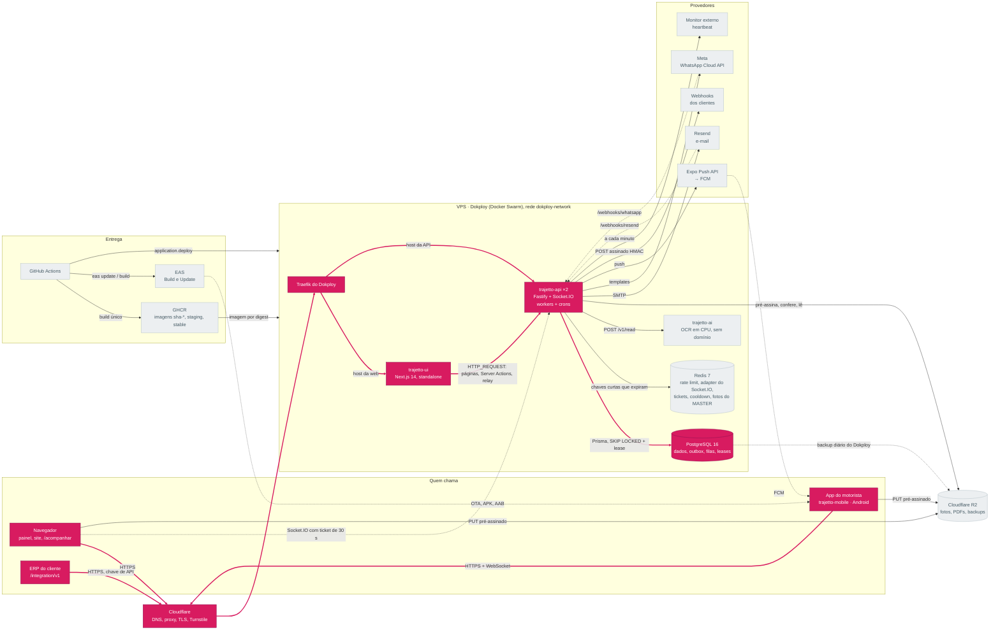

Todo pedido entra pela Cloudflare (DNS, proxy e TLS) e chega ao Traefik do
Dokploy, que escolhe a Application pelo host. O navegador fala com a web; a
web, o app do motorista e o ERP do cliente falam com a API. Dentro da API o
caminho é o mesmo para toda rota. O diagrama abaixo é a versão de hoje do
"Fluxo de Dados" do README da `main` antiga (HTTP Request → Route Handler →
Controller → Use Case → Repository → Database).

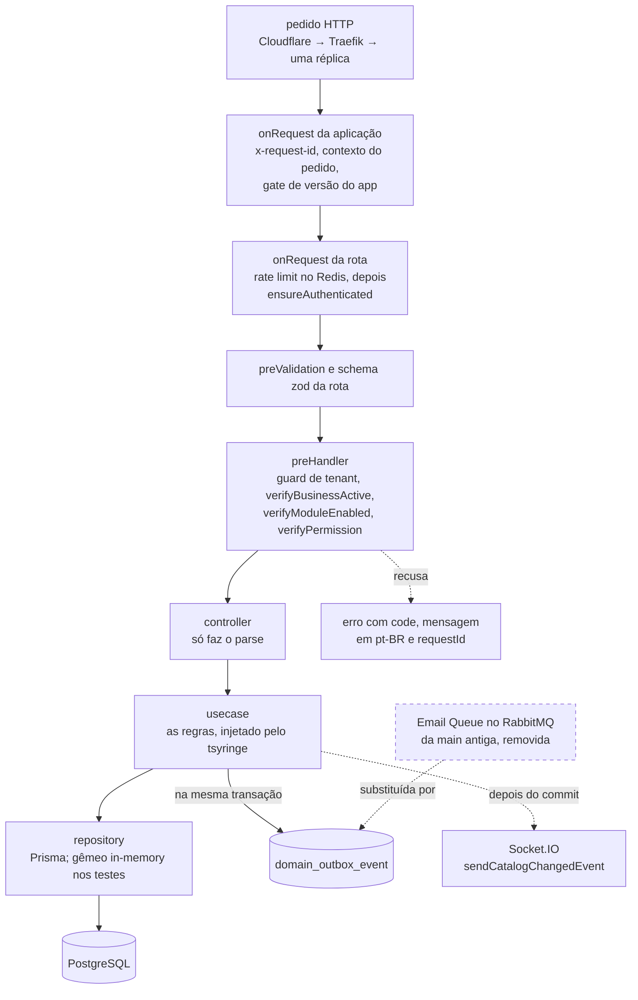

- **Identidade do pedido.** Cada pedido ganha um `x-request-id` (uuid v7; um id
  bem formado vindo do cliente é mantido). Ele volta em toda resposta,
  inclusive nas recusas, aparece em toda linha de log e segue para o outbox
  como id de correlação (`src/shared/logging/request-id.ts`, `src/http.ts`).
- **Rate limit antes da sessão.** O limitador vai para a frente do `onRequest`
  da rota, então um token em loop recebe 429 sem custar a busca da sessão
  (`src/http.ts`, `src/config/rate-limit.ts`). Sem Redis, o pedido passa: o
  limite falha aberto.
- **Acesso.** `ensureAuthenticated` confere o JWT e a versão da sessão. No
  `preHandler` vêm o guard de tenant (só ali o corpo já foi lido), a empresa
  ativa, o módulo contratado e a permissão (`src/modules/middlewares/`). Os
  passos 2 e 3 detalham.
- **Do controller ao banco.** O controller só faz o parse; o usecase
  (`@injectable()`) tem as regras e recebe o repositório pela interface; o
  repositório Prisma tem um gêmeo in-memory com a mesma semântica. Um módulo
  completo para copiar: `src/modules/shipper/`.
- **Efeitos.** O evento vai para o outbox na transação do dado (passo 5); o
  aviso de tempo real sai depois do commit (passo 7). A "Email Queue" da `main`
  antiga era uma fila do RabbitMQ, removida em 09/2026: publicada depois do
  commit e sem outbox, um crash entre os dois perdia o e-mail.
- **Erros.** Todo erro tem `code` estável e mensagem em pt-BR; banco
  indisponível vira 503 com `Retry-After` (`src/shared/errors/`).
- **Na web.** A página é um Server Component que chama a API em `HTTP_REQUEST`;
  a escrita é uma Server Action (`trajetto-ui/src/lib/api-fetch.ts`). O
  navegador nunca recebe o token: as leituras dele passam pelo relay
  same-origin (`trajetto-ui/src/app/api/relay/[...path]/route.ts`), com a lista
  fechada de caminhos em `trajetto-ui/src/lib/api-relay-paths.ts`.

### Onde ler mais

- [`arquitetura.md` → Anatomia de um módulo e como criar uma feature](./arquitetura.md#anatomia-de-um-módulo-e-como-criar-uma-feature)
- [`arquitetura.md` → Regras transversais](./arquitetura.md#regras-transversais)
- [`deploy.md` → 11. Domínios, TLS e a borda](./deploy.md#11-domínios-tls-e-a-borda)
- Web: [Fluxo de dados](https://github.com/Trajetto-Organization/trajetto-ui/blob/staging/docs/arquitetura.md#fluxo-de-dados)

[Índice](#índice) · [Próximo ▶](#passo-2-de-11--sessão-e-login)

## Passo 2 de 11 — Sessão e login

[◀ Anterior](#passo-1-de-11--o-caminho-de-uma-requisição) · [Índice](#índice) · [Próximo ▶](#passo-3-de-11--isolamento-por-empresa)

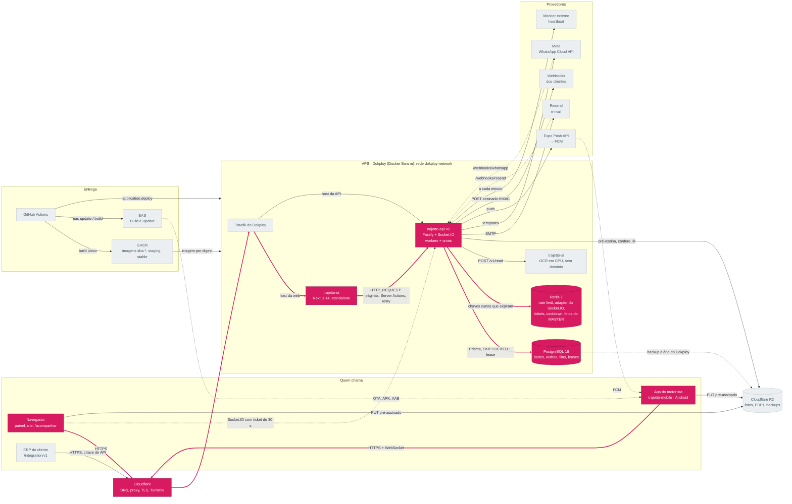

O login acontece no servidor da web, nunca no JavaScript da página. O app
guarda os próprios tokens. A API é quem confere tudo, a cada pedido.

- **Web.** A tela de login chama uma Server Action
  (`trajetto-ui/src/actions/user/login-user/index.ts`). Ela confere o token do
  Turnstile no servidor (`trajetto-ui/src/actions/validate-turnstile/index.ts`)
  e chama `POST /user/session` levando `RATE_LIMIT_FORWARDER_SECRET`, para a
  API contar cada navegador pelo próprio IP
  (`trajetto-ui/src/lib/api-forwarding.ts`). Se a conta pedir, vem o segundo
  fator por e-mail.
- **Cookies.** O acesso e o refresh ficam nos cookies `httpOnly` `tkey` e
  `rkey`. O `trajetto-ui/src/middleware.ts` confere a sessão a cada navegação e
  renova um token vencido (`trajetto-ui/src/lib/session-renewal.ts`); a
  renovação espera no máximo 3 s e nunca desloga por lentidão da API.
- **Captcha.** O widget do Turnstile tem estados explícitos (carregando,
  pronto, verificado, expirado, erro, tempo esgotado, script bloqueado) num
  único wrapper
  (`trajetto-ui/src/components/shared/custom/captcha-turnstile/captcha-machine.ts`).
  O token só vale enquanto o widget que o emitiu está montado, e o formulário o
  descarta quando a resposta mostra que ele já foi usado (`token-consumed.ts`).
- **App.** Faz o mesmo login direto na API e guarda os tokens no SecureStore
  (`trajetto-mobile/utils/storage.ts`). Não há Turnstile na API, exceto no
  formulário público de orçamento: exigi-lo no login quebraria o app.
- **API.** `ensureAuthenticated`
  (`src/modules/middlewares/ensure-authenticated.ts`) confere o JWT e a
  `session_version` do usuário; trocar o papel ou a empresa de alguém encerra
  as sessões dele. Senhas passam por um portão de bcrypt que responde 503
  `AUTH_BUSY` sob rajada (`src/shared/security/bcrypt-gate.ts`), e a trava por
  conta fica no Postgres, porque o rate limit do Redis falha aberto
  (`src/shared/security/login-lockout-rules.ts`).
- **Esqueci minha senha.** No máximo um e-mail por endereço a cada 60 s,
  guardado no Redis como HMAC do e-mail
  (`src/shared/security/mail-cooldown.ts`); a resposta é a mesma exista a conta
  ou não.

### Onde ler mais

- Sequência completa: [`arquitetura.md` → Fluxos em detalhe](./arquitetura.md#fluxos-em-detalhe) (Sessão no painel web e tenant)
- [README → Sessão, empresa e acesso](../README.md#sessão-empresa-e-acesso)
- Web: [Sessão e segurança](https://github.com/Trajetto-Organization/trajetto-ui/blob/staging/docs/arquitetura.md#sessão-e-segurança)

[◀ Anterior](#passo-1-de-11--o-caminho-de-uma-requisição) · [Índice](#índice) · [Próximo ▶](#passo-3-de-11--isolamento-por-empresa)

## Passo 3 de 11 — Isolamento por empresa

[◀ Anterior](#passo-2-de-11--sessão-e-login) · [Índice](#índice) · [Próximo ▶](#passo-4-de-11--arquivos-por-url-pré-assinada)

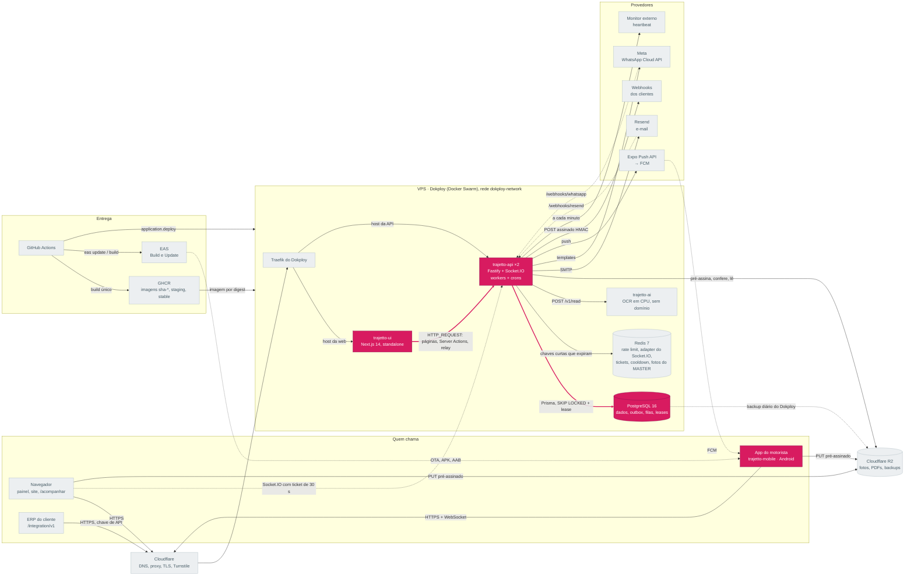

Cada transportadora é um tenant, e quase todo modelo do banco tem `businessId`.
O isolamento é decidido na API, nunca na tela.

- **Quem pede qual empresa.** O usuário de uma transportadora só enxerga a
  empresa do próprio token. O `MASTER` não tem empresa: escolhe uma no `/admin`
  da web (vai na URL como `?businessId=`, só UUID,
  `trajetto-ui/src/lib/business-id-param.ts`) ou na tela `select-business` do
  app, e a API confere que só ele pode pedir outra
  (`src/modules/middlewares/tenant-authorization.ts`).
- **Guard no `preHandler`.** O guard roda depois da leitura do corpo, porque no
  `onRequest` o Fastify ainda não leu o corpo, e um `businessId` no corpo
  passaria sem conferência. Não mova de volta.
- **Mesma resposta para o que não é seu.** Um id de outra empresa recebe o
  mesmo 404 de um id inexistente, e um campo de empresa no corpo que não pode
  mudar é recusado, não ignorado em silêncio.
- **Em cada consulta.** `businessId` é chave de primeiro nível em todo `where`.
  A busca por ID (UUID inteiro, ou o final dele com 8 dígitos ou mais) mantém a
  empresa na consulta, então o registro de outra empresa com o mesmo final
  nunca aparece (`src/shared/pagination/id-search.ts`).
- **Módulo e permissão.** `verifyModuleEnabled` cobra `FLEET` ou `DELIVERIES`
  (inclusive do MASTER) e `verifyPermission` cobra a chave de leitura ou
  escrita do perfil (`src/config/permissions.ts`). A web só esconde ou
  desabilita o que a API vai recusar
  (`trajetto-ui/src/app/app-routes/index.ts`).
- **Unicidade por empresa.** Placa, CPF, CNH e afins são únicos dentro da
  empresa, e nenhuma mensagem confirma que o dado existe em outra.

### Onde ler mais

- [`arquitetura.md` → Papéis, permissões e módulos](./arquitetura.md#papéis-permissões-e-módulos)
- [`arquitetura.md` → Unicidade por empresa](./arquitetura.md#unicidade-por-empresa)
- Web: [Quem vê o quê](https://github.com/Trajetto-Organization/trajetto-ui/blob/staging/docs/arquitetura.md#quem-vê-o-quê-papéis-permissões-e-módulos)

[◀ Anterior](#passo-2-de-11--sessão-e-login) · [Índice](#índice) · [Próximo ▶](#passo-4-de-11--arquivos-por-url-pré-assinada)

## Passo 4 de 11 — Arquivos por URL pré-assinada

[◀ Anterior](#passo-3-de-11--isolamento-por-empresa) · [Índice](#índice) · [Próximo ▶](#passo-5-de-11--outbox-e-filas-no-postgres)

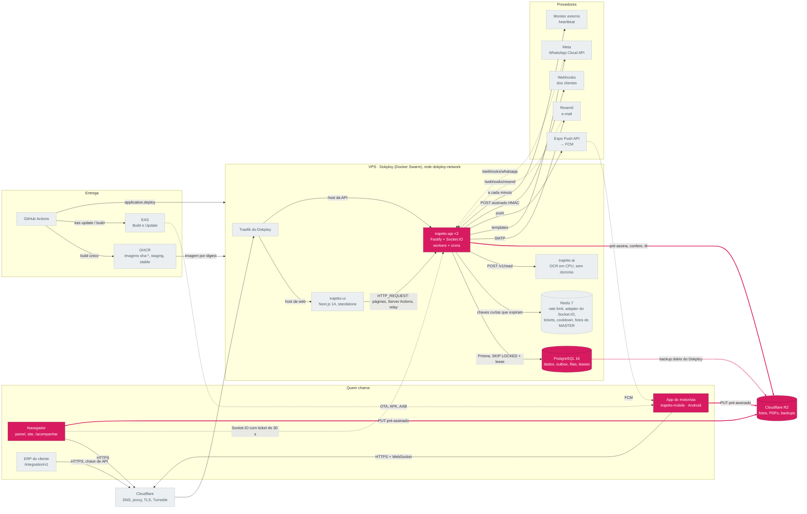

Fotos, assinaturas, áudios do chat e PDFs ficam num bucket R2 privado. Os bytes
nunca passam pela API.

1. O cliente pede uma URL de PUT assinada: `POST /uploads/presign/:businessId`
   (`src/routes/upload-routes.ts`,
   `src/modules/upload/usecases/create-presigned-upload/`). A API confere dono,
   tipo e tamanho.
2. O navegador ou o app envia o arquivo direto ao R2
   (`trajetto-ui/src/lib/upload-to-storage.ts`; a origem do bucket precisa
   estar em `CSP_STORAGE_ORIGINS`). O app re-encoda a foto, tira EXIF e GPS e
   guarda a chave de cada foto que subiu, para o upload recomeçar de onde
   parou.
3. O registro é gravado só com a chave, e a API confere a existência e o
   tamanho com `HeadObject` (`src/shared/services/upload-service.ts`). A
   leitura também é por URL assinada de curta duração.

Desde 28/10/2026 o cliente S3 da API tem prazos: 5 s para conectar, 15 s por
tentativa, até 3 tentativas, e um teto por operação (10 s no `HeadObject`, 30 s
para enviar ou baixar um corpo). Um R2 lento vira 503 `STORAGE_UNAVAILABLE`, e
um objeto que falta continua sendo "não existe": o PDF do comprovante nunca
mais confunde os dois.

Um coletor noturno (`cleanup-orphan-uploads`, 04:50 UTC) conta, ou apaga com
`UPLOAD_ORPHAN_GC=delete`, objetos de 30 a 33 dias que nenhuma linha
referencia; na dúvida, guarda (ADR 0006). O backup diário do PostgreSQL vai
para outro bucket do R2, pelo próprio Dokploy. O adaptador multipart que ainda
aceita abastecimento e checklist do binário antigo do app é temporário
(`src/shared/http/legacy-multipart.ts`).

### Onde ler mais

- Sequência: [`arquitetura.md` → Fluxos em detalhe](./arquitetura.md#fluxos-em-detalhe) (Upload por URL pré-assinada)
- [`arquitetura.md` → Arquivos](./arquitetura.md#arquivos)
- [`deploy.md` → 18. Backup e restauração](./deploy.md#18-backup-e-restauração)

[◀ Anterior](#passo-3-de-11--isolamento-por-empresa) · [Índice](#índice) · [Próximo ▶](#passo-5-de-11--outbox-e-filas-no-postgres)

## Passo 5 de 11 — Outbox e filas no Postgres

[◀ Anterior](#passo-4-de-11--arquivos-por-url-pré-assinada) · [Índice](#índice) · [Próximo ▶](#passo-6-de-11--notificações-e-webhooks)

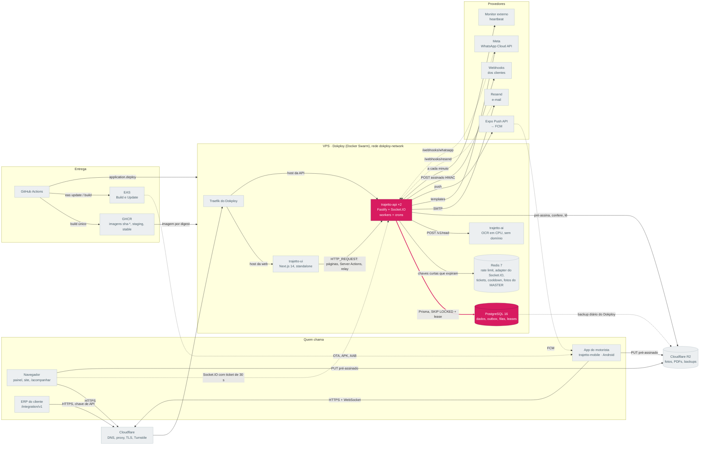

Não há broker. As filas são tabelas do Postgres, e quem as drena são os workers
que rodam dentro de cada réplica da API (`src/workers/index.ts`, ligados por
`WORKERS_ENABLED`).

- **O evento nasce com o dado.** `OutboxService.publish(tx, …)` grava em
  `domain_outbox_event` na mesma transação
  (`src/shared/notifications/outbox-service.ts`); se o dado não foi gravado, o
  evento não existe (ADR 0003).
- **Quatro filas, um desenho.** `domain_outbox_event`, `notification_delivery`
  (raias `internal` e `external`), `webhook_delivery` e `ai_analysis_request`,
  todas reivindicadas com `FOR UPDATE SKIP LOCKED`, lease, fencing por
  `attempts`, backoff com jitter e dead letter (ADR 0005).
- **Dead letter com reenvio.** O que esgotou as tentativas fica em `FAILED` e
  aparece em `/health/dead-letter` e `/health/dead-letter/events`. O MASTER
  reenvia por id: `POST /health/dead-letter/replay` para as entregas e, desde
  28/10/2026, `POST /health/dead-letter/events/replay` para os eventos (até 100
  ids; a expansão idempotente só cria o que faltava). Quem pediu fica na linha
  de log `failed outbox events requeued by hand`; o `lastError` do evento só
  mostra isso até a próxima expansão.
- **Crons sem duplicar.** Um lease por `(jobName, scheduledFor)` garante uma
  execução por horário com várias réplicas (`src/jobs/cron/index.ts`).
- **Por que não um broker.** A `main` antiga tinha RabbitMQ (legado, removido
  em 09/2026) com três filas: e-mail, WhatsApp e verificação por IA, sem DLX,
  com retentativa num `setTimeout` em memória e publicação depois do commit. A
  revisão de 28/10/2026, com medições e os gatilhos para reabrir a decisão,
  está no ADR 0001.

### Onde ler mais

- [ADR 0001 — Filas e mensageria](./adr/0001-filas-e-mensageria.md)
- Diagrama das filas: [`arquitetura.md` → Fluxos em detalhe](./arquitetura.md#fluxos-em-detalhe) (Outbox, filas e efeitos externos)
- [`arquitetura.md` → Crons](./arquitetura.md#crons)

[◀ Anterior](#passo-4-de-11--arquivos-por-url-pré-assinada) · [Índice](#índice) · [Próximo ▶](#passo-6-de-11--notificações-e-webhooks)

## Passo 6 de 11 — Notificações e webhooks

[◀ Anterior](#passo-5-de-11--outbox-e-filas-no-postgres) · [Índice](#índice) · [Próximo ▶](#passo-7-de-11--tempo-real)

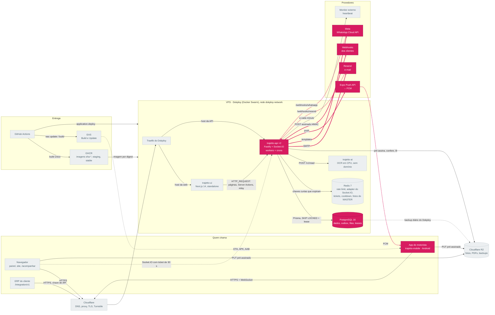

Do outbox saem os efeitos externos, cada um com a sua chave de idempotência
(ADR 0006).

- **Expansão por canal.** O `NotificationPipelineService`
  (`src/shared/notifications/notification-pipeline-service.ts`) transforma cada
  evento em entregas de `notification_delivery`, uma por destinatário e canal,
  em duas raias: `internal` (sino, atividade) e `external` (e-mail, WhatsApp,
  push), para um provedor lento não segurar o sino.
- **E-mail.** SMTP da Resend
  (`src/shared/providers/mail-provider/implementations/resend-mail-provider.ts`),
  com o id da entrega como `Resend-Idempotency-Key`. O e-mail com segredo (2FA,
  senha) sai direto, sem o outbox
  (`src/shared/services/transactional-mail-service.ts`).
- **WhatsApp.** Templates da Meta Cloud API
  (`src/shared/providers/whatsapp-provider/implementations/meta-cloud-api-provider.ts`);
  um template pausado adia os envios em vez de chamar a Meta.
- **Push.** Expo Push API, que repassa ao FCM
  (`src/shared/notifications/push-provider.ts`). Desde 28/10/2026 cada push
  leva o id da entrega como `tag` em todo aparelho e como `collapseId` só no
  iPhone: uma cópia reenviada substitui a anterior no aparelho. No Android
  não vai `collapseId`, que o FCM trata como `collapse_key` e limita a 4 por
  aparelho offline. O cron `check-push-receipts` desativa aparelhos mortos.
- **Recibos.** O que acontece depois do aceite chega por `/webhooks/resend` e
  `/webhooks/whatsapp` (`src/routes/provider-webhook-routes.ts`) e fica em
  `notification_provider_receipt`
  (`src/shared/notifications/provider-receipts.ts`).
- **Webhooks dos clientes.** `webhook_delivery` nasce na transação do evento; o
  `WebhookDispatchService`
  (`src/shared/integration/webhook-dispatch-service.ts`) entrega com assinatura
  HMAC (`X-Trajetto-Signature`), retentativa e um disjuntor por endpoint.
  Catálogo de tópicos em `src/shared/integration/webhook-catalogue.ts`.

### Onde ler mais

- [`arquitetura.md` → Integrações externas](./arquitetura.md#integrações-externas)
- [ADR 0003 — Outbox transacional](./adr/0003-outbox-transacional.md) e [ADR 0006 — Idempotência](./adr/0006-idempotencia-de-efeitos-externos.md)
- [`deploy.md` → 20. Alertas e monitoramento](./deploy.md#20-alertas-e-monitoramento)

[◀ Anterior](#passo-5-de-11--outbox-e-filas-no-postgres) · [Índice](#índice) · [Próximo ▶](#passo-7-de-11--tempo-real)

## Passo 7 de 11 — Tempo real

[◀ Anterior](#passo-6-de-11--notificações-e-webhooks) · [Índice](#índice) · [Próximo ▶](#passo-8-de-11--ia-local)

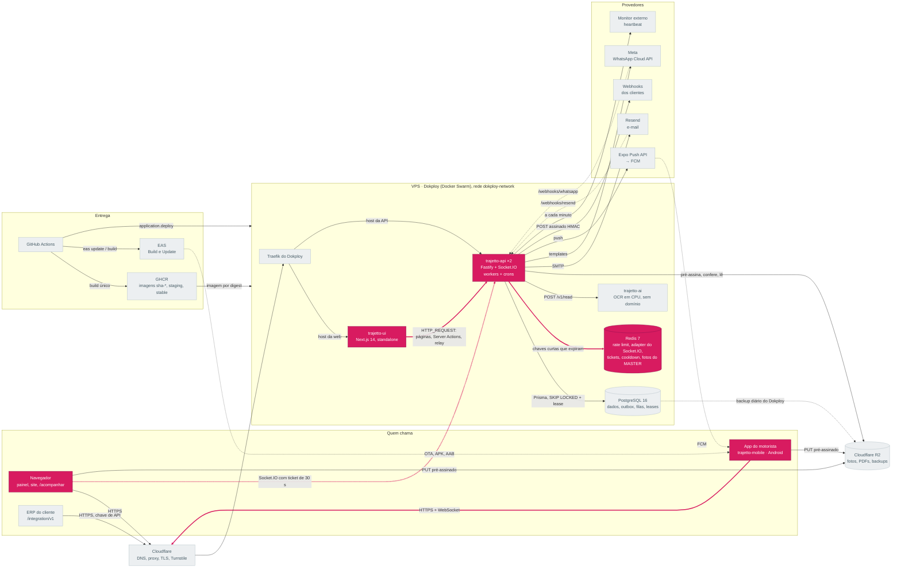

O Socket.IO roda dentro da API (`src/websocket.ts`), só com WebSocket. O Redis
leva os eventos entre réplicas pelo `@socket.io/redis-adapter`
(`src/shared/socket/adapter-redis.ts`).

- **Web.** Uma Server Action troca a sessão por um ticket de uso único
  (`trajetto-ui/src/actions/session/index.ts` → `POST /user/socket-ticket`). O
  ticket vale 30 s, abre um socket só, e o Redis guarda só o hash dele
  (`src/shared/socket/socket-ticket.ts`). O navegador conecta em
  `PUBLIC_API_URL` com ele (`trajetto-ui/src/socket.ts`): o token nunca chega
  ao JavaScript da página.
- **App.** Conecta na mesma URL da API com o próprio token
  (`trajetto-mobile/providers/socket-provider.tsx`).
- **Salas.** Por usuário, sessão, empresa (`business:<id>`) e operação
  (`operations:<id>`). A autorização é relida do banco a cada inscrição e
  revalidada a cada 3 min, com jitter (`SOCKET_REVALIDATE_MS`). O handshake tem
  rate limit próprio (`src/shared/socket/handshake-rate-limit.ts`).
- **No máximo uma vez.** Um evento pode se perder; a verdade está no banco, e
  as telas refazem a consulta ao reconectar (ADR 0007). `catalogChanged` faz a
  web invalidar a lista daquela entidade
  (`trajetto-ui/src/lib/catalog-sync.ts`), e uma rajada de eventos vira um
  refresh só na Torre
  (`trajetto-ui/src/features/control-tower/lib/refetch-scheduler.ts`).
- **Sem Redis**, cada réplica ainda alcança os próprios sockets; só o
  espalhamento entre réplicas degrada.

### Onde ler mais

- Sequência entre réplicas: [`arquitetura.md` → Fluxos em detalhe](./arquitetura.md#fluxos-em-detalhe) (Tempo real entre réplicas)
- [`arquitetura.md` → Redis e tempo real](./arquitetura.md#redis-e-tempo-real)
- [ADR 0007 — Tempo real no máximo uma vez](./adr/0007-tempo-real-at-most-once.md)

[◀ Anterior](#passo-6-de-11--notificações-e-webhooks) · [Índice](#índice) · [Próximo ▶](#passo-8-de-11--ia-local)

## Passo 8 de 11 — IA local

[◀ Anterior](#passo-7-de-11--tempo-real) · [Índice](#índice) · [Próximo ▶](#passo-9-de-11--importações)

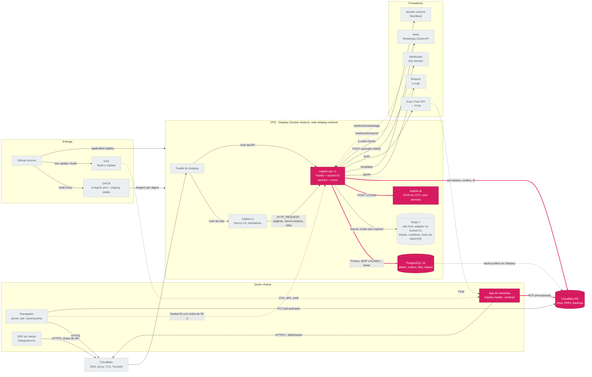

A leitura do canhoto (número da NF e data) e do odômetro roda no serviço
próprio `trajetto-ai` (`infra/ai-ocr/server.py`): RapidOCR sobre ONNX Runtime,
só CPU, sem provedor externo e sem domínio público (ADR 0010).

1. Depois do commit do abastecimento, do checklist ou do comprovante, a API
   cria um pedido em `ai_analysis_request`.
2. O `AIAnalysisPipelineService`
   (`src/shared/ai/ai-analysis-pipeline-service.ts`) reivindica o pedido com
   lease de 300 s, busca a foto no R2 e chama `POST /v1/read` com bearer
   (`src/shared/ai/local/local-ocr-reader.ts`), com até
   `AI_LOCAL_MAX_CONCURRENCY` leituras por réplica.
3. O serviço **só transcreve**. Quem decide o que a foto diz é a API
   (`src/shared/ai/local/ocr-readings.ts`, `src/shared/ai/ai-rules.ts`). Uma
   foto lida consome uma unidade da cota mensal da empresa, uma vez.
4. Serviço cheio responde 503 `busy`, e o pedido volta à fila em 5 a 15 s sem
   gastar tentativa; falhas seguidas abrem um disjuntor
   (`src/shared/ai/provider-circuit.ts`).

Um pedido que se perdeu entre o commit e a fila é refeito por dois crons:
`reconcile-proof-analysis` (comprovantes) e, desde 28/10/2026,
`reconcile-record-analysis` (abastecimentos e checklists com 10 min a 2 dias e
foto legível, só de empresas que já liam quando o registro nasceu e feitos
depois da última vez que a leitura foi religada, dos mais antigos para os mais
novos; `src/jobs/cron/reconcile-record-analysis-job.ts`). O app faz uma pré-checagem
no próprio aparelho (`trajetto-mobile/modules/text-reader`), que é só sugestão
e nunca consome cota.

### Onde ler mais

- [`arquitetura.md` → IA local](./arquitetura.md#ia-local)
- [`deploy.md` → 9. O serviço de IA](./deploy.md#9-o-serviço-de-ia-trajetto-ai)
- [ADR 0010 — IA local](./adr/0010-ia-local.md)

[◀ Anterior](#passo-7-de-11--tempo-real) · [Índice](#índice) · [Próximo ▶](#passo-9-de-11--importações)

## Passo 9 de 11 — Importações

[◀ Anterior](#passo-8-de-11--ia-local) · [Índice](#índice) · [Próximo ▶](#passo-10-de-11--do-commit-ao-ar-deploy-e-rollout)

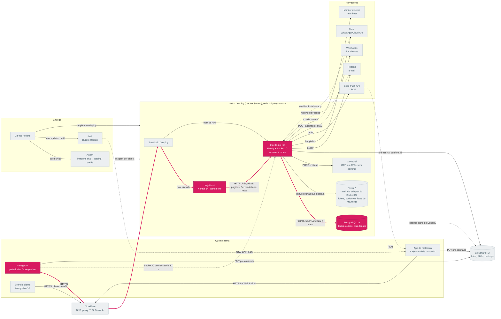

A importação de planilha é assíncrona: uma planilha de 20 mil linhas levava
mais que os 100 s da borda.

1. O diálogo envia o arquivo pelo relay da web em POST
   (`trajetto-ui/src/features/deliveries/deliveries/import-spreadsheet-dialog/hooks/import-client.ts`),
   porque uma Server Action do Next 14 aceita no máximo 1 MB. O relay só aceita
   os dois caminhos de importação, JSON e mesma origem.
2. A API valida embarcador e arquivo (tamanho inflado, células e linhas
   contados no zip; acima disso, 413), abre a importação e responde **202** com
   o id (`src/routes/import-routes.ts`).
3. As linhas são processadas numa fila **por réplica**
   (`src/modules/import/services/import-queue.ts`): uma rodando e até três
   esperando. Além disso, 429 `IMPORT_BUSY` com `retry-after` de 30 s.
4. A web acompanha `GET /import/get-import/:importId/business/:businessId` até
   o `status` sair de `IN_PROGRESS`, mostrando as linhas processadas.

**No desligamento** (desde 28/10/2026), a fila entra em dreno no primeiro
instante do SIGTERM: recusa planilhas novas com 429, fecha na hora as que
esperavam ("não iniciada: envie de novo", sem nenhuma entrega), dá até 15 s à
que está rodando e depois a para entre duas linhas, com o relatório até ali. Se
ela não parar em 5 s, a própria fila a fecha, e espera no máximo 2 s por essas
gravações. Tudo antes dos workers, dentro do teto de 35 s
(`src/shared/lifecycle/shutdown.ts`). Quando é certo que nenhuma entrega foi
criada, o relatório diz "nenhuma entrega foi criada. Envie o arquivo de novo."
em vez de mandar estornar (detalhes no ADR 0001). Uma réplica que morre sem SIGTERM deixa a importação sem batimento, e
o cron `close-abandoned-imports` (a cada 5 min) a fecha com o que ela fez.

O estorno roda em lotes de 500 entregas, cada lote numa transação, com um lease
que permite continuar de onde parou
(`src/modules/import/services/import-reversal.ts`). O XML de NF-e continua
síncrono.

### Onde ler mais

- [`arquitetura.md` → Arquivos](./arquitetura.md#arquivos) (importação, estorno e exportações)
- [ADR 0001 → O que esta rodada mudou](./adr/0001-filas-e-mensageria.md#o-que-esta-rodada-mudou-28102026)
- Web: [Fluxo de dados](https://github.com/Trajetto-Organization/trajetto-ui/blob/staging/docs/arquitetura.md#fluxo-de-dados) (Importações)

[◀ Anterior](#passo-8-de-11--ia-local) · [Índice](#índice) · [Próximo ▶](#passo-10-de-11--do-commit-ao-ar-deploy-e-rollout)

## Passo 10 de 11 — Do commit ao ar: deploy e rollout

[◀ Anterior](#passo-9-de-11--importações) · [Índice](#índice) · [Próximo ▶](#passo-11-de-11--saúde-e-operação)

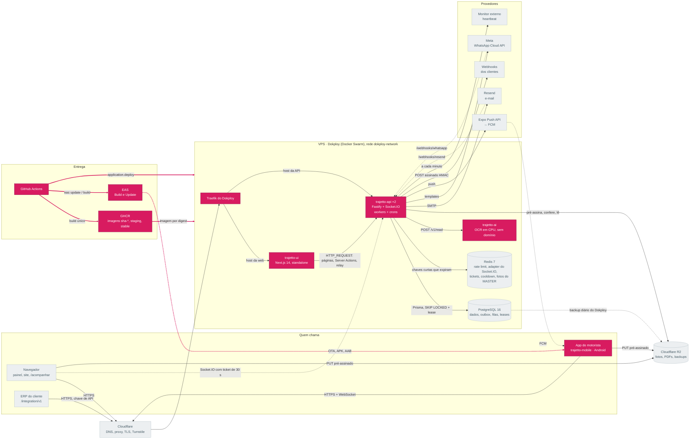

Uma imagem por serviço, construída uma vez e promovida por digest. Staging e
produção mudam só o Environment de cada Application do Dokploy.

1. **Branch de trabalho**: `.github/workflows/ci.yml` (Prettier, typecheck,
   unitários com cobertura, audit, gitleaks).
2. **Push em `staging`**: `.github/workflows/deploy.yml` roda a validação
   completa com E2E e constrói as imagens uma vez, em
   `ghcr.io/trajetto-organization/*:sha-<sha>`, com SBOM, proveniência e Trivy.
   A imagem da IA só é reconstruída quando `infra/ai-ocr` muda e, desde
   28/10/2026, passa por um smoke sem rede antes do push; a web faz o mesmo no
   pipeline dela.
3. **Staging**: a tag `staging` aponta para o digest, e o pipeline chama
   `application.deploy` na API do Dokploy
   (`.github/scripts/dokploy-deploy.mjs`), na ordem IA → API. Ele espera a
   liveness pública responder o commit novo
   (`.github/scripts/wait-for-version.mjs`) e grava o marcador `staged-<sha>`.
4. **Produção**: PR de `staging` para `main` com merge commit; a promoção não
   reconstrói nada. Roda as migrations como job, move a tag `stable` para o
   mesmo digest e faz o deploy, com aprovação do environment `production`.
5. **Rollback**: Actions → Deploy → Run workflow na `main` com
   `image_tag=sha-<commit bom>`. O banco não volta junto; por isso toda
   migration é expandir/contrair.

Cada serviço é uma Application do Dokploy com imagem do GHCR (nunca Compose),
atualizada `start-first` com rollback automático do Swarm. O app do motorista
sai pelo EAS (OTA assinada e, se o lado nativo mudou, AAB). Ordem de cada
release: API → web → app.

### Onde ler mais

- Diagrama: [`arquitetura.md` → Fluxos em detalhe](./arquitetura.md#fluxos-em-detalhe) (Do commit à produção)
- [`deploy.md`](./deploy.md) (do servidor vazio ao rollback)
- [`arquitetura.md` → Migrations: expandir e contrair](./arquitetura.md#migrations-expandir-e-contrair)

[◀ Anterior](#passo-9-de-11--importações) · [Índice](#índice) · [Próximo ▶](#passo-11-de-11--saúde-e-operação)

## Passo 11 de 11 — Saúde e operação

[◀ Anterior](#passo-10-de-11--do-commit-ao-ar-deploy-e-rollout) · [Índice](#índice)

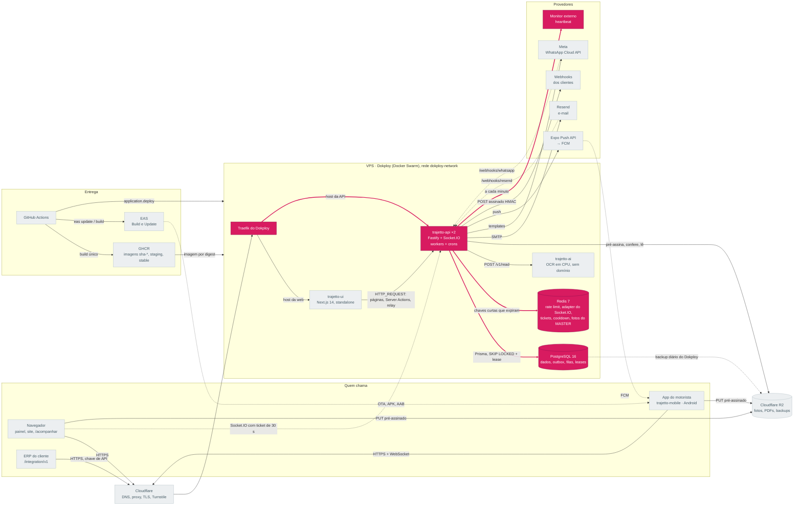

Cada réplica responde por si; o MASTER vê o conjunto na aba Sistema do
`/admin`.

- `GET /health/liveness`: o processo responde (`alive`), com `version` e
  `commit` do build. Não toca dependência nenhuma: é a sonda do Swarm, e uma
  dependência fora nunca deve reiniciar o contêiner.
- `GET /health/readiness`: `ready`, `not ready` (banco inacessível, 503) ou
  `draining` (desligando, 503). Usa uma conexão própria; o Redis fica de fora
  de propósito.
- `GET /health`: `healthy`, `degraded` (Redis fora, ainda 200) ou `unhealthy`
  (banco fora, 503).
- `GET /health/metrics` (MASTER): filas e atraso do outbox, workers e crons,
  pool, conexões, sockets, Redis e certificado, numa foto de 10 s por réplica.
- `GET /health/providers` (MASTER): Resend, Meta, Expo, R2, `trajetto-ai`,
  certificado e heartbeat, sem enviar nada. Cada um é `ok`, `warning`, `error`,
  `not_configured` ou `disabled`; desde 28/10/2026, `transient`, `attempts` e
  `failure_kind` dizem se o veredito depende de uma falha passageira (3,5 s por
  tentativa, no máximo duas dentro de 5 s;
  `src/shared/health/provider-readiness.ts`). A web mostra Operacional,
  Instável, Atenção, Com erro, Não configurado, Desligado ou Não verificado
  (`trajetto-ui/src/features/system-metrics/rules.ts`).

O cron `ops-heartbeat` avalia as regras de alerta a cada minuto e avisa o
monitor externo (`HEALTHCHECK_PING_URL`): o silêncio dele é o alerta
(`src/shared/health/alert-rules.ts`). Os logs são JSON (pino), uma linha por
pedido com o `reqId` (o mesmo `x-request-id` da resposta), `userId`,
`businessId` e a versão do cliente, sem segredo.

### Onde ler mais

- [`arquitetura.md` → Saúde e observabilidade](./arquitetura.md#saúde-e-observabilidade)
- [README → Depuração](../README.md#depuração)
- [`deploy.md` → 20. Alertas e monitoramento](./deploy.md#20-alertas-e-monitoramento)

[◀ Anterior](#passo-10-de-11--do-commit-ao-ar-deploy-e-rollout) · [Índice](#índice)

## O que mudou desde a `main` antiga

A `main` antiga (último commit de 13/08/2026) é a referência do diagrama "Fluxo
de Dados". O que o tour mostra no lugar de cada peça dela:

| Na `main` antiga                                                                                         | Hoje                                                                      | Evidência                                                                                                                                                                      |
| -------------------------------------------------------------------------------------------------------- | ------------------------------------------------------------------------- | ------------------------------------------------------------------------------------------------------------------------------------------------------------------------------ |
| RabbitMQ (`amqplib` 0.10.5), legado com três filas: `emailQueue`, `whatsappQueue`, `aiVerificationQueue` | tabelas do Postgres com outbox transacional e `SKIP LOCKED` (passo 5)     | `origin/main:src/jobs/email-queue.ts`, `origin/main:src/jobs/whatsapp-queue.ts`, `origin/main:src/jobs/ai-verification-queue.ts`; [ADR 0001](./adr/0001-filas-e-mensageria.md) |
| WhatsApp pela Evolution API (`compose.evolution-api-*.yaml`)                                             | Meta WhatsApp Cloud API (passo 6)                                         | `origin/main:src/shared/providers/whatsapp-provider/implementations/evolution-api-provider.ts`                                                                                 |
| verificação de fotos pela Anthropic (`@anthropic-ai/sdk` 0.78.0)                                         | `trajetto-ai` local, RapidOCR em CPU (passo 8)                            | `origin/main:package.json`; [ADR 0010](./adr/0010-ia-local.md)                                                                                                                 |
| `compose.production.yaml` com banco, RabbitMQ (removido), Redis e API                                    | Applications e Databases do Dokploy, imagem do GHCR por digest (passo 10) | `origin/main:compose.production.yaml`; [`deploy.md`](./deploy.md)                                                                                                              |
| OSRM em compose próprio                                                                                  | removido                                                                  | `origin/main:compose.osrm-development.yaml`                                                                                                                                    |

## Como manter este tour

- Cada passo copia o bloco Mermaid de [Visão de
  componentes](./arquitetura.md#visão-de-componentes) sem mudar nada e só
  acrescenta as linhas `classDef`, `class` e `linkStyle`. Mudou o mapa? Copie o
  bloco novo para os onze passos e confira os índices do `linkStyle` (a ordem
  das setas).
- `tests/unitaires/docs/architecture-docs.test.ts` falha se um passo divergir
  do mapa, se um link ou âncora quebrar, se um caminho citado sumir ou se a
  navegação ◀ ▶ pular um passo.
- Uma decisão nova de arquitetura entra em [`adr/`](./adr/README.md) e, se
  mudar o desenho, no passo certo deste tour.
