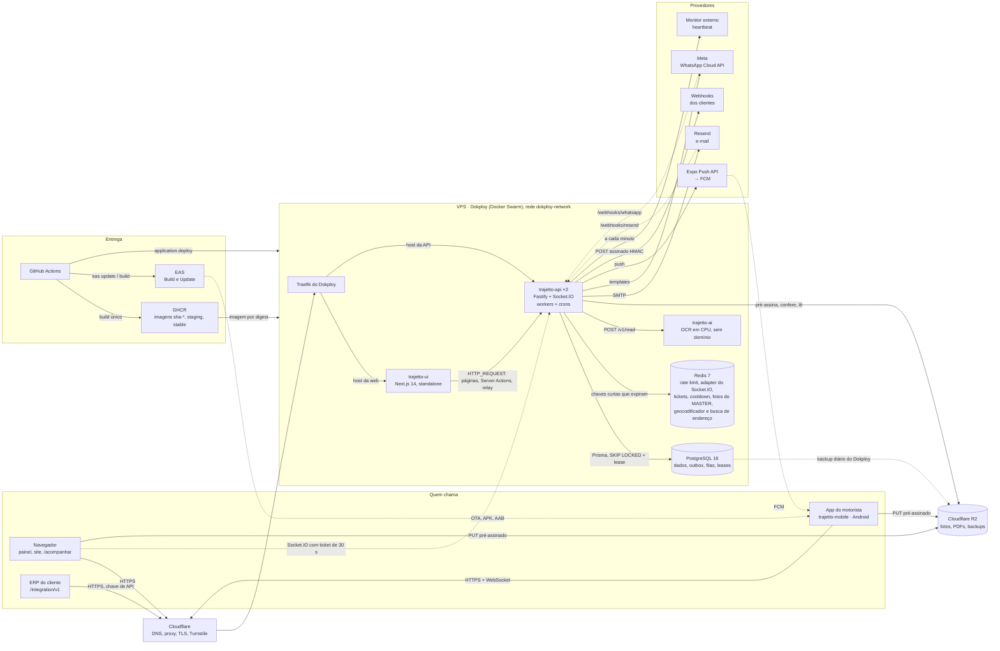
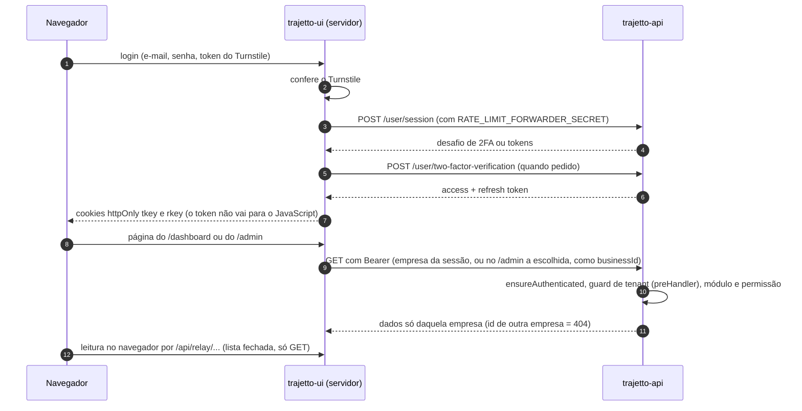
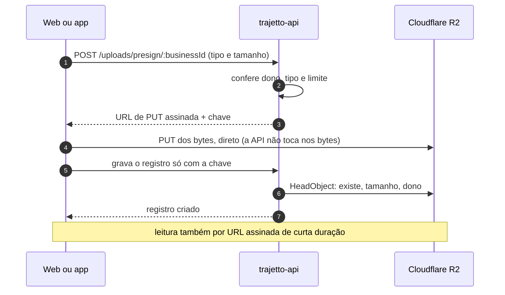
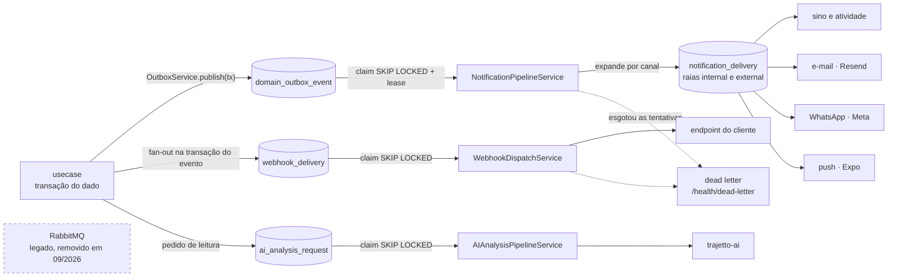
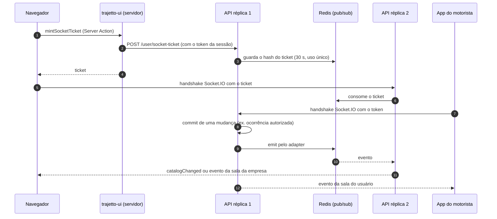
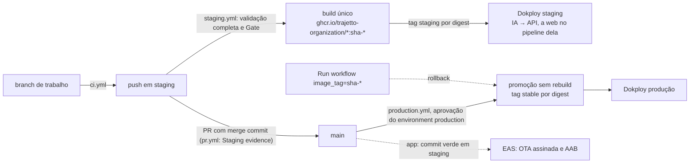

# Arquitetura da API

> Como a API do Trajetto é por dentro: o que ela atende, como o código está
> organizado, os papéis de cada processo, as regras que valem para toda rota e
> as decisões que moldaram o desenho (ADRs). O deploy e a operação estão em
> [`deploy.md`](./deploy.md); as variáveis, em
> [`variaveis-de-ambiente.md`](./variaveis-de-ambiente.md); os testes, em
> [`testes.md`](./testes.md).

## Sumário

- [O produto e os três repositórios](#o-produto-e-os-três-repositórios)
- [Visão de componentes](#visão-de-componentes)
- [Estrutura do código](#estrutura-do-código)
- [Anatomia de um módulo e como criar uma feature](#anatomia-de-um-módulo-e-como-criar-uma-feature)
- [Um processo, vários papéis](#um-processo-vários-papéis)
- [Regras transversais](#regras-transversais)
- [Papéis, permissões e módulos](#papéis-permissões-e-módulos)
- [Acesso do motorista](#acesso-do-motorista)
- [O que o app lê pelo aviso: OS, contas e Kanban](#o-que-o-app-lê-pelo-aviso-os-contas-e-kanban)
- [Gestor e master no app: rotas ao vivo, autorizações e salas sob demanda](#gestor-e-master-no-app-rotas-ao-vivo-autorizações-e-salas-sob-demanda)
- [Configurações da empresa](#configurações-da-empresa)
- [Geocerca e coordenadas do endereço](#geocerca-e-coordenadas-do-endereço)
- [Busca de endereço (Fixar no mapa)](#busca-de-endereço-fixar-no-mapa)
- [Frota ligada à rota](#frota-ligada-à-rota)
- [Motorista, veículo e rota: o que é aviso e o que é recusa](#motorista-veículo-e-rota-o-que-é-aviso-e-o-que-é-recusa)
- [Excluir x inativar/revogar](#excluir-x-inativarrevogar)
- [Entregas na rota: casos de borda](#entregas-na-rota-casos-de-borda)
- [Rotas esquecidas, a lista e a torre](#rotas-esquecidas-a-lista-e-a-torre)
- [Atendimentos do chat](#atendimentos-do-chat)
- [Pausas do motorista](#pausas-do-motorista)
- [Postgres é a fila](#postgres-é-a-fila)
- [Crons](#crons)
- [Redis e tempo real](#redis-e-tempo-real)
- [Arquivos](#arquivos)
- [IA local](#ia-local)
- [Comprovante de entrega](#comprovante-de-entrega)
- [Integrações externas](#integrações-externas)
- [Conexão com o Postgres](#conexão-com-o-postgres)
- [Migrations: expandir e contrair](#migrations-expandir-e-contrair)
- [Compatibilidade com o app do motorista](#compatibilidade-com-o-app-do-motorista)
- [Unicidade por empresa](#unicidade-por-empresa)
- [Saúde e observabilidade](#saúde-e-observabilidade)
- [Decisões (ADRs)](#decisões-adrs)

## O produto e os três repositórios

O Trajetto é uma plataforma B2B (SaaS multiempresa) para transportadoras, com
dois módulos contratados separadamente por empresa:

- **Frotas** (`FLEET`): veículos, motoristas, abastecimentos com foto do
  odômetro, checklists veiculares, ordens de serviço, peças, fornecedores,
  multas, contas a pagar, filiais e um quadro Kanban.
- **Entregas** (`DELIVERIES`): documentos de entrega (manual, planilha ou XML
  de NF-e), embarcadores, rotas, torre de controle, monitoramento, ocorrências
  com formulário e autorização da torre, pausas do motorista, comprovante em
  PDF assinado, atendimento por ticket (chat), mensagens ao cliente final e a
  API pública com webhooks.

| Repositório (GitHub)                  | O que é                                                           | Tecnologia                                                             |
| ------------------------------------- | ----------------------------------------------------------------- | ---------------------------------------------------------------------- |
| `trajetto-api` (este)                 | API HTTP, tempo real, filas, crons, IA local, backup              | Node.js 22, Fastify 5, Prisma 7, PostgreSQL 16, Redis 7, tsyringe, zod |
| `trajetto-ui` (`trajetto-ui`)         | painel web (`/dashboard`, `/admin`), site público, portal `/docs` | Next.js 14 (App Router)                                                |
| `trajetto-mobile` (`trajetto-mobile`) | app de campo do motorista, só Android                             | Expo / React Native                                                    |

A escala alvo usada nas decisões de capacidade: milhares de transportadoras
(cada uma um tenant), dezenas de milhares de motoristas e milhões de entregas
por mês.

## Visão de componentes

O mapa abaixo é navegável no GitHub, no mesmo espírito dos diagramas do README
antigo da `main` (Mermaid renderizado pelo GitHub):

- **Explorar:** o GitHub desenha o diagrama com os controles de zoom, de
  deslocamento (as setas) e de tela cheia sobre ele.
- **Clicar:** cada caixa tem um link (`click` do Mermaid) para a seção que a
  explica, neste documento ou no repositório certo. Se o seu visualizador
  ignorar o clique (fora do GitHub, ou com a interatividade do Mermaid
  desligada), use a tabela [Componentes e relações](#componentes-e-relações),
  que tem os mesmos links.
- **Expandir:** os fluxos principais (sessão, upload, filas, tempo real e
  deploy) ficam recolhidos em [Fluxos em detalhe](#fluxos-em-detalhe); abra o
  que precisar.
- **Avançar passo a passo:** o
  [Tour pela arquitetura](./arquitetura-tour.md) redesenha este mapa em onze
  passos (o caminho de uma requisição, sessão, tenant, arquivos, filas,
  notificações, tempo real, IA, importações, deploy e saúde), acende só as
  peças de cada um e tem links ◀ Anterior · Índice · Próximo ▶. O passo 1 é a
  versão de hoje do diagrama "Fluxo de Dados" do README da `main` antiga, cuja
  "Email Queue" era o RabbitMQ.

Cada relação foi conferida no código (o arquivo está na tabela). Linha cheia é
chamada síncrona; tracejada é assíncrona ou de volta (callback, push, backup).



### Componentes e relações

| Componente                     | O que faz                                                                                         | Relações (conferidas no código)                                                                                                                                                                                                                                                                                                                                                                                                                                                                                                                                                                                                                                                                                                                                                                                                                                      | Onde ler mais                                                                       |
| ------------------------------ | ------------------------------------------------------------------------------------------------- | -------------------------------------------------------------------------------------------------------------------------------------------------------------------------------------------------------------------------------------------------------------------------------------------------------------------------------------------------------------------------------------------------------------------------------------------------------------------------------------------------------------------------------------------------------------------------------------------------------------------------------------------------------------------------------------------------------------------------------------------------------------------------------------------------------------------------------------------------------------------- | ----------------------------------------------------------------------------------- |
| Navegador                      | painel (`/dashboard`, `/admin`, `/driver`), site, `/acompanhar`, `/verificar`                     | nunca recebe o token: lê pelo relay `/api/relay/...` da web; abre o Socket.IO na API com um ticket de uso único (`POST /user/socket-ticket`, 30 s); envia arquivos direto ao R2 por URL pré-assinada                                                                                                                                                                                                                                                                                                                                                                                                                                                                                                                                                                                                                                                                 | `trajetto-ui/docs/arquitetura.md` (Fluxo de dados, Sessão e segurança, Tempo real)  |
| `trajetto-ui`                  | Next.js 14 (App Router), sem banco                                                                | Server Components e Server Actions chamam a API em `HTTP_REQUEST` (`src/lib/api-fetch.ts`); login, 2FA, refresh e rastreio levam `RATE_LIMIT_FORWARDER_SECRET` (`src/lib/api-forwarding.ts`); valida o Turnstile no login                                                                                                                                                                                                                                                                                                                                                                                                                                                                                                                                                                                                                                            | `trajetto-ui/docs/arquitetura.md`                                                   |
| App do motorista               | Expo / React Native, só Android, offline no laço do motorista                                     | HTTP em `EXPO_PUBLIC_API_URL` (`utils/api.ts`); Socket.IO na mesma URL com o token (`providers/socket-provider.tsx`); fotos por PUT pré-assinado com upload retomável; registra o token de push na API (`utils/push-token.ts`)                                                                                                                                                                                                                                                                                                                                                                                                                                                                                                                                                                                                                                       | `trajetto-mobile/docs/arquitetura.md`                                               |
| ERP do cliente                 | integração por chave de API                                                                       | `/integration/v1/*` com escopos e `Idempotency-Key`; recebe webhooks assinados                                                                                                                                                                                                                                                                                                                                                                                                                                                                                                                                                                                                                                                                                                                                                                                       | [Integrações externas](#integrações-externas)                                       |
| Cloudflare                     | DNS, proxy (laranja), TLS de borda, Turnstile                                                     | a API só acredita no `CF-Connecting-IP` vindo das faixas da Cloudflare (`RATE_LIMIT_TRUSTED_PROXY=cloudflare`, `src/config/rate-limit.ts`); o formulário público é conferido no Turnstile (`src/shared/security/turnstile.ts`)                                                                                                                                                                                                                                                                                                                                                                                                                                                                                                                                                                                                                                       | [`deploy.md`, seção 11](./deploy.md#11-domínios-tls-e-a-borda)                      |
| Traefik do Dokploy             | roteia por host para cada Application                                                             | um roteador por domínio de Application; WebSocket sem cookie sticky                                                                                                                                                                                                                                                                                                                                                                                                                                                                                                                                                                                                                                                                                                                                                                                                  | [`infra/traefik/README.md`](../infra/traefik/README.md)                             |
| `trajetto-api`                 | HTTP, Socket.IO, workers e crons num processo (papel `all`), 2 réplicas; um papel por Application | ver as linhas abaixo; desligamento ordenado em `src/shared/lifecycle/shutdown.ts`                                                                                                                                                                                                                                                                                                                                                                                                                                                                                                                                                                                                                                                                                                                                                                                    | [Um processo, vários papéis](#um-processo-vários-papéis)                            |
| PostgreSQL 16                  | dados de todas as empresas, outbox e filas, leases dos crons                                      | `domain_outbox_event` gravado na transação do dado (`src/shared/notifications/outbox-service.ts`); `notification_delivery`, `webhook_delivery` e `ai_analysis_request` lidas com `FOR UPDATE SKIP LOCKED` e lease pelos pipelines de `src/workers/index.ts`                                                                                                                                                                                                                                                                                                                                                                                                                                                                                                                                                                                                          | [Postgres é a fila](#postgres-é-a-fila)                                             |
| Redis 7                        | descartável, nada é fonte de verdade                                                              | rate limit do HTTP, do handshake do socket e das falhas de chave da API pública (`src/http.ts`, `src/shared/socket/handshake-rate-limit.ts`, `src/shared/integration/integration-rate-guard.ts`); intervalo de 60 s por destinatário do "esqueci minha senha" (`src/shared/security/mail-cooldown.ts`, chave = HMAC do e-mail); pub/sub do adapter (`src/shared/socket/adapter-redis.ts`); dicas de despertar entre processos (`src/shared/wake/`); tickets de socket de 30 s (`src/shared/socket/socket-ticket.ts`); fotos curtas de leituras da plataforma só do MASTER, com falha aberta (`src/shared/cache/snapshot-cache.ts`); o geocodificador e a busca de endereço (`geocoding:*`, `src/shared/delivery/geocoding/geocoding-keys.ts`), com falha fechada. O único dado de empresa em cache é o da busca de endereço: por empresa, chave HMAC e valor cifrado | [Redis e tempo real](#redis-e-tempo-real)                                           |
| `trajetto-ai`                  | OCR local (RapidOCR, ONNX, CPU), só transcreve                                                    | a API chama `POST /v1/read` com bearer (`src/shared/ai/local/local-ocr-reader.ts`); serviço em `infra/ai-ocr/server.py`; sem domínio público                                                                                                                                                                                                                                                                                                                                                                                                                                                                                                                                                                                                                                                                                                                         | [IA local](#ia-local)                                                               |
| Cloudflare R2                  | bucket privado de fotos, assinaturas e PDFs (um por ambiente); outro bucket para os backups       | a API pré-assina o PUT e o GET e confere a chave com `HeadObject` (`src/shared/services/upload-service.ts`, rotas em `/uploads`); o backup do Database PostgreSQL vai para o R2 pelo próprio Dokploy                                                                                                                                                                                                                                                                                                                                                                                                                                                                                                                                                                                                                                                                 | [Arquivos](#arquivos), [`deploy.md`, seção 18](./deploy.md#18-backup-e-restauração) |
| Resend                         | e-mail                                                                                            | SMTP `smtp.resend.com` via nodemailer (`src/shared/providers/mail-provider/implementations/resend-mail-provider.ts`); recibos em `/webhooks/resend`                                                                                                                                                                                                                                                                                                                                                                                                                                                                                                                                                                                                                                                                                                                  | [Integrações externas](#integrações-externas)                                       |
| Meta (WhatsApp Cloud API)      | mensagens por template                                                                            | `src/shared/providers/whatsapp-provider/implementations/meta-cloud-api-provider.ts`; status em `/webhooks/whatsapp`                                                                                                                                                                                                                                                                                                                                                                                                                                                                                                                                                                                                                                                                                                                                                  | [Integrações externas](#integrações-externas)                                       |
| Expo Push API → FCM            | push no Android                                                                                   | a API envia para `exp.host` (`src/shared/notifications/push-provider.ts`), que repassa ao FCM com a credencial do projeto EAS; o cron `check-push-receipts` desativa aparelhos mortos                                                                                                                                                                                                                                                                                                                                                                                                                                                                                                                                                                                                                                                                                | `trajetto-mobile/docs/arquitetura.md` (Tempo real e push)                           |
| Webhooks dos clientes          | eventos `delivery.*`, `occurrence.*`, `proof.*`, `route.*`                                        | `webhook_delivery` criada na transação do evento e entregue pelo `WebhookDispatchService` (`src/shared/integration/webhook-dispatch-service.ts`), com HMAC, retentativa e disjuntor                                                                                                                                                                                                                                                                                                                                                                                                                                                                                                                                                                                                                                                                                  | [Integrações externas](#integrações-externas)                                       |
| Monitor externo                | dead man's switch                                                                                 | o cron `ops-heartbeat` avisa `HEALTHCHECK_PING_URL` a cada minuto (`src/jobs/cron/ops-heartbeat-job.ts`)                                                                                                                                                                                                                                                                                                                                                                                                                                                                                                                                                                                                                                                                                                                                                             | [`deploy.md`, seção 20](./deploy.md#20-alertas-e-monitoramento)                     |
| GitHub Actions, GHCR e Dokploy | uma imagem por serviço, promovida por digest                                                      | `staging.yml` constrói `sha-<sha>` e move `staging`; `production.yml` move `stable`; os dois pela ação `.github/actions/deploy`, que chama `application.deploy` (`.github/scripts/dokploy-deploy.mjs`); cada serviço é uma Application (provider Docker) ou um Database do Dokploy, nunca Compose                                                                                                                                                                                                                                                                                                                                                                                                                                                                                                                                                                    | [`deploy.md`](./deploy.md)                                                          |
| EAS                            | build e OTA do app                                                                                | o `staging.yml` e o `production.yml` do app publicam a OTA pela ação `.github/actions/publish` e, quando o canal não tem binário para o runtime do commit (fingerprint), o APK ou o AAB; promove o commit, não o artefato                                                                                                                                                                                                                                                                                                                                                                                                                                                                                                                                                                                                                                            | `trajetto-mobile/docs/deploy.md`                                                    |
| ~~RabbitMQ~~                   | **legado, removido em 09/2026**                                                                   | servia três filas na `main` antiga: e-mail (`emailQueue`), WhatsApp pela Evolution API (`whatsappQueue`) e verificação de fotos pela Anthropic (`aiVerificationQueue`). Hoje o e-mail e o WhatsApp (Meta) saem pelo pipeline de notificações (o e-mail transacional com segredo, como 2FA e senha, por `src/shared/services/transactional-mail-service.ts`), e a leitura de fotos pela fila `ai_analysis_request` até o `trajetto-ai`, tudo em tabelas do Postgres ([ADR 0001](./adr/0001-filas-e-mensageria.md)). A imagem antiga da `main` ainda exige `RABBITMQ_URL`                                                                                                                                                                                                                                                                                              | [Postgres é a fila](#postgres-é-a-fila)                                             |

### Fluxos em detalhe

<details>
<summary><strong>Sessão no painel web e tenant</strong></summary>



O MASTER não tem empresa: no `/admin` (e no app, na tela `select-business`)
ele escolhe uma, e a API confere que só o MASTER pode pedir outra empresa
(`src/modules/middlewares/tenant-authorization.ts`). Trocar o papel ou a
empresa de um usuário encerra as sessões dele.

</details>

<details>
<summary><strong>Upload por URL pré-assinada</strong></summary>



O app re-encoda a foto antes do PUT (tira EXIF e GPS) e guarda a chave de
cada foto que subiu, para o upload recomeçar de onde parou. Em
desenvolvimento, `UPLOAD_STORAGE_TYPE=local` grava em `./tmp`; produção
recusa `local`.

</details>

<details>
<summary><strong>Outbox, filas e efeitos externos</strong></summary>



O evento só existe se o dado foi gravado
([ADR 0003](./adr/0003-outbox-transacional.md)). Retentativa com backoff,
dead letter com reenvio e idempotência dos efeitos externos
([ADRs 0005](./adr/0005-retentativa-backoff-dead-letter.md) e
[0006](./adr/0006-idempotencia-de-efeitos-externos.md)). Os crons usam um lease no Postgres por horário, então várias réplicas
não repetem um job.

Depois do commit, o `publish` acorda o pipeline da própria réplica (500 ms
depois; numa réplica só HTTP, quem pega é a varredura do worker). Quem
encontra um ciclo do pipeline já rodando (o despertar, a varredura ou um
teste) entra nesse ciclo, e ele faz **mais uma passada** quando termina: uma
só, por mais chamadas que cheguem. Antes, a chamada voltava na hora, e o que
ficava pronto depois do último claim do ciclo esperava a próxima varredura
(30 s em produção) com um ciclo ali do lado (30/10/2026).

</details>

<details>
<summary><strong>Tempo real entre réplicas</strong></summary>



A entrega é _at-most-once_ ([ADR 0007](./adr/0007-tempo-real-at-most-once.md)):
a verdade está no banco, e as telas
refazem a consulta ao reconectar. Sem Redis, o tempo real entre réplicas
degrada e o resto da API continua.

`operationsSubscribe` e `chatSubscribe` (e, desde a onda 4,
`operationsUnsubscribe` e `chatUnsubscribe`) aceitam um _acknowledgement_
opcional: quando o cliente pede um, o servidor responde **vazio** depois de
tratar o pedido, tenha entrado (ou saído) da sala ou recusado. Não diz o veredito (uma
recusa continua silenciosa e não revela se a empresa existe); serve para quem
precisa saber que o pedido já foi tratado, como os testes E2E, que esperam a
sala em vez de dormir um tempo chutado. A web emite sem _acknowledgement_.

</details>

<details>
<summary><strong>Do commit à produção</strong></summary>



Ordem de cada release: API → web → app. Detalhes em
[`deploy.md`](./deploy.md) e na seção "Os três repositórios juntos", igual nos
três repositórios.

</details>

Fora do mapa, por serem opcionais: o provedor de tiles e o de geocodificação
do comprovante e dos endereços das entregas (`PROOF_MAP_TILE_URL`,
`REVERSE_GEOCODER_URL`; sem este, a geocerca só avalia entregas com
coordenadas informadas ou marcadas no mapa). Em
staging e produção cada caixa do grupo "VPS · Dokploy" é um serviço próprio
do Dokploy: a API, a IA e a web como Applications que puxam a imagem do GHCR;
o PostgreSQL e o Redis como Databases do Dokploy. A topologia (nomes,
réplicas, limites) está em [`deploy.md`](./deploy.md#4-a-topologia-no-servidor).

## Estrutura do código

```
src/
  server.ts            boot: HTTP + Socket.IO + workers; desligamento ordenado
  http.ts              a instância Fastify: plugins (helmet, cors, compress, rate limit, swagger), hooks, erros, rotas
  websocket.ts         Socket.IO com o adapter Redis, salas, emissores (sendCatalogChangedEvent…)
  env/index.ts         carrega o .env (dotenv + expand) e valida com o env-schema
  config/              auth, CORS, rate limit e borda confiável, upload, permissões, opções do Redis, servidor HTTP
  routes/              um arquivo de rotas por área (`*-routes.ts`), registrado em routes.ts com o prefixo;
                       documentation/ guarda os schemas de resposta do OpenAPI
  schemas/             schemas zod de entrada (um diretório por schema) e o env-schema
  modules/<domínio>/   dtos/, repositories/ (interface, Prisma, in-memory), usecases/<caso>/ (controller + usecase), errors
  modules/middlewares/ ensure-authenticated, verify-permission, verify-tenant-active, verify-module-enabled…
  shared/              o que atravessa domínios: ai, delivery, route, notifications, integration, health,
                       http (idempotência, versão do cliente, multipart legado), pagination, security, time,
                       lifecycle (startup/shutdown/draining), logging, providers (mail, whatsapp), services
                       (PDF, assinatura, cron), in-memory (gêmeos), errors (AppError, indisponibilidade do banco)
                       e index.ts (registro dos repositórios e serviços no container do tsyringe)
  jobs/cron/           os crons e o registro deles (index.ts)
  workers/index.ts     inicia e para os pipelines e o dispatcher
infra/
  database.ts          o PrismaClient compartilhado
  cache/               conexão Redis
  scripts/             entrypoint da imagem (serve, migrate, release), conferência do rollout, backup/restore manuais,
                       seeds, guard de bootstrap, cobertura E2E
  ai-ocr/              o serviço de IA (Python): server.py, Dockerfile, requisitos com hash, modelos, pytest
  traefik/             referência da configuração estática do Traefik do Dokploy
prisma/
  schema.prisma        o modelo de dados (multiempresa: quase todo modelo tem businessId)
  migrations/          migrations SQL (131 até 07/10/2026), sempre expandir/contrair
  backfills/           SQL de backfill avulso
  vitest-environment-prisma/   o ambiente de teste que cria um banco por arquivo E2E
tests/                 unitaires/, E2E/, contract/, ai-local/, load/, support/ (ver testes.md)
```

Aliases de import (`tsconfig.json`): `@/*` → `src/*` e `infra/*` → `infra/*`.
O build é `tsup` (`tsup.config.ts`), que gera `build/` com o servidor, os
seeds e os scripts do entrypoint.

## Anatomia de um módulo e como criar uma feature

Exemplo real: `src/modules/shipper/`.

```
modules/shipper/
  dtos/shipper-dto.ts                                tipos de entrada/saída
  repositories/IShipper-repository.ts                a interface
  repositories/shipper-repository.ts                 a implementação Prisma
  repositories/in-memory/in-memory-shipper-repository.ts   o gêmeo em memória (mesma semântica)
  usecases/create-shipper/create-shipper-controller.ts     lê params/body com zod, resolve o usecase no container
  usecases/create-shipper/create-shipper-usecase.ts        @injectable(), recebe repositórios por @inject("Nome")
  usecases/errors/shipper-errors.ts                  erros com `code` e mensagem em pt-BR
routes/shipper-routes.ts                             as rotas, com guards e schema OpenAPI
routes/documentation/shipper-documentation.ts        schemas de resposta documentados
schemas/create-shipper-schema/                       o schema zod de entrada
shared/index.ts                                      container.registerSingleton("ShipperRepository", ShipperRepository)
```

Passo a passo para uma feature de ponta a ponta:

1. **Modelo**: altere `prisma/schema.prisma`, gere a migration com
   `yarn prisma:migrate:dev` (só cria, `--create-only`), revise o SQL contra as
   [regras de migration](#migrations-expandir-e-contrair) e aplique com
   `yarn prisma:migrate:deploy`. Todo modelo de tenant leva `businessId` e
   uniques compostos com ele.
2. **Repositório**: método na interface, na implementação Prisma **e** no gêmeo
   in-memory, com a mesma semântica (filtros, ordem, nulos, unicidade,
   empresa). Se o modelo tem teste de contrato (`tests/contract/repositories`),
   acrescente o caso lá: ele roda contra os dois.
3. **Schema de entrada** em `src/schemas/<nome>-schema/` (zod 4; mensagens em
   pt-BR; toda lista com `.max()`, ver
   [Regras transversais](#regras-transversais)).
4. **Usecase** `@injectable()` com as regras de negócio; **controller** que só
   faz parse e chama o usecase; **erros** com `code`.
5. **Rota** em `src/routes/<área>-routes.ts`: `onRequest: [ensureAuthenticated]`;
   `preHandler` com `verifyBusinessActive`, `verifyModuleEnabled(...)` quando o
   módulo é contratado, `verifyPermission("<chave>", "read"|"write")`; o guard
   de tenant roda em `preHandler` porque só ali o corpo já foi lido. Declare o
   `schema` completo (`tags`, `summary`, `description` em pt-BR, `params`,
   `body`, `response` com 400/401/403/404/409/429 conforme o caso): o OpenAPI é
   a documentação. As recusas dos hooks (sessão, chave, papel, módulo,
   limitador, banco fora) o `openapi-transform.ts` acrescenta sozinho; num
   status que a rota também descreve, o texto do hook vem depois do dela,
   salvo quando ela já explica cada código dele no formato
   `CÓDIGO: o que significa`. Aí vale só o texto da rota, para o mesmo código
   não sair explicado duas vezes (`mergeResponse`).
6. **Registro** do repositório no container (`src/shared/index.ts`) e da rota
   em `src/routes/routes.ts` se for um arquivo novo. Toda rota nova entra
   também num dos doze grupos de `src/shared/health/route-groups.ts` (o grupo
   em que o tráfego dela conta nas métricas HTTP); o
   `health/route-groups.test.ts` falha com a rota que ficou de fora.
7. **Tempo real**: depois do commit, emita o evento (ex.
   `sendCatalogChangedEvent`) — nunca dentro da transação.
8. **Testes** primeiro (vermelho → verde): unitário do usecase com os gêmeos
   in-memory; E2E HTTP contra o Postgres real quando a regra depende de SQL,
   de autorização ou de tenant. Ver [`testes.md`](./testes.md).
9. **Contratos com os clientes**: se a web ou o app chamam a rota, o teste
   `tests/unitaires/contract/client-routes.test.ts` confere as URLs; rotas
   removidas entram em `src/routes/retired-routes.ts`.

## Um processo, vários papéis

Cada processo sobe, no mesmo `src/server.ts`, o que o papel dele pede
([Os papéis](#os-papéis)); no papel `all`, o padrão e a produção de hoje,
tudo:

1. o HTTP (Fastify, `src/http.ts`), porta `PORT` (3333);
2. o Socket.IO com o adapter Redis (`src/websocket.ts`);
3. os workers (`src/workers/index.ts`), quando `WORKERS_ENABLED=true`, só
   nas filas do `WORKER_QUEUES`:
   - `NotificationPipelineService`: entrega notificações por canal (sino,
     atividade, push via Expo, e-mail via Resend, WhatsApp via Meta), em duas
     raias (`internal` e `external`), para um provedor lento não segurar o
     sino;
   - `AIAnalysisPipelineService`: leituras de odômetro e canhoto no serviço
     `trajetto-ai`;
   - `WebhookDispatchService`: entrega os webhooks dos clientes, assinados,
     com retentativa e disjuntor por endpoint;
   - o agendador de crons, com `CRON_ENABLED`;
4. o `apiUsageRecorder` (contadores de uso da API pública), em todo
   processo.

O boot (`infra/scripts/docker-entrypoint.sh`, sob `dumb-init`) espera o
Postgres, recusa banco vazio em produção (`database-bootstrap-guard.ts`; a
recusa diz que `ALLOW_EMPTY_DATABASE_BOOTSTRAP` vai na Application
`trajetto-api-migrate`, nunca na API), recusa banco sem todas as migrations
do build (`schema-guard.ts`, contra `build/schema-version.json`, que lista
cada uma; a recusa nomeia as que faltam e manda dar Deploy na
`trajetto-api-migrate` do ambiente) e faz
`exec` do servidor — o Node é filho direto do `dumb-init`, então o SIGTERM
do deploy chega a ele. A imagem da API **nunca migra** (não traz o CLI do
Prisma): quem migra é a imagem `trajetto-api-migrate`, rodando como a
Application `trajetto-api-migrate` do Dokploy, antes do rollout e só quando
o banco ainda não aplicou aquela imagem
([`deploy.md`](./deploy.md#15-migrations)). Os builds anteriores a
31/10/2026 migravam no boot, com `RUN_MIGRATIONS_ON_BOOT` no padrão `true`:
por isso a variável fica `false` nas Applications da API enquanto um deles
puder ser alvo de rollback
([`variaveis-de-ambiente.md`](./variaveis-de-ambiente.md#2-banco-de-dados)).
O comando da `trajetto-api-migrate` (`docker-entrypoint.sh release`) migra,
roda os seeds e fica parado; a importação dos códigos de infração
(`infra/scripts/import-violation-codes.ts`) é tudo ou nada, numa transação
só, e um lote que falha falha a etapa. O `HEALTHCHECK` da imagem só passa
depois disso, e é por ele que o pipeline sabe que a etapa terminou.

Já no servidor, o primeiro passo (`src/shared/lifecycle/startup.ts`) confere
com que role o runtime conecta (plano de escala, F3-21;
`src/shared/database/runtime-role-check.ts`): enquanto for superusuário ou o
dono das tabelas, um aviso a cada boot; com
`DATABASE_REQUIRE_RUNTIME_ROLE=true`, o boot é recusado, e também o de um
processo com o cron sem a `BATCH_DATABASE_URL` ou cujo login de batch não
consegue `SET ROLE trajetto_partitions`. Um banco que não responde, ou não
responde em 12 s, nunca impede nem segura o boot (a readiness segura a
réplica). Prova:
`tests/E2E/runtime-role-smoke.test.ts`, com a API inteira como os logins
`trajetto_http` e `trajetto_batch`.

O desligamento é ordenado (`src/shared/lifecycle/shutdown.ts`): a readiness
passa a 503, a réplica continua atendendo durante o dreno as conexões que o
Traefik já tem com ela, fecha o tempo real e o HTTP (os pedidos ainda em
andamento têm até um quarto do grace; depois, a conexão deles é fechada,
para não segurar os workers até o teto), espera a fila de importações
drenar, e então fecha os workers e o Redis. Os prazos saem do
_Stop Grace Period_ que o Swarm dá ao serviço (`STOP_GRACE_PERIOD_MS`,
`src/shared/lifecycle/shutdown-plan.ts`): sem a variável, valem os 10 s do
Docker e tudo termina em menos de 9 s; com `40000`, teto de 35 s e dreno de
12 s ([`deploy.md`](./deploy.md#19-papéis-da-mesma-imagem),
"Desligamento ordenado"). Durante o dreno, cada resposta sai com
`Connection: close`, e o Traefik leva a conexão seguinte para outra
réplica; fora dele, uma conexão é renovada a cada
`HTTP_MAX_REQUESTS_PER_SOCKET` requisições (1.000), para uma réplica nova
receber a parte dela (`src/config/http-server.ts`). Nenhuma rota define o
cabeçalho `Connection` (só o dreno): o Node pula a própria lógica de
keep-alive quando a resposta já o traz, e uma listagem NDJSON que forçava
`keep-alive` desligava o `close` do teto; o Traefik mandava mais um pedido
pela conexão, e o Node respondia 503 sem passar pelo Fastify (achado do
ensaio de rolling, `tests/load/swarm-rolling.sh`). O dreno das importações
começa no primeiro instante do SIGTERM (ver [Arquivos](#arquivos)).

### Os papéis

A mesma imagem roda em uma Application por papel
([ADR 0012](./adr/0012-papeis-de-processo.md), plano de escala F3-01). O
papel sai de `PROCESS_ROLE` (`src/shared/lifecycle/process-role.ts`) e é
um preset: ele preenche as variáveis da tabela, e toda variável dada
explicitamente ganha dele, com aviso no boot (`process role resolved`, com
`overrides`). Sem `PROCESS_ROLE`, o processo é o de antes: `all`, ou `api`
com o `WORKERS_ENABLED=false` antigo.

| Papel             | Superfície HTTP                      | Filas (`WORKER_QUEUES`) | Cron (`CRON_ENABLED`) | Sockets (`SOCKETS_ENABLED`) | Varreduras (pipeline e webhooks) | Application                |
| ----------------- | ------------------------------------ | ----------------------- | --------------------- | --------------------------- | -------------------------------- | -------------------------- |
| `all` (o padrão)  | todas as rotas                       | todas                   | sim                   | sim                         | 30 s e 5 s                       | a `trajetto-api` de hoje   |
| `api`             | todas as rotas                       | nenhuma                 | não                   | sim                         | —                                | `trajetto-api`             |
| `worker`          | só `/health*`                        | todas                   | sim                   | não                         | 2 s e 2 s                        | `trajetto-worker`          |
| `scheduler`       | só `/health*`                        | `none`                  | sim                   | não                         | —                                | `trajetto-scheduler`       |
| `worker-external` | só `/health*`                        | `external`              | não                   | não                         | 2 s                              | `trajetto-worker-external` |
| `realtime`        | `/health*` e o `/socket.io`          | nenhuma                 | não                   | sim                         | —                                | `trajetto-realtime`        |
| `ingest`          | `/health*` e `POST /route/positions` | nenhuma                 | não                   | não                         | —                                | `trajetto-ingest`          |

As filas são `outbox` (a expansão dos eventos), `internal` e `external`
(as duas raias das notificações), `webhooks`, `ai` e `jobs` (os jobs
duráveis da onda 14). Os papéis com filas ou cron rodam os workers
(`WORKERS_ENABLED`); o `scheduler` roda só o cron. A superfície HTTP é do
papel, sem variável (`src/shared/http/http-surface.ts`): fora dela, a rota
responde o mesmo 404 de uma rota inexistente, e um contêiner de outro
environment na `dokploy-network` não alcança as rotas de um worker. Uma
rota nova só existe nos papéis `all` e `api`, a menos que entre ali. O
registro dos crons existe em todo processo; só o `CRON_ENABLED` os agenda.
Todo processo, de qualquer papel, grava a sua linha no `process_heartbeat`
(papel, ambiente, commit, filas, cron, sockets e a impressão da
configuração, F3-03), que o deploy lê para esperar cada papel no commit
novo e os alertas leem para acusar fila sem consumidor, versões misturadas
e processo de outro ambiente no banco ([Saúde e observabilidade](#saúde-e-observabilidade)).
Sem a Application de um papel, o código dele fica inerte; o passo a passo
de cada uma, os valores e os tetos estão em
[`deploy.md` → 19. Papéis da mesma imagem](./deploy.md#19-papéis-da-mesma-imagem).

### Conexões por papel

Cada processo abre o pool principal (a `DATABASE_URL`, no login do papel),
1 conexão da readiness e os pools laterais que usa, todos preguiçosos
([Conexão com o Postgres](#conexão-com-o-postgres)): o `databaseRead` nas
exportações e listas pesadas, que são rotas HTTP, e o `databaseBatch` em
quem roda o cron. No `pg_stat_activity`, cada pool se identifica pelo
papel: `trajetto-<papel>` no principal, `-read`, `-batch` e `-probe` nos
outros.

| Papel                  | Login do principal (`connection_limit`) | Pools laterais                    | Conexões por processo, no máximo |
| ---------------------- | --------------------------------------- | --------------------------------- | -------------------------------- |
| `all`                  | `trajetto_http` (10)                    | `trajetto_batch` (3); leitura (3) | 10 + 3 + 3 + 1 = 17              |
| `api`                  | `trajetto_http` (6)                     | `trajetto_read` (3)               | 6 + 3 + 1 = 10                   |
| `worker`               | `trajetto_worker` (8)                   | `trajetto_batch` (3), com o cron  | 8 + 3 + 1 = 12                   |
| `scheduler`            | `trajetto_batch` (3)                    | `trajetto_batch` (3)              | 3 + 3 + 1 = 7                    |
| `worker-external`      | `trajetto_worker` (4)                   | —                                 | 4 + 1 = 5                        |
| `realtime`             | `trajetto_http` (3)                     | —                                 | 3 + 1 = 4                        |
| `ingest`               | `trajetto_http` (6)                     | —                                 | 6 + 1 = 7                        |
| `trajetto-api-migrate` | o usuário do Database (2)               | —                                 | 2                                |

Os logins são roles com o mínimo de cada um: o `trajetto_http` e o
`trajetto_worker` leem e gravam pelo grupo `trajetto_app`, sem UPDATE nem
DELETE na trilha das entregas; o `trajetto_batch` faz a manutenção e é o
único que chega às partições, por `SET ROLE trajetto_partitions`; o
`trajetto_read` só lê, com 10 s por statement
([`deploy.md` → roles do banco](./deploy.md#roles-do-banco-logins-urls-e-conexões)).
A conta do environment é a soma de cada linha vezes as réplicas da
Application, mais as ferramentas, abaixo do `max_connections` com folga
([ADR 0008](./adr/0008-escala-horizontal.md), adendo de 18/11/2026).

### O despertar e a fila no Postgres

A fila continua no Postgres ([Postgres é a fila](#postgres-é-a-fila)): cada
processo reivindica, com `FOR UPDATE SKIP LOCKED` e lease, só as filas do
seu `WORKER_QUEUES`, e a varredura de cada uma é a rede de segurança. Com
os papéis separados, quem grava trabalho deixa de ser quem o consome: a
`api` publica um evento, e o `worker` o expande. Por isso quem gravou numa
fila que não consome avisa depois do commit, pelo pub/sub do Redis, no
canal `<SOCKET_ADAPTER_KEY>:wake:<fila>` (`src/shared/wake/`, F3-04), e
quem consome acorda o laço daquela fila na hora. Cem milissegundos juntam
uma rajada num aviso só; o corpo é a réplica de quem publicou, nunca uma
empresa, uma linha ou um id. Um processo que consome a fila também avisa
quando há outro consumidor vivo, para ajudarem num backlog. No papel `all`,
o processo se acorda sozinho e não publica nada. A conexão que publica abre
com a primeira dica, e cada dica espera até 1 s por ela pronta (a primeira
depois do boot e a primeira depois de uma reconexão; sem isso, o Redis
recusava a primeira dica de todo deploy da `api`). Uma dica perdida (Redis
fora por mais que isso) custa a varredura, 2 s no `worker`, e o log diz
`wake hint could not be published`, uma vez por queda
([ADR 0002](./adr/0002-redis-descartavel.md), adendo de 18/11/2026). A
concorrência de cada fila vem do _Environment_ e precisa caber no lease do
claim: o boot recusa a que não cabe (F3-05).

### Tempo real por papel

O servidor Socket.IO e o adapter Redis existem em todo processo, de
qualquer papel: o que o `worker` emite (o fim de uma notificação, uma
leitura de IA) atravessa o Redis e chega ao socket conectado na `api` ou no
`realtime`. Só o `SOCKETS_ENABLED` decide quem aceita conexões: sem ele, o
processo recusa o upgrade com `SOCKET_UNAVAILABLE`, sem cobrar o orçamento
do endereço (F3-02). O papel `realtime` recebe o `/socket.io` por uma
_Domain_ com _Path_ no mesmo host da API; depois do corte, a `api` passa a
`SOCKETS_ENABLED=false`. A sala `positions:<businessId>` não muda com o
papel: o `driverPosition` sai `volatile` do processo que recebeu o
`POST /route/positions` (a `api`, ou o `ingest` quando existir) e chega pelo
adapter ao Painel e ao detalhe da rota conectados em qualquer processo
([Redis e tempo real](#redis-e-tempo-real)).

## Regras transversais

- **Multiempresa.** Toda leitura e escrita é filtrada pela empresa da sessão
  (ou pela empresa escolhida pelo MASTER no `/admin`). Um id de outra empresa
  recebe o mesmo 404 de um id inexistente, para não revelar o que existe.
  Campos de empresa no corpo que não podem mudar são recusados (não ignorados
  em silêncio). O guard de tenant roda em `preHandler`, porque no `onRequest`
  o Fastify ainda não leu o corpo — não mova de volta.
- **Dia de negócio.** `Business.timezone` (padrão `America/Sao_Paulo`) define
  o "hoje" de cada empresa. Todo "hoje", "últimos N dias" e agrupamento diário
  passa por `src/shared/time/business-day.ts` (um teste varre `src/` atrás de
  conta de dia feita com o relógio do servidor). Datas sem hora
  (`Delivery.scheduled_date`, `Route.scheduled_date`, `Driver.cnh_expires_at`)
  são `@db.Date`: entram como `YYYY-MM-DD` e ficam à meia-noite UTC. O
  contêiner roda em UTC e **não** deve receber `TZ`.
- **Erros com código.** Todo erro tem `code` e mensagem em pt-BR. Permissão
  negada é `403 PERMISSION_DENIED`, módulo não contratado é
  `MODULE_NOT_ENABLED`, empresa inativa é `TENANT_INACTIVE`. Banco
  indisponível vira 503 com `Retry-After`.
- **Validação (zod 4).** zod 4.6.7 com `fastify-type-provider-zod` 7.0.0.
  A recusa é `400 VALIDATION_ERROR` com `{ code, message, issues }`: `issues`
  traz uma frase em pt-BR por problema e `message` é a primeira. As frases
  padrão ficam em `src/shared/validation/zod-pt-br.ts`
  (`z.config({ customError })`, instalado quando `http.ts` é importado); a
  frase própria de um campo vence. Depois de um tipo errado, o mesmo campo
  não ganha outra frase (`validationIssueSentences`): o zod 4 ainda mede o
  tamanho de uma lista mandada no lugar de um texto, e o zod 3 parava no tipo.
  - "Obrigatório" e "tipo errado" de um campo usam
    `fieldError({ required, invalid })` (o zod 4 tirou `required_error` e
    `invalid_type_error`); `invalid` também responde por um valor fora do
    enum. Um `{ error: "…" }` fixo vale para tudo o que o próprio schema
    recusa e para as checagens dele que não têm frase.
  - Toda lista de entrada tem `.max()` antes de qualquer `.refine()`,
    `.superRefine()` ou `.transform()`: assim o zod 4 recusa a lista longa
    com uma issue só, sem ler os itens. O zod 3 lia todos, e um import-xml de
    ~7 MB derrubava a réplica (GHSA-mrhx-c7xc-m3w5).
    `tests/unitaires/docs/request-array-bounds.test.ts` cobra `maxItems` de
    todo array do corpo, da query e do caminho, no documento, e a ordem nos
    schemas que as rotas usam, pela regra do próprio zod (`util.sizeCaps`,
    que para na primeira checagem que não é de tamanho). O
    `dependency-security-floor` segura o zod em 4.6.6 ou mais, sem o atalho
    `zod/v3` (o código antigo, com o mesmo defeito).
  - Um `z.record` de entrada conta as entradas antes de ler cada uma:
    `boundedRecord(max, frase, z.record(...))`
    (`src/shared/validation/bounded-record.ts`), um preprocess na frente,
    porque o zod 4 não para o record no teto e um `.refine()` de contagem só
    roda depois de ler tudo. O mesmo `request-array-bounds` manda 1.000
    entradas inválidas a cada record das rotas e exige uma issue só.
  - `.default()` não passa pelo schema e precisa ser do tipo de saída. Um
    `.optional()` (ou `.partial()`) por cima dele **aplica** o default quando
    o campo falta: num corpo de edição isso sobrescreve o que está gravado,
    então edição não leva default. Um `z.preprocess` com resultado opcional
    não grava nada quando a chave falta (o zod 3 gravava o que a função
    fazia de `undefined`). `tests/unitaires/docs/request-absent-fields.test.ts`
    percorre os schemas das rotas e recusa os dois casos, pelos indicadores
    do próprio zod (`optin` e `optout`); a única exceção aceita, comentada,
    é o `completed` do card do Kanban.
  - O zod 4 mede um texto em caracteres (code points), e o zod 3 em unidades
    UTF-16: um emoji conta 1, e não 2. O login e a senha atual de uma troca
    usam `storedPasswordField`, com o piso em unidades, para que uma senha
    criada antes continue entrando; quem define senha nova usa
    `passwordField`.
  - `.uuid()` segue a RFC 9562 (versão 1 a 8; nil e max aceitos): os ids do
    Trajetto (v7 e v4) passam. Número infinito é recusado.
  - A resposta de sucesso é **analisada** pelo schema da rota
    (`src/shared/http/response-serializer.ts`), não codificada como faz o
    serializer do pacote: o default é preenchido, o campo desconhecido sai e
    transform e preprocess rodam, como no zod 3. Um 4xx sai como foi montado
    (`error-body.ts`).
  - Um `ZodError` montado à mão sai de `validationError(...)`
    (`validation-error.ts`): o `new ZodError()` do zod 4 não é um `Error`.
  - Data em resposta: `responseDateTime()`
    (`src/routes/documentation/response-date.ts`), o texto ISO ou a `Date`
    que o handler tem, publicada como `string (date-time)`.
  - No `POST /integration/v1/deliveries`, um tipo errado e um campo faltando
    saem com as frases publicadas ("esperado texto, recebido número.",
    "campo obrigatório."), por cima da frase própria do campo, como no zod 3.
    O zod 4 pergunta ao campo primeiro, então o parse refaz a frase a partir
    do valor enviado e tira o valor da issue antes de lançar.
- **Idempotência.** Escritas do aplicativo e da API pública aceitam
  `Idempotency-Key` ou `client_submission_id`: reenviar não duplica, e o
  reenvio de um registro que já existe é respondido com ele.
- **Listagens.** As tabelas do painel usam paginação por página (offset) com
  resposta NDJSON: linhas e uma linha final `meta` com `total`, `page`,
  `pageSize` e `searchMeta` (cartões e filtros contados no servidor). Os
  seletores com busca usam cursor. Uma página que começa na linha
  `LIST_MAX_OFFSET` (10.000) ou depois responde 400 `LIST_OFFSET_TOO_DEEP`,
  com uma frase que manda filtrar (período, status, busca) ou exportar, e a
  web prende o pager na mesma linha: o OFFSET lê e descarta toda linha antes
  da página (plano de escala F2-30, decisão D42;
  `src/shared/pagination/offset-ceiling.ts`, um `preHandler` global depois
  da validação, para toda rota com `page` e `pageSize`). Na lista de
  entregas, `facets=skip` traz só a página, sem `total`, cartões nem opções
  dos filtros (`searchMeta.facetsSkipped`): é para quem vira a página com os
  mesmos filtros e já tem as contagens, a leitura agrupada mais pesada da
  tela.
- **Logs.** JSON (pino), uma linha por requisição com `reqId`, `userId`,
  `businessId` e o cabeçalho de versão do cliente; credenciais censuradas por
  nome.

## Papéis, permissões e módulos

| Papel                     | Quem é                          | O que pode                                                                                                                                                                                                                                          |
| ------------------------- | ------------------------------- | --------------------------------------------------------------------------------------------------------------------------------------------------------------------------------------------------------------------------------------------------- |
| `MASTER`                  | equipe Trajetto                 | todas as empresas, pelo `/admin` da web; cria empresas, usuários master, limites e módulos                                                                                                                                                          |
| `BUSINESS_ADMIN`          | administrador da transportadora | tudo da própria empresa                                                                                                                                                                                                                             |
| `BUSINESS_USER`           | funcionário                     | o que o perfil de acesso libera, chave a chave, em leitura ou escrita                                                                                                                                                                               |
| `BUSINESS_USER` motorista | usuário vinculado a um `Driver` | só o que é dele: entregas, rotas, veículos que dirige, ordens de serviço em que é responsável ou dos veículos que opera (sem valores), contas a pagar em que é responsável, o card do Kanban de que é responsável (leitura) e as próprias conversas |

- Chaves de permissão em `src/config/permissions.ts` (ex. `vehicle_manage`,
  `delivery_manage`, `occurrence_manage`, `integration_manage`); middleware
  `src/modules/middlewares/verify-permission.ts`, com a tabela fixa do
  motorista (`DRIVER_PERMISSIONS`).
- Módulos contratados em `BusinessEntitlement` (`FLEET`, `DELIVERIES`),
  cobrados por `verify-module-enabled.ts`, inclusive para o MASTER. A IA não é
  um módulo: é o limite mensal `Business.ai_analysis_limit` (0 desliga; teto de
  10.000 fotos por mês).
- **O zero dos limites (M2)** quer dizer coisas opostas, de propósito, e está
  escrito num lugar só (`LIMIT_ZERO_MEANING` em
  `src/shared/entitlements/entitlement-rules.ts`): `vehicle_limit` = 0 é **sem
  limite** (não configurado, nunca bloqueia); `ai_analysis_limit` = 0 é **IA
  desligada** (nenhuma foto é lida). Unificar ligaria a IA de quem não comprou
  ou passaria a bloquear frotas sem limite preenchido. Leia um limite só por
  `isVehicleLimitEnforced`/`isAIAnalysisEnabled`, nunca com um `> 0` solto, e
  todo campo publicado que carrega um limite diz o que o 0 significa. Limite
  **novo** não reaproveita o zero: coluna anulável, `NULL` = ilimitado e 0 =
  zero mesmo.
- **Limite de veículos (M8)**: todo veículo que não está `INACTIVE` ocupa uma
  vaga. Cadastrar, reativar e qualquer edição que ponha o veículo numa
  situação que ocupa vaga passam pela mesma trava (`FOR NO KEY UPDATE` na linha
  da empresa) e contam dentro da transação da escrita; se o veículo já ocupa
  uma vaga é lido ali, travado, e não da leitura anterior do caso de uso (um
  desbloqueio que corria com uma inativação e um cadastro novo deixava N+1
  veículos num plano de N). Recusa: 409 `VEHICLE_LIMIT_REACHED` com a contagem.
  A trava está no banco, então vale entre réplicas
  (`tests/E2E/vehicle-limit-http.test.ts`).
- **Limite de IA (M7)**: a cota é reservada com lock da linha do mês em
  `AIUsagePeriod` (`reserveUnits`), no mês civil do fuso da empresa. A foto
  além do limite é aceita sem leitura (pedido `SKIPPED`, "limite atingido" na
  auditoria de comprovantes) e nunca falha para o motorista; baixar o limite
  no meio do mês zera o saldo sem desfazer o que já foi lido.
- Trocar o papel ou a empresa de um usuário encerra as sessões dele
  (`session_version` + refresh tokens revogados) e apaga as notificações
  pessoais; as atividades (auditoria) ficam.
- **Preferências de notificação por papel** (`preferenceCategoriesFor`, em
  `get-notification-preferences-usecase.ts`): cada papel vê e grava só as
  linhas do que pode receber. O MASTER, só `ACCOUNT` (as contas master e o
  plano das empresas); o administrador, `FINES`, `MAINTENANCE`, `FINANCE`,
  `TASKS` e, desde 14/11/2026, `ACCOUNT` (o plano da empresa, o webhook
  desligado, o aparelho novo e a senha criada do motorista); o funcionário
  e o motorista, `MAINTENANCE`, `FINANCE` e `TASKS`. `SYSTEM` não aparece
  para ninguém e só leva a trilha de atividade: os avisos de plano e de
  webhook desligado saíram dela para `ACCOUNT` (decisão D-47), sem
  migration. O sino e o push deles continuam obrigatórios (`mandatory`);
  o e-mail e o WhatsApp passam a seguir a linha "Conta", que antes não
  existia para o administrador e não governava esses avisos para o MASTER.
  O `PUT /notification/preferences` ignora em silêncio a linha de fora do
  papel (D-54), para um app antigo nunca falhar ao salvar. O cartão
  WhatsApp (`whatsapp_notifications_enabled`) é a chave-mestra desde
  14/11/2026 (D-53): desligado, nenhum WhatsApp sai, nem pela linha salva
  com WhatsApp ligado (`resolveRecipientChannelFlags`) nem pela entrega
  enfileirada antes (falha não-retentável "Recipient turned WhatsApp
  off"). O número fica guardado depois de desligar e pode ser de outra
  pessoa; antes, a linha salva valia mais que o cartão.
  `tests/unitaires/notifications/preference-catalog.test.ts` trava as duas
  regras: nenhum aviso com canal em `SYSTEM`, e a categoria de todo aviso
  que uma preferência governa no catálogo de cada papel que o recebe.
- **Ninguém é avisado do que acabou de fazer** (14/11/2026). Quem causou o
  evento (o `actorId` da linha do outbox, que toda publicação feita por uma
  pessoa leva) fica fora dos destinatários em todos os canais: sino, toast
  em tempo real, push, e-mail e WhatsApp. A regra fica num lugar só
  (`recipientsBesidesActor`, em `pipeline-rules.ts`), aplicada pelo pipeline
  ao que a política resolveu. Antes, o administrador que lançava uma multa
  estava entre os administradores avisados, e o toast do sino chegava logo
  depois do "sucesso" do formulário. O mesmo valia para a OS, a conta ou o
  cartão atribuídos a si mesmo e para o push do plano da rota que o próprio
  motorista mudou com uma ocorrência (`route.plan_changed` passou a levar o
  ator). As exceções dizem o motivo em `notifiesActor`: `security` em
  `master-user.created` e `master-user.updated` (a confirmação da conta
  Master que a pessoa criou ou editou, decisão D-49) e em
  `master-user.account-updated` (a própria conta); `verdict` em
  `delivery-proof.ai-flagged` (a leitura da IA do canhoto que o motorista
  mandou) e em `ai-verification.issue` (o alerta de divergência ou de
  suspeita de fraude da IA ao administrador que lançou o abastecimento ou
  o checklist, no painel ou no app, e por isso pediu a leitura). Esse
  alerta chegou a ficar de fora, com o argumento de que o administrador já
  acompanhava a leitura pelo `aiVerification`; mas esse evento é só um
  toast numa aba aberta, que nada guarda, e a leitura termina em segundo
  plano (a fila, as novas tentativas, o job de reconciliação horas
  depois). Numa empresa com um administrador só, ninguém ficava sabendo da
  suspeita de fraude. O motorista que mandou o registro continua fora: a
  regra só tira o ator, nunca põe. Os avisos de plano já deixavam o Master
  que fez a mudança de fora. A trilha de atividade do ator e os sinais de
  tempo real que fazem as telas recarregarem (`routeEvent`,
  `catalogChanged`…) não são avisos e não mudam.
  `tests/unitaires/notifications/actor-notice.test.ts` trava a lista de
  exceções e o `actorId` em toda publicação; só as varreduras (pedido da
  torre escalado, rota esquecida) e o disjuntor de webhook publicam sem
  ator.

| Área         | Módulos (`src/modules/`)                                                                                                                                                      | Prefixo HTTP                                                                                                        |
| ------------ | ----------------------------------------------------------------------------------------------------------------------------------------------------------------------------- | ------------------------------------------------------------------------------------------------------------------- |
| Acesso       | `user`, `business`, `branch`, `profile-access`, `permission`, `notification`, `activity`                                                                                      | `/user`, `/business`, `/branch`, `/profile-access`, `/permission`, `/notification`, `/activity`                     |
| Frotas       | `vehicle`, `vehicle-type`, `driver`, `fuel`, `fuel-type`, `vehicle-checklist`, `service-order`, `service-order-part`, `part`, `supplier`, `fine`, `account-payable`, `kanban` | `/vehicle`, `/driver`, `/fuel`, `/vehicle-checklist`, `/service-order`, `/fines`, `/account-payable`, `/kanban` …   |
| Entregas     | `delivery`, `route`, `shipper`, `occurrence-type`, `status-change-reason`, `import`, `driver-pause`, `chat`                                                                   | `/delivery`, `/route`, `/shipper`, `/occurrence-type`, `/status-change-reason`, `/import`, `/driver-pause`, `/chat` |
| IA           | `ai-analysis`                                                                                                                                                                 | `/ai-analysis`                                                                                                      |
| Integração   | `integration`                                                                                                                                                                 | `/integration/v1` (API pública, chave de API), `/integrations` (gestão no painel)                                   |
| Painéis      | `dashboard`                                                                                                                                                                   | `/dashboard`                                                                                                        |
| Site público | `quote`                                                                                                                                                                       | `/quote`, `/public`                                                                                                 |
| Provedores   | `whatsapp`                                                                                                                                                                    | `/webhooks` (callbacks da Meta e do Resend)                                                                         |
| Arquivos     | `upload`                                                                                                                                                                      | `/uploads` (URLs pré-assinadas)                                                                                     |

## Acesso do motorista

O motorista entra no app sem depender de e-mail (plano de 02/11/2026, itens
D1 a D8; decisões D01 a D04). Usuário de escritório e MASTER continuam no
fluxo de sempre: e-mail e senha, link de uso único para definir a senha
(decisão 4.9) e segundo fator opcional. A onda 2 (06/11/2026) prendeu o
CPF aos aparelhos que o QR Code liberou e deu a cada pessoa a própria conta:
senha, sessões e segundo fator (detalhes depois da tabela).

| Como entra                    | Rota                                                                         | O que vale                                                                                                                                                                                                                                                                                                                                                           |
| ----------------------------- | ---------------------------------------------------------------------------- | -------------------------------------------------------------------------------------------------------------------------------------------------------------------------------------------------------------------------------------------------------------------------------------------------------------------------------------------------------------------- |
| **QR Code** (principal)       | `POST /user/:userId/enrollment` (gestor) → `POST /user/session/enroll` (app) | uso único, 10 minutos; gerar outro anula o anterior; o banco guarda só o SHA-256 do token e do código de 8 caracteres (`driver_enrollment_token`); consumo atômico (dois aparelhos, uma sessão); recusa por motorista inativo conta tentativa, e 5 gastam o código; o aparelho passa a valer para CPF e senha daquele login (onda 2)                                 |
| **CPF e senha** (alternativa) | `POST /user/session` com `{ cpf, password, deviceId }`                       | só num aparelho que o QR Code liberou para aquele login (onda 2); o CPF é único só por empresa: a senha é conferida em cada login do CPF que conhece o aparelho (índice `driver_cpf_idx`); uma empresa entra direto, mais de uma devolve `businessSelection` com as empresas em que a senha conferiu, e o app repete com `businessId`; nada é listado antes da senha |
| E-mail e senha                | `POST /user/session` com `{ email, password }`                               | o mesmo de sempre (o app N-1 e a web)                                                                                                                                                                                                                                                                                                                                |

- **Senha definida pelo gestor (D2, decisão D04):** só no login de um
  motorista, em `POST /user/create-user` (`password`) e em
  `PATCH /user/:userId/driver-password`. Nenhum e-mail sai, o e-mail cadastrado
  fica confirmado e a atividade registra quem definiu; a senha nunca vai para
  log (o logger censura `password`, `qrToken`, `qrContent` e `accessCode`) nem
  para a atividade. Para usuário de escritório o campo é recusado (400). O
  gestor conhece essa senha, então ela marca `user.must_change_password`
  (onda 2): o motorista cria a própria no próximo login. Quem cobra são os
  clientes (a tela bloqueante do app, o redirecionamento da web): a API não
  recusa nada por isso, para nunca devolver o outbox do app. O campo sai em
  `GET /user/me` (`must_change_password`) e como `mustChangePassword` em
  toda resposta que abre uma sessão (`POST /user/session`, o consumo do QR,
  a verificação do 2FA, a troca e a criação de senha). Toda senha que a
  própria pessoa define desmarca: `PATCH /user/password`,
  `POST /user/me/password` e o link de redefinição por e-mail. A senha atual
  de `PATCH /user/password` é conferida pela regra do login (7 a 100
  caracteres, espaço permitido), não pela da senha nova (sem espaços): a
  senha que o gestor define aceita espaço, e o motorista marcado por ela
  precisa conseguir trocá-la.
- **O link de definir senha confirma o e-mail (D1):** gastar o link de uso
  único grava `email_verified` quando ainda não havia.
- **Sessão do aparelho (D4, decisão D03):** a sessão aberta pelo QR Code, ou
  por CPF e senha com `deviceId`, usa a política `driver_device` de
  `config/auth.ts` (30 dias sem uso, 180 no total) e fica presa ao aparelho: o
  refresh token assinado leva o SHA-256 do `deviceId`, toda rotação leva o
  `device_id` para o próximo token, e uma renovação sem o mesmo `deviceId`
  recebe `401 AUTH_DEVICE_MISMATCH` sem gastar o token. Um cabeçalho nunca
  escolhe essa política.
- **Aparelhos confiáveis (onda 2, decisão do dono):** o CPF é público e o
  `deviceId` é o que o cliente disser, então CPF e senha só valem num
  aparelho que entrou naquele login pelo QR Code do gestor. A confiança mora
  em `driver_trusted_device` (um aparelho por login, pelo SHA-256 do
  identificador normalizado, o mesmo `hashDeviceId` do refresh token preso
  ao aparelho; o identificador nunca é gravado ali). O consumo do QR insere
  (`source` `qr`); a migration confiou nos aparelhos em uso quando saiu
  (`backfill`: as sessões presas ao aparelho ainda vivas e o aparelho do
  último QR lido, menos esse quando o gestor desconectou algum aparelho do
  login depois da leitura). O que a imagem anterior abriu durante o rollout
  se resolve no próprio login por CPF, sem nada à mão: um login que não
  confia no aparelho, mas tem uma sessão viva presa a ele (`refresh_token`
  com aquele `device_id`, sem revogação nem vencimento), passa a confiar
  (`backfill`, linha `info` `auth.device_trust_restored`), numa consulta
  antes de qualquer bcrypt. Nunca pelo QR consumido: a desconexão da imagem
  anterior deixava a linha apontando para o aparelho. Desta release em
  diante toda sessão presa ao aparelho já nasce com a confiança, e toda
  saída da confiança encerra antes essas sessões, então a regra só devolve
  o que o backfill daria. Sai quando o gestor desconecta o aparelho, quando
  a própria pessoa encerra em "Aparelhos conectados" a última sessão dela
  naquele aparelho, quando o motorista é inativado ou tem o acesso revogado
  (D5) e quando o login passa para outro motorista (`update-user`, na
  transação da edição: os aparelhos e o QR eram do motorista anterior). Nas duas desconexões, o
  QR consumido esquece o aparelho (`forgetDevice`), para nada mais apontar
  para ele. E vence sozinha: um aparelho sem login por 210 dias (o teto de
  180 da sessão presa ao aparelho mais os 30 de inatividade,
  `services/trusted-devices.ts`) não conta mais no filtro, e o cron diário
  `cleanup-expired-refresh-tokens` apaga a linha; sem isso, um aparelho
  esquecido depois de um logout valia para sempre e nem aparecia na lista
  do gestor, que mostra só sessões vivas. **Trocar a senha nunca mexe na
  confiança**: ela só diz "este aparelho pode tentar uma senha".
  O login por CPF (`executeByCpf`) filtra os logins do CPF pelos que confiam
  no aparelho logo depois de buscá-los e **antes de qualquer bcrypt**. Sem
  `deviceId`, com um CPF sem login ou num aparelho que nenhum login do CPF
  conhece: `403 AUTH_DEVICE_NOT_TRUSTED`, uma resposta só ("Este aparelho
  não está liberado para entrar com este CPF. Isso acontece no primeiro
  acesso em um celular ou quando a empresa desconecta o aparelho. Confira o
  CPF ou peça ao gestor um QR Code de acesso.", desde 14/11/2026 a mesma
  frase do app; a anterior, "Não foi possível entrar...", deixava o
  motorista redigitando a senha), sem comparar senha nem contar tentativa,
  com a linha `auth.login_failed` de motivo `device_not_trusted` e o CPF só
  como impressão com chave. Os builds do app em campo mostram a frase da API
  para um código que não conhecem (`signInFailureMessage`), e o 403 não
  encerra sessão nenhuma (o login não é autenticado). Um QR lido num
  aparelho novo para o login avisa os administradores da empresa, menos
  quem gerou o QR (`driver-access.new_device`, na transação da confiança;
  no sino e no push, pelas preferências; sem e-mail), e registra a
  atividade.
- **Bloqueio e limites:** o login por CPF usa o mesmo freio do e-mail
  (`login-lockout-rules.ts`), só nos logins que confiam no aparelho: uma
  senha errada conta contra todos eles e só quando não confere em nenhum; o
  limite por endereço da rota continua (8 por minuto). Um aparelho estranho
  não chega à senha, então não bloqueia mais o motorista de ninguém. Toda
  recusa depois do filtro dura o mesmo que
  `DRIVER_LOGINS_BY_CPF_LIMIT` comparações (`shared/security/refusal-pacing.ts`):
  um bcrypt por login e, para as comparações que faltam, uma espera no
  ritmo medido na própria requisição. Assim o tempo não diz em quantas
  transportadoras o CPF tem login, e a tentativa não gasta mais CPU
  (fazer os bcrypts que faltam encheria o portão de dois do `bcrypt-gate`).
  O login aceito não espera e grava `last_login_at` do aparelho. Com o
  segundo fator ligado (conta com e-mail), o desafio leva o hash do
  aparelho: a verificação só vale com o mesmo `deviceId` e abre a sessão
  presa a ele.
- **O cadastro confere o CPF pela regra do login (10/11/2026):**
  `create-driver` e `update-driver` passam o CPF pelo `driverRecordCpfField`
  (`src/schemas/driver-cpf-field`), que usa o mesmo `normalizeCpf`
  (`modules/user/services/driver-cpf.ts`): com ou sem máscara, 11 dígitos,
  sem um dígito só repetido e com os dois dígitos verificadores; grava só os
  dígitos. Antes só o tamanho era conferido, e um CPF digitado errado era
  salvo sem aviso. Esse motorista nunca entrava pelo CPF, porque o login
  recusa o CPF antes de procurar o cadastro. Na edição, o CPF é conferido
  sempre que vem no corpo, o já gravado inclusive (a web manda o formulário
  inteiro): um cadastro antigo com CPF inválido só salva depois de corrigido
  (decisão do dono), e inativar também, porque a inativação é esta mesma
  rota. O corte de acesso que não passa pelo cadastro é o
  `PATCH /user/revoke-access/:userId` (Revogar Acesso), que derruba as
  sessões na próxima requisição e anula o QR Code pendente e os aparelhos
  confiáveis. As mensagens ("O CPF é obrigatório.", "O CPF deve ter
  exatamente 11 dígitos.", "O CPF informado não é válido.") são as da web,
  que confere a mesma regra antes de enviar; o
  `cpf-field-api-parity.test.ts` da web roda estes dois schemas contra o
  campo dela. O campo do login (`driverCpfField`, em
  `src/schemas/driver-access-schema`) diz "obrigatório" e "não é válido"
  com as mesmas constantes (`CPF_MESSAGES`). Os E2E que geram CPF em série
  usam o gerador único `tests/support/valid-cpf.ts`: o `driver-write-http`
  manda o CPF à rota, e os de login, QR Code, conta, inativação e motorista
  sem e-mail gravam no banco o motorista que entra por CPF. As varreduras e
  os outros E2E que mandam um só CPF à rota usam um CPF válido fixo.
- **Inativar o motorista (D5):** apaga os refresh tokens e os aparelhos de
  push do login (`revokeAllUserRefreshTokens`), o QR Code ainda não usado e os
  aparelhos confiáveis (onda 2), sem
  mexer em `session_version`: a próxima requisição do app ouve
  `403 AUTH_DRIVER_INACTIVE` (o porquê), e não um 401 genérico (D6). Revogar o
  acesso do login também apaga o QR Code ainda não usado e os aparelhos
  confiáveis (restaurar não traz nenhum dos dois de volta). O consumo do QR confere o hash do código lido: um "gerar outro"
  entre a leitura e o consumo deixa o código antigo morto, e as recusas dele
  não contam contra o novo.
- **Aparelhos (D7):** `GET /user/:userId/devices` lista os aparelhos com
  sessão presa a eles; `DELETE /user/:userId/devices/:deviceId` encerra as
  sessões daquele aparelho e os aparelhos de push delas (evento de segurança
  `device_revoked`) e tira a confiança do aparelho, mesmo sem sessão viva
  nele (onda 2). A lista nomeia cada aparelho pelo `deviceHash` (o SHA-256
  do identificador, o mesmo `hashDeviceId`), nunca pelo Android ID: desde a
  onda 2 o identificador é o que o login por CPF confere, e a lista abre
  para quem só tem `user_registration_manage:read`. `deviceId` repete o
  mesmo valor, com o nome anterior do campo. O `DELETE` recebe esse hash (e
  ainda aceita o identificador, que vira hash no schema); as sessões são
  achadas comparando o hash de cada `device_id`, e o QR consumido esquece o
  aparelho quando o hash do `device_id` dele confere.
- **"Aparelhos conectados" (onda 2):** `GET /user/me/sessions` lista as
  sessões vivas da própria pessoa (toda família de refresh token), da
  atividade mais recente para a mais antiga, com `kind` (`aparelho` para a
  sessão presa a um celular, `app` para o app por e-mail, `navegador` para
  a web; a política não fica gravada na linha, então vem dos rastros: o
  `device_id`, a duração do último token e o aparelho de push que só o app
  registra), `current` e `device_label` ("Este aparelho" na desta
  requisição). Nunca o identificador do aparelho. `DELETE
/user/me/sessions/:id` encerra outra sessão (refresh tokens e push dela,
  evento `logout` na sala dela), tira a confiança do aparelho quando ela era
  presa a um e nenhuma outra sessão viva da pessoa continua nele (a desta
  requisição incluída: encerrar a sessão antiga que um logout sem sinal
  deixou no próprio celular não tira o CPF dele), recusa a desta requisição (`409 SESSION_IS_CURRENT`: a saída
  dela é o logout) e responde 204 para uma sessão já encerrada ou de outra
  pessoa, sem tocar em nada.
- **Trocar a senha mantém esta sessão (onda 2, decisão do dono):**
  `PATCH /user/password` ainda sobe `session_version` (o número que todo
  token, renovação e socket confere), então toda outra sessão morre na
  próxima requisição; esta é reemitida na mesma família e na mesma política
  (presa ao mesmo aparelho, quando era; o nascimento da família vem do
  UUIDv7 do seu id, `familyStartedAtOf`, e o teto não anda), tudo na
  transação da senha (`updateUserPasswordKeepingSession`). O token vivo
  desta sessão é apagado, não revogado: uma renovação dela que leu o usuário
  antes do commit e gira depois não acha linha nenhuma (401 comum); uma
  linha revogada sem `replaced_by_jti` seria lida como token gasto
  reapresentado, e o alarme de reuso derrubaria todas as sessões, inclusive
  a que a troca acabou de devolver. A resposta traz
  `token` e `refresh_token`; o `password_changed` vai só para as salas
  `session:<id>` das outras sessões, e os sockets desta adotam a versão nova
  (`adoptSessionVersion`, entre réplicas pelo adapter) em vez de caírem na
  varredura como `user_updated`. Uma leitura da varredura (ou da releitura
  logo depois do join) que estava em andamento no commit julga o socket pela
  versão com que começou, enquanto a linha lida disser essa versão, e não
  derruba a sessão mantida. Um socket desta sessão que estava no meio do
  handshake no commit ainda não está em `session:<id>` e perde a adoção: entra
  com a versão antiga, e a releitura logo depois do join o encerra com
  `user_updated` em milissegundos, em geral antes de a resposta chegar ao
  cliente. Os dois clientes tratam esse aviso com uma carência, e a API não muda
  por isso. Na web, a aba que trocou a senha guarda o `user_updated` do envio do
  formulário até a resposta (`trajetto-ui/src/lib/own-password-change.ts`, com
  teto de 30 s): se a resposta mantém a sessão, o socket reconecta com um ticket
  da sessão nova; com qualquer outra resposta, a aba desloga como antes. No app,
  a carência de `securityActionFromOwnPasswordChange`
  (`trajetto-mobile/utils/socket-auth-rules.ts`) reconecta com o token novo. A
  carência só vale para `user_updated`; os outros motivos (`logout`,
  `access_revoked`, `password_changed`, `password_reset`, `role_changed`,
  empresa, filial ou motorista desativados) seguem na hora o caminho de cada
  cliente, com ou sem troca em andamento, e a reconexão passa de novo pelo
  handshake, que recusa uma sessão encerrada de verdade. Fica de fora, como já
  era antes da releitura, outra aba do mesmo navegador no meio do handshake no
  commit: ela cai com `user_updated`, e o `force_logout` dela apaga os cookies
  que as abas dividem. A regra da versão ficou como está (decisão do dono); a
  linha `sockets ended right after their handshake` mostra se isso acontece. Os
  aparelhos de push das outras
  sessões (e os sem sessão, de antes da coluna) saem; o bloqueio por senhas
  erradas e o `must_change_password` são limpos. Cliente que ignora os tokens sai na
  próxima requisição, como antes; com e-mail, o aviso "senha atualizada"
  continua. A sessão é conferida viva antes, fora da transação (e de um
  bcrypt); se ela terminou nesse meio-tempo (logout, "Revogar este
  aparelho", "Aparelhos conectados", alarme de reuso, reset do gestor), a
  transação não acha token vivo dela, desfaz tudo
  (`KeptSessionEndedError`) e nada a traz de volta: a troca segue como para
  uma sessão que já não vivia (todas as sessões terminam, sem tokens na
  resposta), e a criação depois do QR recusa com
  `403 PASSWORD_CREATE_NOT_ALLOWED`.
- **Criar a senha depois do QR (onda 2):** "esqueci a senha" sem e-mail é um
  QR Code novo do gestor; logo depois, `POST /user/me/password` (`{ password }`,
  a mesma regra da troca) cria a senha sem a atual. Vale só na sessão que o
  QR abriu: o QR foi consumido há até 15 minutos, no aparelho desta sessão, e
  ela começou depois do consumo (o mais antigo entre o nascimento no UUIDv7
  do id e a primeira linha guardada, com 30 s de folga entre o relógio da
  API e o do banco). Fora disso, `403 PASSWORD_CREATE_NOT_ALLOWED`.
  O efeito é o da troca (mantém esta sessão, encerra as outras, limpa o
  bloqueio e o `must_change_password`); a atividade registra e os
  administradores, menos quem gerou o QR, recebem
  `driver-access.password_created` na transação da senha: um código ditado
  por telefone a alguém que se passa pelo motorista termina aqui.
- **Segundo fator explícito (onda 2):** `PATCH /user/twofactor` leva
  `{ enabled, password }`: o mesmo estado de agora responde 200 sem mudar
  nada (uma repetição depois de um timeout não desfaz), senha errada é
  `400 PASSWORD_CURRENT_INCORRECT` (um 401 numa rota autenticada faria os
  dois clientes renovarem a sessão e saírem) e ligar numa conta sem e-mail é
  `409 TWO_FACTOR_REQUIRES_EMAIL`. Sem corpo, ainda inverte como antes, só
  nesta release, para a web da release anterior (linha `warn`
  `auth.twofactor_legacy_toggle`; a remoção está em
  [`deploy.md`](./deploy.md#expansões-que-pedem-a-release-seguinte-plano-de-02112026)).
  O app não oferece 2FA ao motorista.
- **Logout sem rede (A3):** `POST /user/session/revoke` encerra uma sessão só
  com o refresh token (mesmo vencido) e apaga os aparelhos de push dela;
  idempotente (204).
- Todas as rotas de gestão (`/user/:userId/...`) exigem
  `user_registration_manage`, valem só para login de motorista
  (`409 USER_NOT_DRIVER`) e respondem `404 USER_NOT_FOUND` para usuário de outra
  empresa, como para um inexistente.

## O que o app lê pelo aviso: OS, contas e Kanban

Onda 3 (06/11/2026, decisões do dono): o aviso abre no app o item exato, e
o motorista passa a ver as próprias ordens de serviço, contas a pagar e o
card do Kanban, tudo em leitura (editar continua na web, que não mudou).

**O push diz qual item e de quem.** O push e a linha da caixa de avisos são
entregas separadas do mesmo evento, então o push só sabia abrir a tela de
avisos. O `data` de todo push que reaproveita o aviso do sino passou de
`{ url: "/notifications", link, type, deliveryId }` para essas mesmas
chaves mais `entityId` (o item, o mesmo da linha), `businessId` (a empresa
do evento, a mesma da linha) e `userId` (quem recebeu); os pushes próprios
(chat, rota, decisão da torre) mantêm o `data` da política e ganham
`businessId` e `userId` ao lado, sem sobrescrever chave da política
(`src/shared/notifications/push-data.ts`). Só ids: o `data` passa pela Expo
e pelo FCM e chega à tela bloqueada. Aditivo: o build que lê só `url`
continua abrindo os avisos. O `userId` e o `businessId` deixam o app
recusar um aviso antigo de outro login que ficou na bandeja de um celular
compartilhado.

| Rota                                                            | Quem lê                                                                                                                                                                                                     | Resposta                                                                                       |
| --------------------------------------------------------------- | ----------------------------------------------------------------------------------------------------------------------------------------------------------------------------------------------------------- | ---------------------------------------------------------------------------------------------- |
| `GET /service-order/:serviceOrderId`                            | admin da empresa; perfil com `service_order_manage:read`; MASTER com `?businessId=` (sem ele, `400 BUSINESS_NOT_IDENTIFIED`); motorista só na ordem em que é o responsável ou de um veículo que pode operar | `{ view: "driver" ou "full", serviceOrder }`                                                   |
| `GET /service-order/mine?scope=`                                | só login de motorista (`403 DRIVER_ONLY` para os demais)                                                                                                                                                    | NDJSON por cursor, mais novas primeiro, sempre a visão `driver`                                |
| `GET /service-order/search-service-order-by-vehicle/:vehicleId` | admin da empresa; perfil com `service_order_manage:read`; motorista só no veículo que pode operar (`403 VEHICLE_NOT_ASSIGNED_TO_DRIVER`); o MASTER não usa                                                  | NDJSON por cursor, mais novas primeiro: visão `driver` para o motorista, `full` para os demais |
| `GET /account-payable/:accountPayableId`                        | admin; perfil com `account_payable_manage:read`; MASTER com `?businessId=`; os demais (o motorista inclusive) só a conta em que são o responsável                                                           | `{ accountPayable }`, a linha das listagens com a situação pelo dia de negócio                 |
| `GET /kanban/card/:cardId`                                      | o responsável pelo card (o motorista inclusive); quem tem leitura completa do Kanban (admin, MASTER, perfil com `kanban_manage:read`)                                                                       | `{ card }`: título, descrição, prioridade, prazo, concluído, coluna; o responsável só com nome |
| `POST /notification/read-by-entity`                             | a própria pessoa, nas próprias notificações; um `businessId` no corpo é `400 VALIDATION_ERROR`, a trava de tenant de toda edição (decisão 16.100)                                                           | `{ message, count }`                                                                           |

- **Fora do alcance é 404, com o corpo de um id que não existe**
  (`SERVICE_ORDER_NOT_FOUND`, `ACCOUNT_PAYABLE_NOT_FOUND`,
  `KANBAN_CARD_NOT_FOUND`): outra empresa, outro motorista, outro
  responsável. A OS é buscada já dentro da empresa
  (`findServiceOrderDetail(id, businessId)`), nunca comparada depois. Quem
  não é MASTER e nomeia outra empresa em `businessId` recebe
  `403 TENANT_ACCESS_DENIED` do guard de tenant
  (`resolveRequestedCompany`, em `tenant-authorization.ts`, repete a regra
  no caso de uso).
- **"Minhas OS" tem duas seções**, cada uma com o próprio cursor:
  `assigned` são as ordens em que o usuário é o responsável (as que o aviso
  anuncia; a OS de outro caminhão dava 403 no histórico do veículo) e
  `vehicle` as dos veículos que ele pode operar, menos as que já estão em
  `assigned`. "Pode operar" é a regra de `canDriverOperateVehicle`, como
  lista (`findDriverOperableVehicleIds`): o responsável pelo veículo e o
  substituto da rota liberada ou em andamento. Usa os índices que já
  existiam (`responsibleUserId`, `vehicleId`); sem migration.
- **O motorista nunca recebe dinheiro de uma OS.** A visão `driver`
  (`service-order-views.ts`) é uma lista fechada de campos, montada campo a
  campo: sem total, sem preço ou desconto de peça, sem fornecedor; as peças
  só com nome e quantidade (o que foi feito no caminhão que ele dirige é
  assunto dele, o preço não). Coluna nova na OS fica fora até alguém
  decidir. Desde 09/11/2026 o histórico do veículo
  (`search-service-order-by-vehicle`, a página /driver da web) usa as
  mesmas duas visões: login de motorista recebe a `driver`, o escritório a
  `full`. Ele mandava a linha crua, com o preço de cada peça e o
  fornecedor; nenhum build do app chamou essa rota. A visão `full`
  (escritório e MASTER) traz o total, a soma das peças, preço e desconto de
  cada peça, o fornecedor e a localização. Desde 14/11/2026 o histórico
  aceita `search` (até 100 caracteres), que filtra no servidor: a web
  comparava só as páginas já carregadas. O termo compara o id, a
  descrição, o nome do responsável e a razão social da filial, os campos
  da visão `driver`, para qualquer leitor; nunca o fornecedor, o total, o
  preço ou o desconto, senão buscar "1850" mostraria ao motorista qual
  ordem custou isso. O card que a OS cria no Kanban
  para o responsável (`serviceOrderCardDescription`, em
  `kanban-service.ts`) também saiu sem o valor, desde 09/11/2026: o
  motorista lê a descrição inteira em `GET /kanban/card/:cardId` e no
  WhatsApp do card repassado a ele, e um texto livre que troca de mãos não
  se filtra na leitura. A migration
  `20261109120000_kanban_service_order_card_without_amount` tirou a linha
  "Valor:" dos cards já gravados. A prioridade do card ainda vem do total.
- **Conta a pagar**: o motorista vê só a conta em que é responsável, como em
  "minhas contas" (decisão 4.5); quem lê a empresa vê qualquer uma. Valores
  saem como número.
- **Kanban**: o card ainda avisa o responsável, inclusive o motorista, que
  não tem o quadro em nenhum menu (D45). Ele abre esse card, e só ele, pelo
  aviso. O modelo não tem checklist nem anexos no card; a resposta traz o
  que existe.
- **Marcar como lido pelo item**: o push não sabe o id da linha da caixa de
  avisos, então o app, ao abrir o detalhe, manda `{ type, entityId }` e as
  linhas não lidas da própria pessoa com esse tipo e esse item viram lidas.
  Idempotente (`count: 0` na repetição), 30 por minuto. Cada linha que mudou
  é anunciada por `notificationsRead` com o id dela, nunca com o `null` de
  "todas lidas", que os clientes tratam como ler a caixa inteira.
- **Defeito no checklist** (`vehicle-checklist-defect`) continua indo para o
  responsável indicado no evento, motorista ou não, sem mudança: não há tela
  dele no app nesta onda (o app oferece a web, se houver e-mail, ou nada).
- **Módulo**: OS e contas exigem Frota (`403 MODULE_NOT_ENABLED`, inclusive
  para o MASTER na empresa que ele nomeia); o Kanban não tem módulo.

## Gestor e master no app: rotas ao vivo, autorizações e salas sob demanda

Onda 4 (06/11/2026, decisões do dono): o administrador, o perfil com a chave
de leitura e o MASTER (na empresa escolhida no app) acompanham as rotas e
decidem as autorizações de ocorrência pelo celular. Do lado da API são
quatro mudanças, todas aditivas: a web e os builds em campo não mudam.

**`GET /route/live`: a lista da torre sem o custo da torre.** A torre faz
cerca de oito leituras por atualização (funil, pontualidade, eventos,
pausas). O celular do gestor precisa só da lista: as rotas da empresa em
andamento (de qualquer dia; a esquecida aberta entra com `stale`, a regra
D26) e as liberadas para hoje (dia da empresa, no fuso dela) ainda não
iniciadas. Uma linha por rota:

| Campo                                      | O que é                                                                                     |
| ------------------------------------------ | ------------------------------------------------------------------------------------------- |
| `id`, `code`, `name`, `status`             | a rota; `status` é `IN_PROGRESS` ou `RELEASED`                                              |
| `scheduled_date`, `started_at`, `stale`    | o dia (AAAA-MM-DD), a saída e o selo de rota esquecida da torre                             |
| `driverId`, `driver_name`, `vehicle_plate` | o motorista e a placa                                                                       |
| `stops_total`, `stops_resolved`            | o "8 de 12": paradas sem as canceladas e, delas, as entregues ou com insucesso              |
| `pending_authorizations`                   | pedidos vivos da rota, a mesma conta da fila de autorizações                                |
| `position` (`lat`, `lng`, `recorded_at`)   | o último ponto do motorista, só se das últimas 12 h (a janela do mapa da torre); senão null |
| `last_signal_at`                           | o último ponto, por mais antigo; null se o telefone nunca reportou                          |

E `meta`: `day`, `timeZone`, `generatedAt` (o relógio do servidor, para o
"há N min"), `silentAfterMs` (o "Sem sinal" da torre, 10 min,
`POSITION_FRESH_MS`), `limit` (500), `truncated` e `nextCursor`. A ordem é
em andamento primeiro, depois as liberadas, cada grupo pelo número (único
por empresa: a chave do cursor é total, e uma página nunca repete nem pula
rota). Teto de 500 linhas: havendo mais, `truncated: true` e o cursor
(base64url opaco; inválido é `400 INVALID_CURSOR`) abre a próxima. As
guardas são as da torre: módulo Entregas, `delivery_manage` de leitura,
token de motorista recusado (403), MASTER com `?businessId=` (sem ele,
`400 BUSINESS_NOT_IDENTIFIED`) e outra empresa em `businessId` é
`403 TENANT_ACCESS_DENIED`. A mesma lista alimenta o mapa da onda 5, por
isso a posição vem nela.

**Custo medido em consultas, não em milissegundos.** Por chamada: o
usuário (como em toda rota de gestor), o fuso da empresa (chave primária) e
duas consultas de dados:

1. `listLiveRoutes` (`operation-day-repository.ts`), **uma** instrução. A
   CTE `live` lê as rotas por `route_businessId_status_scheduled_date_idx`
   em duas faixas do índice, ambas só de rotas vivas
   (`businessId, 'IN_PROGRESS'` e `businessId, 'RELEASED', hoje`): nunca o
   histórico da empresa. Ordena esse punhado em memória e corta no teto + 1.
   Só então, para as linhas da página: as contagens de paradas num
   `LATERAL` por `route_stop (routeId, ...)` (uma sondagem por rota, sem ler
   entrega), e o motorista, a placa e `driver_last_position` por chave
   primária. O último ponto é casado pelo motorista **e** pela empresa: um
   motorista que mudou de empresa leva a linha dele, e a antiga não a lê.
2. `countPendingByRoute` (`occurrence-authorization-repository.ts`): a
   leitura da própria fila (o índice parcial
   `delivery_occurrence_pending_authorization_idx`, com a mesma regra de
   pedido vivo), agrupada pela rota da parada aberta de cada pedido e
   restrita às rotas da página. Lê os pedidos pendentes da empresa (um
   punhado), não as paradas nem as entregas das rotas. Pulada quando a
   página vem vazia.

Sem migration: os índices já existiam. O plano, com 2.400 rotas e 48.000
paradas por empresa (40 vivas hoje), está em `query-plans.test.ts` ("lists
the live routes from their own index ranges"): nenhuma varredura
sequencial em `route` nem em `route_stop`, menos de 200 rotas e de 1.600
paradas lidas, e nada de `delivery`, `delivery_event`, `driver_position`
ou `delivery_occurrence` nessa instrução. O app consulta a cada 60 s **só
com a tela focada e o app em primeiro plano**: o custo cresce com os
gestores olhando, não com a frota.

**A fila de autorizações para o app.** `GET /delivery/occurrence-authorizations`
(a mesma da web, que consulta a cada 30 s) ganhou dois parâmetros
opcionais e diz a visão em `view`:

- `view=summary`: a linha da lista, montada campo a campo
  (`summaryOf`): o pedido, o tipo, a categoria, a descrição do motorista,
  quem pediu, os horários, a entrega e `photos_count`, `has_receipt_photo`,
  `has_signature`. Sem URL assinada, formulário, respostas nem coordenadas:
  a consulta de 30 s do celular não assina todas as fotos da fila.
- `occurrenceId`: só esse pedido, se ainda aguarda (o detalhe aberto pelo
  aviso), na visão pedida (`full` por padrão, com as fotos assinadas como
  na web). Decidido, encerrado ou de outra empresa: `data` vazio e
  `total` 0, a resposta de um id inexistente.
- Sem os dois, a resposta é a de antes, com `view: "full"` a mais. O
  esquema de resposta é uma união por `view`, e o serializador lê o corpo
  pelo ramo que ele nomeia: a lista do app nunca carrega uma URL assinada.
- Aprovar e negar continuam em
  `POST /delivery/occurrence-authorization/:occurrenceId/business/:businessId`.
  A decisão já tomada por outra pessoa é `409 OCCURRENCE_ALREADY_DECIDED`
  com `decision.authorizedBy.name` (o "Já decidido por <nome>"); um pedido
  encerrado de outro jeito vem com `decision.status: "SUPERSEDED"` e
  `authorizedBy` nulo.

**O aviso de autorização marcado para o app.** O pedido
(`delivery-occurrence.authorization_requested`) e a escalada
(`delivery-occurrence.authorization_escalated`) continuam com
`type: "delivery"` e a entrega em `entityId`: a web, os builds em campo e o
`read-by-entity` leem assim. O push ganha `kind: "occurrence-authorization"`
e `occurrenceId` (o que o endpoint de decisão pede; a empresa é o
`businessId` do próprio push), pelo `pushData` do render (`RenderedInApp`),
que entra antes das chaves do pipeline e nunca as substitui. A linha da
caixa de avisos não tem coluna livre, então fica como era, e o app trata as
linhas antigas como hoje. A caixa do MASTER continua sem esses avisos
(`findDeliveryOperators` filtra pela empresa): para ele o valor está em
navegar pela empresa escolhida.

**Salas do app sob demanda.** O socket de todo administrador ou operador
entrava sozinho, no connect, nas salas `operations:<empresa>` e
`chat-staff:<empresa>`. Na web é a torre e o SAC. No app eram as posições,
os eventos de rota, o chat, a digitação, a presença e os atendimentos da
frota inteira chegando a um celular que descartava tudo (os ouvintes de
Entregas só montam para o motorista). Agora o socket diz quem é
(`src/shared/socket/socket-client.ts`): o cabeçalho
`x-trajetto-client: mobile` (o mesmo de toda chamada HTTP do app, por
`extraHeaders`) ou `client: "mobile"` no `auth` do handshake. O socket do
app:

- **não entra** em `operations:` nem em `chat-staff:` no connect (continua
  em `user:`, `session:` e `business:`, que levam segurança, plano e
  avisos);
- entra com `operationsSubscribe { businessId }` quando a tela de operação
  ganha foco, com as checagens de sempre: outra empresa recusada sem
  consulta, e a condição de equipe de despacho relida do banco
  (administrador ou `delivery_manage` de leitura; motorista nunca; MASTER
  em qualquer empresa, a escolhida no app);
- sai com `operationsUnsubscribe { businessId }` ao perder o foco ou ir
  para o segundo plano, **inclusive da sala da própria empresa** (a trava
  que impede isso vale só para a web). O mesmo vale para `chatUnsubscribe`.

O subscribe espera a leitura do banco antes de entrar; o unsubscribe não
espera nada. Sem cuidado, um unsubscribe que chega durante essa leitura não
acha sala para sair, e o subscribe entra logo depois. É o que o app manda
quando um push abre uma tela por cima da aba Operação (foco e, milissegundos
depois, perda de foco), e o celular ficava recebendo a frota inteira numa
tela que não desenha nada disso. Por isso cada subscribe pega um ticket
antes de esperar e só entra se o ticket ainda for o último pedido do socket
(`src/shared/socket/subscription-intent.ts`). Um unsubscribe da mesma
empresa cancela o ticket, mesmo sem sala ainda. Um subscribe mais novo
também cancela (o MASTER trocando de empresa): vale a última mensagem que o
cliente mandou, em qualquer ordem que as leituras voltem. Perder a condição
de equipe cancela todos. Um unsubscribe barrado pela trava da web não
cancela nada. O ticket fica num `WeakMap` ao lado do socket, fora do
`socket.data` que o `fetchSockets` serializa pelo Redis.

As recusas continuam silenciosas (sem desconectar, sem dizer se a empresa
existe). `operationsUnsubscribe` e `chatUnsubscribe` passaram a aceitar o
mesmo _acknowledgement_ vazio dos subscribes. A web não muda: entra no
connect e mantém a trava. O marcador só tira salas de quem o manda (quem
mente que é o app ouve menos, nunca mais), por isso basta ele ser
declarado. Builds do app anteriores à onda 4 não mandam o marcador e
continuam entrando no connect, como hoje: descartam esses eventos, então
o custo é só o que já existia, e some à medida que o app atualiza pela OTA.
Prova: `tests/E2E/socket-mobile-rooms.test.ts`.

**O mapa de fundo do app (onda 5): `GET /config/map`.** O mapa ao vivo do
app desenha as posições de `GET /route/live` sobre os tiles do mesmo
provedor da web. A web lê `MAP_TILE_URL` no próprio servidor
(`trajetto-ui/src/features/control-tower/lib/map-tiles.ts`); o app sai por
OTA como um pacote JavaScript, e uma URL de provedor embutida nele entrega
a chave a quem abrir o APK e só muda com outro pacote. Por isso a API tem
as mesmas quatro variáveis (`MAP_TILE_URL`, `MAP_TILE_ATTRIBUTION`,
`MAP_TILE_URL_DARK`, `MAP_TILE_ATTRIBUTION_DARK`), que o dono define no
Dokploy com os valores da web, e as entrega a quem tem sessão:

```json
{
  "tiles": {
    "url": "https://{s}.provedor/…/{z}/{x}/{y}.png?key=…",
    "attribution": "© Provedor",
    "dark": {
      "url": "https://…/{z}/{x}/{y}.png?key=…",
      "attribution": "© Provedor"
    }
  }
}
```

As regras são as da web, portadas uma a uma (com duas diferenças, marcadas
abaixo) em `src/shared/map/map-tiles.ts` (função pura, testada em
`tests/unitaires/map/map-tiles.test.ts`):

- **modelo**: https com `{z}`, `{x}` e `{y}` (`{s}`, `{r}` e outras vagas
  minúsculas do Leaflet opcionais); http só com `APP_ENV` de
  desenvolvimento. O env-schema usa a mesma função: modelo inválido derruba
  o boot com o nome da variável, nunca o valor (a URL pode levar a chave),
  e fora de desenvolvimento `tile.openstreetmap.org` é recusado, como no
  mapa do comprovante;
- **modelo que o app aceita** (diferença da web, mais estrita): a
  página do mapa do app só deixa entrar imagens da origem dos tiles, e
  recusa um modelo cujo host o CSP dela não consegue nomear como uma origem
  só (`isTileTemplate` e `TEMPLATE_HEAD` de
  `trajetto-mobile/features/live-map/map-config-rules.ts`). A API recusa o
  mesmo, copiado como está: host curinga, `{s}` sozinho ou direto sobre o
  domínio de topo, outra vaga no host, credenciais, IPv6, `_` ou ponto no
  fim do host, espaço, aspas, `<`, `>`, `\`, crase ou `*` em qualquer
  lugar, e mais de 1024 caracteres. Sem isso, a API subia e servia o
  modelo, e o app mostrava "Mapa de fundo não configurado" com a variável
  definida. A tabela de paridade de `map-tiles.test.ts` roda também contra
  a função do app quando o checkout irmão existe;
- **crédito**: texto simples no ambiente, devolvido escapado para HTML
  (o Leaflet escreve o crédito como HTML; um valor de ambiente nunca vira
  marcação). Sem crédito, "© provedor de mapas" (e o boot de staging e
  produção avisa);
- **sem provedor**: em desenvolvimento, o OpenStreetMap público; em
  staging e produção, `tiles: null`, e o app desenha os marcadores sem
  mapa de fundo e avisa, como o "sem mapa de fundo" da web. Outra
  diferença da web: o crédito do OSM de desenvolvimento é texto, sem o
  link, porque o WebView do app bloqueia a navegação e um crédito que
  nunca é marcação deixa o app recusar qualquer tag;
- **tema escuro**: `dark` só com `MAP_TILE_URL_DARK` válida e com mapa
  claro; sem crédito próprio, repete o do claro. Sem `dark`, o app recolore
  os tiles claros com o filtro CSS da web.

Só a sessão é exigida (`ensureAuthenticated`, sem empresa, módulo nem
permissão): é o provedor da plataforma, o mesmo que a web entrega a todo
navegador, não dado de empresa; o motorista e o MASTER sem empresa leem a
mesma resposta. `Cache-Control: private, max-age=300`: nenhum cache
compartilhado guarda a chave, e o valor só muda com um deploy. As URLs
entram na censura do logger. Prova HTTP:
`tests/E2E/config-map-http.test.ts`.

## Configurações da empresa

O que a própria transportadora decide para a operação (plano de 02/11/2026,
M1), separado do plano que o MASTER vende (módulos e limites). Tabela
`business_settings`, uma linha por empresa no máximo, gravada no primeiro
salvamento; sem linha, valem os padrões de
`src/shared/business/business-settings.ts` (`BUSINESS_SETTINGS_DEFAULTS`),
iguais aos defaults das colunas (o E2E de schema confere os dois).

| Campo                       | Valores                                                   | Padrão     | Vale com             |
| --------------------------- | --------------------------------------------------------- | ---------- | -------------------- |
| `checklist_requirement`     | `NONE`, `ROUTE_START`, `ROUTE_END`, `ROUTE_START_AND_END` | `NONE`     | Frota **e** Entregas |
| `arrival_geofence_mode`     | `DISABLED`, `ALERT`, `BLOCK`                              | `DISABLED` | Entregas             |
| `arrival_geofence_radius_m` | 50 a 5.000 (CHECK no banco e zod)                         | 500        | Entregas             |

- **Quem edita:** o `BUSINESS_ADMIN` da própria empresa e o MASTER (D11), por
  `GET/PUT /business/:businessId/settings`. O guard de tenant recusa o id de
  outra empresa com 403 `TENANT_ACCESS_DENIED`, exista ele ou não. O PUT
  grava só os campos enviados, trava a linha da empresa
  (`FOR NO KEY UPDATE`), publica `business-settings.changed` no outbox na mesma transação
  (antes, depois e autor; política só de atividade, tipo "Configurações da
  empresa") e, depois do commit, emite `catalogChanged` com `settings`.
  Salvar o que já está gravado não grava nem audita nada.
- **Regra dos módulos (M6):** `effectiveBusinessSettings` lê como `NONE` o
  checklist de uma empresa sem Frota e Entregas, e como `DISABLED` a geocerca
  de uma empresa sem Entregas. O valor salvo fica guardado e volta quando o
  módulo é religado. O GET devolve `available` para a web mostrar só as
  seções que valem.
- **Entrega aos clientes:** `/user/me` traz `businessSettings` (nulo para o
  MASTER) e `GET /delivery/my-deliveries/:businessId` traz `settings`, os dois
  já com a regra dos módulos, para o app guardar no cache offline. Em
  `my-deliveries`, cada item de `routes` traz também `vehicle` (`id` e placa;
  nulo sem veículo) e `checklists.route_start`/`route_end`: o checklist de
  saída e o de chegada mais recentes feitos **para aquela rota**
  (`VehicleChecklist.routeId` + `phase`), derivados das linhas e nunca
  guardados na rota, porque um checklist com fotos pode chegar depois do
  início (C4).
- **Geocerca (decisão do dono sobre a D13):** o raio vale para toda ação no
  endereço do cliente — chegada, comprovante e ocorrência. `ALERT` pede
  confirmação ao motorista e sinaliza; `BLOCK` impede chegada e comprovante
  fora do raio, nunca a ocorrência (sinalizada). Precisão ruim ou endereço sem
  coordenada nunca bloqueiam, e o servidor nunca recusa um envio da fila
  offline: só sinaliza. O registro fica em `distance_m`, `accuracy_m` e
  `geofence_outcome` (`INSIDE`, `OUTSIDE`, `NOT_EVALUATED`) de
  `DeliveryEvent` (chegada, comprovante) e de `DeliveryOccurrence`.

Outras colunas e tabelas da mesma expansão, que as regras das próximas
etapas usam: `driver_enrollment_token` (o QR de acesso do motorista, D3: só
hashes, uma linha por login, consumo atômico, repositório
`DriverEnrollmentRepository`), `RefreshToken.device_id` (o aparelho da sessão
do motorista, D4/D7), `Vehicle.responsibleUserId` (F1; nulo = admins),
`Fuel.routeId` (C5/F3), `RouteStop.stop_group_key` (B6),
`OccurrenceType.code` (único por empresa, L8) e `requirements_changed_at`
(K2), e o índice `route (businessId, created_at DESC)` da lista de rotas
(K14). `get-route` devolve `meta.timeZone` (o fuso da empresa, G8).

## Geocerca e coordenadas do endereço

O ponto do endereço da entrega (`Delivery.latitude`/`longitude`) e a
geocerca das ações no cliente (plano de 02/11/2026, itens E1, E2 e E4;
decisões D12 a D15 e as do dono de 03/11/2026).

**De onde vem o ponto (E1).** O dispatcher fixa no mapa ou informa na
criação (`geo_source: MANUAL`, exato) ou o geocodificador acha pelo endereço
(`GEOCODER`). A fila é a própria tabela: as entregas `PENDING`/`IN_TRANSIT`
sem ponto e ainda não resolvidas. Uma entrega numa rota planejada ou liberada
continua `PENDING`, e numa rota em andamento fica `IN_TRANSIT`, então entra
na fila como qualquer outra. A reserva é um `UPDATE` sobre um `SELECT … FOR
UPDATE SKIP LOCKED` (índice parcial `delivery_geocode_pending_idx`), que
consulta o `/search` do mesmo provedor Nominatim-compatível da geocodificação
reversa (`REVERSE_GEOCODER_*`,
`shared/services/proof-location/address-geocoder.ts`). Dois caminhos usam a
mesma reserva, o mesmo orçamento e o mesmo portão
(`shared/delivery/geocoding/`):

- **Logo depois do commit** (`geocode-soon.ts`, relato do dono de
  09/11/2026: entrega criada com endereço completo e posta numa rota aparecia
  "Sem localização"). A criação pelo painel sem ponto, a criação pela API
  pública sem ponto, a edição que muda o endereço e as entregas que uma rota
  recebe (criação da rota, designação em lote e "Adicionar paradas") pedem o
  ponto em segundo plano, por `claimByIds` (só aqueles ids, só daquela
  empresa). A resposta da requisição nunca espera o provedor, e nada disso
  derruba a requisição. É uma execução por vez por processo, numa fila de no
  máximo 100 ids (o resto fica para o job, com uma linha de log
  `address lookup queue full`). Cada execução leva no máximo um lote
  (`DELIVERY_GEOCODING_BATCH_SIZE`) de uma empresa, e o resto dela volta
  para o fim da fila. Resposta que não é sobre o
  endereço (queda, recusa, 429) devolve a reserva sem gastar tentativa. A
  planilha e o XML ficam só no job, para que mil linhas não passem na frente
  de todo mundo.
- **O job `geocode-deliveries`**, a cada minuto, é a garantia, um lote
  (`DELIVERY_GEOCODING_BATCH_SIZE`, 20) por vez. Primeiro as entregas que
  são parada aberta de rota não encerrada (`claimOpenStops`: a mesma
  reserva com um `EXISTS` em `route_stop` pelo índice
  `route_stop_active_delivery_idx`), depois as mais novas. Assim uma parada
  que a busca logo depois do commit não cobriu (fila cheia, pausa,
  orçamento, vaga ocupada) não espera atrás de uma planilha de mil linhas
  importada depois. Desde o plano de escala (F2-31), a execução reserva de
  novo enquanto o lote volta cheio, nada a parou (pausa, orçamento, vaga,
  provedor falhando) e o tempo dela
  (`DELIVERY_GEOCODING_RUN_BUDGET_MS`, 50 s) não acabou; o desligamento
  também encerra entre dois lotes. O tempo vale dentro do lote: o que
  sobrou dele volta sem gastar tentativa (`stoppedBy: DEADLINE`). Com um
  lote por minuto, uma planilha de 20 mil linhas levava o dia, qualquer que
  fosse o plano do provedor.
- **As faixas** (revisão do F2-31). A execução perguntava um endereço de
  cada vez: fazia no máximo uma chamada por resposta do provedor, umas 3
  por segundo com os 300 ms do LocationIQ a partir do Brasil, qualquer que
  fosse `GEOCODING_CALLS_PER_SECOND`. Agora até uma consulta por chamada
  por segundo do env espera o provedor ao mesmo tempo (`lanesFor`: 1 no
  padrão, que é a execução de antes; 16 ou 17 nos planos pagos, nunca mais
  que o lote), o que mantém a taxa com respostas de até 1 s. Um provedor
  mais lento recebe proporcionalmente menos, nunca mais que a taxa. O
  início das chamadas continua espaçado, e cada uma continua passando pela
  vaga do portão e pela unidade do dia. As reservas são tratadas em ordem,
  uma de cada vez, com as leituras de reaproveitamento; uma entrega numa
  porta que outra faixa está consultando espera essa resposta e leva o
  ponto ou o veredito dela, sem segunda chamada. O que para a execução
  (tempo, orçamento, vaga, pausa, falhas) para as faixas que ainda não
  perguntaram, e as reservas delas voltam sem gastar tentativa; a resposta
  que já está a caminho é gravada.

`DELIVERY_GEOCODING_DAILY_BUDGET` é o teto do dia, somando as réplicas e os
dois caminhos (no Postgres, `provider_quota_day`, desde o F2-32).
`tests/E2E/import-geocoding-volume.test.ts`
prova isso com uma planilha de 1.000 linhas e um provedor que aceita a
conexão e nunca responde: o import termina sem chamar o provedor, as 1.000
entregas ficam na fila sem ponto, e o job drena em lotes até o orçamento.

**A consulta.** O CEP vai como `00000-000`: toda porta grava os 8 dígitos, e
o OpenStreetMap escreve com hífen. "S/N", "SN", "sem número" e "0" saem da
busca. Se o endereço completo voltar sem nada, ou só com bairro ou cidade, e
tinha número, bairro ou CEP, ele é perguntado de novo como busca estruturada
só com rua, cidade e UF (`structuredSearchUrl`). A melhor resposta vence, e
cada chamada gasta uma unidade do orçamento. O CEP no OpenStreetMap
brasileiro é esparso: no exemplo do dono (Rua Epitácio Pessoa, Petrópolis -
RJ, CEP 25610-000), o CEP sozinho não acha nada, e a rua é achada com ou sem
o CEP.

**A segunda busca só vale se não contradiz a entrega**
(`fallback-agreement.ts`, revisão de 09/11/2026). Ela deixa de fora
justamente o que separa duas ruas de mesmo nome (bairro, CEP e número), e um
ponto no bairro errado é pior que nenhum: a geocerca mede dele e, em
`BLOCK`, recusa o motorista na porta certa. A busca estruturada pede 5
resultados (a mesma chamada, o mesmo custo), porque ela também devolve
outras ruas da cidade: para a Rua Epitácio Pessoa, em Petrópolis, vieram
ainda a Rua Amazonas e a Rua Piauí. O ponto dela só fica quando:

- a rua é a pedida (sem acento, caixa, tipo de logradouro e títulos
  abreviados como "Dr." e "Pres.");
- nenhum outro resultado traz a mesma rua a mais de 1 km (`repeated`);
- o bairro do mapa, quando ele traz um, é o da entrega;
- o CEP do mapa, quando ele traz um, tem os mesmos 5 primeiros dígitos. Um
  CEP terminado em `-000` (geral da cidade ou do distrito) não é comparado;
- se a busca completa chegou a um bairro, a rua fica a até 3 km dele.

Fora disso fica a resposta da busca completa: sem ponto, como antes da
segunda busca ("Endereço não localizado — fixe no mapa"). Resposta sem ponto
(bairro, cidade) nunca é pior que nenhuma e não é conferida. A busca em texto
livre, a primeira, segue como antes.

| Resposta do provedor                                                             | O que acontece                                                                                                                               |
| -------------------------------------------------------------------------------- | -------------------------------------------------------------------------------------------------------------------------------------------- |
| número da casa (`ADDRESS`) ou rua (`STREET`)                                     | ponto, `geo_source = GEOCODER`, `geo_precision`, `geocode_status = RESOLVED`                                                                 |
| só bairro ou cidade                                                              | `geo_precision`, `geocode_status = COARSE`, **sem ponto** (não avaliável)                                                                    |
| nada (`[]`, ou o 404 do LocationIQ com o JSON `error`)                           | `geocode_status = NOT_FOUND`                                                                                                                 |
| recusa: 400, 401, 403, outro 4xx, 404 sem o JSON do provedor, 200 que não é JSON | **nada gravado**: a reserva volta como estava, o geocodificador pausa 15 min em todas as réplicas e o log diz `error` (chave ou URL erradas) |
| 429 (`Rate Limited Day`)                                                         | nada gravado; pausa até a meia-noite UTC (a cota do dia)                                                                                     |
| 429 (segundo ou minuto)                                                          | nada gravado; pausa 1 min                                                                                                                    |
| 5xx, 408, rede, tempo esgotado                                                   | `geocode_status = FAILED`; de novo depois de 15, 30, 60, 120, 240 e 360 min (teto de 6 h), até 8 tentativas (cerca de 20 h)                  |
| três `FAILED` seguidos numa execução                                             | a execução para e devolve as outras reservas sem gastar tentativa (o provedor está fora)                                                     |

Antes, todo 404 virava `NOT_FOUND` e 401/403/429 viravam `FAILED` da entrega.
Uma `REVERSE_GEOCODER_URL` com um segmento errado, uma chave inválida ou uma
cota estourada marcavam todas as entregas abertas como "não encontrado" ou
esgotavam as 5 tentativas em 2 h 30, para sempre. A pausa e a vaga por
segundo (no máximo `GEOCODING_CALLS_PER_SECOND`, 1 por padrão, somando
réplicas e caminhos; `geocoding-gate.ts`) ficam no Redis e falham **fechado**, como o orçamento.
O LocationIQ grátis aceita 2 por segundo por chave, e a outra fica para a
geocodificação reversa do comprovante, que usa a mesma chave. Até o F2-32
ela não passava pelo portão nem contava em lugar nenhum: um job ocupado
tomava o segundo dela, e um 429 deixava o PDF sem o endereço do GPS por um
dia. Agora ela tem um segundo só seu (`GEOCODING_PROOF_RESERVED_PER_SECOND`,
1 por padrão, numa janela própria `geocoding:proof:rate:{segundo}` que nada
mais toma), entra no mesmo registro do minuto (o job e a busca contam as
chamadas dela e cedem) e nunca chama durante a pausa de cota ou de pico da
conta (`TAKE_PROOF_SLOT`). Com o próprio segundo cheio, ela toma uma vaga
livre da taxa compartilhada, com os tetos da busca: um ERP que abre de uma
vez os links de vários comprovantes não deve ver a maioria sem endereço com
o job parado. Depois da vaga ela toma uma unidade do próprio dia
(`PROOF_REVERSE_DAILY_BUDGET`, escopo `proof-reverse`). Com o dia gasto ou
desligado (0), ela nem toma vaga: a vaga entra no registro do minuto que o
job e a busca contam, e comprovantes abertos sem nada a perguntar os
deixariam parados (revisão do F2-32). Sem vaga em cinco
tentativas (1,6 s), com a conta pausada ou com o dia gasto, o PDF sai com o endereço
cadastrado, rotulado, e nada é gravado no evento (`proof-lookup-admission.ts`,
ligado em `http.ts` na conexão fail-fast). O comprovante é gerado uma vez,
na primeira abertura, e guardado: esse documento fica com o endereço
cadastrado, e só uma nova geração (`regenerate=true`, com escrita em
`delivery_manage`) pergunta de novo. Por isso o Redis sem resposta não é
motivo para deixar de perguntar (revisão do F2-32): antes do F2-32 a busca
não dependia dele, e sem ele ela volta ao limite de então (4 buscas em voo
por réplica), ainda tomando a unidade do dia no Postgres, que continua
falhando **fechado**. O job e a busca do painel, sem Redis, não perguntam
nada nesse tempo. A
chave da pausa guarda o motivo junto do prazo (`REFUSED`, `QUOTA` ou
`BURST`), para a leitura da rota.

- Nunca sobrescreve `MANUAL`: a escrita exige `geo_source IS NULL`.
- **A tela sabe na hora.** A escrita do geocodificador não sobe
  `plan_version`: um ponto achado não é edição do plano, e não deve mostrar
  "alterada por outra pessoa" nem avisar o motorista de plano novo. Para cada
  rota não encerrada que tem como parada aberta uma entrega cuja busca
  terminou (ponto achado, `NOT_FOUND`, `COARSE` ou a 8ª falha), sai
  `routeStopsLocated` `{ routeId, deliveryIds }` na sala de operações da
  empresa da rota (`geocoding-announcer.ts`). O nome é próprio, e não um
  `routeEvent`, porque quadros, torre, abas de Entregas e fila de ocorrências
  recarregam a cada `routeEvent` e nenhum deles desenha o ponto. Só o detalhe
  da rota escuta. Com ponto achado numa rota `RELEASED` ou `IN_PROGRESS`, o
  motorista recebe o `routeEvent` `route-stop.located` na sala dele. Todo
  build do app relê o dia em qualquer `routeEvent`, sem toast, e a geocerca
  passa a medir pelo ponto novo.
- **A leitura da rota.** `GET /route/get-route` devolve, na entrega de cada
  parada, `geo_precision` e `address_lookup`
  (`shared/delivery/geocoding/address-lookup-state.ts`). `SEARCHING` só
  enquanto uma busca está em andamento ou é iminente: o endereço foi gravado
  (criação ou edição, `updated_at`) ou reservado (`geocode_attempted_at`)
  há menos de 10 min, sem resposta ainda, e as buscas não estão suspensas.
  `NOT_LOCATED` quer dizer que a busca terminou sem ponto (`NOT_FOUND`,
  `COARSE` ou as 8 tentativas gastas, com ou sem status gravado). O valor é
  `null` (a tela diz "Sem localização") com ponto, com o geocodificador
  desligado, na entrega encerrada, depois de apagado à mão um ponto que o
  geocodificador tinha achado, depois de uma falha do provedor (a próxima
  tentativa espera de 15 min a 6 h), quando nada pediu o endereço nos últimos
  10 min e com as buscas suspensas. Antes, `SEARCHING` não tinha prazo: com a
  chave errada, a cota estourada ou a fila sem chegar à entrega, o ícone
  girava para sempre, e o despachante esperava em vez de fixar no mapa
  (revisão de 09/11/2026). Um ponto achado depois ainda chega à tela
  (`routeStopsLocated`).
- **Buscas suspensas** (`geocoding-hold.ts`): a chave da pausa com
  `REFUSED` (chave ou URL erradas, renovada a cada 15 min) ou `QUOTA` (cota
  do dia do provedor, até a meia-noite UTC), ou o orçamento do dia gasto. A
  pausa de um minuto (`BURST`) não suspende. É um `MGET` na conexão de
  limites (`rate-limit`, que falha rápido), ligada em `http.ts`, mais a
  linha do dia na `provider_quota_day` (escopo `geocoding-job`), e só quando
  alguma parada da rota leria `SEARCHING`. A linha é o dia desde o F2-32: a
  chave do Redis é só a cópia da imagem anterior, que um despejo zera e o
  F2-36 tira (revisão do F2-32); com a chave já no limite, a linha não é
  lida. Sem resposta do Redis nem do banco, nada fica suspenso, e o prazo de
  10 min ainda encerra o ícone.
- `geo_precision` só onde a resposta do geocodificador ainda vale: no ponto
  que ele achou (`GEOCODER`, como a geocerca lê em `addressPrecisionOf`) e
  no bairro ou cidade a que ele só chegou (`COARSE`, sem ponto). Um pino
  `MANUAL` é exato e responde `null`, mesmo fixado sobre um ponto achado
  pelo endereço (o "Fixar no mapa" não apaga a coluna). `geocode_status`,
  `geocode_attempts`, `geocode_attempted_at` e `updated_at` são lidos para
  isso e nunca respondidos. Os payloads montados a partir das paradas
  (webhooks, aviso ao cliente) escolhem os campos pelo nome.
- **"Fixar no mapa" com a rota em andamento (D23).**
  `PATCH /route/set-delivery-location` numa entrega que é parada aberta de
  uma rota `IN_PROGRESS` grava o ponto e avisa só o motorista, com o
  `routeEvent` silencioso `route-stop.located` (o mesmo do ponto achado pelo
  geocodificador). Todo build do app relê o dia em qualquer `routeEvent`,
  sem toast e sem som, e a navegação e a geocerca passam a usar o ponto
  novo na hora, em vez de na próxima sincronização. A `plan_version` não
  sobe, porque o pino não muda parada nem ordem, e não há
  `route.stops_changed` nem push: nada muda para a empresa com a geocerca
  desligada, e dez pinos numa rota na rua não viram dez avisos "Rota
  alterada" para o motorista dirigindo. A resposta continua com `routeId` e
  `planVersion` nulos, como antes. Em `PLANNED` e `RELEASED` o pino segue
  sendo mudança de plano (versão e `route.stops_changed`; na liberada,
  também o push). A rota em andamento é travada antes da entrega, como toda
  escrita de rota (`PINNABLE_STATUSES` no repositório). Rota concluída ou
  cancelada não é avisada.
- **Ponto informado na criação.** O formulário do painel
  (`POST /delivery/create-delivery`), a planilha (colunas opcionais
  Latitude e Longitude, com vírgula ou ponto) e a API pública
  (`POST /integration/v1/deliveries`) aceitam `latitude` e `longitude`
  opcionais. Uma regra só para as três portas
  (`shared/delivery/address-coordinates.ts`): as duas juntas ou nenhuma, dentro
  da caixa do Brasil que o "Fixar no mapa" já usa (um par trocado cai no
  oceano e é recusado com a dica). O repositório grava o par como ponto do
  endereço com `geo_source = MANUAL` (`manualAddressPoint`), sem
  `geo_precision`; um valor novo de enum exigiria duas releases. A fila do job
  nem pega essa entrega (`latitude IS NULL AND geo_source IS NULL`). A edição
  não recebe as coordenadas: mover o ponto é o "Fixar no mapa". Na API
  pública, o ponto faz parte do corpo comparado na repetição com a mesma
  `Idempotency-Key`, mas só um ponto `MANUAL`: o que o job achou depois não
  conta.
- Editar o endereço limpa o ponto (também um `MANUAL`, decisão 14.7: um pino
  do endereço antigo está tão errado quanto um calculado) e os quatro campos
  do job (`CLEARED_ADDRESS_POINT`). O endereço novo é pedido logo depois do
  commit e entra de novo na fila. Uma resposta do endereço antigo ainda a
  caminho não grava nada, e uma devolução dessa reserva também não: as duas
  conferem `geocode_attempted_at`, que é o lease da reserva. Reenviar o mesmo
  endereço (o CEP com hífen inclusive) não muda nada.
- **O ponto de outra entrega na mesma porta (14/11/2026).** Relato do dono:
  uma entrega na "Rua Doutor Lipold · Carangola · Petrópolis/RJ" ficava
  "Sem localização" enquanto outra da mesma empresa, no mesmo endereço, tinha
  ponto. Cada entrega só ganhava ponto pelo corpo, pela própria consulta ou
  pelo próprio pino.
  - A chave do endereço (`shared/delivery/address-key.ts`, decisão D-22) é o
    SHA-256 de `v1|rua|número|bairro|cidade|UF`: a rua canônica (acentos e
    maiúsculas fora, "R." vira "rua", "Av." vira "avenida", "Dr." vira
    "doutor", o conectivo entre duas palavras fora, nunca uma letra só nem
    a última palavra: "Rua E" é uma rua, não a "Rua" sem nome; uma Rua e
    uma Avenida de mesmo nome são duas ruas), o número compacto (`s/n`, `0`
    e vazio são "sem número"; 12 não é 12A, e 12/14 não é 1214), o bairro,
    a cidade e a UF. O CEP fica fora, porque costuma vir geral ou errado.
    Sem rua, sem número ou sem cidade, a chave é nula. Sem número (revisão
    antes do push do lote de 14/11/2026), o endereço nomeia uma rua, não
    uma porta: as fazendas de uma estrada, as lojas sem número de uma rua
    de cidade pequena e as casas de um condomínio (o km, o lote ou a casa
    no complemento, muitas vezes com o CEP único da cidade) teriam a mesma
    chave, e o pino de uma iria às outras como ponto exato, levando o
    motorista à porta errada e fazendo a geocerca em BLOCK recusar o
    comprovante na porta certa. Uma entrega sem número é consultada e
    fixada sozinha, como antes da chave. Coluna
    `address_key` (migration `20261114120000_delivery_address_key`, só
    expansão) com o índice parcial `delivery_address_key_idx`, só as
    linhas com chave, nas colunas
    `"businessId", "address_key", "geo_source", "geo_updated_at" DESC NULLS LAST, "id" DESC`.
    Depois da porta vêm a origem e o mais recente primeiro, na ordem das
    sondas: o pino mais recente e o ponto mais recente do geocodificador
    leem uma entrada cada, por mais entregas que a porta acumule (um centro
    de distribuição, uma loja atendida todo dia, as encerradas inclusive),
    e o `UPDATE` da propagação lê só as linhas da porta sem origem
    (`geo_source IS NULL` é condição do índice). A chave sai junto com a
    linha inteira (o dia do motorista, o detalhe e o NDJSON da listagem do
    painel), declarada como opcional no `/docs`; nenhuma tela a lê.
  - A regra (`shared/delivery/geocoding/address-point-reuse.ts`, D-21): o
    ponto `MANUAL` vence o do geocodificador, que só vale no número ou na
    rua (`ADDRESS`, `STREET`); na mesma origem, o mais recente; nunca
    `NOT_FOUND` nem `COARSE`. O ponto copiado é sempre `GEOCODER`,
    `RESOLVED`, com a precisão da origem (`ADDRESS` quando ela é `MANUAL`) e
    `geo_updated_at` de agora (D-23): a repetição da API pública só compara
    ponto `MANUAL` (`replay-fingerprint.ts`), e uma cópia `MANUAL` faria o
    reenvio legítimo do ERP virar 409 `IDEMPOTENCY_KEY_REUSED`. A geocerca da
    API e do app lê `GEOCODER` no número ou na rua como exato, e a web
    mostra "Pelo endereço".
  - **A cópia sabe de onde veio (revisão antes do push do lote de
    14/11/2026).** Sem isso, corrigir ou apagar o pino da origem deixava
    errada para sempre cada cópia que ela já tinha dado: a cópia tem ponto,
    então o geocodificador nunca mais pergunta por ela, e a propagação só
    grava em quem não tem ponto. A coluna `geo_copied_from` (migration
    `20261114130000_delivery_geo_copied_from`, só expansão, sem chave
    estrangeira: a migration diz por quê) guarda a entrega RAIZ do ponto, a
    própria candidata ou, quando ela já é uma cópia, a raiz dela, nunca uma
    corrente. Toda escrita de ponto copiado grava a raiz (a criação e a
    edição, o reaproveitamento do job, a propagação do pino e o backfill do
    dono), e toda escrita de ponto próprio ou de endereço a apaga: o pino
    (a entrega fixada vira a própria raiz), a resposta do provedor, o ponto
    dado na criação, a planilha e a API, a edição do endereço
    (`CLEARED_ADDRESS_POINT`) e a chave corrigida pelo backfill. Na edição
    que volta o endereço para a porta cujo ponto a entrega tinha
    emprestado, ela pega o próprio ponto de volta como dela (sem raiz).
  - Quem empresta: o pino é a própria raiz; uma cópia empresta como a raiz
    dela enquanto essa raiz, na mesma porta, ainda tem o mesmo ponto
    (`lendingRoot`, a mesma regra no SQL de `readDoorCandidates`, com um
    `LEFT JOIN` pela chave primária). Quando a raiz perdeu o ponto ali (o
    pino foi apagado ou mudou), a cópia não empresta mais: a cópia encerrada
    que o acompanhamento deixa como estava daria à próxima entrega da porta
    o ponto que uma pessoa acabou de tirar. Se a raiz sumiu (uma importação
    desfeita) ou mudou de endereço, ela não fala mais por aquela porta, e a
    cópia empresta como a própria raiz. No caso comum a cópia mais nova
    ainda vale e a sonda para na primeira entrada; ela só anda mais depois
    de um ponto tirado, até um ponto achado ali depois ficar mais novo.
  - Toda escrita de cópia só vale enquanto a raiz ainda tem o ponto, lido
    com `FOR SHARE` (`lenderHolds` no `UPDATE` da propagação e do `settle`;
    `lockLender` antes do `INSERT` da criação e do `UPDATE` da edição, na
    mesma transação). O pino trava a raiz com `FOR NO KEY UPDATE`, que
    espera esse lock: ou o pino espera e o acompanhamento dele acha a cópia
    nova, ou o pino vai primeiro e a cópia não é gravada (a criação e a
    edição ficam sem ponto e pedem a localização logo depois; o job devolve
    a reserva e relê a porta na rodada seguinte). Nunca sobra uma cópia de
    um ponto que a raiz já não tem.
  - Na criação (`DeliveryRepository.createDelivery`, a porta única do
    painel, do XML, da planilha e da API pública), a chave é gravada e, sem
    ponto no corpo, a irmã da mesma empresa é lida na mesma transação
    (`findReusablePoint`: duas sondas no índice, a `MANUAL` e a `GEOCODER`
    mais recentes, e a regra decide; o gêmeo roda a mesma regra sobre todas).
    Funciona com o geocodificador desligado, e a resposta da criação já sai
    com o ponto. O `geocodeSoon` não pede nada para ela, porque
    `unlocatedDeliveryIds` já deixa de fora quem tem ponto.
  - Na edição do endereço, a chave nova vai junto com o
    `CLEARED_ADDRESS_POINT`, e o ponto de outra entrega no endereço novo
    (fora a própria), quando existe, entra no lugar do antigo. O
    `geocodeSoon` só é pedido sem ele.
  - No job e logo depois do commit, antes de perguntar ao provedor, cada
    reserva procura o ponto de outra entrega da empresa na mesma porta
    (`reusablePoint`, com a chave calculada do endereço da reserva: também
    vale para uma entrega de antes, ainda sem a coluna). Achando, grava pelo
    mesmo `settle` de uma resposta (a reserva ainda vigente, a entrega ainda
    sem ponto: um pino feito no meio do caminho vence), sem gastar
    orçamento nem vaga e sem chamar o provedor, e o `routeStopsLocated`
    avisa a tela e o motorista como num ponto achado. A linha
    `delivery addresses geocoded` conta `reused`. Endereço repetido deixa de
    gastar a cota do LocationIQ.
  - Sem ponto na porta, a reserva procura depois o veredito sem ponto
    (`NOT_FOUND` ou `COARSE`) que o provedor deu para outra entrega da
    empresa na mesma porta há menos de `GEOCODING_VERDICT_REUSE_DAYS` (30;
    plano de escala F2-33, `reusableVerdict`). Achando, grava o mesmo
    veredito (com o nível, no `COARSE`) sem chamar o provedor, e o
    `geocode_verdict_at` da cópia fica com a data da resposta copiada (a
    janela lê `COALESCE("geocode_verdict_at", "geocode_attempted_at")`):
    copiar uma cópia nunca estica a janela, e passada ela a próxima entrega
    da porta pergunta de novo. O `geocode_attempted_at` da cópia continua
    sendo o instante da reserva, a "última tentativa" que a API documenta;
    até a revisão do F2-33 a data copiada ia nele, e uma entrega criada hoje
    dizia ter sido tentada semanas antes de existir. Um endereço ruim custa uma consulta a cada 30
    dias por empresa, não uma por entrega da planilha. Nunca entre empresas.
    A cópia fica sem ponto e sem fonte, como a resposta do provedor: o pino
    que alguém fizer depois na porta chega a ela pela propagação. A linha
    `delivery addresses geocoded` conta `reusedVerdicts`; `0` desliga. A
    leitura desce pelo `delivery_address_key_idx` até as linhas da porta sem
    fonte (as não localizadas). A reserva continua limitada ao orçamento
    que resta: com o dia gasto, nada é reservado, nem para reaproveitar.
    Com o provedor em pausa (a recusa, `REFUSED`, ou a cota do dia do
    provedor, `QUOTA`), é igual: o job e o `geocodeSoon` voltam antes de
    reservar. Nessas horas, a entrega que já está na fila numa porta com
    ponto espera a pausa acabar (ou o dia seguinte, com o orçamento gasto);
    só o pino de uma entrega da porta a alcança antes, pela propagação.
    Reservar só para reaproveitar, com a pausa, faria o job pegar e devolver
    as mesmas entregas a cada minuto. A criação e a edição do endereço não
    dependem disso: leem a irmã na própria transação.
  - **O pino vale para as outras entregas da porta (D-24).** Depois do
    commit do "Fixar no mapa", as outras entregas abertas (`PENDING`,
    `IN_TRANSIT`) da mesma empresa e da mesma chave, ainda sem ponto e sem
    origem, em qualquer `geocode_status` (um `NOT_FOUND` ou um `COARSE`
    inclusive), recebem o pino como `GEOCODER`, pelo mesmo `UPDATE` com
    guardas (`writePointToDoor`,
    `shared/delivery/geocoding/address-point-propagation.ts`): nunca sobre
    um ponto, nunca na entrega fixada, nunca numa entrega encerrada, sem
    mexer em `updated_at` (não é edição do cliente, e o `updated_since` da
    API pública não a lista). Depois vem o `announceSettledLookups`, sem
    `plan_version`, como um ponto achado pelo geocodificador: a página da
    rota de cada uma relê, e o motorista de rota liberada ou em andamento
    recebe `route-stop.located`. Uma falha aqui só registra `warn` ("pin
    not propagated…"): o pino já está gravado, e o job reaproveita o ponto
    na próxima reserva delas.
  - **As cópias acompanham o pino.** Na mesma transação do "Fixar no
    mapa", com a entrega travada (`FOR NO KEY UPDATE`) e o ponto anterior
    dela lido antes da gravação, o `followSource`
    (`shared/delivery/geocoding/address-point-propagation.ts`) muda as
    cópias dela que ainda estão abertas (`PENDING`, `IN_TRANSIT`), ainda
    são `GEOCODER`, ainda têm exatamente o ponto anterior e ainda estão na
    `address_key` atual dela, sempre filtrando `businessId`: o pino
    corrigido vai para elas (`ADDRESS`, `RESOLVED`, a raiz continua a
    mesma); o pino apagado apaga o ponto delas e as devolve à fila como
    uma entrega nova sem ponto (`CLEARED_ADDRESS_POINT`: sem origem, sem
    precisão, sem status, zero tentativas, sem raiz), com o `geocodeSoon`
    logo depois do commit, e o job pode pegar outro ponto da porta ou
    perguntar ao provedor. Uma cópia fixada à mão depois (`MANUAL`), uma
    com o endereço mudado, uma encerrada e qualquer entrega de outra
    empresa não mudam; um link que a imagem anterior deixou numa entrega
    que ela localizou de novo tem outro ponto e também não muda. Gravar o
    mesmo ponto de novo não mexe em nada. O `UPDATE` lê o índice parcial
    `delivery_geo_copied_from_idx` (`"businessId", "geo_copied_from"`, só
    as abertas com raiz): as cópias abertas daquela origem, não a porta.
    `updated_at` fica como estava. Elas são avisadas como as da
    propagação: `routeStopsLocated` para a página da rota e
    `route-stop.located` para o motorista de rota liberada ou em
    andamento, tanto a cópia que mudou (`RESOLVED`) quanto a apagada
    (`CLEARED`, nunca anunciada como ponto achado: o app relê o dia e para
    de medir a geocerca do ponto antigo). A resposta traz `propagated: n`,
    as cópias que mudaram ou foram apagadas mais as que receberam o ponto
    sem ter nenhum; o toast da web continua certo ("também receberam o
    ponto").
  - **O pino trava a entrega e as cópias juntas, em ordem de id.** Uma
    escrita da rota trava as entregas num `updateMany` por `id IN (...)`,
    que percorre a chave primária em ordem de id (o plano de uma lista
    curta numa tabela de tamanho real). O pino travava a entrega primeiro
    e as cópias depois, e cruzava com ela sempre que uma cópia vem antes
    da origem na ordem de id (a cópia criada antes e localizada depois a
    partir do pino da origem): a escrita da rota segurava a cópia e
    esperava a origem, o pino segurava a origem e esperava a cópia, e o
    Postgres desfazia a escrita da rota com 40P01, porque a espera dela
    começa primeiro e é ela quem acha o ciclo. O 500 ia para o despachante
    que adicionava as paradas. As cópias não dependem do ponto da origem:
    são as entregas abertas da empresa, ainda `GEOCODER`, que a nomeiam em
    `geo_copied_from`. Agora o pino (`lockSourceAndCopies`, em
    `address-point-propagation.ts`) trava a origem e essas cópias juntas,
    em ordem de id, antes de ler qualquer coisa: a ordem da escrita da
    rota, e as duas fazem fila em vez de cruzar. A entrega com link e sem
    ponto (deixado por uma imagem anterior) fica de fora de propósito: é
    nela que a propagação e o acerto do geocodificador gravam uma cópia,
    travando a origem com `FOR SHARE` antes, e em ordem de id o pino
    cruzaria com eles. Os ids saem de um sub-select (a origem pela chave
    primária, as cópias pelo `delivery_geo_copied_from_idx`), e as linhas
    são lidas e travadas só pela chave primária. A empresa da origem é
    comparada com `IS NOT DISTINCT FROM`, como a porta no `followSource`:
    uma igualdade deixava o planejador percorrer as entregas da empresa
    por um índice dela (é o que ele faz numa tabela sem estatística;
    `tests/E2E/delivery-address-point-create.test.ts` confere o plano).
    O `followSource` ainda trava as cópias em ordem de id antes de gravar
    (um sub-select com `ORDER BY "id" || ''` e `FOR NO KEY UPDATE`, as
    guardas conferidas de novo em cada linha travada): não espera por
    nenhuma que o pino já segura e alcança uma cópia gravada entre o lock
    e o `UPDATE`. A ordem ali é `"id" || ''`, e não `"id"`, de propósito:
    o `ORDER BY "id"` puro sai de graça do `delivery_businessId_id_idx`,
    e o planejador o escolheu, percorrendo as entregas da empresa com as
    guardas como filtro em vez das poucas cópias do
    `delivery_geo_copied_from_idx` mais uma ordenação.
  - **O pino roda de novo quando perde um deadlock.** Uma escrita que
    trava a origem e a cópia em comandos separados, contra a ordem de id,
    ou um plano que leia a tabela em outra ordem, ainda fecha um ciclo com
    o pino. Quando o Postgres escolhe o pino como vítima, a transação dele
    (`RouteRepository.pinDeliveryLocation`) roda de novo do começo se
    `isSerializationFailure` reconhece o erro, até três tentativas (o
    orçamento dos laços do abastecimento e do checklist), com uma pausa
    aleatória de 10 a 49 ms entre elas e uma linha `warn` ("pin
    transaction aborted by a concurrent write…") a cada nova tentativa. O
    Postgres desfaz a tentativa perdida inteira, e cada tentativa relê o
    ponto anterior da entrega sob o próprio lock: as cópias mudam a partir
    do ponto que a entrega tem naquele momento. Quando a vítima é a outra
    escrita, ela responde o próprio erro: as escritas da rota não rodam de
    novo. Coberto por `tests/E2E/route-pin-deadlock.test.ts` (o
    `addStops` com a cópia e a origem numa chamada só faz fila com o pino,
    sem deadlock, e as duas gravam; com o pino de antes, a escrita da rota
    era a vítima. O `addStops` em dois passos, a origem e depois a cópia,
    faz do pino a vítima, que roda de novo e responde 200) e por
    `tests/unitaires/route/route-pin-deadlock-retry.test.ts` (o 40P01 em
    cada ponto da transação, o limite de tentativas, o erro que não se
    repete e a pausa).
  - Toda leitura filtra `businessId`: a chave nunca cruza empresas. As
    linhas de antes ficam com a chave nula até o backfill do dono
    (`infra/scripts/backfill-delivery-address-key.ts`, sobre
    `shared/delivery/address-key-backfill.ts`, D-25): recalcula a chave de
    toda entrega, em lotes de 1.000 por id, cada lote numa transação com
    `lock_timeout = '5s'`, e grava onde a guardada difere: preenche a que
    falta e corrige a velha, que a imagem anterior deixa ao editar o
    endereço sem mexer na chave (uma réplica antiga no rollout, ou toda
    edição depois de um rollback para antes desta imagem; por isso o
    backfill roda de novo quando a imagem nova volta). O `UPDATE` confere
    o endereço (um `md5` das colunas) e a chave que o lote leu: a edição
    feita no meio do lote vence. Depois roda uma vez a mesma propagação
    para os pontos já gravados, cada porta numa transação com o mesmo
    `lock_timeout`, o que localiza as entregas de hoje (a da
    Rua Doutor Lipold inclusive), com a raiz de cada ponto. A chave
    corrigida no primeiro passo apaga a raiz, como a edição do endereço.
    Idempotente: rodar de novo termina o que faltou e não grava nada.
- Orçamento: `DELIVERY_GEOCODING_DAILY_BUDGET` consultas por dia (UTC),
  somando as réplicas e os dois caminhos. Desde o F2-32 (decisão D23) o dia
  fica no Postgres, na `provider_quota_day` (PK `provider`, `scope`, `day`),
  e não mais numa chave do Redis que um despejo zerava de graça
  (`shared/delivery/geocoding/geocoding-budget.ts`, sobre o repositório
  genérico `shared/services/provider-quota`). Uma unidade é tomada antes da
  chamada, por um `INSERT … ON CONFLICT DO UPDATE` que só conta abaixo do
  limite: 50 tomadas ao mesmo tempo com limite 10 concedem exatamente 10. Os escopos da conta do geocodificador são `geocoding-job`,
  `address-search`, `address-search:<businessId>` e `proof-reverse`; a onda
  13 acrescenta `whatsapp:<businessId>` na mesma tabela. Durante o rolling
  deploy, a imagem anterior ainda conta e lê a chave
  `geocoding:deliveries:{dia}`: cada tomada conta a partir do maior entre a
  linha e a chave, e escreve a chave de volta com pelo menos o valor da
  linha (`MIRROR_TAKE`), para as duas imagens contarem o mesmo dia; uma
  chave despejada lê 0 e a linha vale. O F2-36, um release depois deste em
  produção, tira a chave. As linhas de mais de 35 dias saem no
  `purge-ops-series`. Ao contrário dos limites de requisição, falha
  **fechado**: sem o banco (ou sem o Redis, pelo portão) o geocodificador
  espera o próximo minuto. As taxas vêm do env (F2-31), com os padrões do
  LocationIQ grátis: `GEOCODING_CALLS_PER_SECOND` (1),
  `GEOCODING_CALLS_PER_MINUTE` (50 em qualquer 60 s, a da busca) e
  `GEOCODING_BACKGROUND_CALLS_PER_MINUTE` (40, a do job e da busca depois
  do commit, nunca acima da da busca: o boot recusa). A execução espaça o
  início das próprias chamadas por 1000 ms / chamadas por segundo, contado
  do início da anterior: um provedor que demora mais que isso para
  responder não é esperado duas vezes, e até uma consulta por chamada por
  segundo espera a resposta ao mesmo tempo (as faixas). O Redis é uma conexão por
  processo, aberta na primeira busca e fechada no desligamento
  (`geocoding-runtime.ts`).
- Não mexe em `updated_at` (não é edição do cliente).
- **O log.** Sem `REVERSE_GEOCODER_URL` ou com orçamento 0, o job diz uma vez
  por processo, em `info`, `geocode-deliveries off` com o motivo. Toda
  execução que reservou algo escreve `delivery addresses geocoded` (contagens
  por resultado, os pontos reaproveitados de outra entrega na mesma porta,
  `reused`, as devolvidas e `providerStatuses`). A que parou antes escreve
  `geocoding provider refused the request` (`error`, com o código HTTP:
  401/403 é a chave, 404 é a URL), `rate-limited` ou `failing` (`warn`).
  Cada mudança do que segura as consultas sai uma vez por processo, em
  `info` (`createGeocodingRunLog`, com o estado anterior em memória), numa
  linha que começa por `geocoding held:` e diz o motivo: o provedor recusou
  (`provider refused (HTTP 401) until …`), a cota do dia do provedor
  (`provider daily quota until …`) ou o orçamento do dia gasto
  (`budget spent for today (N/M)`). Na volta, `geocoding running again`. O
  pico de um minuto não conta, e um minuto segurado como o anterior não
  escreve nada. A pausa que outra réplica ou a busca gravou é lida do Redis
  (um `MGET` da pausa e da contagem do dia, só na execução que não perguntou
  nada), e o valor da pausa guarda o HTTP que a causou (`pauseValue`,
  terceiro token). Até 14/11/2026 esses estados saíam em `debug`, que o
  `LOG_LEVEL=info` da staging e da produção não mostra: uma entrega "Sem
  localização" não tinha explicação no log.
- **Reenfileirar os veredictos da consulta anterior.** `NOT_FOUND`, `COARSE`
  e a 8ª falha são finais até o endereço mudar. Os que a versão anterior
  gravou vieram de outra consulta (CEP sem hífen, `s/n` na busca, sem a
  segunda busca, todo 404 como "não encontrado" e 401/403/429 como falha da
  entrega), e a consulta nova acharia vários deles: no exemplo do dono, o
  OpenStreetMap devolve a Rua Epitácio Pessoa no nível da rua. Com o provedor
  configurado certo e esta versão servindo, rode **uma vez**, fora do horário
  de pico, em lotes, até o `UPDATE` afetar 0 linhas. `<subida>` é o instante
  (UTC) em que a imagem nova assumiu: limita os lotes ao que a versão
  anterior gravou, sem reabrir os veredictos da consulta nova.
  ```sql
  SET lock_timeout = '5s';

  -- Quantas são (uma vez, antes):
  SELECT count(*) FROM "delivery"
   WHERE "status" IN ('PENDING', 'IN_TRANSIT')
     AND "latitude" IS NULL AND "geo_source" IS NULL
     AND "geocode_status" IN ('NOT_FOUND', 'COARSE', 'FAILED')
     AND "geocode_attempted_at" < '<subida>';

  -- Um lote; repita até "UPDATE 0".
  WITH batch AS (
    SELECT "id" FROM "delivery"
     WHERE "status" IN ('PENDING', 'IN_TRANSIT')
       AND "latitude" IS NULL AND "geo_source" IS NULL
       AND "geocode_status" IN ('NOT_FOUND', 'COARSE', 'FAILED')
       AND "geocode_attempted_at" < '<subida>'
     ORDER BY "id"
     LIMIT 1000
     FOR UPDATE SKIP LOCKED
  )
  UPDATE "delivery" AS d
     SET "geocode_status" = NULL, "geo_precision" = NULL,
         "geocode_attempted_at" = NULL, "geocode_attempts" = 0
    FROM batch
   WHERE d."id" = batch."id";
  ```
  Cada lote é uma transação curta (o `psql` confirma cada comando): uma linha
  que o motorista ou o painel está gravando é pulada (`SKIP LOCKED`) e entra
  num lote seguinte, e nenhuma escrita espera mais que um lote. `updated_at`
  não muda. O orçamento do dia continua valendo, e o job drena na taxa do
  env, um lote atrás do outro, as paradas abertas primeiro. Não há nova tentativa automática de
  `NOT_FOUND`: a resposta raramente muda, e repetir exigiria trocar o
  predicado do índice parcial. Uma entrega nova na mesma porta pergunta de
  novo só quando o veredito da porta tem mais de
  `GEOCODING_VERDICT_REUSE_DAYS` (o reuso do veredito, acima).

**A regra (E2), igual no servidor e no app.**
`shared/delivery/geofence/geofence-rules.ts`, com os casos em
`tests/unitaires/delivery/fixtures/geofence-verdict-cases.json`; o app roda a
mesma fixture contra a cópia dele. `geofenceVerdict` responde `INSIDE`,
`OUTSIDE` ou `NOT_EVALUATED`, nesta ordem de motivos:

1. modo `DISABLED` → `NOT_EVALUATED` (`DISABLED`), mas a distância é gravada;
2. endereço sem ponto, ou em (0, 0) → `NO_ADDRESS_POINT`;
3. endereço `NEIGHBORHOOD` ou `CITY` (só ponto do geocodificador; ponto
   `MANUAL` é exato) → `COARSE_ADDRESS`, sem distância;
4. posição ausente, fora do globo ou em (0, 0) → `NO_POSITION`;
5. precisão ausente, negativa ou não numérica → `NO_ACCURACY` (todo app
   anterior a este);
6. precisão maior que o raio → `POOR_ACCURACY`;
7. posição de mais de 2 min antes do toque → `STALE_POSITION` (idade
   desconhecida não conta como velha);
8. senão, `OUTSIDE` se `distância − precisão > raio`, `INSIDE` se não.

A distância é a de haversine (raio da Terra 6.371.000 m), arredondada a
0,1 m. `geofenceDecision` diz o que fazer: só `OUTSIDE` importa; `ALERT` →
`CONFIRM` (o app pergunta, o servidor aceita e sinaliza); `BLOCK` → `REFUSE`
para chegada e comprovante **feitos agora**, `CONFIRM` para ocorrência e para
envio da fila offline.

**No servidor (E4).** `GeofenceCheck`
(`shared/delivery/geofence/geofence-check.ts`), chamado num ponto só da
chegada e do relato (comprovante e ocorrência), depois da checagem de reenvio
— um reenvio responde com o que foi decidido e nunca reavalia. O corpo aceita
`accuracy` (metros) e `position_recorded_at` (quando o GPS obteve a posição,
pelo relógio do aparelho; a idade é `occurred_at` − `position_recorded_at`, os
dois do mesmo relógio). "Feito agora" é o toque (`resolveOccurredAt`) de no
máximo 2 min antes da chegada ao servidor. A recusa é
`422 ARRIVAL_OUTSIDE_GEOFENCE` com a distância e o raio na mensagem; o relato
do painel não é avaliado. O resultado fica em `distance_m`, `accuracy_m` e
`geofence_outcome` do evento (ARRIVAL, PROOF, OCCURRENCE) e da ocorrência.

**Onde a web lê (E5).** Os três campos saem com os mesmos nomes no detalhe
da entrega (eventos e ocorrências), nos `events` da torre de controle
(`GET /route/control-tower`; nulos numa movimentação de rota) e nos
`visitedPoints` do detalhe da rota (`GET /route/get-route`). É o selo "Fora
do raio (820 m)" da web (`lib/geofence-flag.ts`). Os schemas de resposta
declaram os campos: sem isso o serializador os descarta. O card da parada
no detalhe da rota lê `data.stopGeofence` do `get-route`: uma linha por
entrega com apontamento fora do raio nesta rota, o registro `OUTSIDE` mais
recente entre chegada, comprovante e ocorrência (`deliveryId`, `type`,
`distance_m`, `accuracy_m`, `recordedAt`). A ocorrência, que sempre passa
sinalizada, não é ponto do mapa e por isso não vem em `visitedPoints`;
antes ela aparecia na torre e na linha do tempo, mas não no card da parada.

**As saídas no `BLOCK` (09/11/2026).** A recusa só alcança a chegada e o
comprovante feitos agora, e o motorista nunca fica sem caminho:

- a ocorrência nunca é recusada (D13) e sai sinalizada;
- **ponto errado** (o geocodificador parou no meio da rua, o cliente mudou
  de endereço): a base corrige no "Fixar no mapa" e o app passa a medir pelo
  ponto novo na hora (D23);
- **GPS errado com o ponto certo** (centro da cidade, galpão, subsolo): a
  base não deve mover o ponto para onde o GPS errou. Isso grava um endereço
  errado, que vale para a navegação, o mapa e os relatórios, e tira o "Fora
  do raio" do comprovante. Apagar o ponto também esconde o selo, porque a
  parada sem ponto não é avaliada. A saída é a base confirmar a entrega pelo
  painel (`PATCH /delivery/update-delivery-status`, Entregue, com motivo do
  catálogo e observação). A linha do tempo guarda quem fez, quando e por
  quê, mas a foto e a assinatura do motorista não entram.

Não existe liberação por entrega, que guardaria a prova do motorista com o
selo "Fora do raio" e o nome de quem liberou. Ela pede coluna nova, rota
nova, botão na web e o app novo (o app antigo recusa no toque, sem ir ao
servidor), e muda o que o dono definiu para o `BLOCK`. Fica como decisão do
dono.

## Busca de endereço (Fixar no mapa)

A busca da barra do "Fixar no mapa", na página da rota (plano pin-search,
decisões do dono de 10/11/2026): `GET /address-search/:businessId` devolve
sugestões para o que o despachante está digitando. Só sugere: o ponto é
gravado depois, pelo mesmo `PATCH /route/set-delivery-location`, quando ele
confirma o pino na web. Não há migration nem mudança no app.

**Por que no servidor.** A busca da OS chama o Nominatim público do
navegador. A política dele proíbe busca enquanto se digita e soma o limite de
1 por segundo de todos os usuários do produto. Aqui o provedor é o mesmo
LocationIQ da localização automática das entregas, com a chave só no
servidor, e as buscas de todas as empresas passam por um cache, um orçamento
e a vaga do provedor, não por cada aba. A web fala só com a própria origem (o
relay), então a CSP dela não muda.

**Quem pode.** Sessão, módulo DELIVERIES e `delivery_manage:write`, as mesmas
exigências de quem grava o ponto. Motorista nunca (`allowDriver: false`): o
app não busca, e um token de motorista não pode gastar o dia da empresa. A
empresa é a do caminho, conferida pelo guard global; o cache e a contagem são
dela. Até 30 buscas por minuto por usuário (o limitador por rota, chaveado
pelo usuário do token).

**O provedor** (`src/shared/services/address-search/address-search-provider.ts`).
`ADDRESS_SEARCH_PROTOCOL=locationiq-autocomplete` chama o `/autocomplete` em
`ADDRESS_SEARCH_URL` (`https://api.locationiq.com/v1`, que não é o host
regional da `REVERSE_GEOCODER_URL`). Vão só os parâmetros que o autocomplete
documenta: `q`, `countrycodes=br`, `limit=10`, `accept-language=native` (o
`pt` não está na lista dele) e, com a área das paradas, `viewbox` com
`bounded=0`. Um parâmetro desconhecido que voltasse 400 contaria como recusa.
`nominatim-search` é o `/search` de um Nominatim nosso ou do desenvolvimento,
com a mesma montagem do geocodificador (`searchRequestUrl`). As respostas são
lidas como as da localização automática (`refusalOf`): 404 com o `error` do
provedor é "nada encontrado"; 429 é a cota do dia ou um pico. A recusa se
divide em duas, porque o texto é de uma pessoa: 401, 403 e o 404 sem o `error`
falam da conta ou da URL (`REFUSED`, a busca pausa); qualquer outro 4xx (um
400, um 414) fala do texto enviado (`REJECTED`) e só aquela busca falha, com
`503 ADDRESS_SEARCH_UNAVAILABLE` e `retry-after: 5`, sem pausa nem cache.
Antes, um texto longo colado por qualquer usuário de qualquer empresa
desligava a busca de todas por 15 min. Corpo cortado pelo prazo (no máximo
2,5 s) ou pela desistência da pessoa nunca conta como recusa. A chave é a
`ADDRESS_SEARCH_KEY` ou, vazia, a `REVERSE_GEOCODER_KEY` (a mesma conta).

**O texto e a ordem** (`address-search-ranking.ts`, puro). Com `city` e `uf`
(a cidade da entrega), o texto enviado vira `"{q}, {cidade}, {estado}"`, a
menos que a cidade já esteja nele: uma "Rua São José" se repete de cidade em
cidade, e o `viewbox` só aproxima. O texto enviado nunca passa dos 200
caracteres do LocationIQ (`ADDRESS_SEARCH_MAX_QUERY`): o schema confere só o
`q`, então, quando o sufixo não cabe, sai primeiro o estado e depois a cidade,
e a ordenação continua pondo a cidade da entrega na frente. A `city` aceita até
100 caracteres (`ADDRESS_SEARCH_MAX_CITY`), o mesmo teto da entrega, e a `uf`
uma das 27; a web só manda a dica nessas condições. Ficam só resultados no
Brasil (dentro da caixa do "Fixar no mapa"), cada lugar uma vez (mesmo título
na mesma cidade, ou a menos de 30 m). O título é o nome do lugar,
`"rua, número"`, a rua, o bairro ou a cidade; o subtítulo traz o resto, com o
CEP como `00000-000`. A
precisão é a do geocodificador (`precisionOf`) mais `PLACE`, um lugar com
nome (hospital, loja, escola) cujo ponto é o próprio lugar. Bairro e cidade
trazem a `bbox` e nunca viram ponto na web: centro de bairro não é porta de
cliente. A pontuação põe a cidade da entrega primeiro (+4), depois a UF (+1),
o número digitado (+2) e um nome digitado na rua ou no lugar (+1), com bairro
(−1) e cidade (−2) depois das ruas. O desempate é a distância ao centro das
paradas e, por fim, a ordem do provedor. `weak` diz que nenhum resultado tem
um nome digitado ("Curitba" respondeu uma rua em Boa Vista): a web então não
pré-seleciona nada, e o Enter não escolhe um lugar a 3.000 km.

**A ordem de cada busca**
(`src/modules/address-search/usecases/search-address/search-address-usecase.ts`),
cada passo mais barato que o seguinte:

1. o cache da empresa: um acerto não gasta nada, mesmo com a busca desligada
   ou pausada;
2. ligada: sem `ADDRESS_SEARCH_URL` ou com `ADDRESS_SEARCH_DAILY_BUDGET=0`,
   `503 ADDRESS_SEARCH_DISABLED` com `retry-after: 3600` e a frase "A busca de
   endereço não está disponível. Clique no mapa onde fica o endereço." Desde
   14/11/2026 é um código próprio: a busca desligada não volta sozinha, e a
   web vai direto ao clique em vez de dizer "por enquanto" (a web anterior
   trata qualquer 503 desconhecido como indisponível);
3. uma leitura que falha **fechado**: a pausa da conta e a pausa da busca no
   Redis (`MGET`), e as contagens do dia da plataforma e da empresa no
   Postgres (`provider_quota_day`, escopos `address-search` e
   `address-search:<businessId>`, desde o F2-32);
4. a vaga do provedor (`geocoding-gate.ts`), a mesma da localização
   automática: três tentativas a 500 ms, que sempre alcançam o segundo
   seguinte; sem vaga, `503 ADDRESS_SEARCH_BUSY` com `retry-after: 1`;
5. a chamada, contada nos dois dias quando sai: uma tomada das duas linhas
   juntas, as duas ou nenhuma, só abaixo dos limites (duas buscas na última
   unidade do dia não saem as duas); sem conseguir contar, `503` como no
   passo 3;
6. a ordenação e o cache.

A pessoa que digitou de novo cancela o fetch do navegador. O socket da
resposta fecha antes dela, o controller aborta a busca e ela para ali: sem
vaga, sem chamada, sem gasto. O ouvinte do `close` só entra com o handler,
depois dos guards; uma requisição largada enquanto eles rodavam já tinha
fechado o socket, e o controller responde 499 logo no começo, sem buscar. Uma
vaga tomada na mesma ida ao Redis em que a pessoa desistiu é largada sem uso:
é um segundo da vaga dividida, e a chamada gastaria o dia da empresa numa
resposta que ninguém lê. Se a chamada já tinha saído, ela é contada (o
provedor contou) e nada vai para o cache. A resposta, que ninguém lê, sai com
o status 499.

**A cota dividida.** O plano grátis do LocationIQ dá 5.000 chamadas por dia,
2 por segundo e 60 por minuto, para a conta inteira:

- por dia: o job (`DELIVERY_GEOCODING_DAILY_BUDGET`, 2.000), a busca
  (`ADDRESS_SEARCH_DAILY_BUDGET`, 1.000, separado do job) e a reversa do
  comprovante (`PROOF_REVERSE_DAILY_BUDGET`, 1.500, desde o F2-32): 4.500
  dos 5.000, 90%. Com o plano escrito em `LOCATIONIQ_DAILY_QUOTA` e
  `LOCATIONIQ_RATE_PER_SECOND` (decisão D40), o boot recusa uma soma dos
  três orçamentos, ou das chamadas por segundo com a reserva do
  comprovante, acima de 90% do plano, e o `ops-heartbeat` alerta
  `geocoding-quota-high` com o dia acima de 70% da cota. Cada empresa tem ainda o seu teto
  (`ADDRESS_SEARCH_BUSINESS_DAILY_LIMIT`, 150), para uma transportadora não
  gastar o dia de todas. Estourado, `429 ADDRESS_SEARCH_DAILY_LIMIT` com
  `retry-after` até a meia-noite UTC;
- por segundo: job e busca somam no máximo 1, na mesma chave
  `geocoding:deliveries:rate:{segundo}`, que não foi renomeada para réplicas
  antigas e novas contarem juntas no rolling deploy. A outra vaga é da
  reversa do comprovante, numa janela só dela;
- por minuto: em quaisquer 60 s, não no minuto do relógio. O registro é um
  _sorted set_ (`geocoding:provider:minute`), com um membro por chamada e o
  horário dela como nota: o script tira o que tem 60 s ou mais, conta, e só
  então concede. As chamadas com vaga param em 50
  (`GEOCODING_CALLS_PER_MINUTE`), deixando 10 para a reversa do comprovante. O
  job e a busca logo depois do commit param em 40
  (`GEOCODING_BACKGROUND_CALLS_PER_MINUTE`), e os últimos 10 dos 60 s são da
  busca, que tem uma pessoa esperando. Um lote do job pede no máximo 40 (20
  entregas, duas consultas cada), então ele quase nunca esbarra nisso. Segundo
  e minuto são tomados num script só (`TAKE_SLOT`): uma chamada recusada pelo
  minuto não gasta a vaga do segundo, e as tentativas recusadas do job não
  entram no registro. Sem o minuto modelado, a 61ª chamada levava um 429, a
  pausa de pico e tudo parava por um minuto. Em janelas fixas por minuto,
  50 chamadas no fim de um minuto e 50 no começo do seguinte davam 60 em menos
  de 60 s, a uma por segundo, e a folga do comprovante sumia onde quer que o
  minuto do provedor comece.

**As pausas.** Só a cota do dia (`QUOTA`, até a meia-noite UTC) e o pico
(`BURST`, 60 s) valem para a conta inteira. A busca grava as duas na pausa
compartilhada `geocoding:deliveries:paused`, e o job para junto. Uma recusa do
`/autocomplete` (token sem o produto, URL errada) pausa **só a busca** por
15 min, em `geocoding:search:paused`: a localização das entregas chama outro
endpoint e continua funcionando. Da mesma forma, a recusa do `/search` do job
não pausa a busca. A cota e o pico que a busca recebe vão também para a chave
própria dela, com o motivo: a compartilhada nunca troca uma pausa mais longa
por uma mais curta, e atrás do `REFUSED` de 15 min do job (que a busca
ignora) o pico se perdia e a busca seguia chamando durante ele. Durante uma
pausa, a busca responde `503 ADDRESS_SEARCH_UNAVAILABLE` (recusa ou cota) ou
`ADDRESS_SEARCH_BUSY` (só pico), com o `retry-after` até o fim da mais longa,
sem chamar o provedor. Como a cota do dia é a mesma conta, a página da rota
também para de dizer "Localizando…" (`geocoding-hold.ts`). O valor da pausa é
`"{motivo} {prazo ISO} {HTTP}"`, por exemplo `REFUSED 2026-11-14T15:15:00.000Z
403`: o HTTP que a causou é um terceiro token opcional (`pauseValue`,
`pauseStatusOf`), que as réplicas anteriores, que leem só os dois primeiros,
ignoram; um valor gravado por elas é lido sem o HTTP.

**O cache** (`address-search-limits.ts`). Por empresa:
`geocoding:search:cache:{businessId}:{HMAC}`. Uma empresa não descobre, pelo
tempo de resposta, o que outra buscou. A chave é um HMAC (chave derivada da
`JWT_SECRET`, rótulo próprio) da versão, do protocolo, do texto dobrado, da
cidade, da UF, da área com duas casas e do limite. O texto digitado nunca
aparece em claro: ele pode ser o endereço de um destinatário. O valor, a
resposta ordenada, fica cifrado (AES-256-GCM, `secret-box.ts`, com outra chave
derivada da `JWT_SECRET`): numa busca por número, o título da sugestão ("Rua
Epitácio Pessoa, 120") é o endereço digitado, quase igual, e um dump do Redis
não pode entregar por empresa o que ela buscou. Valor em claro, adulterado ou
cifrado com outra `JWT_SECRET` (troca do segredo) conta como cache vazio. A
resposta fica `ADDRESS_SEARCH_CACHE_SECONDS` (padrão 48 h, o máximo que o
plano grátis permite guardar), e "nada encontrado" fica 10 min. Erro ao ler
conta como cache vazio; erro ao gravar é ignorado. As chaves de contagem são
`geocoding:search:{AAAA-MM-DD}` e `geocoding:search:{dia}:{businessId}`.

**O log.** Uma linha por busca (`component: "address-search"`) com
`businessId`, `outcome` (`OK`, `BUSY`, `ABORTED`, `DAILY_LIMIT_BUSINESS`,
`DAILY_LIMIT_PLATFORM`, `UNAVAILABLE_DISABLED`, `UNAVAILABLE_PAUSED`,
`UNAVAILABLE_PROVIDER`, `UNAVAILABLE_LIMITS_UNREADABLE`), `status` do
provedor, `ms` e `cached`. Nunca o texto digitado nem a URL, que leva a chave.
Quando a busca não responde, a linha diz também o porquê (`reason`, desde
14/11/2026; antes, uma staging sem `ADDRESS_SEARCH_URL` só dizia
`UNAVAILABLE_DISABLED`, igual a uma chave recusada para quem lia):

- desligada: a variável (`ADDRESS_SEARCH_URL is not set` ou
  `ADDRESS_SEARCH_DAILY_BUDGET is 0`, de `addressSearchOffReason`, irmã da
  `deliveryGeocodingOffReason` do job). A primeira busca do processo que a
  encontra desligada sai em `warn` ("address search off: …"), as seguintes em
  `info`, para não haver um `warn` por tecla;
- pausada: `{pauseReason, until, refusedStatus}`, o motivo, o prazo e o HTTP
  da recusa que a causou;
- recusada: o HTTP com o que ele quer dizer (`searchRefusalHint`): 401, a
  chave (`ADDRESS_SEARCH_KEY`, ou a `REVERSE_GEOCODER_KEY` quando ela está
  vazia); 403, o token sem o Autocomplete liberado ou com restrição de
  Referrer ou IP; 404 ou um 200 que não é lista, a `ADDRESS_SEARCH_URL` que
  não é a raiz da API ou o `ADDRESS_SEARCH_PROTOCOL` trocado. Só nomes de
  variáveis, nunca os valores.

O mesmo motivo vai, numa frase, no `diagnostic` do `ServiceBusyError`, que o
serializador de erro do pino escreve na linha "Request rejected" do
`http.ts` e que nunca entra no corpo (o `sendError` só escreve o `code` e a
`message`). A recusa sai em `error` ("address search provider refused the
request"), o texto rejeitado ("address search provider rejected the text;
nothing paused") e o 429 em `warn`, o resto em `info`. `ADDRESS_SEARCH_KEY`
está na lista de segredos censurados do logger. As variáveis são lidas uma
vez, no boot: mudar o _Environment_ no Dokploy sem um novo deploy não muda
nada.

**O Redis** é a conexão do caminho da requisição, a do rate limit (falha
rápido, 250 ms por comando), ligada em `http.ts` por
`configureAddressSearch`, como a `geocoding-hold`. Sem Redis, a busca
responde 503 e não chama o provedor. O clique no mapa continua gravando.
Todas as chaves acima saem de `src/shared/delivery/geocoding/geocoding-keys.ts`,
sob o prefixo `geocoding`, o mesmo em toda réplica, nas antigas e nas novas de
um rolling deploy (adendo de 10/11/2026 do
[ADR 0002](./adr/0002-redis-descartavel.md)). As fábricas do portão, do
orçamento, da `geocoding-hold` e da busca recebem outras chaves só num E2E,
sob um prefixo próprio por execução
(`tests/E2E/support/geocoding-test-keys.ts`). O Redis dos E2E sobrevive à
execução e pode servir duas ao mesmo tempo (duas execuções locais, réplicas
em paralelo): nas chaves da produção, a chamada de outra execução no mesmo
segundo responde a busca com `503 ADDRESS_SEARCH_BUSY`, e uma pausa ou uma
contagem do dia que outra deixou, com 503 ou 429.

Testes: `tests/unitaires/address-search/` (provedor, ordenação, caso de uso,
controller, variáveis e query), `tests/unitaires/delivery/geocoding-gate.test.ts`
(o minuto e o rolling deploy), `tests/unitaires/delivery/geocoding-keys.test.ts`
(a produção nas chaves de antes, compartilhadas: nenhuma fábrica sem chaves
usa outras, e nada em `src` dá outro prefixo),
`tests/E2E/address-search-http.test.ts` (HTTP, Redis e um provedor local) e
`tests/E2E/geocoding-gate-redis.test.ts` (o portão, com os scripts
`TAKE_SLOT` e `EXTEND_PAUSE`, e o cache cifrado no Redis de verdade), os dois
E2E sob chaves próprias, como o `delivery-geocoding-routes-http` (a
`geocoding-hold`) e o `import-geocoding-volume` (o orçamento).

**Segundo passo (depois de medir o consumo).** A OS, a multa e o abastecimento
passam a usar este endpoint, e o endereço reverso do clique e do GPS ganha um
`GET /address-search/:businessId/reverse` com o mesmo portão e o mesmo
orçamento. Aí o módulo e a permissão do endpoint mudam, e o Nominatim sai da
CSP e das páginas de privacidade e de cookies da web.

## Frota ligada à rota

Checklist e abastecimento como parte da rota e da gestão da frota (plano de
02/11/2026, itens C4, C5, F1 a F4 e K6; decisões D08 a D10 e D44).

- **Checklist da rota (C4/F3):**
  `POST /vehicle-checklist/create-vehicle-checklist/:businessId` aceita
  `routeId` com `phase` (`ROUTE_START` saída, `ROUTE_END` chegada); um sem o
  outro é 400 (`CHECKLIST_ROUTE_PHASE_REQUIRED`/`CHECKLIST_ROUTE_REQUIRED`). A
  rota tem de ser do motorista do checklist e ter o veículo dele
  (`422 ROUTE_LINK_MISMATCH`); rota de outra empresa responde como inexistente
  (`404 DELIVERY_ROUTE_NOT_FOUND`, o código do módulo de rotas; nunca o
  `ROUTE_NOT_FOUND` de endpoint inexistente, que o app lê como versão
  desatualizada e reenvia a cada atualização). Para o vínculo o status da
  rota não importa, e o checklist de saída nunca é recusado por ele no
  servidor: um checklist com fotos feito sem sinal pode chegar depois do
  início (D08). O de chegada do motorista tem regra própria (item abaixo).
  Regra em `shared/vehicle/route-link.ts`. A rota que
  passa nessa regra também vale como a atribuição do veículo ao motorista
  (`canDriverOperateVehicle` só olha rota liberada ou em andamento): sem isso,
  o substituto que levou o caminhão na rota recebia
  `403 VEHICLE_NOT_ASSIGNED_TO_DRIVER` no checklist de chegada, que só abre
  com todas as paradas resolvidas — o que já concluiu a rota. Essa prova tem
  limite (`routeProvesCustody`, mesmo arquivo): vale para rota liberada ou
  em andamento e, numa rota concluída ou cancelada, só se ela chegou a ser
  liberada (ou iniciada) e só para um registro datado do dia da liberação
  até `ENDED_ROUTE_CHECKLIST_WINDOW_MS` (24 h) depois do fim (`completed_at`;
  na cancelada sem ele, o `updated_at`). A data é a do registro, a que o app
  capturou no gesto (K6), então o que foi feito durante a rota entra mesmo
  sincronizado dias depois; uma rota planejada, nunca liberada ou de outra
  época não abre o caminhão de hoje, e vale `canDriverOperateVehicle`.
- **Checklist de chegada só com a rota resolvida (05/11/2026, D08/D09):** o
  checklist de chegada (`ROUTE_END`) do motorista só vale com a rota
  iniciada (`started_at`, ou a rota já em andamento ou encerrada) e **todas**
  as paradas em status final (`COMPLETED`, `FAILED` ou `CANCELLED`; ver
  `isStopOpen` em `shared/route/route-rules.ts`). Todas, e não "a última
  entrega da lista": as paradas se resolvem em qualquer ordem, e o despachante
  pode incluir paradas numa rota em andamento (K12,
  `add-route-stops-usecase.ts`), o que a reabre. Uma rota encerrada não tem
  parada aberta (o cancelamento e o "Encerrar com pendências" cancelam as
  abertas), então a chegada dela abre. Regra pura `arrivalChecklistRefusal`
  em `shared/vehicle/route-link.ts`, chamada pelo caso de uso logo depois do
  vínculo com a rota já carregada. A recusa é
  `409 CHECKLIST_ARRIVAL_ROUTE_OPEN` com a frase "O checklist de chegada só
  pode ser feito depois que todas as entregas da rota forem resolvidas (faltam
  N)." (singular "falta 1"; numa rota que nem saiu e não tem parada aberta,
  "O checklist de chegada só pode ser feito depois que a rota for iniciada e
  todas as entregas forem resolvidas.", a mesma ideia do texto do app) e
  `open_stops` no corpo (enviado por
  `replyChecklistError`, porque o handler global só manda `code` e
  `message`); o app decide só pelo `code` e mostra a mensagem. **Portão de
  contrato:** a recusa só vale para o motorista (`BUSINESS_USER` com
  motorista, o mesmo teste de `record-origin.ts`) cujo app manda `contract`
  5 ou mais em `x-trajetto-client-version` (`enforcesArrivalChecklistRule`;
  o controller passa o `parseClientVersion` do cabeçalho). O build de antes
  (`contract` < 5, ou sem o cabeçalho, como o `main` em produção) deixava o
  motorista fazer a chegada a qualquer hora e o outbox dele falharia uma
  recusa que ele nunca evitou: o checklist é gravado como antes e
  **marcado** — o evento `vehicle-checklist.created` leva `arrivalOpenStops`
  e a linha da atividade ganha "Checklist de chegada feito com N paradas em
  aberto" (ou "feito antes de a rota começar"), antes da "Origem", que segue
  no fim por causa do backfill de `created_from`; uma linha de log `warn`
  ("Early arrival checklist from a build without the arrival rule"), escrita
  só depois que o checklist é gravado, diz quando esses builds pararam de
  mandar: uma por checklist, sem contar o pedido recusado depois da regra
  (custódia, filial, quilometragem), que o outbox reenvia, nem o reenvio do
  que já foi gravado. O checklist do escritório (gestor,
  administrador ligado a motorista, web) nunca passa por essa regra. O reenvio
  de um checklist já gravado é respondido com ele antes de qualquer regra (a
  busca do reenvio continua primeiro), e a recusa de data no futuro continua
  antes do reenvio, como era. A regra de saída (`ROUTE_START`) não muda.
- **Checklist de chegada datado depois da última entrega (09/11/2026):** ter
  todas as paradas finais quando o checklist chega ao servidor não basta; ele
  precisa ter sido feito depois do fim do trabalho da rota. O caso: sem sinal,
  o motorista resolve as paradas e faz a chegada, que fica na fila do
  aparelho; o despachante inclui uma parada (K12, ou ela já existia e o
  aparelho não sabia); a chegada recebe `CHECKLIST_ARRIVAL_ROUTE_OPEN`, espera
  e, depois que o motorista entrega a parada nova, seria gravada com a data e
  o conteúdo (km, estado do veículo) de antes dela. O rascunho que ficou retido
  enquanto a rota reabria guarda a data antiga do mesmo jeito. Regra pura
  `arrivalBeforeRouteEndRefusal` (`shared/vehicle/route-link.ts`): uma parada
  `COMPLETED` ou `FAILED` cujo `completed_at` (o momento do fato, MOB-08) passa
  da data do checklist (o toque corrigido pelo relógio do aparelho, K6) mais
  `ARRIVAL_CHECKLIST_CLOCK_SLACK_MS` (5 minutos, porque cada instante carrega o
  atraso da própria requisição) recusa o checklist com
  `409 CHECKLIST_ARRIVAL_BEFORE_ROUTE_END` ("Este checklist de chegada foi
  feito antes da última entrega da rota. Faça um novo checklist de chegada,
  com a quilometragem e o estado do veículo de agora."). Uma parada cancelada
  depois não conta: ninguém foi até ela, e o checklist mostra o veículo como a
  rota o deixou. Vem logo depois da recusa de paradas em aberto, para o mesmo
  público (motorista com `contract` 5 ou mais) e antes do bloco que grava, então
  as fotos já enviadas não são apagadas. Ao contrário da outra, é
  **definitiva**: o outbox do app a lê como recusa, a etapa Chegada da rota
  fica "não enviado" com "Fazer checklist de chegada" e, quando o checklist
  novo chega ao servidor, a fila do app descarta o recusado. O build de antes
  (`contract` < 5 ou sem o cabeçalho) segue como era, sem marcação: o `main`
  carimba o checklist com o relógio do aparelho, sem correção, e a comparação
  acusaria um aparelho com a hora alguns minutos atrasada. O reenvio de um
  checklist já gravado continua respondido com ele antes de qualquer regra.
- **Abastecimento da rota (C5/F3):** `POST /fuel/create-fuel/:businessId`
  aceita `routeId`, com a mesma regra de vínculo (inclusive a atribuição do
  veículo); a regra da chegada é só do checklist.
- **A rota nas listas da frota (contrato C3, 03/11/2026):** cada linha de
  `GET /fuel/list-fuel`, do histórico do veículo
  (`GET /fuel/search-fuel-by-vehicle/:vehicleId`) e de
  `GET /vehicle-checklist/list-vehicle-checklist` traz `routeId` (a coluna,
  ou null) e `route: { id, code }` (o número da rota como texto, ou null), e
  o checklist traz `phase` (`ROUTE_START`, `ROUTE_END`, ou null para o
  `STANDALONE`). A rota vem no mesmo `SELECT` (join pela chave estrangeira,
  sem consulta a mais) e `listedRoute` (`shared/vehicle/route-columns.ts`) só
  a nomeia quando é da empresa da linha: a chave estrangeira deixa uma linha
  apontar para a rota de outra empresa (os contratos de repositório semeiam
  uma), e essa linha sai com `route: null`. O gêmeo in-memory faz o mesmo.
- **Horário do envio offline (K6):** os dois aceitam `occurred_at` e o header
  `X-Client-Sent-At`; o toque corrigido pelo relógio do aparelho
  (`resolveOccurredAt`) substitui `checklist_date`/`refueling_date`. A web não
  manda nenhum dos dois e continua com a data escolhida.
- **Origem do checklist e do abastecimento (05/11/2026):** os dois guardam
  `created_from` (`MOBILE_APP` ou `WEB_DASHBOARD`), que é o selo "App"/"Web"
  do painel e a "Origem" da atividade. O checklist só ganhou a coluna em
  `20261105120000` (até ali todo checklist do app aparecia como "Web"), e
  `20261105120100` marcou como `MOBILE_APP` os checklists antigos do app: os
  que a atividade registrou com "Origem: Aplicativo" e os que têm
  `client_submission_id`, que só o app manda. **A origem do registro do
  motorista é decidida pelo servidor:** para um `BUSINESS_USER` com motorista
  ela é sempre `MOBILE_APP`, seja qual for o corpo
  (`shared/vehicle/record-origin.ts`), porque o corpo é a palavra do cliente e
  a área do motorista na web só lê. No abastecimento isso traz as regras do
  app: localização GPS (`400 LOCATION_REQUIRED`) e chave de idempotência
  (`400 VALIDATION_ERROR`, com a mesma frase e o mesmo `issues` do schema).
  Quem não é motorista mantém a origem enviada, e o administrador ligado a um
  motorista continua com a do escritório. No checklist, o único que pode vir
  sem origem, a ausência vale `MOBILE_APP` quando o envio traz a chave de
  idempotência (no corpo ou no header `Idempotency-Key`), o mesmo sinal da
  migration: o build do app em uso (`main`, multipart) não manda a origem e
  também é usado por gestores e usuários de perfil. Sem chave, como no
  formulário da web, vale `WEB_DASHBOARD`. O reenvio de um registro já gravado
  é respondido antes de tudo isso.
- **Linha do tempo do odômetro (abastecimento e checklist, cadastro e
  edição):** a quilometragem é posta na data do registro, antes de qualquer
  mudança no odômetro (`placeReading` em
  `modules/fuel/usecases/fuel-rules.ts`, sobre o que `odometerTimeline` em
  `shared/vehicle/odometer-timeline.ts` lê dentro da transação serializável
  da escrita, com abastecimentos e checklists do veículo na mesma linha do
  tempo, sempre pela empresa e pelo veículo). Entre a leitura anterior e a
  seguinte, estritamente, o registro fica e o odômetro não muda; como o mais
  recente (leituras do mesmo dia civil não contam: a data da web é o dia),
  precisa passar o odômetro, que avança com ele; um registro novo sem
  leitura antes dele é recusado; uma leitura de dia civil posterior sempre o
  limita; a edição do registro que definiu o odômetro o leva à maior leitura
  restante, nunca abaixo da última manutenção. **O odômetro nunca volta, mas
  pode ficar parado um pouco (05/11/2026):** a leitura pode ser **igual** à
  do registro vizinho — o anterior ou o seguinte na linha do tempo,
  abastecimento ou checklist — quando a data dele está a menos de
  `SAME_READING_WINDOW_MINUTES` (30) da data deste, antes ou depois, e
  nenhuma das duas é só um dia (`standsStillWith`, que usa `isDayOnlyDate`:
  dois registros que o escritório digitou para o mesmo dia ficam com a regra
  estrita). São o segundo tanque, completar o tanque ou a bomba que parou
  antes, no mesmo posto (as razões da pergunta do segundo abastecimento); o
  abastecimento na base logo depois do checklist de saída; o checklist de
  chegada logo depois de um abastecimento; e o registro que a fila offline
  entrega depois de outro da mesma quilometragem já enviado (o vizinho
  "seguinte" é igual). Antes o motorista tinha de inventar 1 km a mais. Essa
  saída só vale para o que a regra estrita recusaria: nada que ela aceita
  muda. Como o mais recente, um registro novo (ou levado de outro veículo)
  que repete a leitura anterior também não pode ficar abaixo do odômetro:
  se uma ordem de serviço (`advanceMileageAfterService`) ou um MASTER o
  subiu depois daquela leitura, vale a regra estrita, senão o histórico
  mostraria o odômetro voltando; a edição de um registro que já é do
  veículo fica abaixo dele como toda correção. A leitura igual nunca move o
  odômetro para frente nem o baixa (como registro mais recente com a
  quilometragem do odômetro, nenhum `UPDATE` no veículo); só a correção do
  registro que definiu o odômetro para a leitura igual o leva, como em toda
  correção, à maior leitura restante, que é a igual. Para isso os vizinhos trazem o registro de cada leitura
  (`beforeReading`/`afterReading`: tipo, id e data; de vários com a mesma
  quilometragem, o mais próximo da data): as quatro leituras de
  `odometerNeighbours` deixaram o `MAX`/`MIN` pela primeira linha de cada
  tipo e lado (pela quilometragem e depois pela proximidade da data), sem
  consulta a mais, e `neighboursAmong` escolhe entre elas — a mesma função
  que os gêmeos in-memory usam sobre todas as linhas do veículo (cada gêmeo
  aceita as linhas do outro tipo, `fuels.checklists` e `checklists.fuels`,
  nos testes que cruzam os dois). Um abastecimento aceito assim está, por
  definição, na janela de `RECENT_REFUEL` do outro abastecimento (a janela
  do odômetro nunca é maior que a dele): continua perguntado (`409`) e
  marcado. As mensagens: `VEHICLE_MILEAGE_INVALID` diz "maior que a
  quilometragem atual do veículo, ou igual à de outro registro com menos de
  30 minutos de diferença, os dois com hora (não só o dia)" — a web manda
  só o dia, que nunca conta (a do abastecimento, que explica a linha do
  tempo, ganha "Repetir a leitura de outro registro só vale com menos de 30
  minutos de diferença entre eles, os dois com hora (não só o dia); se for
  o mais recente e novo, sem ficar abaixo da quilometragem atual do
  veículo."); `VEHICLE_MILEAGE_OUT_OF_ORDER`, da edição do checklist,
  acrescenta "Também pode ser igual a X km, de um registro com menos de 30
  minutos de diferença." só quando o vizinho está na janela. O app tem a
  sua cópia do número (`SAME_READING_WINDOW_MINUTES` e
  `RECENT_REFUEL_WINDOW_MINUTES` em trajetto-mobile), presa à da API por
  `tests/unitaires/contract/app-reading-windows.test.ts` quando o
  repositório irmão está ao lado. Prova:
  `tests/unitaires/fuel/fuel-rules.test.ts`,
  `tests/unitaires/vehicle/odometer-timeline.test.ts`,
  `tests/unitaires/vehicle/odometer-standing-still.test.ts` e
  `tests/E2E/odometer-standing-still-http.test.ts`.
- **Segundo abastecimento em menos de 30 minutos (05/11/2026,
  `20261105130000`):** o dono pediu que o motorista não registrasse
  abastecimento "toda hora", mas **não há bloqueio por tempo**: numa viagem
  longa vários abastecimentos por dia são legítimos (é o que Samsara e Geotab
  assumem). Em vez disso o app mostra o último abastecimento do veículo
  (`GET /fuel/get-previous-fuel/:vehicleId`, mais os da fila offline dele) e,
  para um segundo do **mesmo veículo** a menos de
  `RECENT_REFUEL_WINDOW_MINUTES` (30) do outro, pede confirmação e motivo; o
  registro leva o alerta para o escritório. Regras puras em
  `modules/fuel/usecases/fuel-rules.ts`. **"Recente"** é outro abastecimento
  do veículo, na mesma empresa, com `refueling_date` a menos de 30 minutos
  da do registro, **antes ou depois** (a fila offline chega atrasada), sem
  contar o próprio registro: vale a data do registro, nunca a hora em que
  chegou (`findRecentRefuel`, o mais próximo; empate, o mais antigo). Uma
  data que é só um dia — o formulário da web manda o início do dia no fuso
  da empresa, e um cliente de API o "AAAA-MM-DD" (00:00 UTC) — não é um
  momento e não entra na conta, de nenhum dos lados (`isDayOnlyDate`): dois
  abastecimentos que o escritório digitou para o mesmo dia ficariam a zero
  minuto um do outro. **Confirmado** é `confirm_recent: true` com
  `recent_reason` de 3 a 300 caracteres (sem os espaços das pontas;
  `confirmedRecentReason`); os dois campos são opcionais no corpo, então os
  corpos já congelados no outbox continuam passando. **Recusa**
  (`409 FUEL_RECENT_REFUEL`, `FuelRecentRefuelError`): "Este veículo já tem
  um abastecimento registrado às HH:MM. Para registrar outro em menos de 30
  minutos, confirme e informe o motivo." (HH:MM no fuso da empresa), com
  `previous_refuel: { id, refueling_date, liters_amount, current_mileage }`
  no corpo (enviado por `replyFuelWriteError`, porque o handler global só
  manda `code` e `message`). Só quando tudo vale (`asksAboutRecentRefuel`):
  quem chama é motorista (`BUSINESS_USER` com motorista, o teste de
  `record-origin.ts` e da regra da chegada), o app manda `contract` 5 ou mais
  em `x-trajetto-client-version`, **sem** `X-Client-Queued-At` (a fila
  offline: ninguém mais pode ser perguntado), o envio não está confirmado e
  existe o outro abastecimento. Só nesse caso o caso de uso lê a janela
  (`findRefuelsNear`), depois de todas as outras validações e **antes** de
  tocar na foto (as chaves pré-assinadas): o app reenvia o mesmo corpo, a
  mesma chave e a mesma foto com a confirmação, e a foto continua lá. A busca
  do reenvio continua primeiro: o reenvio de um abastecimento já gravado
  nunca recebe 409. **Alerta gravado**, em todo caminho de criação
  (motorista, escritório, fila offline, build antigo, multipart legado):
  `Fuel.alerts` (`FuelAlert[]`, vazio por padrão) recebe `RECENT_REFUEL`,
  `recent_refuel_previous_at` a data do outro e `recent_refuel_reason` o
  motivo, só quando confirmado; sem outro abastecimento, nada (o motivo
  enviado mesmo assim não fica). É decidido dentro da transação serializável
  do cadastro (`recentRefuelAlert` em `createFuelWithMileage`): a leitura da
  janela pelo índice `(vehicleId, refueling_date)` conflita com a inserção
  do outro, uma das duas é refeita e enxerga a primeira, então dois
  abastecimentos enviados juntos ficam marcados. Só o registro que chega por
  último leva o alerta. A **edição** do escritório que muda a data ou o
  veículo mede de novo (`recheckedRecentRefuel` em `updateFuelAndMileage`):
  põe ou tira `RECENT_REFUEL` e a data do outro, mantendo o motivo do
  motorista. **Excluir** o outro abastecimento deixa o alerta como está: é
  um fato histórico (o que a API viu quando o registro chegou). **Sem
  backfill:** os gravados antes desta release não foram marcados. **Leituras:**
  cada linha de `GET /fuel/list-fuel` e do histórico do veículo traz
  `alerts`, `recent_refuel_reason` e `recent_refuel_previous_at`, e também
  os `fuels` do detalhe da rota (`get-route`); a lista filtra por `alerts`
  (valores separados por vírgula: os com qualquer um deles), com a faceta em
  `searchMeta.facets.alerts` (todos os valores de `FuelAlert`, mesmo com 0,
  sem rótulo, como a condição do checklist); a exportação aceita o mesmo
  filtro e ganha as colunas Alertas, Abastecimento Anterior (alerta) e
  Motivo Informado; a atividade do cadastro ganha
  " | Alerta: outro abastecimento do veículo às HH:MM" e, com motivo,
  " (motivo: …)", antes da "Origem", que segue no fim. O motorista lê o
  último abastecimento de todo veículo que pode abastecer na hora do toque:
  `canDriverOperateVehicle` cobre o veículo de que é responsável e o da rota
  liberada ou em andamento, e o app só oferece o abastecimento da rota com
  ela em andamento (a prova da rota encerrada há menos de 24 h vale para o
  registro que a fila entrega depois, não para a pergunta).
- **Rota liberada tem veículo (D10):** liberar já exigia veículo
  (`canReleaseRoute`); agora `PATCH /route/update-route` também recusa
  `vehicleId: null` numa rota `RELEASED` (`400 ROUTE_VEHICLE_REQUIRED`).
- **Filial do checklist e do abastecimento (revisão de 03/11/2026, contrato
  C1):** a filial é opcional no veículo e no motorista, mas os dois registros
  exigem uma. O motorista nunca a escolhe: ela vem do veículo, senão do
  motorista, senão da **única filial ativa** da empresa
  (`IBranchRepository.findSoleActiveBranchId`, que lê no máximo duas linhas
  da própria empresa). O registro do **motorista** passa só por filiais
  **ativas** (`resolveActiveRecordBranchId` em
  `shared/vehicle/record-branch.ts`, onda 3.7): a filial desativada do
  veículo é pulada para a do motorista e depois para a única ativa da
  empresa, em vez de recusar com `BRANCH_INACTIVE`; filial de outra empresa
  nunca conta. O gestor que deixa a filial em branco no formulário recebe a
  resolução de antes (`resolveRecordBranchId`, com `409 BRANCH_INACTIVE`
  para a filial desativada do veículo e `400 BRANCH_REQUIRED` quando nada
  resolve): quem pode corrigir é quem está pedindo. Antes, faltando a filial
  nos dois, o app recebia um 400 (recusa definitiva para a fila) e, com o
  checklist exigido, a rota nunca iniciava.
  Para o despachante descobrir antes do motorista: com `checklist_requirement`
  diferente de `NONE` (e o módulo Frota ligado, M6), liberar a rota
  (`PATCH /route/release-route`), designar entregas pelo atalho que já libera
  (`PATCH /delivery/assign-deliveries`) ou trocar o veículo ou o motorista de
  uma rota `RELEASED` (`PATCH /route/update-route`) responde
  `409 ROUTE_BRANCH_REQUIRED` quando nenhuma filial ativa resolve, com a
  mensagem "O checklist desta empresa exige filial: defina a filial do
  veículo <placa> ou do motorista <nome>." e nada gravado (`RouteBranchGuard`
  em `modules/route/usecases/shared/route-branch-guard.ts`, que faz a mesma
  pergunta do checklist do motorista; empresa sem a exigência só lê a linha
  de configurações). Se nada ativo resolve e o veículo ou o motorista aponta
  para uma filial **inativa** (desativar uma filial só confere as rotas
  abertas dos motoristas dela, então um veículo continua apontando para
  ela), a frase nomeia essa filial: "O checklist desta empresa exige filial
  ativa: a filial <razão social> do veículo <placa> está inativa. Reative a
  filial ou troque a filial do veículo." (do motorista, o mesmo com o nome).
  Uma filial inativa com outra ativa para cair não recusa nada. Uma rota
  `PLANNED` aceita qualquer equipe: a conferência fica para a liberação.
- **Filial que muda depois da liberação (onda 3.7):** a conferência da
  liberação não alcança o que acontece depois dela (a filial do veículo
  desativada ou trocada, uma segunda filial ativa criada). Pelo princípio de
  produto (nunca prender o motorista por uma falta de cadastro do lado do
  gestor; mostrar a falta ao despachante), o checklist da rota (`ROUTE_START`,
  `ROUTE_END`) e o abastecimento da rota do motorista nunca se perdem por
  isso: (1) a resolução por filiais ativas acima registra o checklist na
  filial do motorista ou na única ativa quando a do veículo foi desativada.
  O build instalado (e os itens que ele deixou na fila) manda no corpo a
  filial que leu do veículo; o app atual não manda filial para o motorista
  (trajetto-mobile `checklistBodyOf`/`fuelBodyOf`, ondas 3.7 e 3.9). A
  guarda de filial (`verifyBranchActive`) recusava essa filial com
  `403 BRANCH_INACTIVE` antes do caso de uso; por isso, nas duas criações, a
  `ignoreDriverBranchChoice` descarta a filial do corpo quando quem envia é
  motorista (a do gestor continua passando pela guarda);
  (2) quando nada ativo resolve, a recusa fica (`409 BRANCH_REQUIRED`, um
  conflito com os cadastros da empresa e não com o corpo; o app lê o código,
  deixa a rota seguir e oferece "Tentar de novo"), e quem opera as entregas
  (`findDeliveryOperators`: administradores e operadores da torre) é avisado
  pelo outbox com `route.record_branch_missing` (caixa de entrada,
  obrigatória, com link para a rota, e uma linha "Pendente" na atividade da
  rota): "Checklist de saída do motorista <nome> recusado: a rota <código>
  não tem filial ativa (veículo <placa>)." Essa linha é histórico e continua
  "Pendente" depois do reenvio: a atividade só recebe linhas novas (nenhum
  código altera uma linha, e o catálogo não tem status de resolvido), e o
  reenvio aceito aparece como a linha "Criado" do próprio checklist ou
  abastecimento. O aviso sai **uma vez por rota e
  momento** (`route.record_branch_missing:<rota>:ROUTE_START|ROUTE_END|FUEL`):
  `OutboxService.publishOnce` grava com `ON CONFLICT DO NOTHING` na chave
  única do outbox, fora de transação (a recusa não grava mais nada), então
  os reenvios do app e duas réplicas respondendo ao mesmo tempo deixam uma
  linha só; a chave vale enquanto a linha existir (as `PUBLISHED` são
  apagadas depois de 30 dias). O aviso que falha é registrado no log e a
  recusa sai igual; o próximo reenvio tenta de novo. Checklist sem rota
  (`STANDALONE`) e abastecimento sem rota recebem a mesma recusa, sem aviso:
  não seguram rota nenhuma. Por que não registrar na filial inativa: ela está
  fechada para registros novos (pode estar a caminho da exclusão, que apaga
  em cascata os checklists e abastecimentos dela), e o motorista com a
  própria filial inativa nem tem sessão (`AUTH_BRANCH_INACTIVE`). Guardar a
  filial na rota ao liberar foi descartado: pediria migration e congelaria
  uma filial que o gestor pode corrigir depois. Prova:
  `tests/unitaires/vehicle/record-branch.test.ts`,
  `tests/unitaires/route/route-branch-guard.test.ts`,
  `tests/E2E/route-record-branch-gap-http.test.ts` e
  `tests/E2E/route-branch-required-http.test.ts`.
- **Checklist de chegada pendente no app (C4):** com `ROUTE_END` ou
  `ROUTE_START_AND_END`, `my-deliveries` mantém em `routes` (depois das
  abertas, com `completed_at` preenchido) a rota que terminou nas últimas
  24 h sem o checklist de chegada da própria empresa
  (`listRoutesAwaitingEndChecklist`, até 5). A mesma janela
  (`ENDED_ROUTE_CHECKLIST_WINDOW_MS`, em `shared/vehicle/driver-vehicle-access.ts`)
  deixa o motorista dessa rota **ler** o veículo dela em
  `GET /vehicle/get-vehicle` (`canDriverReadVehicle`): a tela do checklist de
  chegada preenche a quilometragem e a filial com essa leitura, pedida
  justamente quando a rota já está `COMPLETED`. Só a leitura: abastecimento,
  checklist sem rota, a lista de veículos e os históricos continuam em
  `canDriverOperateVehicle` (rota liberada ou em andamento).
- **Responsável pela frota (F1):** `Vehicle.responsibleUserId`, no cadastro e
  na edição do veículo; usuário de outra empresa responde como inexistente
  (`400 RESPONSIBLE_USER_NOT_FOUND`, como os outros vínculos do formulário);
  `null` devolve aos administradores. A lista (`GET /vehicle/list-vehicle`) e
  o detalhe (`GET /vehicle/get-vehicle`) trazem `responsibleUser { name }` e
  `branch { corporate_reason, name }` (null sem um ou outro; `name` da filial
  é a razão social, o rótulo dos seletores): a edição mostra o nome do
  responsável e a OS sugerida (F4) já vem com a filial.
- **Alerta de checklist com defeito (F2):** só com defeito
  (`shared/vehicle/checklist-defects.ts`: os itens que o app e
  `PhotoValidationService` já tratam como defeito com foto, mais os pneus, ou
  situação reprovado ou aprovado com restrições), o checklist publica
  `vehicle-checklist.defects_found` no outbox na mesma transação. Vai ao
  responsável (F1) ou, sem ele (ou se ele saiu da empresa), aos
  administradores; categoria Manutenção (in-app, push e e-mail conforme as
  preferências); sem WhatsApp. Checklist limpo continua só na atividade.
- **OS sugerida (F4):** o link do alerta abre
  `/dashboard/service-order?new=1&vehicleId=…&checklistId=…&description=…`,
  com o veículo e os defeitos já escritos; nada bloqueia o veículo sozinho.

## Motorista, veículo e rota: o que é aviso e o que é recusa

As regras entre motorista, veículo e rota (decisões do dono de 10/11/2026,
sobre FLEET-ASSIGN-1 a 5 e as decisões 8.2 e 8.3). O desenho: planejar é
livre e avisa; liberar confere o que impediria a saída; a saída é onde o banco
recusa.

- **Planejar (criar, editar, atribuir em lote):** motorista ou veículo de
  outra empresa responde como inexistente (404). Motorista inativo:
  `400 ROUTE_DRIVER_INACTIVE`; veículo bloqueado ou inativo:
  `400 ROUTE_VEHICLE_UNAVAILABLE`, com a placa ("O veículo ABC1D23 está
  bloqueado e não pode receber uma rota."). Na planilha a mesma regra não
  recusa nada: vira nota por linha (item **Planilha**, abaixo). Uma regra só,
  `crewIssues` (`modules/route/usecases/shared/route-crew.ts`), para a tela
  de Rotas, a atribuição em lote (que passa pela criação) e a planilha. Todo o
  resto é aviso, nunca recusa (`GET /route/assignment-preview`,
  `assignment-warnings.ts`):
  o veículo cujo responsável é outro motorista (o substituto da decisão 8.2:
  permitido, sem mexer em `Vehicle.driverId`, que é a custódia — a rota é o
  uso do dia), o veículo ou o motorista numa rota em andamento ou em outra
  rota do mesmo dia, a CNH vencida ou de categoria incompatível (continua só
  aviso), a OS aberta e o checklist reprovado. Um veículo em rota (`IN_ROUTE`)
  continua selecionável: o mesmo caminhão faz duas viagens no dia, e a semana
  é planejada com ele na rua.
- **Planilha:** a importação passa pela mesma regra. Motorista da CNH inativo
  não gera rota; as entregas ficam, com a nota "Entrega importada, mas a rota
  não foi criada: o motorista com CNH … está inativo." em cada linha, como o
  motorista não encontrado. Veículo bloqueado ou inativo dá a rota sem
  veículo, com "Rota criada sem veículo: o veículo … está bloqueado." (ou
  "inativo"), como a placa não encontrada. O status do motorista é relido sob
  trava na transação da rota (`assertDriverStillActive`; uma inativação no
  mesmo instante cai na mesma nota), e as paradas ganham a linha "Adicionada à
  Rota N (parada i)." no histórico, como na criação manual.
- **Liberar:** além de paradas, veículo definido, motorista ativo e a filial
  do checklist, recusa o veículo bloqueado ou inativo (por exemplo, bloqueado
  depois do planejamento) com `400 ROUTE_VEHICLE_UNAVAILABLE`: "O veículo …
  está bloqueado e não pode sair em rota. Troque o veículo da rota antes de
  liberá-la." Sem trava: a saída confere de novo, então um bloqueio no
  milissegundo seguinte ainda é pego lá. Devolver ao planejamento nunca é
  recusado por isso. Veículo ou motorista numa rota em andamento não recusa a
  liberação (a rota de amanhã é liberada com a de hoje na rua); o painel pede
  confirmação ("Liberar mesmo assim") quando a rota é de hoje ou de um dia
  passado (trajetto-ui, `docs/arquitetura.md`).
- **Sair:** a cada saída, o veículo é conferido: de outra empresa, 404; fora de
  operação, `400 ROUTE_VEHICLE_UNAVAILABLE` ("… Fale com o despachante.", para
  o motorista). Veículo em outra rota em andamento: `409 ROUTE_VEHICLE_BUSY`,
  lido antes da transação (`findRunningRouteOfVehicle`) para a frase nomear a
  placa e a rota: "O veículo ABC1D23 ainda está na Rota 12, em andamento. Esta
  rota só pode sair quando aquela terminar. Se precisar de outro veículo, fale
  com o despachante." Sem o nome do outro motorista: o app do motorista não
  mostra colegas. A garantia continua sendo o índice parcial
  `route_active_vehicle_idx`; a saída que passa pela leitura e esbarra no
  índice relê fora da transação abortada e responde a mesma frase. Motorista
  com outra rota em andamento: `409 ROUTE_DRIVER_BUSY`, conferido sob trava
  por motorista na transação da saída (FLEET-ASSIGN-3); o índice equivalente
  no banco (`route_active_driver_idx`) é uma migration à parte, ainda não
  aplicada. Quando a rota em andamento com o caminhão é do próprio motorista
  (a 2ª viagem do dia no mesmo caminhão, com a 1ª ainda aberta), quem está
  ocupado é ele: a resposta continua `409 ROUTE_DRIVER_BUSY`, "Você já está
  com a Rota N em andamento…", a frase do aviso do app, e nunca a do veículo,
  que o mandaria procurar outro caminhão (`findRunningRouteOfVehicle` traz o
  motorista da rota; a releitura depois do índice decide igual). As respostas
  ao reenvio idempotente do app vêm antes dessas leituras, então o outbox não
  muda. Cada caso responde o código que respondia antes desta mudança; o que
  muda é o texto do `ROUTE_VEHICLE_BUSY`, e o app mostra o texto como recebe.
- **Status do veículo na rua (decisão 8.3):** `IN_ROUTE` é da rota. Com rota
  em andamento, bloquear é permitido (roubo, acidente, pane); "Ativo" num
  veículo bloqueado desbloqueia e grava `IN_ROUTE` ("Em rota"), nunca
  `ACTIVE` — antes era recusado até a rota acabar, e um veículo bloqueado não
  recebe abastecimento. Inativar e qualquer outra mudança continuam recusados
  (`409 VEHICLE_IN_ACTIVE_ROUTE`), com a frase conforme o status atual (o
  veículo já bloqueado ouvia "só é possível bloqueá-lo"). A escrita do
  desbloqueio relê a rota em andamento com `FOR SHARE` na mesma transação
  (`statusFromRunningRoute` em `updateVehicle` e `updateVehicleWithinLimit`),
  antes de travar o veículo, na ordem em que o fim da rota trava (a rota,
  depois o veículo): uma rota terminando no mesmo instante é esperada e então
  vista encerrada (grava `ACTIVE`); uma rota ainda em andamento só termina
  depois do commit, e o acerto de status do fim dela devolve o caminhão para
  `ACTIVE`. As duas ordens estão provadas em `tests/E2E/route-lifecycle.test.ts`.
  O desbloqueio continua passando pela escrita da frota contratada (M8), que
  não recusa quem já ocupa vaga. O `message` do 200 diz o efeito nas rotas:
  "Veículo desbloqueado. Como ele está numa rota em andamento, o status voltou
  para “Em rota”."; ao bloquear com rotas planejadas ou liberadas, "Veículo
  bloqueado. Ele está em 1 rota liberada: troque o veículo dessa rota antes da
  saída."; com rota em andamento, o que fazer se ele não puder seguir (encerrar
  com pendências e montar outra rota). Sem efeito nas rotas, "Veículo
  atualizado com sucesso!". Regras puras em
  `shared/vehicle/vehicle-status-change.ts` (`decideVehicleStatusChange`,
  `statusChangeNotice`).
- **Fica para depois:** trocar o veículo de uma rota já em andamento
  (transbordo) — hoje o caminho é bloquear, encerrar com pendências e montar
  outra rota com outro veículo — e o selo "veículo bloqueado" no cartão da
  Torre.
- **Compatibilidade:** rolling deploy nos dois sentidos, sem cabeçalho de
  contrato novo. API nova com web antiga: a recusa nova da liberação chega ao
  toast com a mensagem da API, e o desbloqueio na rua, antes 409, vira 200 com
  a mensagem. Web nova com API antiga: a confirmação usa o
  `assignment-preview`, que já existe, e o desbloqueio na rua segue recusado.
  App (todas as versões): nenhum código novo; `409 ROUTE_VEHICLE_BUSY` e
  `400 ROUTE_VEHICLE_UNAVAILABLE` só mudam de texto.

## Excluir x inativar/revogar

Uma regra só (lote de 14/11/2026): excluir é para o cadastro feito por
engano. Quem já trabalhou fica, com o histórico: o motorista é inativado e o
login tem o acesso revogado. Cada recusa diz o que segura o cadastro e aponta
o caminho que resolve.

- **Excluir um login** (`DELETE /user/delete-user/:userId` e
  `/user/delete-master-user/:masterUserId`):
  - Login de motorista cuja rota está planejada, liberada ou em andamento:
    `409 DRIVER_HAS_OPEN_ROUTES`, com as contagens (`openRoutesRefusal`, ato
    `DELETE_LOGIN`), a mesma regra da revogação. Iniciar a rota não grava
    nenhuma linha com o login, então nenhuma FK segurava a exclusão, e a rota
    ficava esperando alguém que não consegue mais entrar.
  - Histórico: `countUserHistory`, um SELECT com um sub-select por FK
    RESTRICT para `user` (OS sob a responsabilidade dele, contas a pagar que
    ele registrou, eventos de entrega, ocorrências, revisões de comprovante,
    mensagens do chat e importações), e a regra pura `userHistoryRefusal`
    (`modules/user/user-history-rules.ts`): `USER_HAS_SERVICE_ORDERS`,
    `USER_HAS_ACCOUNT_PAYABLES` e `USER_HAS_RECORDS`, nesta ordem, com as
    contagens ("12 evento(s) de entrega e 3 mensagem(ns) no chat") e o
    caminho "Revogar acesso". Concluir a OS ou quitar a conta não destrava
    nada (a OS concluída continua com o responsável): as opções são só
    transferir a responsabilidade ou revogar o acesso.
  - Abastecimentos, checklists, multas e rotas são do `Driver`, não do
    login: o login de motorista que só tem isso é excluído, e o motorista
    fica com tudo.
  - Corrida: uma linha gravada entre a contagem e o DELETE bate na FK
    (P2003); a use case conta de novo e responde o mesmo 409 (ou a frase
    genérica, para uma FK que a contagem não conhece).
- **Trocar o motorista de um login** (`PATCH /user/update-user/:userId`):
  tirar o login do motorista atual, para outro motorista ou para nenhum,
  enquanto esse motorista tem rota aberta: `409 DRIVER_HAS_OPEN_ROUTES` (ato
  `MOVE_LOGIN`). Passar para outro motorista um login que já tem histórico:
  `409 USER_DRIVER_LOCKED`, "crie outro login para o novo motorista"
  (decisão D-37): eventos, ocorrências e mensagens apontam para o `User`, e o
  trabalho dos dois ficaria misturado. Sem histórico, a troca continua como
  antes. As duas checagens vêm antes da transação que anula o QR Code e os
  aparelhos do motorista anterior: a recusa não muda nada.
- **Excluir um motorista** (`DELETE /driver/delete-driver/...`): a regra pura
  `driverHistoryRefusal` responde o primeiro motivo, com a quantidade, e o
  trabalho vem antes do login: multas, abastecimentos, checklists,
  operação (`DRIVER_HAS_OPERATION`: entregas, rotas e, pela decisão D-39, as
  mensagens do chat e os atendimentos) e pausas. Com histórico, a resposta é
  inativar, que também impede o login dele de entrar no app. Antes, o login
  vinha primeiro: a pessoa ouvia "desvincule o usuário", o login recusava
  com `USER_HAS_RECORDS` ("revogue") e só a terceira tentativa dizia
  "inative". `DRIVER_HAS_USER` ficou para o motorista sem histórico com um
  login do app: "Exclua esse login na tela Usuários antes de excluir o
  motorista." A conversa contava como nada: a `chat_thread` é CASCADE no
  motorista e levava as mensagens e os atendimentos sem aviso. A recontagem
  sob a trava da linha do motorista (`deleteDriver`) usa a mesma função e
  conta a conversa também.
- **Excluir uma coluna do Kanban** (`DELETE /kanban/column/delete/...`,
  decisão D-38): coluna com cards responde `409 KANBAN_COLUMN_HAS_CARDS`,
  "A coluna tem N cartão(ões). Mova ou exclua os cartões antes de excluir a
  coluna." A FK `kanban_card.columnId` é CASCADE e levava os cards junto.
  A contagem roda na transação da exclusão, depois da trava do quadro e da
  trava da linha da coluna (a mesma que toda escrita de card pega): um card
  criado ou movido para ela no meio é contado ou espera e encontra a coluna
  excluída. Coluna vazia continua saindo, com as posições renumeradas.
- **Compatibilidade:** os códigos que a web e o app leem continuam os mesmos;
  `USER_DRIVER_LOCKED` e `KANBAN_COLUMN_HAS_CARDS` são novos e chegam ao
  toast da web antiga com a mensagem da API.
- **Remover e anonimizar uma pessoa que trabalhou** (plano de escala F3-27,
  decisão D49, LGPD): o motorista que a exclusão recusa por histórico
  (`POST /driver/anonymize-driver/:driverId/business/:businessId`) e o
  usuário do painel recusado por `USER_HAS_RECORDS`
  (`POST /user/anonymize-user/:userId`, com as regras da exclusão de quem
  pode remover quem; o login de um motorista sai com o motorista,
  `409 USER_IS_DRIVER_LOGIN`). A rota responde 202 e enfileira o job
  `USER_ANONYMIZE` (`src/shared/jobs/user-anonymize/`); pedir de novo
  responde o mesmo job. Recusa o motorista com rota em aberto
  (`DRIVER_HAS_OPEN_ROUTES`) e quem já foi anonimizado
  (`DRIVER_ALREADY_ANONYMIZED`, `USER_ALREADY_ANONYMIZED`). O job:
  - tira do texto da trilha de auditoria da empresa o nome (vira o
    rótulo) e os documentos, o e-mail e o telefone (viram `***`), em
    lotes, antes de tudo, enquanto os dados ainda estão nas linhas;
  - numa transação, troca o nome por "Motorista removido" (ou "Usuário
    removido"), apaga RG, nascimento, endereço, e-mail, telefone e foto,
    troca CPF e CNH por um marcador único do motorista, revoga o acesso,
    apaga as sessões, os aparelhos, o 2FA, os tokens por e-mail, o sino e
    a última posição, inativa o motorista e grava `anonymized_at`;
  - apaga a foto do bucket, a trilha de GPS quente dele pela chave
    primária, em lotes, e o aparelho (`device`, `device_id`) dos eventos
    de entrega que o login registrou. Esta última parte vai pelo pool de
    manutenção: depois do corte dos papéis, só o `trajetto_batch` muda
    uma coluna da trilha das entregas além do endereço do GPS (o
    `runtime-role-smoke` cobre);
  - deixa as entregas, os comprovantes, as assinaturas, as mensagens e
    os registros com o autor anônimo. Na trilha arquivada, o motorista
    entra em `trail_archive_redaction`, e a restauração de um dia do
    arquivo deixa as linhas dele de fora (`withoutRedactedDrivers`); os
    objetos expiram em 180 dias. As filas (os eventos do outbox, o
    registro dos webhooks) saem pela retenção delas, 30 dias.
- **Excluir uma empresa com dados** (plano de escala F3-25): uma ação do
  MASTER separada do ativar/inativar, que só bloqueia o acesso e guarda tudo
  (é o que uma empresa recebe por falta de pagamento). A empresa ganha uma
  máquina de estados em `purge_state`, sem backfill: toda empresa de antes,
  ativa ou inativa, fica nula e nunca é excluída sozinha.
  - **Agendar**
    (`POST /business/schedule-business-purge/:businessId`, com a razão
    social digitada em `confirmation`): numa transação, a empresa fica
    inativa (`deactivated_at`), SCHEDULED, com `purge_after`
    `TENANT_PURGE_AFTER_DAYS` (30) dias depois, e o job `TENANT_OFFBOARD` é
    enfileirado para esse instante. Depois do commit, os sockets da empresa
    caem (`business_inactive`), as sessões terminam, os webhooks dela param
    de sair e os administradores recebem um e-mail; outro sai 7 dias antes
    (cron `remind-business-purge`).
  - **Reativar**
    (`POST /business/cancel-business-purge/:businessId`): só em SCHEDULED,
    por uma gravação condicional que, na mesma transação, devolve o
    `is_active`, limpa as colunas da exclusão e cancela o job. Em PURGING
    (a exclusão começou) a resposta é `409 BUSINESS_PURGE_RUNNING`; numa
    empresa só inativa, `409 BUSINESS_PURGE_NOT_SCHEDULED`.
  - O ativar/inativar recusa uma empresa com a exclusão agendada
    (`409 BUSINESS_PURGE_SCHEDULED`): ativada por ali, ela seria excluída
    ativa no dia.
  - **O expurgo** (o job `TENANT_OFFBOARD`, plano de escala F3-26a,
    `src/shared/jobs/tenant-offboard/`), pelo pool de manutenção
    (`databaseBatch`, o login `trajetto_batch` depois do corte dos papéis):
    - começa com `SELECT … FOR UPDATE` na empresa e grava PURGING na mesma
      transação, só a partir de SCHEDULED com `purge_after` vencido; senão
      termina sem apagar nada. O Reativar é um `UPDATE` condicional na
      mesma linha: quem grava primeiro ganha. Reativada antes, a empresa
      fica inteira; depois do PURGING, `409 BUSINESS_PURGE_RUNNING`. Nunca
      uma empresa viva pela metade;
    - apaga primeiro os objetos dela no bucket de uploads, página por
      página (`r2-purge.ts`, F3-26b): os prefixos da empresa, os avatares
      dos usuários e os comprovantes de cada entrega, enquanto os ids
      deles ainda existem. Um objeto que o Bucket Lock segura conta como
      retido e não falha o job; ele sai quando a trava acaba
      (`infra/r2/bucket-locks.md`);
    - apaga na ordem do plano (`purge-plan.ts`): o filho antes do pai, para
      nenhum lote bater num RESTRICT (a pausa antes do motorista) nem
      disparar uma cascata de tamanho desconhecido. Cada lote é uma
      transação com o cursor do job, com `statement_timeout`,
      `lock_timeout` e o teto de 5 s da transação; o lote que estoura volta
      com a metade das linhas. O `tenant-purge-plan` (unitário, pelo
      `schema.prisma`) e o `tenant-offboard` (E2E, pelo catálogo do banco)
      falham quando uma tabela com linhas da empresa fica fora do plano ou
      um filho vem depois do pai;
    - no fim do plano, as contagens por dia do dashboard (`tenant_day_count`)
      e os dias marcados (`tenant_day_dirty`, F4-20): cada DELETE de entrega
      marca o dia dela por gatilho, e essa tabela não tem chave para a
      empresa;
    - o que ele deixa, e o que leva: as filas sem índice por empresa (os
      eventos publicados, as chaves de envio, o sino dos usuários da
      plataforma sobre a empresa) saem pela retenção de cada uma; a trilha
      de GPS sai pelo DROP da partição do dia, ou na hora com
      `TENANT_PURGE_TRAIL_NOW`; o arquivo da trilha (objetos e
      `archive_manifest`) sai com `deleteTrailArchive`, e a partir do
      PURGING o arquivo da noite trata a empresa como excluída;
    - termina com a empresa PURGED: uma lápide sem o nome e o contato do
      responsável (a lista do MASTER diz "Os dados da empresa foram
      apagados"), e uma linha na auditoria da plataforma.
  - **O "Deletar" com o código por e-mail** (a empresa sem filial, usuário
    nem motorista) também passa pelo job: a confirmação agenda a exclusão
    para agora (`removeRow`) e responde como antes; o job apaga em lotes e,
    no fim, remove a linha da empresa, o que libera o CNPJ como o DELETE de
    antes, sem a cascata de 15 s dentro do pedido.

## Entregas na rota: casos de borda

O que a rota e as entregas fazem quando o plano muda com o motorista na rua
(plano de 02/11/2026, itens K2, K7 a K10, K12, K13, K16 e K17; decisões D27 a
D32).

- **Linhas de planejamento na linha do tempo (K8):**
  `PLANNING_TIMELINE_EVENTS_ENABLED` está ligado: incluir e retirar paradas
  grava `ROUTE_ADDED`/`ROUTE_REMOVED` (todos os leitores já conhecem os dois
  tipos; o feed da torre e a API pública os deixam de fora). Cancelar a rota
  grava, na mesma transação, `ROUTE_REMOVED` com a nota "Rota N cancelada:
  motivo" em cada entrega que volta ao pool.
- **Toda mudança de status tem a sua linha (plano de escala, F2-06), com
  `DELIVERY_STATUS_TRAIL_ENABLED=true`** (desligada por padrão: a imagem de
  antes da onda 7 lê essas linhas errado enquanto ainda atende;
  `src/shared/delivery/status-trail.ts` e
  [`deploy.md`](./deploy.md#as-linhas-de-status-da-entrega-onda-7)): a
  criação grava um `STATUS_CHANGE` de nada para `PENDING` (ator `USER`, ou
  `INTEGRATION` com a chave), e o que a rota move sozinha grava um
  `STATUS_CHANGE` com ator `SYSTEM` e o `routeId`, por entrega que mudou, na
  mesma transação: a saída da rota (`PENDING` → `IN_TRANSIT`, por
  `UPDATE … RETURNING id` e um `createMany`), a parada incluída em rota em
  andamento, a volta à base de uma rota cancelada ou encerrada com
  pendências (`IN_TRANSIT` → `PENDING`) e a saída em lote antiga do app. A
  saída manda um `delivery.in_transit` por entrega (`announceMany`, um lote:
  a leitura dos endpoints, a sequência e as linhas em três comandos, um só
  sem assinante). A linha do tempo diz "Entrega criada" e "Saiu para entrega
  (Rota N)". Desligada, o status muda e a saída manda o
  `delivery.in_transit` do mesmo jeito, só sem as linhas. O feed da torre
  deixa de fora a criação e as linhas `SYSTEM` (a rota tem a linha dela); a regra de autorização da torre só conta a
  mudança de status de uma pessoa ou de uma chave; o desfazer da importação
  não conta a criação como trabalho; o feed `/integration/v1/events` mostra a
  criação como `delivery.created`. A invariante (a última linha com status
  diz o status da entrega) é conferida em
  `tests/E2E/delivery-status-change-invariant.test.ts`, com a mesma consulta
  que confere a staging.
- **Rota com tudo cancelado fica Cancelada (K8, D32):** a rota que fecha sem
  nenhuma parada resolvida (`routeClosingStatus`) vira `CANCELLED` com o
  motivo "Todas as paradas canceladas", sem `completed_at`; o webhook e o
  socket dizem `route.cancelled`, e o veículo volta.
- **Editar entrega de rota planejada ou liberada (K9):** `PATCH
/delivery/update-delivery` trava a rota (`lockRouteOfOpenStop`), sobe o
  `plan_version` e grava o apontamento "Dados alterados no painel: …" na
  mesma transação, e depois avisa as telas e, com a rota liberada, o motorista
  (push de plano alterado). Reenviar os mesmos valores não muda nada. O
  e-mail do destinatário se compara pelos endereços: uma lista reenviada no
  formato gravado ("a, b" que volta como "a;b") não é mudança (ver
  [Arquivos](#arquivos), "E-mail do destinatário: importações e painel").
- **Adicionar à rota em andamento e "Reentregar" (K12, D30):**
  `POST /route/add-stops` aceita rota `IN_PROGRESS` (`APPENDABLE_STATUSES`;
  remover, reordenar e editar seguem só com rota planejada ou liberada). A
  entrega entra no fim, já EM ROTA, com `delivery.dispatched` ao destinatário,
  `plan_version` novo e push ao motorista (`announcePlanChange` também avisa
  rota em andamento). Com `redelivery: { reasonId, note? }`, as entregas com
  INSUCESSO voltam a PENDENTE com a mudança de status citando o motivo e
  entram na rota, numa transação só (rota travada primeiro).
- **Revogar acesso ou desativar filial com rota aberta (K10, D31):** recusado
  com `409 DRIVER_HAS_OPEN_ROUTES`, as contagens e os passos da inativação do
  motorista (`openRoutesRefusal` com o ato). Restaurar o acesso e reativar a
  filial nunca são recusados. Excluir o login do motorista e tirá-lo do
  motorista seguem a mesma regra (ver
  [Excluir x inativar/revogar](#excluir-x-inativarrevogar)).
- **Exigência ligada com relato na fila (K2, D29):**
  `OccurrenceType.requirements_changed_at` é gravado quando uma exigência de
  anexo (foto, canhoto, assinatura) muda. O relato do motorista tocado offline
  antes disso é aceito mesmo sem o anexo e ganha um apontamento do sistema
  ("Aceita sem …"); tocado depois, ou sem `occurred_at`, segue recusado.
- **Comprovante depois do cancelamento ou da mudança de status (K7, D27):** o
  comprovante do motorista da rota de onde a entrega saiu
  (`findLostStop`: a última parada dele cancelada ou com insucesso) não é mais
  recusado. Tocado antes disso, com a entrega pendente ou com insucesso, sem
  outro motorista e sem parada aberta em outra rota: ENTREGUE, de volta ao
  motorista e ao veículo da rota. Senão (tocado depois, sem `occurred_at`,
  entrega cancelada, com outro motorista, já planejada de novo em outra rota
  ou tipo que pede autorização): evidência sem efeito (`SUPERSEDED`, com o
  canhoto). A entrega planejada de novo fica com a torre porque o comprovante
  só fecha parada de rota em andamento: aplicado, deixaria a parada da rota
  nova aberta numa entrega entregue, e essa rota nunca concluiria. Nos dois
  casos, apontamento do sistema, atendimento para a torre e `late_proof`
  (`APPLIED`/`EVIDENCE`) na resposta.
- **Chave de envio reutilizada (K13):** chegada e ocorrência respondem
  `409 SUBMISSION_ID_REUSED` quando o `client_submission_id` já está em outro
  registro — outra entrega, outro tipo de evento ou outra empresa (o índice é
  único na tabela inteira e a busca do reenvio só vê a empresa). Antes era 500
  ou o sucesso do registro alheio. Trocar o índice por um por empresa fica
  para uma release de contract.
- **Chave de envio da trilha numa tabela própria (plano de escala F2-14):**
  a chegada, o comprovante e o "a caminho" gravam a chave também em
  `delivery_event_submission` (chave primária = a chave; o evento e a
  empresa ao lado; sem FK), na mesma transação do evento. É o que segura a
  chave quando a `delivery_event` virar particionada por mês (onda 11), que
  não comporta índice único fora da chave de partição. A chave primária tem
  o nome da coluna, então o P2002 dela e o do índice único legado seguem o
  mesmo caminho de reenvio ou `409 SUBMISSION_ID_REUSED`. A busca do reenvio
  lê a tabela nova e, sem achar, a coluna legada (o que a imagem anterior
  grava durante o rolling; sai no U-10). A migration copiou as chaves que já
  existiam; o cron `cleanup-delivery-event-submissions` apaga as mais velhas
  que `DELIVERY_EVENT_SUBMISSION_RETENTION_DAYS` (90 dias).
- **Exclusão em corrida (K16):** o P2003 da FK na exclusão de embarcador,
  motivo de status e tipo de ocorrência vira o mesmo 409 da contagem
  (`isForeignKeyViolation`).
- **Matriz das exigências (K17):** a fixture compartilhada
  `occurrence-requirements-cases.json` (API, web e app) cobre cada exigência
  ligada e desligada em tipos de entrega e de não entrega, e
  `tests/E2E/occurrence-requirements-matrix-http.test.ts` roda cada caso pela
  rota real, mais a autorização (aceita, sem efeito até a decisão) e o K2.

## Rotas esquecidas, a lista e a torre

O detalhe e a lista de rotas, a torre e o relatório de pausas (plano de
02/11/2026, itens F3, G9, H3, H5, H6, J4, K11, K14 e K15; decisões D26, D53 e
D54).

- **Rota esquecida aberta (D26):** uma rota `IN_PROGRESS` que começou antes
  de hoje no fuso da empresa, ou há mais de 16 h
  (`shared/route/route-left-open.ts`, `isRouteLeftOpen`). A mesma regra vale
  na torre (`activeRoutes[].stale`/`openSince` e `inherited`: as paradas
  ainda abertas dessas rotas, que o funil conta como Em rota hoje), no
  Monitoramento por rota (`stale`/`openSince`), no relatório de pausas
  (alerta `ROUTE_LEFT_OPEN` com os dias e a data; o `DRIVING_REST_SHORT` da
  jornada vem com `unreliable: true` e a nota "Estimativa não confiável",
  D54) e no job `alert-routes-left-open`, que avisa os administradores uma
  vez por rota (`route.left_open`, in-app; carimbo `left_open_alerted_at` sob
  `SKIP LOCKED` e chave única no outbox).
- **O que cada número herdou (H3):** `{routes, deliveries, since}`, o
  resumo `inheritedOpenStops`, para a nota "inclui N de rotas abertas desde
  dd/mm". Na torre é `inheritedFromRunningRoutes` sobre as rotas em
  andamento de `listTowerRoutes`; em `GET /delivery/operation-summary`
  (`data.inherited`) é a mesma conta lida só das rotas esquecidas
  (`listRoutesLeftOpen`, as duas leituras de `openStopsOnRoutesLeftOpen`
  abaixo, sem filtro de entrega): os dois números sempre batem (teste de
  paridade em `operation-summary-day.test.ts` e em `query-plans.test.ts`), e
  o resumo deixou de ler o dia inteiro da torre a cada chamada (720 linhas
  de rota e parada contra menos de 160 no plano medido). O painel inicial
  (dashboard) lê só os totais e não paga essa leitura. Na lista de
  entregas (`searchMeta.inherited` da linha `meta`) é a parte do cartão Em
  rota: entregas `IN_TRANSIT` com a busca e os demais filtros (sem o de
  status, como o cartão), cuja parada aberta está numa rota esquecida. A
  consulta escolhe as rotas por um instante (`leftOpenStartedBefore`: o
  maior entre a meia-noite da empresa e agora − 16 h, equivalente a
  `isRouteLeftOpen` e testado instante a instante) e, numa segunda leitura,
  agrupa só as paradas abertas dessas rotas (`route (businessId, status, …)`
  e depois `route_stop (routeId, status)`; o helper compartilhado
  `src/shared/route/routes-left-open-query.ts`); num dia sem rota esquecida ela
  não lê nenhuma parada. Não use um `_count` de relação com filtro aqui: o
  Prisma o escreve como um subselect agrupado sobre todas as paradas abertas
  do banco, de todas as empresas (o plano está em `query-plans.test.ts`).
- **`_count` de relação com filtro em listagens:** o mesmo vale fora da torre.
  A lista de empresas do MASTER (`BusinessRepository.listBusiness`) contava
  a frota ativa de cada empresa com `_count` filtrado, e o Prisma agregava os
  veículos de todas as empresas da plataforma a cada página. Agora são duas
  leituras: a página de empresas e um `vehicle.groupBy(businessId)` restrito
  aos ids da página (`status` diferente de `INACTIVE`), com a mesma resposta
  (`vehicle_count`, 0 sem veículo). O plano, com 400 empresas e 10.000
  veículos, está em `query-plans.test.ts` ("the MASTER's company list").
- **Fuso na lista de rotas:** a linha `meta` de `GET /route/list-routes`
  traz `searchMeta.timeZone` (o fuso da empresa), para Previsto, Saída e
  Conclusão no relógio da empresa, como o detalhe da rota (`meta.timeZone`
  do `get-route`).
- **Período das rotas (09/11/2026):** a lista de rotas e o quadro da Torre
  aceitam o período de Entregas: `period` = `today`, `7d`, `14d`, `30d`
  ou `custom` com `from`/`to` (até 92 dias). Os presets, o teto e os
  textos do 400 vêm de `shared/time/list-period.ts`, o mesmo módulo de
  Entregas, sem o conselho de exportar (rotas não têm exportação).
  - **Qual data conta:** o dia da rota (`scheduled_date`, a coluna Data da
    lista), no fuso da empresa, e não a criação. É o dia que a Torre já lia.
    Pela criação, a rota de terça montada na segunda sairia do Hoje de terça.
  - **A regra** (`shared/route/route-period.ts`, `routePeriodDays` e
    `isRouteInPeriod`): entram as rotas cujo dia está no período e, quando
    o período inclui o hoje da empresa, também toda rota `IN_PROGRESS` de
    outro dia. É a regra do dia da Torre
    (`scheduled_date = dia OR (hoje AND IN_PROGRESS)`), estendida de um dia
    para N. Assim a rota esquecida aberta (D26) nunca some da lista nem do
    quadro, com o selo "Aberta desde". Um período só de dias passados ou
    futuros não traz as rotas em andamento de hoje.
  - **Rota que não saiu (só na lista):** com o hoje da empresa no período,
    a lista (`routeListPeriodDays`, `includesOverdue`) traz também toda rota
    de dia anterior ao período ainda `PLANNED` ou `RELEASED`. As entregas
    dela esperam por ela, e antes do período a lista mostrava todas as
    datas, então essa rota aparecia. No Hoje ela sumiria sem aviso. Na
    tabela ela leva o selo "Não saiu em dd/mm". Cancelada ou concluída não
    entra. O quadro da Torre não a traz e abre como sempre abriu. O custo é
    um braço do `OR` em `route (businessId, status, scheduled_date)`,
    proporcional a quantas rotas estão nesse estado; cancelar ou remarcar a
    rota a tira do Hoje.
  - **Lista:** o período vale para a página, o paginador, os cartões e as
    opções dos filtros (não é faceta: `routeListWhere` o mantém em toda
    variante). Com período e sem `sort`, a página vai pelo dia da rota, o
    mais recente primeiro, e no mesmo dia pela criação
    (`ROUTE_PERIOD_SORT`). No Hoje isso só põe depois das de hoje as rotas
    de outros dias que o período mantém. Sem período continua a criação
    mais recente primeiro. `searchMeta.period` traz `{from, to, applied}`,
    ou `null` sem período. Uma busca que é exatamente o número ("12",
    "Rota 12", "#12") ou o ID inteiro de uma rota da empresa, no escopo de
    quem pede (`exactRouteSearch`, uma leitura pela chave primária ou por
    `(businessId, code)`), ignora o período, como em Entregas, com
    `applied: false`. Sem `period`, todas as datas: os outros chamadores
    (escolher rota aberta, reentrega, contextos do chat, teste de carga)
    continuam iguais.
  - **Quadro da Torre:** `period=today` é o mesmo quadro de sem período. Com
    vários dias, a ordem por grupo de status continua, e dentro de cada grupo
    vem primeiro o dia mais recente. `data.day` passa a ser o hoje da
    empresa, então uma hora de outro dia sai com a data. `data.period` vem
    `{from, to}`, ou `null` sem período. O `day` antigo continua aceito;
    `day` com `period` dá 400.
  - **Índice:** `route (businessId, scheduled_date)`, migration
    `20261109150000_route_business_scheduled_date_idx`, só de expansão. O
    índice `(businessId, status, scheduled_date)` começa pelo status, e o
    Postgres 16 não tem skip scan: um intervalo de dias sem status fixo lia
    todas as rotas da empresa. Os planos estão em `query-plans.test.ts`.
    A página vai pelo dia com período porque, pela criação, o Postgres
    percorria `(businessId, created_at DESC)` a partir de hoje e filtrava o
    intervalo. O planejador estima esse caminho como se as rotas do
    período estivessem espalhadas pelo índice, mas a criação anda com o dia
    e elas ficam todas no fim dele: um Personalizado de março do ano
    passado lia toda rota criada desde então. Uma ordem pedida pela
    criação ou pelo número (`sort=created_at` ou `code`, colunas com índice
    próprio que andam com o dia) ainda pode percorrer esse índice até o
    período. É uma escolha de quem ordena, e o custo fica limitado às rotas
    entre o período e a ponta do índice.
  - **A leitura fica presa aos dias do período:** a rota em andamento ou
    que não saiu pode ser de qualquer dia. Por isso, sem limite, a página
    do Hoje, depois das rotas de hoje, descia o índice do dia da rota pelo
    histórico inteiro da empresa à procura de uma delas, só para fechar a
    ordenação (o `query-plans` pegou: 2.400 rotas lidas para mostrar 10).
    Antes da lista, uma consulta pelo índice de
    status (`routeListUnfinishedWhere`, `MIN`/`MAX` de `scheduled_date`)
    diz até onde essas rotas vão. Toda leitura da lista ganha
    `scheduled_date` entre esse dia e o fim do período (`periodSpan`). Não
    muda o que a lista mostra, só onde a leitura para. Sem rota esquecida,
    a faixa é a do próprio período.
- **Fuso nas abas Ocorrências, Auditoria e Atendimentos (H6, D22):** as três
  listas da torre trazem o fuso da empresa ao lado das linhas, para a web
  mostrar a mesma hora que o detalhe da rota e o Painel (S16, S20):
  `searchMeta.timeZone` na linha `meta` do NDJSON de
  `GET /delivery/list-occurrences` e de `GET /delivery/proof-audits` (o mesmo
  lugar da lista de rotas) e `meta.timeZone` no JSON de `GET /chat/tickets`.
  Aditivo e declarado nos schemas de resposta (sem isso o serializador
  descarta o campo do JSON); sem ele, numa API anterior, a web cai no relógio
  do navegador. Prova: `tests/E2E/tower-tabs-time-zone-http.test.ts`.
- **Fuso no detalhe da entrega:** `GET /delivery/get-delivery` responde
  `{ data, meta: { timeZone } }`, com o fuso da empresa (mesma fonte e mesmo
  padrão de `GET /chat/tickets`, `loadBusinessTimeZone`), lido depois do
  detalhe: uma leitura recusada nunca chega à linha da empresa. O diálogo de
  detalhe da web (`lib/delivery-reads.ts`) mostra nele as datas de
  `messageOptOut` (C2); o app do motorista lê só `data`. Aditivo e declarado
  no schema de resposta; mesma prova E2E das abas.
- **Encerrar com pendências (K11):**
  `POST /route/close-with-pending/:routeId/business/:businessId`, motivo
  obrigatório, só rota em andamento. Sob a trava da rota: as paradas abertas
  viram `CANCELLED`, as entregas `IN_TRANSIT` voltam a `PENDING` (sem
  motorista nem veículo) com `ROUTE_REMOVED` "Rota N encerrada com
  pendências: motivo", a rota fica `COMPLETED` com `closure_reason`, sobe
  `plan_version` e o veículo volta. O motorista recebe `route.plan_changed`
  (push) e `route.stops_changed` (socket); o ERP, `route.completed`. Reenvio:
  200 com `unchanged: true`. Muda a regra de que a rota só termina sozinha.
- **Lista enxuta (K14):** cada linha de `GET /route/list-routes` traz
  `stopCounts` (paradas por status, por `groupBy(routeId, status)`) e nunca
  as entregas; o detalhe (`get-route`) continua completo. `stops` (id e
  status) fica uma versão só, para o painel ainda em uso; a release seguinte
  o tira (patch `_n1/api-k14-route-list-without-stops.patch`). A ordem
  padrão usa `route_businessId_created_at_idx` (plano em
  `query-plans.test.ts`).
- **Consultas da página da rota (G9):** a trilha lê só a janela da rota
  (`findRouteWindow`) e vem afinada no Postgres (`listTrail` com `max`, a
  regra de `downsample`, e `recorded` com o total real); os pontos visitados
  ficam os 400 mais recentes; o seletor "Adicionar entregas" pagina por
  cursor (`cursor`/`meta.nextCursor`, chave (dia previsto sem dia por
  último, criação, id)), com `total` e `facets` só na primeira página; `page`
  continua aceito para o painel em uso.
- **"Fora de parada aberta" dentro da empresa (plano de escala, F2-21):**
  o seletor "Adicionar entregas", a contagem e a partida em lote do app
  (`countPendingForDriver`/`startDriverRoute`) e o desfazer da importação
  procuram a parada aberta pelas rotas não encerradas da própria empresa
  (`notOnAnOpenStop`, `src/shared/route/open-stop-anti-join.ts`), e não
  mais por toda parada aberta da plataforma. A resposta é a mesma porque
  encerrar ou cancelar uma rota cancela as paradas abertas dela na mesma
  transação; `route-lifecycle.test.ts` guarda essa invariante e
  `query-plans-scale.test.ts` mede o seletor com 150 mil paradas abertas de
  500 outras empresas. O índice `route_stop (status, deliveryId)` sai
  (F2-21b) num banco novo pela migration
  `20261118110000_drop_route_stop_status_delivery_idx` e, num banco que
  serve, pelo passo `prisma/post-deploy/03-route-stop-status-index.sql`,
  que espera todo processo vivo anunciar `route-stop-open-by-route-v1`.
- **O que aconteceu com o veículo (F3, leitura):** `get-route` traz
  `checklists` (`route_start`/`route_end`, o mais recente de cada momento,
  o formato do `my-deliveries`) e `fuels`; `null` com Gestão de Frotas
  desligada ou num perfil sem a leitura de checklists/abastecimentos.
- **Governança de papéis (H5):** a torre, a trilha, os dois monitoramentos e
  o resumo da operação recusam o motorista já na guarda
  (`allowDriver: false`, 403 `PERMISSION_DENIED`); a recusa dos casos de uso
  (`DRIVER_CANNOT_VIEW_PANELS`) continua atrás, como segunda trava.
- **A fonte de cada número da torre (H6):**

| Aba          | Número                                  | Endpoint                                  | Escopo e janela                                                                                                                                       |
| ------------ | --------------------------------------- | ----------------------------------------- | ----------------------------------------------------------------------------------------------------------------------------------------------------- |
| Painel       | funil, progresso, pontualidade, eventos | `GET /route/control-tower`                | dia da empresa no fuso dela (`operationDay`); funil = documentos ativos no dia, incluindo os herdados de rotas esquecidas (`inherited`)               |
| Painel       | veículos no mapa / rotas em andamento   | `GET /route/control-tower`                | mapa: pontos das últimas 12 h; `activeRoutes`: toda rota `IN_PROGRESS`, com `stale` — por isso "1 em andamento · 0 no mapa" se explica sozinho        |
| Rotas        | quadro por rota                         | `GET /route/monitoring`                   | rotas do dia da empresa mais as em andamento de dias anteriores (com `stale`/`openSince`); paginado; com `period`, os dias escolhidos (`data.period`) |
| Ocorrências  | cartões e lista                         | `GET /delivery/list-occurrences`          | todas as ocorrências da empresa (sem "hoje"); os cartões contam o conjunto filtrado inteiro, com os mesmos filtros da lista, nunca a página           |
| Ocorrências  | fila de autorizações                    | `GET /delivery/occurrence-authorizations` | pedidos pendentes; o aviso aos administradores conta 10 min da chegada ao servidor                                                                    |
| App          | rotas ao vivo do gestor (onda 4)        | `GET /route/live`                         | rotas em andamento (de qualquer dia, com `stale`) e liberadas para hoje no fuso da empresa; 500 por página, com cursor                                |
| Atendimentos | selo e balão                            | `GET /chat/tickets/summary`               | contagens por situação (abertos, sem atendente, meus, aguardando autorização, não lidos), sem janela de data                                          |
| Atendimentos | lista                                   | `GET /chat/tickets`                       | os mesmos tickets, com os filtros da tela                                                                                                             |
| Auditoria    | fila e taxa de concordância             | `GET /delivery/proof-audits`              | fila sem janela; `agreementRate` cobre os últimos 90 dias civis no fuso da empresa                                                                    |

## Atendimentos do chat

A conversa com cada motorista é uma só (`ChatThread`); cada assunto dentro
dela é um atendimento (`SupportTicket`, decisão 14.5): de uma ocorrência
(`OCCURRENCE`, aberto pelo relato), de uma entrega (`DELIVERY`), de uma rota
(`ROUTE`), geral (`DRIVER`) ou a conversa de antes dos tickets (`LEGACY`).
Toda mensagem fora de aviso em massa cai num atendimento; o app e a web
desenham a conversa separada por assunto. Abrem atendimento: a torre ("Novo
atendimento", com motorista e assunto, entrega ou rota; "Abrir atendimento"
no detalhe da entrega e da rota), o motorista ("Novo assunto") e a própria
API, quando uma mensagem chega sem assunto (`routeLegacy` em
`send-chat-message-usecase.ts`: resposta à torre dos últimos 30 min, a
entrega, a rota em andamento, o geral aberto mais recente ou um geral novo).
Entrega e rota são get-or-create (um aberto por entrega e por rota, pelos
índices parciais); `POST /chat/tickets` exige `Idempotency-Key`.

- **"Novo assunto" do motorista (10/11/2026):** o dono via "#5 · Conversa
  com Gabriel..." a cada toque, sem dizer do que era, e um toque a mais
  abria outro igual, vazio, tocando a torre. O app agora pede o assunto (ou
  a rota em andamento, que manda `routeId`) e manda `subject`. **Com
  `subject`** o atendimento é geral com esse assunto, mesmo durante uma rota
  (antes a rota em andamento engolia o assunto). **Sem `subject`** (apps
  antigos) nada muda: durante a rota, o atendimento dela; fora, um geral
  "Conversa com {nome}". **Sem `message`**, um geral do motorista ainda
  aberto, sem nenhuma mensagem e com o mesmo assunto (maiúsculas ignoradas)
  é devolvido no lugar de um novo: 200 `created: false`, sem número novo e
  sem tocar a torre de novo (`resolveDriverSubjectTicket` em
  `usecases/shared/ticket-factory.ts`, `findEmptyOpenDriverTicket` no
  repositório, pelo índice de `driverId`). O assunto é comparado ao pé da
  letra, por `insensitiveEquals`: sem o escape, "Pagamento%" ou
  "Pagamento_e despesas" devolviam o "Pagamento e despesas" vazio (revisão,
  10/11/2026; E2E em `support-ticket-http.test.ts`). Com mensagem não
  reaproveita: o retry precisa achar o atendimento pela própria chave. Não é
  trava: dois toques com chaves diferentes ao mesmo tempo podem abrir dois; a
  chave é o que faz um toque abrir um. Vários assuntos gerais abertos
  continuam valendo, cada um com o seu nome; quem encerra é a torre.
- **Rota cancelada, concluída ou excluída:** o atendimento da rota continua
  aberto quando ela termina ou é cancelada, porque a conversa pode seguir
  ("por que cancelaram?"); a torre encerra quando acabar. `route.status` vai
  no atendimento (lista, detalhe, eventos e na visão do motorista) para a
  web e o app dizerem "rota cancelada". Uma rota só some do banco ao desfazer
  uma importação, e só se ainda estiver planejada (o motorista nunca a viu):
  `SupportTicket.routeId` e `ChatMessage.routeId` são `ON DELETE SET NULL`,
  o atendimento e o histórico ficam, e o assunto guarda o nome ("Rota 3 ·
  Zona Sul"). Um atendimento `ROUTE` com `route: null` é exatamente esse
  caso; o mesmo vale para `DELIVERY`/`OCCURRENCE` com `delivery: null`. A API
  não encerra sozinha: o registro existe para sobreviver ao que foi apagado,
  e encerrar dentro do desfazer em lotes da importação mexeria num caminho
  sensível por um caso raro. A web e o app avisam, e a torre encerra.
- **Compatibilidade:** o app novo com a API antiga recebe, durante uma rota,
  o atendimento dela no lugar do assunto digitado (o aviso diz qual foi);
  `route.status` é campo novo, que os clientes antigos ignoram. Testes:
  `tests/unitaires/chat/tickets/support-ticket-usecases.test.ts`,
  `tests/unitaires/contract/chat-documented-shapes.test.ts` e o bloco "the
  driver's Novo assunto" de `tests/E2E/support-ticket-http.test.ts`.
- **Retenção (plano de escala U-08, decisão D12):** por padrão nenhuma
  mensagem é apagada. Com `CHAT_MESSAGE_RETENTION_DAYS` (no mínimo 365, e só
  depois do parecer jurídico), o cron `purge-chat-messages` apaga toda noite
  as mensagens mais velhas que isso, com os anexos. A tabela não tem índice
  só por `created_at`: o expurgo anda pela chave primária, porque o id é um
  uuid v7 gravado na hora da mensagem
  (`tests/unitaires/chat/chat-message-retention.test.ts` trava o único
  caminho de escrita), e confere o `created_at`. O anexo sai antes da
  mensagem, e a mensagem só sai com o objeto apagado: o coletor de órfãos
  só olha objetos de 30 a 33 dias e nunca acharia um anexo de um ano. Falha
  no bucket deixa a mensagem para a janela das parciais; trava do bucket
  deixa a mensagem enquanto a trava segurar o objeto. O atendimento, a
  conversa e os cursores de leitura ficam. As linhas e o tamanho de
  `chat_message` entram no `ops_sample` (`HOT_TABLES`), para a decisão de
  ligar sair do volume medido. E2E: `tests/E2E/chat-message-retention.test.ts`.

## Pausas do motorista

O motorista registra as próprias pausas pelo app (`/driver-pause`, decisão
6.1; tipos e jornada na decisão 14.4): o início e o fim são dois envios do
outbox, cada um idempotente pela própria chave, e o relatório da Lei
13.103/2015 só sinaliza, nunca bloqueia.

- **Só com a rota iniciada (decisão 14.4, revista em 12/11/2026):** o dono
  viu o motorista pausar com a rota só liberada, antes do checklist de saída
  e de "Iniciar rota", e pediu que a pausa só comece com a rota de fato
  iniciada. **A regra** (`modules/driver-pause/rules/pause-journey-rules.ts`,
  `isJourneyRouteAt` e `journeyRouteAt`): uma rota do próprio motorista com
  `started_at` até o toque e ainda não encerrada nele — em andamento,
  concluída com `completed_at` (ou `updated_at`, sem ele) no toque ou depois,
  ou cancelada com `updated_at` no toque ou depois. `started_at` só é gravado
  pela saída (RELEASED → IN_PROGRESS) e nunca é zerado, então "iniciada" é o
  mesmo que `started_at` preenchido. Julgada no toque corrigido
  (`resolveOccurredAt`), não na chegada, como antes: a pausa tocada durante a
  rota e entregue depois que ela terminou continua valendo. Havendo mais de
  uma, a pausa fica presa à de início mais recente (depois, ao maior id).
  **O que saiu:** a rota RELEASED, a cláusula do dia (`scheduled_date`) e os
  substitutos de `released_at`. A rota iniciada vale em qualquer dia: a
  noturna depois da meia-noite e a esquecida aberta, que o relatório já marca
  ROUTE_LEFT_OPEN (bloqueá-la quebraria a noturna, que também começou antes
  de hoje). Mudam duas respostas: a pausa entre duas rotas do dia (a primeira
  concluída, a segunda liberada e não iniciada) passa a ser recusada, e a
  rota liberada e cancelada antes de sair deixa de contar. **Folga de
  relógio** (`PAUSE_ROUTE_START_SLACK_MS`, 2 minutos): a saída e a pausa são
  corrigidas cada uma pelo próprio `X-Client-Sent-At`, e a saída cai para a
  hora de chegada quando o toque é anterior à criação da rota; sem a folga,
  a pausa tocada segundos depois de "Iniciar rota" podia ficar datada antes
  de `started_at` e ser recusada. Não é regra de negócio: o app não oferece a
  pausa antes da saída. Nas leituras (`at` = agora) ela não muda nada, porque
  `started_at` nunca fica no futuro. **O checklist de saída** não é conferido
  na pausa (D08, `shared/vehicle/route-link.ts`: o checklist com fotos feito
  sem sinal pode chegar depois da saída, e conferi-lo recusaria a pausa
  legítima enquanto ele está na fila). Quem o garante é o app, que só deixa
  tocar em "Iniciar rota" depois dele quando a empresa o exige; a rota
  iniciada é a prova transitiva. **A recusa:** a mesma
  `409 PAUSE_REQUIRES_ROUTE` (`PauseRequiresRouteError`), com a frase "Pausas
  só podem ser iniciadas com uma rota em andamento. Inicie a rota antes de
  pausar.". Código novo não: todo app desde o contrato 3 (o de produção
  incluso) tira esse código da fila sem cartão vermelho, com aviso, e o envio
  direto mostra a frase da API e desfaz o registro local; um código novo
  viraria falha visível nos aparelhos instalados. **Sem portão de
  contrato:** vale para todo chamador, a fila offline e quem chama a API com
  o token do motorista inclusive. Um portão deixaria a falha aberta em todo
  celular sem atualização. A pausa já na fila de um build antigo, tocada com
  a rota só liberada, é recusada e descartada com o aviso: é exatamente a
  pausa que a regra proíbe. **Apps instalados sem a atualização** (o de
  produção, contrato 3, e o contrato 7 sem a OTA) decidem o botão pelo
  `journey.pause_allowed` de hoje, que vence o estado local deles. Com a
  rota só liberada ele passa a vir `false` e fica no cache: depois de um
  "Iniciar rota" feito sem sinal, o botão "Pausa" fica escondido até a saída
  chegar e o app reler my-deliveries. Antes, o `true` da rota liberada
  continuava valendo e a pausa podia ser registrada sem sinal. Online, sem
  saída na fila, o botão desses apps some com a rota só liberada; onde ainda
  aparece (dia em cache de antes), o toque recebe o 409. A janela fecha com
  a atualização do app (a OTA logo depois da API; o de produção, com a
  versão que levar a trava). Manter `pause_allowed` verdadeiro para a rota
  liberada de hoje, só como dica aos apps antigos (o novo o ignora e a API
  recusaria o início do mesmo jeito), é a alternativa, que fica para o dono
  decidir. **Nunca bloqueia o fim:** encerrar uma pausa que existe nunca
  passa pela jornada, inclusive a aberta numa rota só liberada antes da
  mudança, e o reenvio de uma chave que já entrou continua
  respondido antes de tudo (200 `replayed`). Só o fim que cria a pausa (chega
  antes do início, pela fila) julga a jornada no toque do início, porque ali
  ele é um início. **Sem transação nem trava, de propósito:** para um toque
  fixo, o veredito só passa de "não" para "sim" (`started_at` é escrito uma
  vez, e o fim da rota carimba `completed_at`/`updated_at` depois do toque).
  A única corrida, uma saída ainda não confirmada quando a pausa lê, erra
  para a recusa, e o app a evita pondo o início da pausa na fila atrás das
  saídas do motorista ainda a caminho nela (a pausa não diz a rota, então
  espera todas; a saída recusada antes do toque não conta), e o fim só
  enquanto o próprio início ainda está na fila: o fim de uma pausa que
  existe nunca espera saída nenhuma. Tomar a trava da saída
  (`route-driver-departure:<driverId>`, `route-repository.ts`) custaria uma
  transação por pausa contra uma corrida que só produz recusa. **Ordem no
  caso de uso**, sem mudança: o reenvio → PAUSE_TOO_OLD → o tipo → a jornada
  → o motivo → o intervalo → o insert. **Leitura:** o `pause_allowed` de
  `GET /driver-pause/current` e o `journey` de `GET /delivery/my-deliveries`
  passam pela mesma `findJourneyRouteAt` e ficam `false` com a rota só
  liberada, sem campo novo; o `day` e o `time_zone` continuam só datando a
  resposta. **Repositório:** o pré-filtro do Prisma (`started_at` preenchido
  e até o toque mais a folga, e a rota não encerrada no toque) traz os
  candidatos, e a regra pura decide, a mesma do gêmeo em memória;
  `findRouteRunningAt`, que ninguém chamava, saiu. **Paridade com o app:** os
  casos de `tests/unitaires/driver-pause/fixtures/pause-journey-cases.json`,
  julgados agora (só o status decide no aparelho), rodam aqui e na cópia do
  app contra o portão do botão "Pausa". Prova:
  `tests/unitaires/driver-pause/pause-journey-rules.test.ts`,
  `tests/unitaires/driver-pause/pause-rules-edges.test.ts`,
  `tests/unitaires/driver-pause/driver-pause-usecases.test.ts`,
  `tests/E2E/occurrence-categories-http.test.ts` (a rota liberada recusada
  até a saída de verdade) e o contrato do repositório em
  `tests/E2E/driver-pause-repository-contract.test.ts`.
- **Intervalo entre pausas (05/11/2026):** o dono viu o motorista ligar e
  desligar a pausa sem parar e pediu um bloqueio. A lei não deixa bloquear
  descanso: o fim de uma pausa **nunca** é recusado, o descanso de 30 minutos
  da direção pode ser fracionado (CTB, art. 67-C) e a refeição tem pelo menos
  1 h (CLT, art. 71 e art. 235-C). Por isso só o **início de uma pausa nova**
  espera, e pouco: `PAUSE_COOLDOWN_MINUTES` (5, fixo, não é configuração da
  empresa) depois do fim da pausa anterior, o bastante para parar o
  liga-desliga. Regras puras em `modules/driver-pause/rules/pause-rules.ts`;
  o app tem a cópia com o mesmo nome (`features/pauses/pause-rules.ts` em
  trajetto-mobile), presa à da API por
  `tests/unitaires/contract/app-reading-windows.test.ts`. **A pausa
  anterior** é a última encerrada do motorista, da empresa e do motorista
  (`findLastEndedPause`), que começou antes do toque do início novo — pelo
  índice `(driverId, started_at)`, sem migration. **A recusa**
  (`409 PAUSE_COOLDOWN`, `PauseCooldownError`): o toque corrigido
  (`resolveOccurredAt`) menos de 5 minutos **menos 30 s de folga** (a
  correção do relógio do aparelho) depois daquele fim; um toque antes do fim
  também conta. Nada é gravado, e o corpo traz `last_ended_at`,
  `next_pause_allowed_at` (o fim mais 5 minutos, sem folga) e
  `next_pause_in_seconds` (de agora, no relógio do servidor, até lá,
  arredondado para cima e nunca negativo), enviados pelo controller do início
  (o handler global só manda `code` e `message`), e a frase "Você encerrou
  uma pausa às HH:MM. Uma nova pausa fica disponível às HH:MM." no fuso da
  empresa (o fim cortado no minuto, como nas outras telas; o próximo início
  arredondado para cima, o mesmo minuto do botão do app: o início tocado no
  minuto mostrado sempre passa, mesmo sem a folga). O app conta a espera no
  próprio relógio a partir dos segundos, nunca do instante: o relógio do
  aparelho costuma estar errado, e o app nunca pode bloquear mais que o
  servidor. **Só quando tudo vale** (`enforcesPauseCooldown`): quem chama é
  motorista (`assertPauseDriver`, como em todo o módulo), o app manda
  `contract` 5 ou mais em `x-trajetto-client-version` e o envio é direto, sem
  `X-Client-Queued-At` — o início que a fila offline reenvia nunca é recusado
  por uma regra de tempo, e a web e os builds sem o cabeçalho (o `main` em
  produção) também não. Esses são gravados como antes, sem marca que o
  escritório veja (nem coluna, nem alerta, nem texto na atividade): o único
  rastro é uma linha de log `warn` ("Pause started inside the cooldown by a
  queued resend or a build without the rule: recorded", só ids) escrita
  depois da gravação. **Ordem no caso de uso:** o reenvio de uma chave que
  já entrou é respondido antes de tudo (200 com a pausa, mesmo dentro dos 5
  minutos); depois PAUSE_TOO_OLD,
  o tipo e a jornada (PAUSE_REQUIRES_ROUTE); o intervalo por último, logo
  antes do insert, então a recusa mais fundamental vence — e com outra pausa
  ainda aberta a resposta é PAUSE_ALREADY_OPEN, não o intervalo. O fim,
  inclusive o que chega antes do início e cria a pausa já encerrada, nunca
  passa por essa regra. **Leitura:** `GET /driver-pause/current` traz os
  mesmos `last_ended_at` (de qualquer dia; nulo sem pausa encerrada),
  `next_pause_allowed_at` e `next_pause_in_seconds` (0 quando já pode), para o
  app segurar a espera também depois de reinstalar ou trocar de aparelho.
  Prova: `tests/unitaires/driver-pause/pause-cooldown-rules.test.ts`,
  `tests/unitaires/driver-pause/pause-cooldown-usecases.test.ts`,
  `tests/E2E/driver-pause-cooldown-http.test.ts` e o contrato do repositório
  em `tests/E2E/driver-pause-repository-contract.test.ts`.
- **Motivo na pausa por outro motivo (09/11/2026):** o escritório não sabia
  por que o motorista parou numa "Outra pausa", e o dono pediu a observação
  obrigatória nela. **Qual tipo:** só o padrão semeado "Outra pausa"
  (`system_key` `pause_other`, `pauseTypeRequiresNote` em
  `shared/delivery/default-occurrence-types.ts`), inclusive renomeado — a
  categoria e a natureza de um tipo semeado são travadas, então ele continua
  o genérico — e o corpo legado com `kind: OTHER` sozinho, que cai nele. Os
  tipos que a empresa criou, de qualquer natureza ("Banheiro", natureza
  Outra), não pedem: o nome já diz o motivo. **O motivo:**
  `PAUSE_NOTE_MIN_LENGTH` (3) letras sem contar espaços, sobre a nota já
  limpa (`pauseNoteTooShort`); o máximo continua 200. Contra erro de
  digitação, não contra má-fé ("xxx" passa). O app tem a cópia com o mesmo
  nome, presa à da API por
  `tests/unitaires/contract/app-reading-windows.test.ts`. **A recusa**
  (`400 PAUSE_NOTE_REQUIRED`, `PauseNoteRequiredError`, pelo handler global
  com `code` e `x-error-code`): nada é gravado. **Só quando tudo vale**
  (`enforcesPauseNote`, o mesmo desenho do intervalo): o app manda
  `contract` 7 (`PAUSE_NOTE_RULE_CONTRACT`) ou mais e o envio é direto, sem
  `X-Client-Queued-At`. A fila offline reenvia o corpo que o motorista tocou,
  e depois de uma atualização o mesmo corpo sem nota: recusá-la seria um
  cartão vermelho para sempre. Por isso a fila, a web e os builds sem o
  cabeçalho ou de contrato anterior gravam como antes, com ou sem motivo —
  a pausa sem observação já é o que o escritório vê, e o rastro é uma linha
  de log `warn` ("Generic pause started without a reason by a queued resend
  or a build without the rule: recorded", só ids, `clientContract` e
  `queued`) escrita depois da gravação, nunca num reenvio —, e a regra fica
  **fora do zod** de propósito (`driver-pause-schemas.ts`: o
  schema não enxerga cabeçalho, e o 400 dele derrubaria a fila e os builds
  antigos; `driver-pause-schemas.test.ts` trava isso). **Ordem no caso de
  uso:** o reenvio da mesma chave (200, antes de tudo) → PAUSE_TOO_OLD → o
  tipo → a jornada (PAUSE_REQUIRES_ROUTE) → o motivo → o intervalo → o
  insert (PAUSE_ALREADY_OPEN). O fim, inclusive o que cria a pausa já
  encerrada a partir de `start`, nunca pede motivo. **Leitura:** cada tipo de
  `pause_types` do dia do motorista (`GET /delivery/my-deliveries`) diz
  `requires_note`; o campo está em `driverPauseTypeEntity`, senão o
  serializer o tiraria em silêncio. Se um dia a empresa puder marcar o
  motivo por tipo, muda só a API e a web: o app lê o campo. Sem migration
  (`PauseTypeInfo` passou a ler o `system_key`, que já existe). Prova:
  `tests/unitaires/driver-pause/pause-note-rules.test.ts`,
  `tests/unitaires/driver-pause/pause-note-usecases.test.ts`,
  `tests/unitaires/occurrence-type/occurrence-type-category-usecases.test.ts`,
  `tests/E2E/driver-pause-note-http.test.ts`,
  `tests/E2E/occurrence-categories-http.test.ts` e o contrato do repositório
  em `tests/E2E/driver-pause-repository-contract.test.ts`.

## Postgres é a fila

Não há broker (o RabbitMQ saiu em 09/2026). As filas são tabelas
(`domain_outbox_event`, `notification_delivery`, `webhook_delivery`,
`ai_analysis_request`) lidas com `FOR UPDATE SKIP LOCKED` e lease. O evento
nasce na mesma transação do dado (outbox transacional,
[ADR 0003](./adr/0003-outbox-transacional.md)), então nada é anunciado sem ter
sido gravado. Retentativa com backoff e dead letter (`/health/dead-letter` e
`/health/dead-letter/events`, cada um com o seu replay) seguem a política do
[ADR 0005](./adr/0005-retentativa-backoff-dead-letter.md); efeitos externos
levam chave de idempotência
([ADR 0006](./adr/0006-idempotencia-de-efeitos-externos.md)). A `main` antiga
usava RabbitMQ para e-mail, WhatsApp e verificação por IA; a revisão de
28/10/2026 e os gatilhos para um dia adotar broker (só por medição) estão no
[ADR 0001](./adr/0001-filas-e-mensageria.md).

**Chaves que sobrevivem à partição (plano de escala, onda 8).** As tabelas
que vão ser particionadas por `RANGE(id)` não comportam índice único fora da
chave de partição, então cada garantia de "uma vez só" ganha uma âncora que
continua de pé depois:

- a linha da trilha de auditoria que o pipeline grava (canal `ACTIVITY`)
  tem o id da `notification_delivery` que a gerou (F2-15). O reenvio da
  mesma entrega acha a linha pela chave primária, e a linha que a imagem
  anterior gravou com outro id, pelo `deliveryId` (esse caminho sai depois
  da janela de cópia da onda 11, no U-10). Quando a `activity` perder o
  índice único de `deliveryId`, dois workers ainda gravam uma linha só. No
  feed de atividades (ordenado pelo id), a linha fica na posição do instante
  em que o evento foi expandido, não no da gravação.
- a chave de um evento do outbox que o chamador informou (uma chave de
  envio, a chave fixa de um aviso) e a `mergeKey` de um grupo (B6) ganham
  uma linha em `outbox_event_key` (F5-02), na transação do evento, com a
  chave como chave primária. A chave repetida continua um P2002 para quem
  publica. O `publishOnce` toma a chave antes de gravar o evento (um
  `INSERT` com `ON CONFLICT DO NOTHING`). O `publishMerged` toma ou acha a
  chave do grupo e faz `UPDATE` do evento que ela nomeia enquanto ele está
  PENDING: duas transações do mesmo grupo caem numa linha só, com ou sem o
  índice único legado de `eventKey` (que sai com o F5-06). A chave
  aleatória de um evento sem chave não colide e não ganha linha. Um evento
  que a imagem anterior gravou sob a chave sem a linha dela (o rolling) é
  adotado, nunca duplicado. O expurgo noturno apaga a chave com o evento
  publicado e, depois de 90 dias, a que ficou sem evento.
- cada linha da `notification_delivery` nasce com um id decidido pelo que
  ela é (F5-03,
  `src/shared/notifications/delivery-id.ts`):
  o layout de um uuid v7 com o milissegundo do evento na frente e, no
  resto, um hash do evento, do destinatário (usuário ou externo) e do
  canal. A segunda expansão do mesmo evento (a retentativa depois de uma
  queda, ou a réplica que tomou o evento) calcula as mesmas chaves
  primárias, e o `skipDuplicates` não grava nada de novo, com ou sem os
  índices únicos parciais de evento, destinatário e canal (que saem com
  o F5-06). Todas as entregas de um evento ficam no dia dele, a
  partição em que o evento também está. A janela de 24 h do
  `/health/metrics` (`deliveryIdFloor`) passa a contar as entregas pelo
  instante do evento, não pelo da expansão.
- cada recibo de provedor (`notification_provider_receipt`) nasce com um
  id decidido pelo fato que ele registra (F5-04,
  `src/shared/notifications/receipt-id.ts`):
  um hash do provedor, do id da mensagem e do status, com o milissegundo
  da entrega na frente quando o recibo está ligado a uma (o dia do evento)
  e, quando não está, a meia-noite (UTC) do `occurredAt`, presa entre hoje
  e o dia mais antigo da retenção dos recibos soltos (30 dias). A Meta e o
  Svix repetem o que não viram responder 2xx, e três chamadas do mesmo
  fato continuam uma linha só sem o índice único de provedor, mensagem e
  status (que sai com o F5-06). O id sozinho não garante isso: a cópia que
  chega antes de o worker gravar o wamid fica solta e a que chega depois
  fica ligada, e um recibo solto preso em hoje e repetido amanhã muda de
  dia; os dois calculam outro id. Por isso quem grava (`insertReceipts`,
  em `provider-receipts.ts`) tranca cada fato com
  `pg_advisory_xact_lock`, lê quais deles o livro já tem com qualquer id
  e grava só os outros; a primeira linha fica como chegou. A leitura usa
  o índice de provedor, mensagem e status, que o F5-06 troca pelo
  `notification_provider_receipt_fact_idx`, não único.
- a notificação do sino nasce com o id da `notification_delivery` IN_APP
  que a criou (F5-14). Um IN_APP enviado de novo (a queda antes do
  DELIVERED, dois workers ao mesmo tempo) bate na chave primária e não
  toca o sino duas vezes, com ou sem o índice único de `deliveryId`, que
  sai quando o sino for particionado por mês (F5-15). A linha que a imagem
  anterior gravou com outro id continua pega por esse índice até lá. As
  retenções do sino viraram variáveis (`NOTIFICATION_READ_RETENTION_DAYS`,
  90, e `NOTIFICATION_UNREAD_RETENTION_DAYS`, 180, nunca abaixo de 30).

**Dead letter dos eventos (F5-10).** Um evento do outbox que esgotou as
expansões fica FAILED na `domain_outbox_event` por 30 dias, como um
PUBLISHED. Depois o expurgo noturno o leva para a `outbox_event_dead_letter`
(cópia e exclusão no mesmo comando, `failedPurgeBatchSql`), onde ele fica até
`OUTBOX_FAILED_RETENTION_DAYS` (90) dias depois da falha: as filas vão ser
particionadas por dia, e um dia é apagado inteiro (F5-11). Para quem olha,
nada muda. `GET /health/dead-letter/events` junta os dois lugares
(`archived` diz onde está cada um), e o `outbox.failed` do
`/health/metrics` conta os dois. O
`POST /health/dead-letter/events/replay` devolve o evento da fila para
PENDING e transforma o arquivado num evento novo (id e chave próprios,
mesmo tópico, empresa, autor e conteúdo), marcando no arquivado qual evento
ele virou: o segundo clique não faz nada
(`src/shared/notifications/outbox-dead-letter.ts`). Um evento que uma
réplica expandiu depois de perder o lease, e que falhou com o novo dono, já
tinha mandado as suas entregas, e a mudança para o arquivo as apaga junto.
Por isso ela guarda no arquivado as entregas concluídas (DELIVERED ou
FAILED, em `settled_deliveries`), e o replay as devolve ao evento novo, com
os ids que a expansão dele calcula (`delivery-id.ts`): a expansão pula essas
e cria só as que o original nunca criou, como no replay do evento da fila,
e quem já recebeu não recebe de novo. Um destinatário apagado nesse meio
tempo fica de fora. A mesma variável
governa o arquivo das entregas que falharam (`notification_dead_letter`).

**Exclusões sem cascata nas filas (F5-05).** A `notification_delivery`, os
recibos e a `webhook_delivery` dependiam de `ON DELETE CASCADE` em `user`,
`external_recipient`, `webhook_endpoint`, `business` e no próprio evento.
Essas chaves saem com o F5-06, então cada exclusão leva as suas linhas na
mesma transação, antes da linha de que elas dependem
(`src/shared/notifications/queue-row-cleanup.ts`):

- usuário (`deleteUser`, `deleteMasterUserKeepingOne`): as entregas
  endereçadas a ele e os recibos delas. O `endSessionsAndClearInbox` apaga
  só as que ainda iam sair (PENDING e PROCESSING), com os recibos;
- endpoint de webhook: as `webhook_delivery` dele, sempre filtradas pela
  empresa;
- empresa: as `webhook_delivery` dela e as entregas endereçadas aos
  usuários e aos destinatários externos dela, com os recibos;
- o expurgo noturno: cada lote de eventos PUBLISHED ou FAILED apaga, no
  mesmo comando, as entregas dos eventos e os recibos delas, pelos ids em
  `= ANY (ARRAY(...))` (o plano está preso em
  `tests/E2E/notification-purge-plan.test.ts`).

Uma linha gravada por uma transação que terminou depois de a exclusão ler a
fila escapa dela. Ela fecha como FAILED com `lastError` começando por
`recipient_gone:`, na hora, sem chamar provedor nem gastar retentativa
(decisão D54): o usuário apagado, o destinatário externo apagado, o autor
apagado de uma linha da trilha e o endpoint apagado de um webhook. O
`tests/unitaires/database/queue-deletion-paths.test.ts` lista todo caminho
que apaga uma dessas linhas-mãe e cobra a limpeza de cada um (a reversão de
uma importação, que apaga entregas e com elas os destinatários externos,
fica com o `recipient_gone`), e o `tests/E2E/queue-no-cascade.test.ts`
prova que nada sobra sem as FKs.

**A contração das filas (F5-06).** As quatro filas ficam sem chave
estrangeira e sem unique além da chave primária, o que a partição por dia
do F5-09 exige: saem as seis FKs (da `notification_delivery` para o evento,
o usuário e o destinatário externo; do recibo para a entrega; da
`webhook_delivery` para o endpoint e a empresa) e os quatro uniques
(`eventKey` do outbox, os dois parciais de evento, destinatário e canal, e o
de provedor, mensagem e status do recibo, que fica como o índice comum
`notification_provider_receipt_fact_idx`). O `schema.prisma` já não tem
essas relações: as leituras que passavam por elas buscam a outra tabela
pela chave (o monitor de webhooks e o reenvio leem o endpoint à parte). Num
banco sem empresa, a migration `20261118120000_queue_contract` tira tudo; num
banco que serve, o passo `prisma/post-deploy/05-queue-contract.sql` espera
todo processo vivo anunciar `queue-partition-agnostic-v1` e nenhum evento
ainda não publicado ter entrega gravada pela imagem anterior com outro id
(ela grava as entregas mesmo quando perde a posse do evento, e esta imagem
o expandiria de novo com os ids do `deliveryIdFor`, que não colidem com os
dela: só os uniques evitariam a mensagem em dobro), copia de novo para
`outbox_event_key` a chave de todo evento sem a sua (o que a imagem
anterior gravou no rolling) e tira um de cada vez, cada um na sua
transação, deixando para o próximo release o que não pegou o lock. Desde o
`applied`, o piso de rollback é esta release
([deploy.md](./deploy.md#contrações-que-esperam-a-capability-onda-10)).

**As filas particionadas por dia (F5-09).** Depois da contração, o passo
`prisma/post-deploy/10-queue-partition-swap.sql` troca cada fila comum por
uma tabela particionada por `RANGE ("id")`, um dia UTC por partição, com a
tabela de hoje anexada como `<fila>_legacy` (`FROM (MINVALUE)` até a
meia-noite de depois de amanhã) e uma semana a partir dali; o job
`partition-maintenance` mantém a folga dali em diante. A tabela só fica sob
`ACCESS EXCLUSIVE` por instantes: uma guarda `CHECK ("id" < corte) NOT VALID`
entra antes, é validada sem travar as escritas e prova o limite para o
`ATTACH` não ler nada sob a trava (o dia de folga do corte é o da guarda).
A chave primária e os índices do pai têm os nomes de sempre, e toda
consulta passa pelo pai. Todo id das filas é um v7, então uma
linha cai no dia do seu id, e a entrega e o recibo no dia do seu evento. A
troca espera a capability, como a contração, deixa comum a fila com mais de
2 M linhas (pede uma janela) e tem volta à mão
([ADR 0014](./adr/0014-filas-particionadas.md)).

**A retenção por dia da família (F5-11).** Com as três tabelas da família
de notificação particionadas (eventos, entregas e recibos: a entrega leva
o milissegundo do evento e o recibo o da entrega, então um intervalo de ids
é um conjunto de eventos com tudo o que veio deles), o job
`partition-maintenance` destaca e apaga o dia que passou de
`OUTBOX_PUBLISHED_RETENTION_DAYS` (30). Antes de cada `DETACH` ele pergunta
ao portão `notification-family`
(`src/shared/notifications/notification-family-retention.ts`), que só diz
sim quando nenhuma linha do intervalo está em voo (um evento a expandir,
uma entrega a enviar), depois de copiar as falhas para os dead letters
(os eventos FAILED com o que as entregas deles resolveram e as entregas
FAILED dos eventos publicados, como o expurgo em lotes faz) e apagar as
chaves dos eventos publicados da `outbox_event_key`. Um dia que espera fica
anexado e legível, e o alerta `partition-stuck` avisa depois de
`QUEUE_PARTITION_STUCK_ALERT_DAYS` (3). O expurgo em lotes do
`cleanup-notification-pipeline` passa a alcançar só as partições legadas (o
plano de antes da troca), até elas também saírem. O `DROP` roda às 04:10,
no job das partições, e não às 03:30, no do expurgo: um
`DETACH … CONCURRENTLY` espera a transação do `pg_dump` das 03:00.

**Os planos das filas particionadas (F5-13).** Uma reivindicação (claim)
não filtra pelo id, então planeja e sonda toda partição da fila: com a
retenção de 30 dias, 39 por fila. O
`tests/E2E/query-plans-partitioned-queues.test.ts` monta esse mês e confere
as reivindicações reais (`outboxClaimSql`, `deliveryClaimSql`,
`webhookClaimSql`, exportadas pelos serviços), a janela de 24 h das métricas
e o expurgo em lotes contra três portões: índice em toda partição com
linhas, menos de 300 buffers e p95 do planejamento abaixo de 2 ms. Sem mais
nada, as reivindicações passam de 2 ms (o dobro ou o triplo, medido); o
plano B é o intervalo de ids em voo
(`src/shared/database/queue-claim-floor.ts`, com
`QUEUE_CLAIM_ID_FLOOR_ENABLED`): cada reivindicação pede ids do início do
dia da linha em voo mais velha (no máximo ontem) ao fim do dia da mais nova
(no mínimo amanhã), lido de novo a cada 30 s pelos índices parciais das
reivindicações, e o planejador poda os outros dias. Uma linha em voo está
sempre dentro do intervalo por construção; uma que entra em voo fora dele
espera a próxima leitura; um intervalo que não se lê é nenhum. Desligado
por padrão até o dono medir na staging. O `/health/metrics` soma o inchaço
de cada fila pelas partições dela (`queue_tables[].partitions`), e a folga
das partições está em `partitions.<fila>`.

**O sino particionado por mês (F5-15).** O sino (`notification`) perde as
chaves estrangeiras para `user` e `business` e o unique de `deliveryId`
(o id da notificação é o da entrega, F5-14; excluir um usuário ou uma
empresa leva o sino dela pelo `queue-row-cleanup.ts`), pelo passo
`prisma/post-deploy/07-notification-contract.sql`, que espera a capability
`notification-partition-agnostic-v1` e nenhuma entrega IN_APP em voo com
notificação gravada pela imagem anterior com outro id. Depois, o
`20-notification-partition-swap.sql` o troca por uma tabela particionada
por mês pelo id, como as filas, com a tabela de hoje como
`notification_legacy` e dois meses à frente; o `partition-maintenance`
apaga o mês que passou de `NOTIFICATION_UNREAD_RETENTION_DAYS` (180, que
cobre também as lidas). A lista, as contagens e o "marcar todas como lidas"
pedem ids do primeiro dia do mês da notificação mais velha que a retenção
guarda até um dia à frente (`src/shared/notifications/bell-id-range.ts`):
no máximo sete meses, e nenhum dos feitos à frente.

O registro de webhooks (`webhook_delivery`) sai do mesmo jeito depois de
`WEBHOOK_DELIVERY_RETENTION_DAYS` (31), pelo portão `webhook-deliveries`
(`src/shared/integration/webhook-delivery-retention.ts`, F5-12): o dia só
sai sem linha que o despachante ainda tem (PENDING ou PROCESSING). A
retenção é de pelo menos a janela de reenvio mais um dia, então a linha que
um reenvio ainda aceita (até 30 dias do `created_at`, o dia do id) está numa
partição que termina depois do corte.

Cada linha da `notification_delivery` leva a empresa do evento em
`business_id` (F3-09), copiada na expansão, com um índice parcial por raia
(`business_id`, `availableAt`) com o mesmo predicado do claim da raia. É o
preparo do claim justo por empresa (F3-10): hoje a raia ainda é tomada pela
ordem de vencimento, sem olhar a empresa. Sem cópia das linhas antigas: elas
e os eventos da própria plataforma ficam com `NULL`, o balde "sem empresa".

**Jobs duráveis (`background_job`, plano de escala F3-22).** O trabalho
longo que vivia na memória de quem atendeu o pedido (a planilha de 20 mil
linhas, o estorno grande, a exclusão de uma empresa e a anonimização de
uma pessoa) vira uma linha de `background_job`, com o
tipo (`kind`), a empresa (`businessId`, nulo nos da plataforma), o registro
em que ele trabalha (`subjectId`: um job vivo por tipo e registro), o
`payload` e o cursor (`progress`). Quem consome a fila `jobs` do
`WORKER_QUEUES` (todo processo no papel `all`, a produção de hoje; o
worker numa frota separada) roda o `JobRunner`
(`src/shared/jobs/job-runner.ts`):

- o claim é o justo das outras filas, empresa por empresa, um job de cada
  por vez, com `SKIP LOCKED`, e só dos tipos que o processo sabe rodar; um
  tipo pode limitar quantos rodam ao mesmo tempo por empresa;
- o lease é de 120 s, renovado a cada 40 s enquanto o job roda; toda escrita
  depois do claim é cercada pelo número da tentativa, com
  `WHERE id = $1 AND attempts = $n`,
  e o job grava os efeitos e o cursor na mesma transação. Um SIGKILL não
  grava nada: o lease vence, outro processo pega o job e retoma do cursor,
  sem repetir o que já foi gravado. Ele é pego no instante em que o lease
  vence, não na varredura seguinte: quando o próximo lease a vencer (ou a
  próxima espera de retentativa a acabar) cai antes da próxima varredura,
  o runner marca um claim para esse instante. Assim o job volta em até
  2 min também no papel `all`, cuja varredura é de 30 s (antes, até
  150 s);
- no SIGTERM, o `AbortSignal` para cada job no próximo ponto de gravação,
  e ele volta para a fila na hora, sem gastar a tentativa;
- a falha volta com espera (30 s, 2 min, 10 min, 30 min) até
  `maxAttempts`; depois, FAILED, e o tipo fecha o seu registro (o relatório
  da importação);
- a exclusão de empresa (`TENANT_OFFBOARD`) e a anonimização
  (`USER_ANONYMIZE`) precisam terminar (`MUST_FINISH_JOB_KINDS`): parar no
  meio deixaria a empresa `PURGING` ou a pessoa com `anonymized_at`, com os
  dados pela metade e sem caminho para terminar. Depois das tentativas
  normais, a falha delas volta a cada hora, do cursor, com uma tentativa a
  mais, até terminar. Só falham de vez num `PermanentJobError` ou quando o
  processo morre durante a última tentativa (um job que derruba o processo
  não fica derrubando a API a cada hora), e o alerta `job-failing` acusa os
  dois casos;
- quem enfileira com teto (`enqueueWithCap`) conta os jobs vivos do tipo na
  empresa e grava na mesma transação, sob
  `pg_advisory_xact_lock('job-cap:<tipo>:<empresa>')`, e acorda a fila depois
  do commit (o próprio runner e, pelo Redis, os outros processos);
- o alerta `job-overdue` acusa um job PENDING vencido há mais de 10 min, e
  o `job-failing`, um job que precisa terminar e segue falhando; o
  cron `cleanup-background-jobs` apaga os que terminaram (30 dias os que
  deram certo, 90 os que falharam).

## Crons

Registrados em `src/jobs/cron/index.ts`. Horário em UTC (o contêiner não tem
`TZ`). Um lease no Postgres (linha única `(jobName, scheduledFor)`) garante uma
execução por horário com várias réplicas, e um catch-up refaz jobs diários
perdidos. Um expurgo que para no orçamento com sobra termina FAILED com
`[partial]` (`src/shared/errors/partial-run-error.ts`), e o catch-up o repete
só na janela das parciais, depois dos backups
(`src/shared/services/cron-catch-up-decision.ts`; operação em
[`deploy.md`](./deploy.md#expurgos-parciais)). O handler recebe o minuto que
venceu a eleição (`run.scheduledFor`). O mapa de horários, com o que roda fora
do código (o backup do Database, o PITR, o ensaio de restauração e as janelas
de carga), está em [`operacao/jobs.md`](./operacao/jobs.md); o
`cron-registry.test.ts` confere que as agendas daqui batem com ele e que duas
entradas pesadas não se cruzam.

| Job                                  | Quando (UTC)              | O que faz                                                                                                                                                                                                                                                                                                                                                                                                                                                                                                                                                                                                                                                                                                                                                                                                                                                                                                                                                                                                                                                                                                                                                                                                                                                                                                                                                                                                                                                                                                                                       |
| ------------------------------------ | ------------------------- | ----------------------------------------------------------------------------------------------------------------------------------------------------------------------------------------------------------------------------------------------------------------------------------------------------------------------------------------------------------------------------------------------------------------------------------------------------------------------------------------------------------------------------------------------------------------------------------------------------------------------------------------------------------------------------------------------------------------------------------------------------------------------------------------------------------------------------------------------------------------------------------------------------------------------------------------------------------------------------------------------------------------------------------------------------------------------------------------------------------------------------------------------------------------------------------------------------------------------------------------------------------------------------------------------------------------------------------------------------------------------------------------------------------------------------------------------------------------------------------------------------------------------------------------------- |
| `ops-heartbeat`                      | a cada minuto             | lê o estado da operação, os números do banco e o Redis, avalia as regras e avisa o monitor externo (`HEALTHCHECK_PING_URL`); depois grava a linha `cluster` do `ops_sample` com as mesmas leituras                                                                                                                                                                                                                                                                                                                                                                                                                                                                                                                                                                                                                                                                                                                                                                                                                                                                                                                                                                                                                                                                                                                                                                                                                                                                                                                                              |
| `escalate-occurrence-authorizations` | a cada minuto             | pedido de autorização sem resposta da torre em 10 min vai aos administradores, uma vez                                                                                                                                                                                                                                                                                                                                                                                                                                                                                                                                                                                                                                                                                                                                                                                                                                                                                                                                                                                                                                                                                                                                                                                                                                                                                                                                                                                                                                                          |
| `repair-unticketed-messages`         | a cada minuto             | arquiva em ticket a mensagem gravada sem ticket por uma imagem antiga                                                                                                                                                                                                                                                                                                                                                                                                                                                                                                                                                                                                                                                                                                                                                                                                                                                                                                                                                                                                                                                                                                                                                                                                                                                                                                                                                                                                                                                                           |
| `geocode-deliveries`                 | a cada minuto             | geocodifica o endereço das entregas abertas sem ponto (as mais novas primeiro), dentro de `DELIVERY_GEOCODING_DAILY_BUDGET` por dia; a criação, a edição do endereço e a rota também pedem logo depois do commit (`geocode-soon.ts`)                                                                                                                                                                                                                                                                                                                                                                                                                                                                                                                                                                                                                                                                                                                                                                                                                                                                                                                                                                                                                                                                                                                                                                                                                                                                                                            |
| `close-abandoned-imports`            | a cada 5 min              | fecha importação que ficou `IN_PROGRESS` num processo que morreu                                                                                                                                                                                                                                                                                                                                                                                                                                                                                                                                                                                                                                                                                                                                                                                                                                                                                                                                                                                                                                                                                                                                                                                                                                                                                                                                                                                                                                                                                |
| `snapshot-query-stats`               | de hora em hora (:13)     | grava em `pgss_snapshot` o custo da última hora das 200 consultas mais caras deste banco, pela diferença do `pg_stat_statements` contra a leitura anterior (reset e despejo tratados); sem a biblioteca carregada, não faz nada e avisa no log                                                                                                                                                                                                                                                                                                                                                                                                                                                                                                                                                                                                                                                                                                                                                                                                                                                                                                                                                                                                                                                                                                                                                                                                                                                                                                  |
| `alert-routes-left-open`             | de hora em hora (:07)     | avisa os administradores, uma vez, da rota esquecida em andamento (desde antes de hoje no fuso da empresa ou há mais de 16 h)                                                                                                                                                                                                                                                                                                                                                                                                                                                                                                                                                                                                                                                                                                                                                                                                                                                                                                                                                                                                                                                                                                                                                                                                                                                                                                                                                                                                                   |
| `reconcile-proof-analysis`           | a cada 10 min             | pede de novo a leitura de IA de um comprovante cujo pedido se perdeu                                                                                                                                                                                                                                                                                                                                                                                                                                                                                                                                                                                                                                                                                                                                                                                                                                                                                                                                                                                                                                                                                                                                                                                                                                                                                                                                                                                                                                                                            |
| `reconcile-record-analysis`          | a cada 10 min (:05, :15…) | o mesmo para abastecimentos e checklists `pending` sem pedido e com foto legível, de 10 min a 2 dias, sem gastar quota com o histórico                                                                                                                                                                                                                                                                                                                                                                                                                                                                                                                                                                                                                                                                                                                                                                                                                                                                                                                                                                                                                                                                                                                                                                                                                                                                                                                                                                                                          |
| `check-push-receipts`                | a cada 15 min             | lê os recibos da Expo e desativa aparelhos mortos                                                                                                                                                                                                                                                                                                                                                                                                                                                                                                                                                                                                                                                                                                                                                                                                                                                                                                                                                                                                                                                                                                                                                                                                                                                                                                                                                                                                                                                                                               |
| `tenant-day-rollup`                  | a cada 15 min (:09, :24…) | conta os dias fechados das entregas de cada empresa em `tenant_day_count`, no fuso dela e no da plataforma, para o dashboard (plano de escala F4-21; em [Conexão com o Postgres](#conexão-com-o-postgres), "O job dos dias fechados"); pelo `databaseBatch`, com o orçamento dos expurgos e parcial com sobra; desligado com `TENANT_DAY_ROLLUP_ENABLED=false`                                                                                                                                                                                                                                                                                                                                                                                                                                                                                                                                                                                                                                                                                                                                                                                                                                                                                                                                                                                                                                                                                                                                                                                  |
| `remind-business-purge`              | 12:00                     | lembra os administradores de uma empresa com a exclusão agendada (plano de escala F3-25) 7 dias antes de os dados serem apagados                                                                                                                                                                                                                                                                                                                                                                                                                                                                                                                                                                                                                                                                                                                                                                                                                                                                                                                                                                                                                                                                                                                                                                                                                                                                                                                                                                                                                |
| `cleanup-expired-refresh-tokens`     | 03:17                     | remove refresh tokens vencidos (em lotes de 5.000, os mais velhos primeiro; com sobra, a execução fica parcial), os push das sessões que sumiram e os aparelhos confiáveis sem login há 210 dias                                                                                                                                                                                                                                                                                                                                                                                                                                                                                                                                                                                                                                                                                                                                                                                                                                                                                                                                                                                                                                                                                                                                                                                                                                                                                                                                                |
| `cleanup-notification-pipeline`      | 03:30                     | limpa entregas de notificação antigas; leva os eventos FAILED de `OUTBOX_PUBLISHED_RETENTION_DAYS` (30) dias para o dead letter deles e apaga as falhas mais velhas que `OUTBOX_FAILED_RETENTION_DAYS` (90). Com a família (eventos, entregas, recibos) particionada, os lotes só alcançam as partições legadas, abaixo do menor início de um dia: o resto sai por dia no `partition-maintenance` (F5-11)                                                                                                                                                                                                                                                                                                                                                                                                                                                                                                                                                                                                                                                                                                                                                                                                                                                                                                                                                                                                                                                                                                                                       |
| `cleanup-ai-pipeline`                | 03:45                     | limpa pedidos de IA antigos                                                                                                                                                                                                                                                                                                                                                                                                                                                                                                                                                                                                                                                                                                                                                                                                                                                                                                                                                                                                                                                                                                                                                                                                                                                                                                                                                                                                                                                                                                                     |
| `cleanup-background-jobs`            | 03:52                     | apaga em lotes os jobs duráveis (`background_job`) que terminaram: os que deram certo depois de `BACKGROUND_JOB_SUCCEEDED_RETENTION_DAYS` (30) dias e os que falharam ou foram cancelados depois de `BACKGROUND_JOB_FAILED_RETENTION_DAYS` (90)                                                                                                                                                                                                                                                                                                                                                                                                                                                                                                                                                                                                                                                                                                                                                                                                                                                                                                                                                                                                                                                                                                                                                                                                                                                                                                 |
| `cleanup-user-history`               | 04:00                     | limpa histórico antigo do usuário: o sino pelas `NOTIFICATION_READ_RETENTION_DAYS` (90) e `NOTIFICATION_UNREAD_RETENTION_DAYS` (180), e a trilha de auditoria só com `ACTIVITY_RETENTION_DAYS`, nunca abaixo de 365                                                                                                                                                                                                                                                                                                                                                                                                                                                                                                                                                                                                                                                                                                                                                                                                                                                                                                                                                                                                                                                                                                                                                                                                                                                                                                                             |
| `partition-maintenance`              | 04:10                     | para cada tabela do registro de partições (`src/shared/database/partitions.ts`; hoje, a trilha enxuta `driver_position_v2`, onde as posições são gravadas, a legada `driver_position`, mantida até sair na F2-12, a casca mensal da trilha das entregas, `delivery_event_part`, com limites de uuid v7, três meses à frente e nada destacado nem apagado, F2-16, e as quatro filas, `domain_outbox_event`, `notification_delivery`, `notification_provider_receipt` e `webhook_delivery`, diárias pelo id, `QUEUE_PARTITION_LOOKAHEAD_DAYS` (7) à frente, cada partição nova com os parâmetros de armazenamento da tabela de hoje, F5-07; onde a troca do F5-09 ainda não rodou elas são tabelas comuns, que o job deixa em paz e os alertas não julgam; trocadas, o dia da família de notificação sai depois de `OUTBOX_PUBLISHED_RETENTION_DAYS` pelo portão `notification-family`, F5-11): cria as partições à frente (`LIKE` mais `ATTACH`, que não faz o INSERT esperar), destaca com `DETACH … CONCURRENTLY` e apaga as que passaram da retenção (`DRIVER_POSITION_RETENTION_DAYS`, 90 dias), termina um `DETACH` que ficou pendente e, aos domingos, faz o `ANALYZE` do pai e o `VACUUM (FREEZE)` das assentadas. Com `TRAIL_ARCHIVE_ENABLED=true`, o dia vencido da trilha vai antes para o bucket de arquivo e só é apagado com a soma do manifesto conferida ([Arquivos](#arquivos)). Roda como `trajetto_partitions` onde esse role é o dono (`infra/sql/10-partitions.sql`); falha quando falta a partição de ontem, hoje ou amanhã |
| `cleanup-webhook-deliveries`         | 04:20                     | remove entregas de webhook resolvidas fora da janela de reenvio (`WEBHOOK_DELIVERY_RETENTION_DAYS`, 31: a janela de 30 dias mais um); com a `webhook_delivery` particionada, só da partição legada, e o dia inteiro sai no `partition-maintenance` pelo portão `webhook-deliveries`, nunca com linha PENDING ou PROCESSING (F5-12)                                                                                                                                                                                                                                                                                                                                                                                                                                                                                                                                                                                                                                                                                                                                                                                                                                                                                                                                                                                                                                                                                                                                                                                                              |
| `purge-chat-messages`                | 04:25                     | só com `CHAT_MESSAGE_RETENTION_DAYS` (vazio, o padrão, não apaga nada): apaga as mensagens do chat mais velhas que isso, pela chave primária (id uuid v7), primeiro as com anexo, cada uma depois do objeto dela, e depois as outras em lotes; com sobra ou anexo que não saiu, a execução fica parcial (plano de escala U-08)                                                                                                                                                                                                                                                                                                                                                                                                                                                                                                                                                                                                                                                                                                                                                                                                                                                                                                                                                                                                                                                                                                                                                                                                                  |
| `cleanup-api-usage`                  | 04:35                     | remove contadores diários de uso da API pública com mais de 400 dias                                                                                                                                                                                                                                                                                                                                                                                                                                                                                                                                                                                                                                                                                                                                                                                                                                                                                                                                                                                                                                                                                                                                                                                                                                                                                                                                                                                                                                                                            |
| `purge-ops-series`                   | 04:40                     | apaga em lotes as linhas do `ops_sample` e do `pgss_snapshot` mais velhas que `OPS_SAMPLE_RETENTION_DAYS` e `PGSS_SNAPSHOT_RETENTION_DAYS` (30 dias); com sobra, a execução fica parcial. Antes, os dias da `provider_quota_day` com mais de 35 dias (F2-32) e as linhas do `process_heartbeat` sem batida há 7 dias (F3-03)                                                                                                                                                                                                                                                                                                                                                                                                                                                                                                                                                                                                                                                                                                                                                                                                                                                                                                                                                                                                                                                                                                                                                                                                                    |
| `cleanup-delivery-event-submissions` | 04:45                     | apaga em lotes as chaves de envio da trilha (`delivery_event_submission`) mais velhas que `DELIVERY_EVENT_SUBMISSION_RETENTION_DAYS` (90 dias, F2-14); com sobra, a execução fica parcial                                                                                                                                                                                                                                                                                                                                                                                                                                                                                                                                                                                                                                                                                                                                                                                                                                                                                                                                                                                                                                                                                                                                                                                                                                                                                                                                                       |
| `cleanup-orphan-uploads`             | 04:50                     | conta (ou remove, com `UPLOAD_ORPHAN_GC=delete`) objetos do bucket sem linha                                                                                                                                                                                                                                                                                                                                                                                                                                                                                                                                                                                                                                                                                                                                                                                                                                                                                                                                                                                                                                                                                                                                                                                                                                                                                                                                                                                                                                                                    |

O backup diário do Dokploy (03:00 UTC, aba _Backups_ do Database) roda antes do
primeiro job que apaga dados.

## Redis e tempo real

**Redis** ([ADR 0002](./adr/0002-redis-descartavel.md)) tem sete usos, e
nenhum é fonte de verdade:

- contadores de rate limit (HTTP, handshake do socket e falhas de chave da
  API pública) e do orçamento do painel por empresa (`panel-user:<id>` e
  `panel:<empresa>`, um minuto cada; abaixo), que falham aberto;
- o intervalo por destinatário do "esqueci minha senha"
  (`src/shared/security/mail-cooldown.ts`): no máximo um e-mail por endereço
  a cada 60 s, venha o pedido de onde vier (`SET NX EX`). A chave é um HMAC
  do e-mail normalizado, nunca o endereço; o pedido repetido recebe a mesma
  resposta e não envia. Sem Redis, o e-mail sai (falha aberta);
- pub/sub do adapter do Socket.IO, para o evento emitido numa réplica chegar
  ao cliente conectado em outra;
- as dicas de despertar entre processos (`<SOCKET_ADAPTER_KEY>:wake:<fila>`,
  `src/shared/wake/`), no mesmo cliente de pub/sub: quem grava numa fila que
  não consome avisa quem consome. Perdida, custa a varredura da fila (ver
  [O despertar e a fila no Postgres](#o-despertar-e-a-fila-no-postgres));
- os tickets de socket da web (`src/shared/socket/socket-ticket.ts`): o
  servidor da web troca o token da sessão por um ticket de uso único, que
  vale 30 s e abre um socket só; o Redis guarda só o hash. Sem Redis, a web
  não abre socket novo, e o resto funciona.
- as fotos curtas de leituras **da plataforma** que só o MASTER vê
  (`src/shared/cache/snapshot-cache.ts`): a prontidão dos provedores (30 s, ou 5 s
  quando algum provedor está transitório: o TTL vem do conteúdo) e
  os números do dashboard global do MASTER (60 s). A réplica que recebe o
  próximo pedido serve a foto em vez de chamar a Meta ou contar a plataforma
  de novo. Nunca dado de empresa nem de pessoa (o feed de atividades do
  dashboard é lido a cada visita); leitura e escrita com prazo de 200 ms e
  falha aberta: sem Redis, cada réplica calcula a sua. Uma leitura por vez em
  cada réplica (single-flight).
- o geocodificador e a busca de endereço (`geocoding:*`): o orçamento do dia,
  a pausa e a vaga por segundo e por minuto do provedor, a contagem do dia da
  busca por empresa e o cache das respostas da busca, **por empresa**, com
  a chave em HMAC e o valor cifrado (ver
  [Busca de endereço](#busca-de-endereço-fixar-no-mapa)). Como o ticket de
  socket, e ao contrário do rate limit, do intervalo do e-mail e das fotos,
  falha **fechado**: sem Redis, nada é perguntado ao provedor.
  As chaves saem de `src/shared/delivery/geocoding/geocoding-keys.ts`, sob um
  prefixo só, compartilhado por todas as réplicas (adendo de 10/11/2026 do
  ADR 0002).

Não há sessão, lock nem fila no Redis, e cache só o descrito acima. Se ele
cair, o tempo real entre réplicas degrada e o resto funciona. Em produção ele
não persiste nada.

**Tempo real** ([ADR 0007](./adr/0007-tempo-real-at-most-once.md)): Socket.IO
só com WebSocket, salas por usuário,
sessão, empresa (`business:<id>`), operação (`operations:<id>`) e posições
(`positions:<id>`, abaixo). A
autorização é relida do banco a cada inscrição; a sessão é relida no banco
logo depois de o socket entrar nas salas (fecha a janela entre o handshake e
o join) e revalidada a cada `SOCKET_REVALIDATE_MS` (3 min com jitter). O
socket da web da equipe de despacho entra nas salas de operação e do SAC da
própria empresa no connect; o do app (cabeçalho `x-trajetto-client: mobile` ou
`auth.client: "mobile"`) só entra com `operationsSubscribe` e sai com
`operationsUnsubscribe`, a própria empresa inclusive (onda 4, ver
[Gestor e master no app](#gestor-e-master-no-app-rotas-ao-vivo-autorizações-e-salas-sob-demanda)).
A entrega é _at-most-once_: a
verdade está no banco e as telas refazem a consulta ao reconectar. Mudanças de
catálogo emitem `catalogChanged` `{ businessId, entity }` depois do commit, e
a web invalida a lista daquela entidade. `SOCKET_ADAPTER_KEY` separa os canais
de dois ambientes que dividam um Redis (Pub/Sub ignora o número do banco).

**Admissão, sala de posições e dreno** (plano de escala U-01, F2.19;
`src/shared/socket/admission.ts` e `src/shared/socket/gradual-close.ts`):

- **Dois tetos por réplica**, conferidos antes de ler a credencial: no
  máximo `SOCKET_HANDSHAKE_MAX_INFLIGHT` handshakes ao mesmo tempo (64; cada
  um faz uma ida ao Postgres, ou três com `SESSION_LOOKUP_MODE=legacy`) e
  `SOCKET_MAX_CONNECTIONS` sockets seguros (5.000, ou o teto efetivo mais abaixo, contando as conexões do engine,
  inclusive a que está sendo julgada). Passou de um deles, a recusa sai do middleware como
  `SOCKET_UNAVAILABLE` com `data.retryAfterMs` de 5 a 10 s, que a web e o app
  esperam antes de tentar de novo. Não sai do `allowRequest` de propósito: a
  recusa do engine é um 400 no upgrade, cujo corpo o navegador não deixa o
  cliente ler, e a espera nunca chegaria. O engine só recusa, barato, quando a
  réplica passou do teto pela folga dos handshakes em voo.
- **O orçamento por endereço** (`HANDSHAKES_PER_ADDRESS`, 300 por minuto)
  passa a guardar só as falhas: cada upgrade continua contado no engine, e a
  tentativa volta (`refund`) quando o handshake termina num socket admitido,
  numa réplica cheia ou no banco piscando (`SOCKET_UNAVAILABLE`). Token ou
  ticket ruim, sessão encerrada, o upgrade que nunca manda CONNECT e o
  usuário acima dos próprios limites (`SOCKET_RATE_LIMITED`, as 30 tentativas
  por minuto dele, e `SOCKET_TOO_MANY_CONNECTIONS`, os sockets dele na
  réplica) continuam contando: devolvidas, um token válido, inclusive o de
  uma sessão revogada que ainda não expirou, repetia handshakes de um
  endereço sem limite nenhum depois de gastar o próprio orçamento. Um
  cliente normal não chega a nenhum dos dois. Um CGNAT de operadora põe
  centenas de motoristas atrás de um endereço, e um deploy reconecta todos
  em segundos. O orçamento por usuário (30 por minuto) conta toda tentativa,
  como antes.
- **O pedido do upgrade é solto** assim que a conexão existe
  (`rawSocket.request = null`), depois de guardar o que o handshake usa (o
  balde do endereço e o cabeçalho `x-trajetto-client`).
- **Métricas**: duração (p50 e p99, pelos baldes) e recusas por motivo, por
  minuto na seção `realtime` do `ops_sample` (a fonte do gatilho do papel
  `trajetto-realtime`) e na janela corrente do `/health/metrics`.
- **Sala `positions:<businessId>`**, com a regra da sala de operações
  (`positionsSubscribe` e `positionsUnsubscribe`, com o _acknowledgement_
  "tratado" de sempre). Só o Painel e o detalhe da rota assinam. O
  `driverPosition` sai `volatile` num emit só para ela e, enquanto
  `SOCKET_POSITIONS_ON_OPERATIONS_ROOM=true` (padrão), também para a de
  operações, para a web de antes continuar com os pontos. Quem está nas duas
  recebe uma vez. Por ser `volatile`, o ponto que chega enquanto o quadro
  anterior ainda está sendo escrito naquele socket é descartado, em vez de
  ficar na fila; a leitura periódica da Torre e o ponto seguinte redesenham.
  O U-03 desliga a variável uma semana depois de a web que
  assina chegar à produção, e a frota deixa de ir para toda aba do despacho.
- **Fechamento gradual no dreno**: no desligamento, 1/N dos sockets da réplica
  por segundo ao longo do `SHUTDOWN_DRAIN_MS` (N = segundos do dreno; 12 com
  o grace de 40 s), com `socket.conn.close()`, que o cliente lê como queda de
  transporte e reconecta noutra réplica. O que sobrar, e o que chegar depois,
  o `engine.close()` do fim do dreno fecha, como antes. Numa réplica com
  sockets, o dreno não deve ficar abaixo de 10 s (o grace de 40 s dá 12 s; o
  padrão de 10 s do Docker dá só 3 s).
  `SOCKET_GRADUAL_DRAIN=false` volta a fechar tudo de uma vez.

**Teto efetivo de sockets e os limites de fora da API** (plano de escala
F5-31, `src/shared/socket/socket-cap.ts`):

- Cada WebSocket é um descritor de arquivo, como cada conexão do Postgres e
  do Redis e cada keep-alive do HTTP. O teto que a admissão aplica é
  `socket_cap = min(SOCKET_MAX_CONNECTIONS, fd_soft − SOCKET_FD_RESERVE)`,
  com a reserva de 1.024 para o que não é socket: sem ela, os sockets
  levariam os últimos descritores, e o próximo connect do Postgres falharia
  com `EMFILE`, derrubando a réplica inteira em vez de recusar um handshake.
  O `fd_soft` sai de `/proc/self/limits` no boot (o Node sobe o limite
  _soft_ até o _hard_ ao iniciar, então o arquivo diz o que o processo tem
  de fato). Fora do Linux vale só a variável. Num limite tão baixo que a
  reserva deixaria menos de 1.024 sockets, a reserva encolhe: o teto fica em
  1.024 sockets, ou na metade dos descritores abaixo de 2.048, e o boot
  avisa para subir o `nofile`. É justamente o host em que os sockets levam o
  processo ao `EMFILE`, então os descritores nunca saem do teto (voltar aos
  5.000 derrubava a réplica), e a reserva inteira (1.024 menos 1.024)
  recusaria todo socket.
  `SOCKET_MAX_CONNECTIONS=0` é a reversão e desliga o teto inteiro, o dos
  descritores junto; `SOCKET_FD_RESERVE=0` tira só os descritores. `socket_cap` e
  `fd_limit` saem na seção `realtime` do `/health/metrics` e do
  `ops_sample`; o alerta `socket-cap-high` dispara com uma réplica em 80% do
  teto dela ([runbook](./runbooks/socket-cap-high.md)).
- `pingInterval` de 25 s, `pingTimeout` de 20 s e `perMessageDeflate`
  desligado ficam fixos nas opções do servidor e num teste
  (`tests/unitaires/socket/socket-transport-limits.test.ts`), em vez de
  depender do padrão da biblioteca. O ping de 25 s mantém cada socket bem
  abaixo dos 100 s em que a Cloudflare fecha uma conexão ociosa, a um quadro
  pequeno por socket; a compressão guardaria dezenas de kilobytes de zlib
  por socket para quadros de poucas centenas de bytes.
- **Traefik.** Cada WebSocket são duas conexões TCP no Traefik: a do
  cliente e a dele até a réplica, pelo IP virtual (VIP) do serviço no
  Swarm. Cada conexão até o VIP gasta uma porta efêmera do Traefik, e a
  faixa padrão do Linux (`ip_local_port_range`, 32768 a 60999) dá cerca de
  28 mil portas por destino: algo como 28 mil sockets por VIP e porta. Acima
  disso, só com outro VIP (o papel `trajetto-realtime` do plano, num serviço
  próprio) ou com a faixa ampliada no host.
- **conntrack.** O Swarm faz o balanceamento do VIP com IPVS e NAT, e cada
  conexão ocupa uma entrada na tabela de conntrack do host
  (`nf_conntrack_max`), que precisa de folga para duas vezes os sockets mais
  o HTTP. Tabela cheia descarta conexões novas em silêncio.
- O dono roda no host e anota `cat /proc/sys/net/ipv4/ip_local_port_range`,
  `ss -s` e `cat /proc/sys/net/netfilter/nf_conntrack_max`: são os números
  que dizem quando o teto deixa de ser o da réplica e passa a ser o do host.

A releitura logo depois do join fecha uma janela do handshake. Ele lê a
sessão no `io.use`, em várias idas ao banco, e o socket só entra nas salas
depois do `next()`. Uma revogação gravada e avisada nesse meio-tempo (mudança
de permissão, empresa desativada, motorista inativado, senha trocada, logout)
não achava o socket em sala nenhuma: o aviso se perdia, e ele conectava com
os direitos de antes (na web, as salas de operação e do SAC inclusive) até a
varredura, até 225 s depois. A releitura
(`src/shared/socket/admission-recheck.ts`) começa depois do último join e usa
a regra e o veredito da varredura: a sessão encerrada recebe o
`securityAction` de sempre e cai; quem só perdeu `delivery_manage` sai das
salas de despacho, continua conectado e recebe o `permissions_changed` que
tinha se perdido (a web relê o `/user/me`, o app também, e nenhum dos dois sai
da sessão). Esse aviso sai uma vez só, quando o handshake deu o direito e
nada o tirou depois. A releitura nunca devolve o direito: uma remoção avisada
enquanto ela lia já tirou o socket das salas, e um veredito lido antes desse
commit não religa o `isDeliveryStaff`, que sozinho libera para os motoristas
os avisos de "digitando" e "gravando" do SAC (`keepAdmitted`). Cada réplica
junta as conexões novas numa leitura em lote, com no máximo uma em andamento;
se o banco falhar, ninguém é derrubado e o caso fica para a varredura (no
máximo uma linha de log por minuto, com quantos sockets ficaram para a
varredura). A linha `sockets ended right after their handshake` conta quantas
vezes a corrida acontece. Isso só fecha a janela porque todo aviso de
revogação sai **depois do commit**: o que foi gravado antes da releitura ela
enxerga, e o que foi gravado depois é avisado com o socket já nas salas. Um
aviso emitido de dentro da transação reabre a janela. A releitura e a
varredura leem o primário: apontá-las para uma réplica de leitura do Postgres
reabre a janela sem nenhum teste acusar, porque os E2E usam um banco só.
Provas: `tests/unitaires/socket/socket-admission-race.test.ts` e o describe
`"a revocation between the handshake's reads and its joins"` de
`tests/E2E/socket-revocation.test.ts`.

**Escala horizontal** ([ADR 0008](./adr/0008-escala-horizontal.md)): N
réplicas idênticas atrás do Traefik, sem
cookie sticky; o estado está no Postgres; os crons e as filas não duplicam
trabalho; o adapter Redis leva os eventos. Provado em
`tests/E2E/multi-replica-events.test.ts` e no harness de carga
(`tests/load/`). O Socket.IO dispensa afinidade porque o servidor só
oferece WebSocket, e um socket fica numa réplica por natureza: o handshake
por _long-polling_, que precisaria cair sempre na mesma réplica, é recusado
(`tests/unitaires/socket/socket-engine-admission.test.ts`), e um cliente que
o pedisse nunca ganharia uma sessão presa a uma réplica só. Os três clientes (a web, o app e os scripts de carga) só falam
WebSocket. O
`tests/unitaires/socket/websocket-only-clients.test.ts`
confere o servidor e os scripts de carga na CI da API; a web e o app ele só
lê onde os três repositórios estão lado a lado, e na CI da API, que baixa só
este repositório, essas duas partes pulam: o guarda que roda numa mudança
do cliente é o do repositório dele. Com três réplicas,
os eventos e a presença atravessam o adapter, e a pergunta a todas as
réplicas espera no máximo `SOCKET_ADAPTER_REQUESTS_TIMEOUT_MS` (2 s) antes de
responder com o que tem (plano de escala F4-51).

## Arquivos

Fotos, assinaturas e PDFs vão para um bucket R2 **privado**. O cliente pede
uma URL pré-assinada (`/uploads`), envia o arquivo direto ao bucket e manda só
a chave para a API, que confere dono, tamanho e existência. A leitura também é
por URL assinada de curta duração (`UPLOAD_SIGNED_URL_TTL_SECONDS`). Em
desenvolvimento, `UPLOAD_STORAGE_TYPE=local` grava em `./tmp`; produção recusa
`local`. Fora de produção, a API serve essa pasta em `/tmp/*`
(`@fastify/static`), legível por página de outra origem:
`Cross-Origin-Resource-Policy: cross-origin` e `Access-Control-Allow-Origin: *`.
Para uma origem aceita pelo CORS, fica a resposta dele (a própria origem, com
credenciais, que o navegador recusa ao lado do `*`). No `@fastify/static` 10,
o `setHeaders` roda depois dos cabeçalhos da resposta, por isso só põe o `*`
quando o CORS não respondeu. Um coletor noturno conta (ou apaga) objetos de 30
a 33 dias que nenhuma linha referencia; na dúvida, guarda
([ADR 0006](./adr/0006-idempotencia-de-efeitos-externos.md)).

O cliente S3 da API (`createR2Client` em
`src/shared/services/upload-service.ts`) tem prazos desde 28/10/2026: 5 s para
conectar, 15 s por tentativa (com `throwOnRequestTimeout`, sem o qual o
`@smithy/node-http-handler` só registrava um aviso), até 3 tentativas e um
teto por operação que soma todas elas (10 s no `HeadObject`, 30 s para enviar
ou baixar um corpo e para limpezas). Um R2 que não responde vira
`503 STORAGE_UNAVAILABLE`, e `readObject` distingue o objeto que falta (`null`)
do armazenamento que não respondeu (503): antes, um R2 lento imprimia "foto
ausente" num PDF de comprovante guardado para sempre. A pré-assinatura não
muda (é local).

Existe um adaptador multipart temporário para abastecimento e checklist (o
binário antigo do app); ver [compatibilidade](#compatibilidade-com-o-app-do-motorista).

**Arquivo da trilha de GPS** (plano de escala F2-11,
`src/shared/archive/trail-archive.ts`). Com `TRAIL_ARCHIVE_ENABLED=true`, o
cron `partition-maintenance` copia o dia da trilha que passou da retenção para
um bucket **de arquivo** (nunca o de fotos: ele tem uma regra de Expiration
que apagaria comprovantes), com token próprio, antes de apagar a partição:

- um objeto por empresa e por dia, CSV em gzip, em
  `trail/<aaaammdd>/<businessId>.csv.gz` (os dias da trilha legada vão em
  `trail/<aaaammdd>/legacy/`), na classe `ARCHIVE_STORAGE_CLASS`;
- a leitura é pela chave primária `(driverId, recorded_at)`, motorista por
  motorista, depois de um `GROUP BY` que diz quantas linhas cada empresa
  tem; tudo pelo pai, dentro do intervalo da partição;
- cada objeto vira uma linha de `archive_manifest` com contagem, tamanho e
  sha256 dos bytes guardados (`sha256sum` do download confere). A linha nasce
  `PENDING` antes do primeiro byte, e a chave é fixa por dia e empresa:
  depois de uma queda, a nova execução reescreve o mesmo objeto, sem
  duplicata;
- desde o F3-28, o cron não arquiva: ele enfileira o job
  `PARTITION_ARCHIVE` do dia (um job vivo por partição,
  `src/shared/jobs/partition-archive.ts`) e mantém o dia anexado. O job
  roda em quem consome a fila `jobs`, em fatias de 60 s com o cursor
  gravado entre elas; morto no meio (SIGKILL, queda do bucket), a próxima
  tentativa retoma pelo manifesto, sem objeto repetido;
- a partição só é destacada e apagada numa noite seguinte, quando a soma do
  manifesto bate com o `count` dela, tirado depois do envio
  (`archive_partition` registra isso), e nenhum job do dia está vivo. Se
  não bate ou se o bucket não respondeu, o job tenta de novo com espera e,
  esgotado, fica FAILED; o dia fica anexado, e o alerta `partition-stuck`
  aparece em três noites ([runbook](./runbooks/partition-stuck.md));
- as linhas de uma empresa que já não existe não são arquivadas (entram no
  manifesto como `SKIPPED`, com a contagem); a faxina da mesma execução
  apaga o arquivo das empresas excluídas depois de arquivadas
  (`deleteTrailArchive`, que também serve a um pedido da LGPD) e limpa o
  manifesto uma semana depois da Expiration do bucket
  (`TRAIL_ARCHIVE_RETENTION_DAYS`, 180 dias, configurada à mão no R2).

Para ler um dia arquivado (disputa ou pedido legal): R2 → bucket de arquivo →
o objeto do dia e da empresa; o `sha256` e o `row_count` dele estão em
`archive_manifest`. Antes de entregar, tire as linhas dos motoristas
removidos e anonimizados (`trail_archive_redaction`, F3-27;
`withoutRedactedDrivers`).

**Pool de CPU** (plano de escala F3-29, `src/shared/cpu-pool/`). O parse
das NF-e (`POST /delivery/import-xml/:businessId`, até 25 por chamada) e a
planilha da exportação em Excel rodam em _worker threads_, não no _event
loop_ dos pedidos: 25 NF-e grandes eram mais de um segundo de CPU parado
para todas as requisições e sockets da réplica, e o ExcelJS monta o XML de
cada linha e zipa o arquivo na thread que o roda, durante o download
inteiro. São até `CPU_POOL_THREADS` threads (padrão 2; `0` faz tudo na
thread principal, como antes), criadas no primeiro uso, cada uma com teto
de heap `CPU_POOL_THREAD_MAX_OLD_MB` (que o orçamento de memória do boot
conta). Uma chamada espera uma thread por até `CPU_POOL_TIMEOUT_MS`, numa
fila de até `CPU_POOL_MAX_PENDING`; fila cheia é `503 CPU_POOL_BUSY` na
hora, com `retry-after`; a thread que não responde no prazo é trocada
(`503 CPU_POOL_TIMEOUT`), e a que morre leva só a chamada dela
(`503 CPU_POOL_UNAVAILABLE`). A importação de XML lê todos os arquivos
antes de gravar qualquer coisa, então a recusa do pool chega antes da
primeira entrega. A exportação em Excel prende uma thread pelo download
inteiro (as linhas vão em lotes de 500 e os bytes voltam para o socket),
e as exportações usam no máximo todas as threads menos uma, para a NF-e
não esperar um download. Uma exportação nunca espera na fila: se as
threads que ela pode usar já estão com outras exportações, a planilha é
montada na thread principal, como antes do pool, e o arquivo sai na hora
(com o padrão de 2 threads, a primeira exportação vai para a thread e as
outras, até as três do `EXPORT_BUSY`, rodam como antes). Uma falha do pool
ao abrir a planilha chega antes do primeiro byte.

**Importação de planilha** (`POST /import/import-spreadsheet/:businessId`) é
assíncrona: o pedido valida embarcador e arquivo (tamanho inflado, células e
linhas contados no zip antes de carregar o .xlsx; `413` acima disso), abre a
importação e responde `202` com o id; as linhas são processadas depois, numa
fila por réplica (`src/modules/import/services/import-queue.ts`) que roda uma
importação por vez e deixa até três esperando (`429 IMPORT_BUSY` com
`retry-after` além disso). O cliente acompanha por
`GET /import/get-import/:importId/business/:businessId` até `status` sair de
`IN_PROGRESS`. O arquivo é lido numa _worker thread_ só para ele
(`src/modules/import/services/spreadsheet-worker.ts`, plano de escala
F3-23b), com teto de heap próprio (`SPREADSHEET_WORKER_MAX_OLD_MB`) e prazo
(`SPREADSHEET_READ_TIMEOUT_MS`, 60 s): uma pasta grande custa segundos de
CPU, e na thread principal isso parava todas as requisições e sockets da
réplica, e uma pasta maior que o heap derrubava o processo inteiro. Agora a
que passa do teto encerra só a thread, e a importação fecha com "a planilha
é grande demais para ser lida agora; divida em partes ou tente de novo"
(`413 SPREADSHEET_TOO_LARGE`); a que passa do prazo, com
`503 SPREADSHEET_READ_TIMEOUT`. A thread principal só copia o arquivo para
lá e as linhas de volta, mil por mensagem, à medida que a thread as lê. O
.xlsx é lido linha a linha (`src/shared/delivery/xlsx-row-reader.ts`), com
as mesmas classes do exceljs que o `xlsx.load` usa e as mesmas linhas que
ele dá: o `xlsx.load` monta um objeto por célula de todas as abas antes da
primeira linha (~350 bytes por célula, 278 MB numa pasta de 20 mil × 40),
o que não cabia no teto da thread; linha a linha, só as strings
compartilhadas ficam até o fim, e a maior pasta que o leitor aceita (20 mil
× 40, ou o teto inflado todo de texto) cabe em 64 MB. Só a primeira aba é
aberta: uma pasta com outra aba quebrada, que antes falhava inteira, agora
importa a primeira. Células mescladas, links e linhas fora de ordem, que só
se conhecem depois das linhas, voltam ao `xlsx.load` inteiro, como antes, e
ali uma pasta grande ainda pode passar do teto (o aviso do log diz
`wholeLoad: true`). No máximo
`SPREADSHEET_READS_PER_PROCESS` threads (1), as outras leituras esperam a
vez; com `0`, a leitura volta para a thread principal, dentro do heap dela,
como antes. No SIGTERM, a fila drena desde o primeiro instante
(`ImportQueue.drain`, chamado por `src/shared/lifecycle/shutdown.ts`): recusa
planilhas novas com `429 IMPORT_BUSY`, fecha na hora as que esperavam
("não iniciada: envie o arquivo de novo", sem nenhuma entrega), dá até 15 s
à que está rodando (em produção) e depois pede que ela pare entre duas
linhas, com o relatório até ali; se ela não parar em 5 s, a fila a fecha
contando as entregas como a varredura conta, e espera no máximo 2 s por essas
gravações (o que não couber fica para a varredura). Quando é certo que nenhuma
entrega foi criada (ainda lia o arquivo, ou parou sem criar nenhuma), o
relatório manda enviar o arquivo de novo em vez de estornar. Um estorno na
espera tem o lease liberado e retoma no próximo pedido. Tudo termina antes dos
workers, em até 22 s contados do SIGTERM. Uma
réplica que morre sem SIGTERM (OOM, SIGKILL, perda do nó) deixa a importação
sem batimento, e o cron `close-abandoned-imports` a fecha com o que ela fez;
as que esperam na fila mantêm o batimento. Uma
planilha de 20 mil linhas levava mais que os 100 s da borda, e o operador via
erro enquanto as entregas continuavam sendo criadas. A listagem
(`list-imports`) traz só os contadores; o relatório linha a linha vem do
detalhe (ou de `includeReport=true`).

**Importação como job durável** (plano de escala F3-23a, com
`IMPORT_DURABLE_JOBS=true`; desligada por padrão, e o caminho em memória
acima fica por dois releases). O pedido valida como antes, guarda o arquivo
no armazenamento (prefixo `spreadsheetImports/`, escrito pelo servidor: a web
não muda) e, numa transação só, abre a importação e enfileira o job
`SPREADSHEET_IMPORT` na `background_job`, sob o teto da empresa
(`IMPORT_RUNNING_PER_TENANT` rodando, 1, e `IMPORT_QUEUED_PER_TENANT` na
fila, 5): passou disso, `429 IMPORT_BUSY` com `retry-after`, sem importação
aberta e sem arquivo guardado. Quem consome a fila `jobs` lê o arquivo e
decide as linhas a partir do cursor do job, em lotes de
`IMPORT_ROWS_PER_TRANSACTION` linhas (100; F3-23c): cada lote grava as
entregas, as linhas de webhook e o cursor numa transação curta, e um lote que
falha inteiro é refeito linha a linha, como antes (com `1`, linha a linha o
tempo todo). Os duplicados do lote são lidos de uma vez e decididos na ordem
da planilha, como a conferência de uma linha veria; os pedidos que o lote cria
são travados em ordem e relidos sob a trava. Um SIGKILL retoma noutro
processo no primeiro lote sem commit, e o relatório sai igual ao do caminho em
memória (cada linha guarda uma letra no cursor, e a linha do relatório é
refeita dela; as rotas já montadas também ficam no cursor); o teste dourado
`import-batch-golden` compara as duas saídas. Um SIGTERM devolve o job à
fila na hora, sem fechar a importação. A varredura
`close-abandoned-imports` não fecha importação com job vivo; o job que falha
de vez fecha a importação dizendo que foi uma falha do servidor. O arquivo é
apagado no fim; numa falha, fica 7 dias (o `cleanup-background-jobs` o
apaga depois e só então deixa o job ser expurgado).

Com o mesmo flag, o estorno acima de `REVERSAL_INLINE_LIMIT` (500) vira o
job `IMPORT_REVERSAL` (plano de escala F3-24): o pedido toma o lease e
responde `202` com o estado RUNNING, como antes, e o job roda os lotes de 60
s no processo que consome a fila `jobs`, longe do HTTP. O job é a única
execução daquele estorno (um job vivo por importação): ao começar, toma o
lease de quem o tiver e retoma do progresso gravado no registro; um segundo
clique com o job vivo só acompanha. No SIGTERM ele para entre dois lotes,
solta o lease e volta à fila; o próximo processo termina.

**E-mail do destinatário: importações e painel** (10/11/2026,
`src/shared/delivery/recipient-email.ts`). A coluna "E-mail" e o `dest/email`
da nota entravam sem conferência no `recipient_email` (TEXT). Daí iam, a cada
aviso ao cliente, para o leitor de endereços do nodemailer, dentro do processo
da API. Agora:

- **O campo é uma lista** separada por `;`, como as notas trazem
  ("compras@cliente.com.br;financeiro@cliente.com.br"), ou por `,`, como um
  programa de e-mail cola (o nodemailer 6 também mandava para os dois).
  Nenhum endereço válido tem `;` ou `,`, então separar nunca corta um.
- **Cada item passa pela regra do cadastro manual**: o mesmo
  `recipientEmailField` (`.email()` e até 100 caracteres) que o
  `createDeliverySchema` usa. O formato "Nome <a@b.com>" não passa, como no
  cadastro.
- **O que fica**: os válidos, como foram escritos, sem repetição (a caixa não
  conta) e no máximo 5, gravados juntos com `;`. O que não é endereço fica de
  fora. Só os primeiros 20 itens são lidos (o espaço vazio entre separadores
  não conta como item), e cada busca começa onde a anterior parou: o trabalho
  fica linear e limitado, qualquer que seja o tamanho do campo.
- **A entrega entra do mesmo jeito.** A linha do relatório diz o que ficou de
  fora em `message`, mesmo com `outcome: "imported"`, citando entre aspas os
  dois primeiros itens recusados (até 40 caracteres cada, numa linha só): 'O
  e-mail "mercado@" do destinatário não é válido e não será usado nos avisos
  ao cliente.', 'Os e-mails "a@", "b@" e outros 2 do destinatário não são
  válidos...', "Só os 5 primeiros e-mails válidos..." (só com mais de 5
  endereços válidos distintos) ou "O campo de e-mail do destinatário tem itens
  demais: só os 20 primeiros foram lidos.". Sem nenhum válido,
  `recipient_email` fica nulo.
- **O envio relê o valor gravado** com a mesma função
  (`notification-pipeline-service.ts`). Uma linha gravada antes da regra
  chega ao transporte só com os endereços válidos, juntados por vírgula num
  `to` só. Sem nenhum, não nasce linha de e-mail (motivo `invalid_address` no
  log de canais suprimidos, em `debug`), e uma mensagem já na fila termina
  `FAILED` sem nova tentativa.
- **O cadastro e a edição pelo painel.**
  `POST /delivery/create-delivery/:businessId` e
  `PATCH /delivery/update-delivery/:deliveryId/business/:businessId` aceitam
  a mesma lista (`panelRecipientEmailField`, sobre o
  `recipientEmailListField`): um endereço ou até 5, separados por `;` ou `,`,
  cada um pela regra do cadastro de um endereço. Gravam como a importação
  grava: os endereços juntos por `;`, sem repetição (a caixa não conta), na
  ordem digitada. Assim o formulário da web mostra de volta o que a
  importação gravou e salva sem ninguém mexer no e-mail; antes, com um
  endereço só, a edição de qualquer campo de uma entrega importada com lista
  era recusada. Diferente da importação, um item inválido recusa o pedido
  inteiro, com a frase do cadastro ("O e-mail do destinatário não é
  válido."), porque quem digita pode corrigir. Mais de 5 itens: "Informe no
  máximo 5 e-mails do destinatário.". O campo inteiro vai até 510 unidades
  UTF-16, contadas pelo próprio campo, como na web, e não pelo `.max()` do
  zod 4, que conta caracteres: um valor de emoji passava por ele e gravava
  `""`. Na edição, o e-mail se compara pelos endereços
  (`canonicalRecipientEmail`): uma lista antiga "a, b" que volta do
  formulário como "a;b" não conta como mudança na linha do tempo nem sobe a
  versão do plano da rota. A web confere com a mesma regra e as mesmas frases
  (`src/schemas/recipient-email-field` do trajetto-ui, com o teste de
  paridade que roda os dois schemas na mesma entrada).
- **A integração continua com um endereço só.** O corpo de
  `POST /integration/v1/deliveries` deriva do objeto `createDeliverySchema`,
  que mantém o `recipientEmailField`; a lista fica no corpo do painel
  (`createDeliveryBodySchema`) e na edição. O contrato público não mudou.
- **A supressão (D38) guarda a lista por endereço**: o descadastro grava a
  chave do campo inteiro (a da primeira versão) e uma por endereço válido, e
  a busca confere todas (ver "Descadastro por telefone e e-mail na
  transportadora" em
  [Integrações externas](#integrações-externas)).

**Estorno de importação** (`POST /import/reverse-import/:importId/business/:businessId`)
roda em lotes de 500 entregas, cada lote numa transação
(`src/modules/import/services/import-reversal.ts`): numa transação só, desfazer
2.000 entregas levava 29 s e estourava os 15 s do Prisma. As rotas são decididas
uma vez, antes das entregas, contra todas as entregas da importação; cada lote
remove, anuncia `delivery.cancelled` e grava o andamento em `import.reversal`
juntos. A importação continua `COMPLETED` até o último lote, que a vira
`REVERSED`. Uma execução por vez: o lease `import.reversal_started_at`, tomado
por `UPDATE` condicional e conferido no começo de cada lote, com o batimento em
`updated_at`; sem batimento por 5 min, a execução é dada como morta e o próximo
pedido continua de onde ela parou. Com até 500 entregas a desfazer, o estorno
roda no pedido e responde `200` com o resultado; acima disso vai para a mesma
fila das importações e responde `202`, e o cliente acompanha `reversal` no
detalhe da importação (`RUNNING`, `INTERRUPTED`, `DONE`). Uma entrega que já
saiu de "Pendente", tem ocorrência ou tem evento fica (o motivo vai no
resultado), mas o evento `ROUTE_ADDED` não conta como trabalho
(`PLAN_ONLY_EVENT_TYPES`): a planilha grava a linha "Adicionada à Rota N" em
cada parada da rota que cria, e contá-la mantinha a rota e as entregas de uma
importação intocada. Uma entrega ainda numa rota que fica é mantida pela
parada aberta ("Está numa rota que não pode ser desfeita."), e sair de uma
rota (retirada, movida, rota cancelada ou encerrada com pendências) grava um
`ROUTE_REMOVED`, que continua contando. O mesmo filtro vale na decisão das
rotas, na contagem do lote e na conferência do `DELETE`.

**Exportações** (CSV e Excel, `src/shared/services/export/`) passam por
`ExportPipeline`, que reserva uma vaga antes do primeiro byte: uma exportação
por empresa e três por réplica ao mesmo tempo (`429 EXPORT_BUSY` com
`retry-after`). As linhas saem do banco em lotes por chave (`created_at`,
`id`); o Excel grava texto em linha (sem a tabela de strings compartilhadas,
que estourava a memória em 250 mil linhas); o cliente que desconecta encerra
a exportação; e uma falha depois que o download começou fecha a conexão em vez
de deixar o navegador esperando.

## IA local

A leitura automática do canhoto (número da NF e data de recebimento) e do
odômetro roda no serviço próprio `trajetto-ai` (`infra/ai-ocr`): RapidOCR
sobre ONNX Runtime, em CPU, sem provedor externo
([ADR 0010](./adr/0010-ia-local.md), decisão 14.1 — o
provedor Anthropic foi removido e `AI_PROVIDER=anthropic` impede o boot).

- O serviço **só transcreve**: `POST /v1/read` com a foto e o perfil, bearer
  `AI_TOKEN`. Quem decide o que a foto diz é a API
  (`src/shared/ai/local/ocr-readings.ts` e `ai-rules.ts`).
- Fila do lado da API: `ai_analysis_request` no Postgres, lease de 300 s (o
  `AI_LOCAL_TIMEOUT_MS` mais a busca da foto precisam caber nele, ou o boot
  para). `AI_LOCAL_MAX_CONCURRENCY` leituras em voo por réplica.
- O serviço lê uma foto por vez, com fila curta (`AI_MAX_QUEUE`); cheio,
  responde 503 `busy` e o pedido volta à fila em 5–15 s sem gastar tentativa
  nem abrir o disjuntor `provider_down`.
- Cada perfil lê a foto como o app grava (≤ 1600 px). O
  `OCR_DIGITS_MAX_SIDE` reduziria só a do perfil de dígitos (as caixas voltam
  nos pixels da foto enviada), mas fica em `0`: a 896 px o canhoto perde a
  data manuscrita (17/20 → 8/20) e o odômetro, 3 km exatas em 15
  (`scripts/ai-benchmark/results-2026-11.md`). O `/health` diz o valor em
  uso (`digitsMaxSide`).
- Assinatura, fraude por foto de tela, nível de combustível e pneus seguem para
  conferência humana e **não consomem cota**. Uma foto lida é uma unidade da
  cota, contada uma vez. O app faz uma pré-checagem no aparelho, que é só
  sugestão e nunca consome cota.
- Modelos embutidos na imagem e conferidos por SHA-256 (`models.sha256`),
  sem rede no build: o par PP-OCRv5 fica versionado em `infra/ai-ocr/models`
  e o resto vem na roda do RapidOCR; dependências Python com
  `--require-hashes`. Benchmark em
  `scripts/ai-benchmark/` (p95 de 3,1 s por foto a 2 CPU / 1 GiB).

## Comprovante de entrega

`src/shared/services/proof-pdf-service.ts` gera o PDF no modelo validado
(documento, dados da entrega, protocolo com GPS e mapa, entregador, comprovante
digitalizado com tarja, autenticação com QR). Com o certificado A1 ICP-Brasil
configurado (`PROOF_SIGNING_*`, decisão 14.8), o PDF sai com assinatura PAdES
(perfil AD-RB) verificável no validar.iti.gov.br; sem certificado, sai sem
assinatura e diz isso no próprio documento.

**Cadeia ICP-Brasil (reunião de 14/10/2026).** O texto de validade jurídica
(MP 2.200-2, "Assina-se com Certificado Digital ICP-Brasil", QR do ITI) só sai
quando a cadeia do certificado é verificada por assinaturas até uma raiz
oficial (`src/shared/services/proof-signing/icp-brasil-chain.ts`), usando os
intermediários que vêm no `.pfx`; o nome do emissor (`O=ICP-Brasil`) não basta
mais. Certificado fora da cadeia continua assinando (CMS simples, sem a
política AD-RB), o PDF diz que não pertence à cadeia, o log avisa uma vez
(`proof_signing_not_icp_brasil`) e o documento grava `cert_icp_brasil = false`
(a web e o `/verificar` só dizem "ICP-Brasil" com `true`). As raízes estão em
`assets/icp-brasil/ICP-Brasilv{5,10,11}.crt` (PEM, baixadas do repositório do ITI em 28/10/2026, embutidas
em `icp-brasil-roots.ts`; o teste `icp-brasil-chain.test.ts` confere arquivo e
impressão digital SHA-256 do DER):

| Raiz                   | Uso no ITI                 | Válida até | SHA-256                                                                                           |
| ---------------------- | -------------------------- | ---------- | ------------------------------------------------------------------------------------------------- |
| AC Raiz Brasileira v5  | assinatura (e-CPF, e-CNPJ) | 02/03/2029 | `CA:A5:3F:C6:09:1C:69:51:88:7C:97:6E:37:8F:6E:F8:9A:A6:37:7C:55:D9:7B:64:75:42:2B:71:ED:7E:9B:17` |
| AC Raiz Brasileira v10 | SSL/TLS                    | 01/07/2032 | `6E:0B:FF:06:9A:26:99:4C:15:DE:2C:48:88:CC:54:AF:84:88:2E:54:95:B7:FB:F6:6B:E9:CC:FF:EC:74:89:F6` |
| AC Raiz Brasileira v11 | assinatura de código       | 01/07/2032 | `14:06:71:00:58:18:0F:A4:08:1A:AB:3F:24:6F:17:02:42:9C:55:2A:11:FA:31:43:B8:4C:88:CB:3A:B8:E5:E7` |

Não verificados de propósito: revogação (LCR), OIDs de política e restrições
de nome/caminho — o validador do ITI confere tudo isso no arquivo. **Falta o
carimbo do tempo RFC 3161 (perfil AD-RT)**: exige uma ACT credenciada na
ICP-Brasil (serviço pago); até lá a hora da assinatura é a declarada pelo
servidor, que é o que o AD-RB é. O título do PDF segue o tipo do registro:
`SERVICE_ORDER` sai como "Comprovante de Ordem de Serviço". O link público
`/verificar/<token>` da web confere o documento
([ADR 0009](./adr/0009-comprovante-publico-por-token.md)): o token é uma
capacidade sem login e expira em `PROOF_VERIFICATION_TTL_DAYS` (1825 dias).
Mapa estático (`PROOF_MAP_TILE_URL`) e geocodificação reversa
(`REVERSE_GEOCODER_URL`, o mesmo provedor que dá o ponto do endereço das
entregas à geocerca) são opcionais; em produção os servidores públicos do
OpenStreetMap são recusados.

## Integrações externas

- **API pública** `/integration/v1/*`, autenticada por chave de API com
  escopos (ex. `deliveries:write`). `POST /integration/v1/deliveries` exige
  `Idempotency-Key` e aplica as mesmas regras do cadastro manual, menos o
  e-mail do destinatário, que aqui é um endereço só (o painel aceita a lista
  que a importação grava). Documentação
  para clientes em `/integration/docs` (Scalar, só o que uma chave alcança) e
  no portal `/docs` da web. A referência interna completa fica em `/docs`
  (aberta fora de produção; em produção, só com `DOCS_USER`/`DOCS_PASSWORD`).
  - A tela é o `@fastify/swagger-ui` 6, que serve os arquivos do
    `swagger-ui-dist` em `/docs/static/*` pelo `@fastify/static` 10 (a
    versão exata fica no `package.json`).
    Esses arquivos são públicos também em produção: a senha guarda a página,
    o `/docs/json`, o `/docs/yaml` e o `swagger-initializer.js`, e nenhuma
    trava nossa fica na frente do static.
  - A página só carrega script e CSS de `/docs/static/`, sem script inline,
    e por isso abre sob a CSP padrão do helmet (`script-src 'self'`).
    `tests/unitaires/http/static-assets.test.ts` confere a página e cada
    arquivo que ela pede. O `dependency-security-floor` segura o
    `@fastify/static` em 10.1.4 ou mais, também na cópia que o swagger-ui
    carrega.
- **Buscadores no host da API**: só o console de produção é indexável
  (`APP_ENV=production`; fora dele, `noindex`). O host responde o próprio
  `/robots.txt`, que libera `/integration/docs` (e o `openapi.json` que o
  console lê) e fecha o resto com `Disallow: /*`, e um `/sitemap.xml` com o
  console na origem `API_HTTP_REQUEST`. Fora de produção, o `robots.txt` fecha
  tudo e o sitemap responde 404. O `/*`, e não `/`, porque a Cloudflare
  antepõe o bloco gerenciado com `Allow: /`: vence a regra mais longa e, no
  empate, a que libera.
- **Webhooks**: até 10 endpoints por empresa, só `https`, assinados com
  `X-Trajetto-Signature: t=<timestamp>,v1=<hex>` (HMAC SHA-256 sobre
  `timestamp.corpo`). Tópicos `delivery.*`, `occurrence.*`, `proof.*` e
  `route.*` (catálogo em `src/shared/integration/webhook-catalogue.ts`). Os
  segredos ficam cifrados em repouso com `WEBHOOK_SECRETS_KEY` (AES-256-GCM;
  `yarn webhooks:seal` cifra os já gravados). Com o módulo Entregas
  **desligado** pelo MASTER (linha de `BusinessEntitlement` desligada; M3,
  D51), o despachante retém os eventos da empresa como retém os de um endpoint
  pausado (sem chamada, sem tentativa contada, até 30 dias) e a volta do
  módulo os libera (`releaseHeldWebhookDeliveriesOfBusiness`, depois do
  commit; salvar o módulo ligado de novo repete a liberação). As rotas em
  andamento não são canceladas, e o diálogo de desligar mostra quantas são e
  quantos webhooks vão pausar (`getDeliveriesImpact`). **Enviar teste** (plano de
  02/11/2026, L1): `POST /integrations/webhook-endpoint/:id/business/:businessId/test`
  (`integration_manage` de escrita, 10/min) põe na fila um evento de tópico
  `ping` só para aquele endpoint, assinado, numerado e registrado em
  `webhook_delivery` como um evento real; `ping` fica fora de `ALL_TOPICS`,
  então nenhuma inscrição nem curinga o alcança. Endpoint pausado ou
  desligado por falhas responde 409 (`WEBHOOK_ENDPOINT_PAUSED`,
  `WEBHOOK_ENDPOINT_DISABLED`).
- **Comprovante para o integrador** (L7, [ADR 0009](./adr/0009-comprovante-publico-por-token.md)):
  `proof_url` na leitura pública da entrega e no `data` dos eventos de
  documento cujo status depois do evento é DELIVERED ou FAILED. É um link de
  portador sem estado: `<API_HTTP_REQUEST>/public/delivery-proof/<id>.<hmac>`,
  HMAC SHA-256 do id e da empresa com chave derivada do `JWT_SECRET` (HKDF,
  rótulo próprio; `src/shared/integration/proof-link.ts`). Abrir confere a
  assinatura contra a empresa dona da entrega, o prazo
  (`PROOF_VERIFICATION_TTL_DAYS`, contado da criação da entrega) e o status,
  gera o PDF na primeira abertura (o mesmo do painel) e redireciona (302)
  para o arquivo. Toda recusa é 404 `PROOF_NOT_FOUND`; 30/min por endereço.
  Trocar o `JWT_SECRET` invalida todos os links já enviados.
- **Código da ocorrência** (L8): `OccurrenceType.code`, opcional e único por
  empresa (409 `OCCURRENCE_TYPE_CODE_TAKEN` pelo índice
  `occurrence_type_businessId_code_key`), sai como `occurrence_code` no
  webhook `occurrence.reported` e no `data` do mesmo evento em
  `/integration/v1/events`.
- **Cancelamento pela API** (L9, D49): `POST /integration/v1/deliveries/:id/cancel`,
  com o escopo próprio `deliveries:cancel` (`deliveries:write` não cancela:
  nenhuma chave já emitida ganha o poder em silêncio, e chave não se edita) e
  o corpo `{ reason }` obrigatório (3 a 500 caracteres, as regras de texto
  multilinha da anotação do painel; `.strict()`). Qualquer entrega da
  empresa da chave, de qualquer origem; outra empresa é o mesmo 404
  `NOT_FOUND` de um id inexistente. Pendente e Insucesso cancelam; Entregue
  e Em rota respondem 409 `DELIVERY_NOT_CANCELLABLE` com `delivery_status`
  (uma carga no caminhão fica com a transportadora, no painel; a regra é a
  tabela `INTEGRATION_CANCEL_VERDICTS` em
  `src/shared/integration/cancel-delivery-rules.ts`, de onde sai também o
  enum publicado de `delivery_status` (`NOT_CANCELLABLE_STATUSES`), e
  liberar Em rota é passar IN_TRANSIT para CANCEL). Já cancelada (pela mesma chave, por outra
  ou pelo painel) é 200 com `idempotent-replayed: true`, sem gravar nem
  anunciar, e por isso não há `Idempotency-Key`: duas chamadas iguais ao
  mesmo tempo dão uma gravação, porque a perdedora encontra a linha mudada
  (`DeliveryStatusConflictError`), relê e responde a repetição; se ela foi
  para outro status cancelável, 409 `DELIVERY_STATUS_CONFLICT`. A resposta é
  só `{ id, code, invoice_key, status, status_label, updated_at }`: o escopo
  não dá leitura. O cancelamento em si é o do painel, sem cópia:
  `applyDeliveryStatusChange`
  (`src/modules/delivery/usecases/update-delivery-status/apply-delivery-status-change.ts`)
  é o escritor único da mudança de status à mão, usado pelo
  `UpdateDeliveryStatusUseCase` (ator USER, motivo do catálogo) e pelo
  `CancelIntegrationDeliveryUseCase` (ator INTEGRATION, motivo em texto):
  mesma ordem de locks (rota antes da entrega), a parada sai do plano que
  não saiu (`plan_version` +1, `route.stops_changed` e o push
  `route.plan_changed` ao motorista de rota liberada), o aviso
  `delivery.status_overridden` na outbox e o webhook `delivery.cancelled` no
  mesmo commit, com o payload de sempre. Uma rota liberada que fica vazia
  não é cancelada sozinha. No histórico, o evento STATUS_CHANGE tem ator
  INTEGRATION, `reportedById` e `reasonId` nulos, o texto em `note` (em
  `/integration/v1/events`, `data.note` do `delivery.cancelled`) e
  `delivery_event.apiKeyId`, de onde a linha do tempo tira o nome da chave
  como autor; no aviso ao motorista o texto é o `reason` e a `note` vai
  nula, para não sair repetido. A atividade diz "... → Cancelada pela
  integração «nome» | ID: <entrega>", com `performedBy` nulo. Comprovante
  que chega depois do cancelamento vira evidência, como no painel.
- **Autenticação da chave** (L5): uma consulta por chamada; a busca da
  credencial traz junto a linha DELIVERIES de `BusinessEntitlement`.
- **Escritores do histórico limitados** (plano de escala U-16, D66): um
  gatilho por comando em `delivery_event` e na casca `delivery_event_part`
  (`trajetto_delivery_event_writer_bound`, migration
  `20261118100000_delivery_event_writer_bound`) recusa com o SQLSTATE
  `TJ001` o INSERT de uma transação aberta há mais de 240 s, e a transação
  volta atrás inteira. É o que deixa o feed `/integration/v1/events` começar
  cada página num piso de ids, o `created_at` do último evento servido menos
  `FEED_FLOOR_MARGIN_MS` (10 min; o boot recusa menos que o dobro do limite,
  `src/modules/integration/feed-floor.ts`), sem pular um evento gravado
  tarde. Grave o histórico em transações curtas; uma carga de massa num banco
  descartável desliga os gatilhos da sessão com
  `session_replication_role = replica`. Runbook:
  [delivery-event-writer-bound](./runbooks/delivery-event-writer-bound.md).
- **Feed pela ordem de commit** (plano de escala F2-05, com
  `INTEGRATION_FEED_ORDER=commit`; `id` por padrão, o caminho antigo): o
  `/integration/v1/events` anda por `(COALESCE(txid, 0), id)` no índice
  `delivery_event_feed_idx` e serve só `txid` abaixo do `xmin` do snapshot
  (`pg_snapshot_xmin(pg_current_snapshot())`): toda transação até o último
  `txid` servido já terminou, e um evento que confirma tarde cai sempre
  depois do cursor. O cursor é o `v2.<época>.<txid>.<id>.<piso>` do F2-04,
  agora emitido (`src/modules/integration/commit-order.ts`); o histórico de
  antes da coluna (`txid` nulo, lido como 0) vem primeiro, em ordem de id e
  sem piso. São três leituras curtas: a época com o `xmin`, as chaves da
  página e as linhas pelo id, com o mesmo `select` do caminho antigo. Um
  cursor antigo (o id) ou de outra época (`cluster_epoch`, U-14) é
  convertido, nunca recusado: recomeça no menor `txid` dos eventos que
  podem não ter sido vistos (os de id acima do cursor antigo; os do piso
  em diante, na outra época), ou no `xmin` se for menor. As duas conversões
  repetem eventos e nunca pulam, e o contrato público manda deduplicar pelo
  `id`; a de época conta em `feed.epoch_conversions` da `ops_sample` e
  alerta `feed-epoch-conversion` só quando a história do cluster a
  sustenta (o cursor não é assinado): a época passou da primeira, mudou há
  no máximo 7 dias e o último evento do cursor é anterior à mudança. Outra
  época qualquer no cursor (editado, de outro ambiente, de um integrador
  que voltou dias depois) é convertida igual, conta em
  `feed.stray_epoch_conversions` e não alerta. `resume_cursor` (onde a próxima consulta
  começa, também na última página) e o `sync_watermark` do `/deliveries` e
  do `/routes` (a leitura menos `SYNC_WATERMARK_MARGIN_MS`, o
  `updated_since` da próxima sincronização) saem nos dois modos. O `xmin` é
  do cluster inteiro: uma transação aberta em qualquer banco segura o feed
  (atrasa, não pula), por isso o E2E de duas conexões
  (`integration-feed-commit-order`) roda na fase de um arquivo por vez.
- **Feed no standby** (plano de escala F4-43, com
  `INTEGRATION_EVENTS_READ_REPLICA=true`; `false` por padrão): a ordem de
  commit lê a página inteira no standby enquanto o replica-guard o abona
  (`replicaDatabase()` de `infra/database.ts`; sem ele, o pool da
  aplicação, como sempre), e o horizonte é o `pg_current_snapshot()` do
  próprio standby. Tudo abaixo do `xmin` dele já foi reaplicado ali: uma
  transação aberta no primário, ou cujo commit o standby ainda não
  reaplicou, fica no `xmin` ou acima. Um cursor de uma página do primário,
  mais à frente, só espera no standby até ele passar, sem voltar. A página
  que o standby falhar (um conflito com a recuperação, o standby fora) sai
  do primário. O caminho por id e o resto do feed ficam no primário.
  Prova: `tests/E2E/infra/events-on-standby.test.ts`, 2.000 eventos de
  quatro escritores lidos alternando standby e primário, nenhum pulado nem
  repetido.
- **WhatsApp (Meta Cloud API)**: cada mensagem tem o seu modelo de
  utilidade em `pt_BR` (plano de 02/11/2026, B1/B2): 17 internos, um por
  evento e público (`src/shared/notifications/whatsapp-templates.ts`), e 4 ao
  cliente final, um por momento, com os botões de URL "Acompanhar entrega" e
  "Parar de receber" (`src/shared/delivery/customer-whatsapp-templates.ts`).
  O render devolve o nome do modelo e os parâmetros crus; o registro achata
  cada um numa linha, corta no limite com "…", põe o valor padrão no lugar do
  vazio e segura o corpo em 1024. O texto livre da transportadora vai só por
  e-mail; no WhatsApp a linha `delivery_message_template` é só o liga/desliga
  do momento (B3). O modelo genérico `trajetto_notification` (Marketing) não
  é mais usado. Pausa (132015) é por modelo e adia só aquele modelo, de hora
  em hora, por até ~8 h; modelo inexistente ou com outra contagem de
  variáveis (13200x) falha sem nova tentativa, com erro no log. Callbacks em
  `/webhooks/whatsapp` com `META_WHATSAPP_APP_SECRET` e
  `META_WHATSAPP_WEBHOOK_VERIFY_TOKEN`: status de mensagem, status de modelo
  (pausa por nome) e `template_category_update` (erro no log quando um dos 21
  sai de UTILITY). Os textos para criar na Meta: [whatsapp-modelos.md](./whatsapp-modelos.md),
  gerado dos registros por `yarn docs:whatsapp` (um teste falha se divergir).
- **Mensagem ao cliente por parada** (B6): as paradas de uma rota com o mesmo
  endereço normalizado e o mesmo destinatário (documento, senão telefone)
  dividem `RouteStop.stop_group_key` (gravada em `createRoute`/`addStops` e
  recalculada ao editar a entrega, `src/shared/delivery/stop-group.ts`). Os
  quatro momentos saem uma vez por parada: `OutboxService.publish` desvia
  para a linha do grupo (`customerStopGroup` em
  `src/shared/delivery/customer-notice.ts`) com um `INSERT ... ON CONFLICT`
  na chave do evento, que junta as entregas em `payload.deliveries` enquanto
  a linha está PENDING. "Saiu" e "a caminho" saem na hora (o "a caminho"
  também marca as paradas irmãs); "entregue" e "insucesso" esperam 90 s para
  juntar as irmãs resolvidas na janela. O link é o da entrega de menor id da
  parada, e a página de acompanhamento lista as outras (`sameStop`).
- **Descadastro por telefone e e-mail na transportadora** (B5, D38): o
  `POST /public/track/:token/opt-out` (o botão "Parar de receber" e as
  páginas `/acompanhar/<token>/parar` e `/parar/<token>` da web) marca o
  `external_recipient` da entrega e, na mesma transação, grava em
  `customer_message_suppression` o telefone e o e-mail desse destinatário
  para a empresa dona da entrega: `channel` `WHATSAPP` com o telefone como
  uma linha só, em E.164 sem o "+" (`normalizeSuppressionPhone` em
  `src/shared/notifications/customer-message-suppression.ts`: os dígitos que
  o remetente da Meta põe no `to`, de `normalizePhoneNumber`, que já tira o
  prefixo de discagem "0"/"00" da frente (nenhum código de país nem DDD
  começa com 0; antes, "011 99123-4567" ia para a Meta como 011991234567, um
  destino inexistente), mais o nono dígito de um celular antigo de 8
  dígitos, aquele que começa com 6 a 9; fixo começa com 2 a 5 e não muda; o
  remetente nunca acrescenta o nono dígito), então "(11) 9123-4567" num
  cadastro antigo e "011 99123-4567" na NF-e seguinte são o mesmo telefone;
  `EMAIL` com o
  e-mail aparado e em minúsculas, o campo inteiro e, numa lista da NF-e ou da
  planilha, também cada endereço válido dela (`suppressionAddresses`, com a
  leitura de `recipient-email.ts`): o descadastro de "a; b" para a entrega a
  "a;b", a "b" e a "b;c" (o e-mail vai para todos da lista, então não sai),
  e o campo inteiro continua casando com as linhas da primeira versão; a
  migration `20261110130000_customer_message_suppression_email_entries`
  gravou a chave por endereço das linhas já existentes. Grava também a
  entrega de onde veio o clique
  (`source_delivery_id`, sem chave estrangeira). O porquê: quem recebe muitas
  entregas da mesma transportadora continuava recebendo as mensagens da
  próxima. A gravação é `INSERT ... ON CONFLICT DO NOTHING` na chave única
  (empresa, canal, endereço): repetir o clique, ou duas réplicas ao mesmo
  tempo, não grava de novo. Toda mensagem ao cliente (os 4 modelos de
  WhatsApp, a mensagem por parada do B6 e os e-mails da transportadora)
  confere a supressão na expansão do evento (sem linha de entrega, motivo
  `suppressed_address` no log de canais suprimidos) e de novo na hora do
  envio, a cada tentativa (`loadExternalMessage`): uma mensagem que já estava
  na fila termina `FAILED` sem nova tentativa, com o motivo em `lastError`.
  Outra transportadora continua enviando ao mesmo telefone; notificações
  internas (equipe e motorista) não leem a tabela. Retenção: enquanto a
  empresa existir (`ON DELETE CASCADE`). A resposta do endpoint continua a
  mesma frase com token válido ou não.
- **Estado do descadastro e como desfazer (contrato C2, 03/11/2026):** o
  detalhe da entrega (`GET /delivery/get-delivery/:deliveryId/business/:businessId`)
  traz `messageOptOut: { whatsapp, email }`, a data ISO da supressão do
  telefone e do e-mail **atuais** da entrega nesta empresa (null enquanto
  recebe ou sem endereço naquele canal; uma linha descadastrada antes da
  tabela de supressões vale pela própria `opted_out_at`, `messageOptOutOf`).
  O despachante desfaz com
  `POST /delivery/reactivate-customer-messages/:deliveryId/business/:businessId`
  (permissão `delivery_manage` de escrita; o motorista recebe 403
  `DRIVER_CANNOT_MANAGE_DELIVERIES`; entrega de outra empresa, 404
  `DELIVERY_NOT_FOUND`): numa transação, apaga as supressões da empresa para
  o telefone e o e-mail normalizados do destinatário (os atuais da entrega e
  os que o `external_recipient` guardou, que podem ser de antes de uma
  correção; numa lista de e-mails, o campo inteiro e cada endereço dela, que
  é o que volta a deixar a lista receber), limpa `opted_out_at` de todo
  `external_recipient` da empresa com algum desses endereços (a leitura é
  das linhas descadastradas da própria empresa, pelo índice
  `(businessId, created_at)`; descadastro é
  raro e o botão também) e grava a atividade "Mensagens ao cliente
  reativadas" com quem fez. As próximas mensagens de qualquer entrega dessa
  pessoa voltam a sair (as duas conferências do envio leem exatamente essas
  linhas); as já descartadas não são reenviadas. Outra transportadora não
  muda. Idempotente: sem nada a desfazer, responde 200 com o mesmo estado,
  sem gravar nem registrar atividade. Resposta:
  `{ message, data: { messageOptOut: { whatsapp: null, email: null } } }`.
- **E-mail (Resend)**: `DELIVERED` quer dizer aceito pelo provedor; o que
  acontece depois chega por `/webhooks/resend` (assinado com
  `RESEND_WEBHOOK_SECRET`) e fica em `notification_provider_receipt`. O envio
  é SMTP em `smtp.resend.com:587` pelo nodemailer 10.3.1, que traz os
  próprios tipos (sem `@types/nodemailer`). As opções ficam em
  `resendTransportOptions()` e a mensagem em `buildResendMessage()`, em
  `resend-mail-provider.ts`:
  - `requireTLS`: sem STARTTLS, a conexão não autentica nem envia.
  - Pool de 3 conexões, com 10 s para o aperto de mão inteiro. Desde a 10.1,
    o DNS, o TCP, a saudação e o STARTTLS contam juntos no
    `connectionTimeout`.
  - `disableFileAccess` e `disableUrlAccess`: nenhuma mensagem tem anexo, e
    nenhum campo de conteúdo lê arquivo do disco nem busca URL.
  - Sem `RESEND_SECRET_KEY`, o envio falha com `EAUTH` 'Missing credentials
    for "PLAIN"' (antes de mandar o AUTH), e a chave errada com `EAUTH` e a
    resposta 535: nenhum dos dois é reprocessado. O `ENOAUTH` (o `NoAuth` até
    a 7) só sai do `verify()` sem `auth` e com `forceAuth`, que os nossos
    transportes não usam; fica na lista dos não reprocessados por defesa.
  - `EFILEACCESS`, `EURLACCESS` (as recusas das duas travas acima) e
    `ECONFIG` também terminam sem nova tentativa: cada tentativa repete a
    mesma recusa.
  - No aviso ao cliente, o `to` só leva os endereços que passaram pela regra
    do cadastro manual ([Arquivos](#arquivos), "E-mail do destinatário:
    importações e painel").
  - Piso de versão em `tests/unitaires/security/dependency-security-floor.test.ts`:
    10.1.4 ou mais, e nunca 10.0.0 a 10.0.11, que ignoravam o `requireTLS`.
    `tests/unitaires/mail/resend-transport.test.ts` confere, contra um
    servidor SMTP local sem STARTTLS, que o AUTH não sai, e lê no bruto o
    `Message-ID` determinístico, o `Resend-Idempotency-Key` e o
    `X-Entity-Ref-ID`.
- **Push**: pela Expo, para o app Android; o cron `check-push-receipts`
  desativa aparelhos mortos. O `data` leva o item, a empresa e quem recebeu
  (`entityId`, `businessId`, `userId`; onda 3, em
  [O que o app lê pelo aviso](#o-que-o-app-lê-pelo-aviso-os-contas-e-kanban)). Cada tópico diz por quanto tempo o push vale
  (`pushTtlSeconds` na política, `ttl` da Expo; D41): rota e decisão da torre
  12 h, chat e IA do canhoto 24 h, os demais o padrão do provedor. Com
  `EXPO_ACCESS_TOKEN`, o envio e os recibos levam `Authorization: Bearer`
  (exigido quando a "segurança reforçada de push" está ligada no projeto da
  Expo). A limpeza diária também apaga o aparelho sem sessão vinculada
  (registrado antes da coluna) sem registro há mais que a maior janela ociosa
  das sessões (A9).
- **Turnstile**: o formulário público de orçamento é verificado pela própria
  API; com `TURNSTILE_SECRET_KEY` definida, pedido sem token é recusado.

## Conexão com o Postgres

A API fala com o Postgres pelo Prisma 7 com o driver adapter
`@prisma/adapter-pg` (o pool é o do `pg`, não mais o do engine em Rust). Todo
`PrismaClient` — o da aplicação, o da readiness, o do `wait-for-postgres` e os
dos testes — nasce em `src/shared/database/database-client.ts`, que monta o
pool a partir da `DATABASE_URL`. As decisões da camada de dados (o PITR, o
standby, o PgBouncer, os roles e as leituras explícitas) estão no
[ADR 0013](./adr/0013-camada-de-dados.md).

A `DATABASE_URL` da Application `trajetto-api` em staging e produção (só o
servidor; migrations e seeds usam a URL sem tetos, a `DATABASE_URL` da
Application `trajetto-api-migrate`; a URL inteira, para
copiar, está em [`variaveis-de-ambiente.md`](./variaveis-de-ambiente.md#2-banco-de-dados))
não mudou de formato. O `pg` ignora os parâmetros do Prisma 6, então
`src/shared/database/pool-config.ts` lê cada um e os entrega ao pool de forma
explícita:

| Parâmetro                      | Valor                                                                                 | Vira no `pg`                         | Por quê                                                                                                                                                                                                                                                                                         |
| ------------------------------ | ------------------------------------------------------------------------------------- | ------------------------------------ | ----------------------------------------------------------------------------------------------------------------------------------------------------------------------------------------------------------------------------------------------------------------------------------------------- |
| `connection_limit`             | 10                                                                                    | `max` do Pool                        | pool por réplica; orçamento: réplicas × (10 + 1 da readiness) + migrations (2) + ferramentas < `max_connections`                                                                                                                                                                                |
| `pool_timeout`                 | 5 s                                                                                   | `connectionTimeoutMillis` do Pool    | espera por uma conexão livre; estourou, a requisição falha com 503 + Retry-After em vez de esperar para sempre (sem o parâmetro, 10 s, o padrão do Prisma 6). Era 20 s até o descarte de carga (plano de escala F2-24): com o pool cheio, 5 s devolvem a resposta antes de a fila atrás crescer |
| `connect_timeout`              | 5 s                                                                                   | `connectionTimeoutMillis` do Client  | abrir uma conexão nova; o `pg-pool` também limita a abertura pelo `pool_timeout`, então vale o menor dos dois (hoje iguais), como no Prisma 6 (o `pool_timeout` cobria a espera e a abertura)                                                                                                   |
| `socket_timeout`               | 60 s                                                                                  | `query_timeout` do Client            | uma query sem resposta falha (503 + Retry-After) e a conexão dela é fechada; acima do `statement_timeout` para um servidor vivo responder antes                                                                                                                                                 |
| `max_idle_connection_lifetime` | 300 s                                                                                 | `idleTimeoutMillis` do Pool          | conexão ociosa há 5 min é fechada; o IPVS do Swarm esquece um fluxo ocioso aos 900 s, e escrever num fluxo esquecido trava sem erro (sem o parâmetro, 300 s; o padrão do `pg` seria 10 s)                                                                                                       |
| `options`                      | `statement_timeout=30s`, `lock_timeout=5s`, `idle_in_transaction_session_timeout=60s` | enviado na conexão, + `TimeZone=UTC` | tetos do lado do servidor; e a sessão sempre em UTC, que o pool acrescenta no fim (sem `options` na URL, vai só ele), a menos que a própria URL defina `TimeZone` (parágrafo abaixo)                                                                                                            |
| `schema`                       | `public`                                                                              | opção `schema` do adapter            | o schema das queries                                                                                                                                                                                                                                                                            |

**Uma URL pelo PgBouncer** (porta 6432 ou `pgbouncer=true`; plano de
escala, F4-31) muda três coisas no pool. Em modo transaction, cada
transação cai na conexão de servidor que estiver livre, então uma
configuração ou viaja com cada cliente (o PgBouncer faz isso com as poucas
que ele rastreia, como `TimeZone` e `application_name`) ou é do login. Os
tetos são do login: cada role do runtime leva o seu `statement_timeout`,
`lock_timeout` e `idle_in_transaction_session_timeout` por `ALTER ROLE`
(`infra/sql/20-runtime-roles.sql`).

- O `options` leva só o `TimeZone`. Com qualquer outra coisa ali, o
  PgBouncer recusa a conexão ("unsupported startup parameter in options"),
  e o processo falharia todas as queries. Por isso o boot recusa a
  `DATABASE_URL` ou a `DATABASE_READ_URL` assim, dizendo o que tirar. O
  teto próprio de um pool de lado (os 10 s do `databaseRead`) também não é
  acrescentado: vem do login (`trajetto_read` tem 10 s). Um pool de lado
  que cai numa `DATABASE_URL` pelo PgBouncer roda com o teto do login
  dela.
- Cada conexão vive no máximo 60 s (`max_connection_lifetime`; a URL pode
  pedir menos, e o boot recusa 0 ou mais de 60). O SIGTERM do PgBouncer
  espera os clientes saírem, e o Swarm o mata no Stop Grace Period de 90 s.
  Com as conexões trocadas a cada minuto, a tarefa antiga de um rolling
  fica sem cliente antes disso, e a próxima conexão abre na nova. É também
  como um retarget (failover) ou uma segunda réplica do PgBouncer chegam a
  todos os processos em um minuto.
- O `application_name` do pool (`trajetto-<papel>`, F3-02) continua indo
  como parâmetro de abertura. O PgBouncer o aplica na conexão de servidor
  de cada transação do cliente.

O `keepAlive` do TCP fica ligado (com o tempo do sistema), como no driver do
Prisma 6. Provas: `tests/unitaires/database/pool-config.test.ts` (o mapeamento
com a URL de produção do `.env.example`),
`tests/E2E/runtime-database-dead-peer.test.ts` (um proxy "esquece" os fluxos
sem FIN nem RST), `tests/E2E/runtime-database-timeouts.test.ts`,
`tests/E2E/pool-pressure.test.ts` e
`tests/unitaires/lifecycle/database-dead-connection-params.test.ts`.

**Os dois pools de lado** (plano de escala, F3-16): `infra/database.ts`
exporta, além do cliente da aplicação, o `databaseRead` (as leituras pesadas,
em `DATABASE_READ_URL`, ou na `DATABASE_URL` sem ela; 3 conexões, 10 s por
statement) e o `databaseBatch` (a manutenção do cron: expurgos, partições,
métricas pesadas do banco e o `pg_stat_statements`, em `BATCH_DATABASE_URL`,
ou na `DATABASE_URL`; 3 conexões, 30 min por statement, URL sempre direta).
Cada um é um pool próprio, para o que roda nele não tomar as conexões das
requisições. Os dois são preguiçosos: o cliente nasce no primeiro uso e o pool
só abre conexão para um statement, fechando-a depois do tempo ocioso da URL;
sem as variáveis, são no máximo 3 conexões a mais por pool, e só enquanto um
deles trabalha. O teto vai no `options` depois do da URL (vale o último
`-c`), e um `socket_timeout` menor que ele sobe para o teto mais 30 s. Quem
usa cada um é uma lista fechada, na guarda
`tests/unitaires/database/database-read-guard.test.ts` (no `databaseRead`,
arquivo a arquivo e método a método): o `databaseRead`
nunca num middleware, na admissão de socket, num claim de fila, numa chave
de idempotência ou num CAS, e o `databaseBatch` só nos crons e no que eles
chamam. Provas: `tests/unitaires/database/pool-config.test.ts` e
`tests/E2E/runtime-database-pools.test.ts`.

No `databaseRead` rodam hoje (F3-17), método a método: as exportações
(entregas, ocorrências, veículos, motoristas, abastecimentos, multas,
ordens de serviço, checklists e contas a pagar, com as contagens que as
precedem), as listas do MASTER (empresas, orçamentos e usuários master),
as listas e o resumo de atividades e as LISTAS de
`/integration/v1/deliveries` e `/integration/v1/routes`. Ficam no
primário o `/integration/v1/events` e a leitura de uma entrega ou rota (o
ERP lê logo depois de gravar), a Torre, o escopo das atividades (quem pode
ver o quê), a admissão, a sessão, os claims, a idempotência e todo CAS. O
repositório lê por um getter `read`, que desde a onda 17 (F4-42) chama o
`readDatabase()`: o standby enquanto o replica-guard o abona, o
`databaseRead` no resto do tempo e sempre sem `DATABASE_REPLICA_URL`;
construído com outro cliente (o de um teste, o de uma transação), lê nesse
mesmo cliente. É a lista fechada do standby, e por isso só de LISTAS: um
GET por id logo depois de um POST daria 404, e um caminho de escrita
decidiria sobre uma linha de até 15 s atrás. A guarda
`tests/unitaires/database/read-routing-guard.test.ts` confere método a
método que cada um é uma lista, uma exportação, uma contagem ou um resumo,
que o `readDatabase` só aparece nesses getters, e que nenhum middleware,
admissão de socket, claim ou worker de fila, idempotência, create ou
cancelamento da integração (e o replay), coletor de uploads órfãos,
expurgo de empresa, anonimização nem usecase que escreve chama um deles. Três exportações lentas seguram as 3 conexões do `databaseRead` e
nenhuma do pool principal (`tests/E2E/pool-pressure.test.ts`); a quarta
espera a vez entre elas, até o `pool_timeout` da URL, e o pool principal
segue livre para o resto. Cada statement tem o teto de 10 s do pool: uma
exportação lê em lotes de 1.000 pela chave do keyset, cada um bem abaixo
disso.

**O standby e o `readDatabase()`** (plano de escala, F4-41): com
`DATABASE_REPLICA_URL`, um terceiro pool de lado, do mesmo tamanho e teto do
`databaseRead` (3 conexões, 10 s, sessões `trajetto-<papel>-replica`), lê do
standby, e o `readDatabase()` de `infra/database.ts` escolhe a cada leitura:
o standby enquanto o replica-guard (`src/shared/database/replica-guard.ts`)
o mede no máximo 15 s atrás, o `databaseRead` do primário no resto do tempo.
A medida é a idade de uma linha (`replica_heartbeat`) que cada processo com a
variável grava no primário a cada 5 s e lê de volta no standby: ela envelhece
tanto com o replay parado quanto com o primário ocioso ou o streaming cortado,
então "sem notícia" nunca passa por "em dia". O relógio é o do standby contra
o do primário (os dois no NTP; uma idade negativa conta como zero). Acima do
limite, com o standby mudo, falhando ou sem a linha, as leituras voltam ao
primário na hora; voltam ao standby só depois de 3 medidas boas seguidas, e
um processo começa no primário. Uma leitura no standby tem no máximo o
limite mais uma rodada de atraso. O heartbeat que falha no primário não
decide sozinho: decide a idade que ele deixa de renovar. As mudanças de lado
saem no log (`component: replica-guard`). Sem a variável, nada disso roda:
nem heartbeat, nem timer, e o `readDatabase()` é o `databaseRead`. Quem usa
o `readDatabase()` é a lista fechada da guarda
`tests/unitaires/database/read-routing-guard.test.ts` (F4-42). Provas:
`tests/unitaires/database/replica-guard.test.ts` e, contra o standby de
verdade, `tests/E2E/infra/replica-guard.test.ts` (o replay pausado manda as
leituras ao primário; retomado, elas voltam).

No `databaseBatch` rodam hoje (F3-18): os expurgos noturnos (o
`deleteInBatches` dos crons e os repositórios que o expurgo de tokens
chama), o job `partition-maintenance`, o `snapshot-query-stats` e as
leituras do próprio banco que o `ops-heartbeat` faz para os alertas e para
a linha `cluster` do `ops_sample`. A eleição do cron continua no pool da
aplicação. Depois do corte dos roles, o login do runtime (`trajetto_http`)
não lê as sessões dos outros roles, o `pg_wal` nem a lista de bibliotecas
pré-carregadas; o `/health/metrics` toma essas partes da linha `cluster`
mais nova (até 5 min), que o cron leu como `trajetto_batch`, e diz quando
em `database.sampled_at`. Os parâmetros vêm do `pg_settings`, que só lista
o que o usuário pode ler: antes, um `current_setting` de
`shared_preload_libraries` sem `pg_read_all_settings` derrubava a leitura
inteira. Prova: `tests/E2E/maintenance-batch-pool.test.ts`.

A conexão DDL do job de partições (`src/shared/database/ddl-connection.ts`,
a do `DETACH … CONCURRENTLY` e do `VACUUM (FREEZE)`, fora de transação)
abre na mesma `BATCH_DATABASE_URL` (F3-20), e na `DATABASE_URL` só sem
ela. Depois do corte, as duas conexões do job são o login
`trajetto_batch`, que só cria, anexa, destaca e apaga partições por ser
membro do `trajetto_partitions`: `SET LOCAL ROLE` nas transações do pool,
`SET ROLE` e `RESET ROLE` na sessão da conexão DDL. Prova:
`tests/E2E/database-roles.test.ts`, com um login que é membro só do
`trajetto_batch`.

**A sessão abre sempre em UTC**: as colunas `DateTime` do schema são
`timestamp(3)` sem fuso, gravadas em UTC, e o SQL cru das filas e das
métricas as compara com `now()` (`"availableAt" <= now()`,
`"leaseExpiresAt" < now()`, `now() - MIN("availableAt")`) ou grava `now()`
nelas (`"updated_at" = now()` nos upserts, e o `DEFAULT CURRENT_TIMESTAMP` de
um INSERT cru que omite a coluna). O Postgres converte entre `timestamp` e
`timestamptz` no `TimeZone` da sessão, então tudo isso só acerta com a sessão
em UTC — o que até aqui valia só porque as imagens do Postgres vêm em UTC (no
Prisma 6 também). Com o servidor, o banco ou o papel em `America/Sao_Paulo`,
a fila pegaria com três horas de atraso a linha que o app marcou para agora,
sem erro nenhum. Por isso `pool-config.ts` acrescenta `-c TimeZone=UTC` ao
fim do `options` da URL (ou o cria, se a URL não tiver): é parâmetro de
abertura, sem ida e volta a mais, no mesmo `options` que a URL de produção já
manda, e vale para todo pool que nasce em `database-client.ts` — o da
aplicação, o da readiness, o do `wait-for-postgres`, o dos scripts e o dos
testes. Vai na connection string, e não na config do Pool, porque o `pg` deixa
o `options` da URL substituir o da config. Um `TimeZone` que a própria URL
defina é mantido, e nada é acrescentado: o Postgres aplica o último `-c` de
cada nome, e acrescentar UTC depois desfaria em silêncio uma escolha
deliberada (rodar um cliente em outro fuso para provar que uma query não
depende dele) — quem põe outro fuso na URL tira as filas de UTC junto, e as
URLs de produção não definem `TimeZone`. Um `SET TIME ZONE` na conexão
continua valendo para aquela sessão. Fora do pool ficam o cliente
administrativo do ambiente de testes (só `CREATE`/`DROP DATABASE`) e o
`prisma migrate deploy`, que abre a própria conexão pelo schema engine com a
URL sem tetos da etapa de release e segue o padrão do servidor. Provas:
`tests/unitaires/database/pool-config.test.ts` (o mapeamento, com e sem
`options` na URL) e `tests/E2E/database-session-timezone.test.ts` (num banco
com padrão `America/Sao_Paulo`, uma sessão crua abre em São Paulo e não vê a
linha vencida da outbox; o pool da aplicação e o da readiness abrem em UTC e
veem).

**Nada pode depender da sessão** (item F4-30 do plano de escala): a partir
da onda 17 as Applications chegam ao Postgres pelo PgBouncer em modo
transaction, em que cada transação pode cair numa conexão de servidor
diferente, e o que um statement deixa na sessão fica lá para o próximo
cliente. Por isso o código de `src/` e `infra/` não usa `LISTEN`/`UNLISTEN`,
advisory lock de sessão (`pg_advisory_lock`; o `pg_advisory_xact_lock` pode),
`SET` sem `LOCAL` (o `SET LOCAL`, o `SET TRANSACTION` e o `SET CONSTRAINTS`
podem) nem `set_config(…, false)`, `PREPARE`, cursor `WITH HOLD`,
`CREATE TEMP TABLE` ou `DISCARD`. A guarda é
`tests/unitaires/database/pgbouncer-compat.test.ts`: ela lê as strings de
SQL pelo parser do TypeScript (e as dos scripts de shell e os `.sql`) e
ancora a regra do `SET` no início do statement, para não pegar o
`UPDATE … SET` nem o `ON CONFLICT … DO UPDATE SET`. As exceções, na lista
da própria guarda, são as conexões diretas que nunca passam pelo PgBouncer:
as da etapa de release (`infra/scripts/release-connection.ts`, que recusa
uma URL do PgBouncer) e a conexão DDL dedicada das partições
(`src/shared/database/ddl-connection.ts`), que destaca partições com
`CONCURRENTLY` fora de transação, com `SET ROLE` de sessão.

**Erros do banco viram 503 por tipo, não por texto**: o adapter mapeia quatro
erros de socket (`ECONNREFUSED`, `ENOTFOUND`, `ECONNRESET`, `ETIMEDOUT`) e o
SQLSTATE para códigos do Prisma, mas repassa cru o que é do próprio `pg` —
pool cheio (`timeout exceeded when trying to connect`), conexão que morreu
(`Connection terminated unexpectedly`) e query além do `socket_timeout`
(`Query read timeout`) — e os demais errnos de rede (`EHOSTUNREACH`,
`ENETUNREACH`, `EAI_AGAIN`, `EPIPE`…), que o Prisma devolveria com o errno
como código, num 500. O pool da API (`src/shared/database/pg-driver.ts`) tipa
essas falhas como `DatabaseUnavailableError` na saída, com o motivo em
`reason`: `pool-timeout` e `connect-failed` não enviaram nada ao banco;
`connection-lost` e `query-timeout` podem ter enviado (uma conexão que morre
na volta do COMMIT parece igual a uma que morreu antes dele). Por isso a
trilha de auditoria (`NotificationService`) repete uma vez só a escrita que
falhou pelos dois primeiros motivos, ou cuja causa no adapter é a conexão
recusada na abertura — host recusado (`DatabaseNotReachable`, P1001), sem
vaga (`TooManyConnections`/53300, P2037) ou o banco ainda subindo (57P03,
que no Prisma 7 chega como P2039 ou P2010, sem código próprio) —, e nunca a
que pode ter chegado, inclusive o banco indo embora no meio da instrução ou
do COMMIT (57P01, classe 08). O classificador
(`src/shared/errors/database-unavailable.ts`) confia só em classes: além dos
códigos P1001/P1002/P1008/P1017/P2037 e do P2028 de "não conseguiu começar a
transação", aceita P2010/P2039 cuja causa no adapter é o banco indo embora
(`DatabaseNotReachable`, `ConnectionClosed`, SQLSTATE 57P01–57P03, classe
08, 53300) e o erro do Prisma cujo código é um daqueles errnos de rede, caso
algum chegue sem passar pelo pool. Aceita também o `DriverAdapterError` cru
com a mesma causa, que é o que o COMMIT de uma `$transaction` interativa
devolve quando o banco vai embora: backend encerrado durante o COMMIT
(reinício, failover; `postgres`/57P01) ou conexão resetada depois que o
COMMIT rodou (`ConnectionClosed`). No Prisma 6 os dois eram P1017 e 503; sem
isso, viravam 500 sem Retry-After
(`tests/E2E/commit-database-unavailable-http.test.ts`). No segundo caso a
linha **foi gravada**, por isso nenhum dos dois conta como conflito de
serialização para os laços de retentativa. Violação de unicidade (P2002)
agora nomeia o **índice** (`driver_businessId_cpf_key`) em
`meta.driverAdapterError.cause.constraint`, e não mais as colunas em
`meta.target`; os leitores usam `uniqueTargetOf`
(`src/shared/errors/prisma-error-meta.ts`) e casam um trecho do nome — por
isso os índices parciais da rota são lidos por `active_vehicle` e
`active_delivery`.

**Banco ocupado vira 503 `SERVICE_BUSY`, não 500** (plano de escala, U-13):
a espera por um lock que passou do `lock_timeout` (55P03; vale também para
os `pg_advisory_xact_lock` que serializam os códigos, as cotas e os quadros
de uma empresa) e a instrução cancelada pelo `statement_timeout` (57014) não
são defeito nem queda: o servidor está de pé e o mesmo pedido passa daqui a
pouco. O tratador de erro responde 503 com `retry-after: 2`, a frase "O
sistema está ocupado; tente de novo em instantes." e o `requestId`, no
formato do `SERVICE_UNAVAILABLE`. Nada é repetido no servidor: o Postgres
desfez a transação, e repetir uma escrita é do cliente (com a
`Idempotency-Key` onde a rota pede). O mapa é
`src/shared/errors/database-error-map.ts`, que confia só nas classes do
Prisma e no `DriverAdapterError` cru do COMMIT. O log tem mensagem própria
(`Database busy while processing request`): `warn` para o lock, `error` para
o `statement_timeout`, que ainda pede investigação (um plano ruim, um índice
que falta). Provas: `tests/unitaires/http/database-error-map.test.ts` e
`tests/E2E/lock-timeout-mapping.test.ts` (uma disputa por chave de advisory
lock, pela rota de verdade).

**As recusas do PgBouncer também viram 503** (plano de escala, F4-32). O
PgBouncer responde tudo o que ele mesmo diz com o SQLSTATE 08P01 (violação
de protocolo), em FATAL, e fecha o cliente. O código sozinho não prova
nada: uma violação de protocolo de verdade ou uma URL que ele recusa
(`unsupported startup parameter`) também chegam assim, e continuam 500. Por
isso o mapa confia numa lista fechada das palavras exatas do PgBouncer
1.26, sempre num erro tipado:

- `query_wait_timeout` (todas as conexões de servidor do pool ficaram
  ocupadas além do `query_wait_timeout`, 5 s na imagem; o statement nunca
  chegou ao Postgres) e `no more connections allowed (max_client_conn)`
  (o teto de clientes do PgBouncer, no login) viram `SERVICE_BUSY`, com
  `retry-after: 2`. O log é `warn` para o primeiro, que é carga, e `error`
  para o segundo: milhares de clientes é vazamento ou orçamento errado.
- `server login has been failing, … (server_login_retry)` (o PgBouncer não
  consegue entrar no Postgres: reinício, failover), `server conn crashed?`
  (a conexão de servidor morreu no meio do statement, que pode ter rodado)
  e `pooler is shutting down` (a tarefa antiga de um rolling recusando um
  login) são o banco indo embora: `SERVICE_UNAVAILABLE`, com
  `retry-after: 5`, como uma queda com a conexão direta.

A lista fica em `src/shared/errors/database-error-map.ts`, e o
`database-unavailable.ts` lê dela as três de queda. Provas:
`tests/unitaires/http/database-error-map.test.ts`,
`tests/unitaires/http/database-unavailable.test.ts` e
`tests/E2E/infra/pgbouncer-busy-errors.test.ts` (o pool do PgBouncer de
verdade cheio; o cliente da API recebe o `query_wait_timeout` numa query
crua, numa query de modelo e numa transação interativa).

**Conflito de serialização no COMMIT chega sem classe do Prisma**: quando o
Postgres recusa o COMMIT de uma `$transaction` interativa com 40001 — o caso
comum do isolamento serializável entre duas transações que só leem e inserem,
como dois abastecimentos ou checklists antigos do mesmo veículo —, o Prisma 7
não converte o erro do adapter, e quem chamou recebe o `DriverAdapterError`
cru (`cause.kind` = `TransactionWriteConflict`, `cause.originalCode` =
`40001`), não o P2034 do Prisma 6. Os laços de retentativa serializável
(abastecimento e checklist, criação e edição) perguntam a
`isSerializationFailure` (`src/shared/errors/prisma-error-meta.ts`), que
aceita o P2034, o P2010 de SQL cru com SQLSTATE 40001/40P01 e o erro cru do
adapter. O deadlock (40P01) conta de propósito: o adapter o mapeia para o
mesmo `TransactionWriteConflict` e o próprio P2034 já o incluía, e o Postgres
desfaz a transação inteira da vítima, então rodá-la de novo é seguro (o
orçamento de três tentativas impede laço; deadlock recorrente se corrige na
ordem dos locks). Nunca teste `code === "P2034"` direto. Coberto por
`tests/E2E/serializable-commit-retry.test.ts`, que segura a corrida aberta e
prova que a primeira tentativa falhou no COMMIT e a segunda gravou. O "Fixar
no mapa" (`RouteRepository.pinDeliveryLocation`, em READ COMMITTED) usa a
mesma pergunta e o mesmo orçamento para o deadlock com uma escrita que trava
as mesmas entregas fora da ordem de id (a ordem do pino), com uma pausa
aleatória curta entre as tentativas (`tests/E2E/route-pin-deadlock.test.ts`).

**Parâmetros de SQL cru vão sem tipo**: o Prisma 6 mandava cada parâmetro de
`$queryRaw`/`$executeRaw` já tipado; o `pg` manda sem tipo e o Postgres deduz
pelo contexto. Numa lista `VALUES` solta o parâmetro vira `text`: faça o cast
no SQL (`d.receipt::boolean`, `${valor}::int`) sempre que o contexto não
disser o tipo. A exceção é o instante, no parágrafo seguinte.

**Instante em SQL cru vai como texto ISO**: um `Date` do JavaScript agora
viaja como texto ingênuo em UTC, **sem offset** (`2026-10-28 03:00:00.123`), e
o Postgres lê esse texto na hora local da sessão sempre que o contexto o tipa
como `timestamptz`. Por isso `${data}::timestamptz` com um objeto `Date` — o
padrão antigo do repositório, que o Prisma 6 tipava sozinho — desloca o
instante pelo fuso da sessão. Mande o instante como string ISO, que leva o
`Z`: `${data.toISOString()}::timestamptz`, e, contra as colunas do schema
(`timestamp(3)` sem fuso, gravadas em UTC),
`(${data.toISOString()}::timestamptz AT TIME ZONE 'UTC')` — o padrão que a
integração do Prisma 7 aplicou em todos os pontos que usavam o cast antigo.
Nunca `${data}::timestamptz` com um `Date`.

Numa comparação com `timestamptz` (`now()`, um literal com fuso, um
`AT TIME ZONE` que devolve instante) sob uma sessão fora de UTC, os dois lados
precisam ser instantes: o parâmetro vai em ISO com `::timestamptz` (um
`${data}` solto ali é tipado como `timestamptz` e lido na hora local), e a
coluna vai com `"coluna" AT TIME ZONE 'UTC'` (comparada direto com
`timestamptz`, ela também é lida na hora local) — ou leve o instante a UTC
ingênuo do outro lado, `now() AT TIME ZONE 'UTC'`. Contra a coluna sozinha, um
`${data}` solto (ou `${data}::timestamp`) acerta, porque a coluna o tipa como
`timestamp`. Na volta, não devolva `timestamptz` como coluna de um
`$queryRaw`: o adapter troca o offset do texto por `+00:00` em vez de
converter, e sob uma sessão fora de UTC o instante chega deslocado (o Prisma 6
convertia). Devolva `timestamp` em UTC (`"coluna"` como está, ou
`instante AT TIME ZONE 'UTC'`) ou o valor dentro de JSON (`json_agg` e
`to_json` escrevem o offset, como em `src/shared/health/operational-state.ts`).
Numa sessão em UTC os jeitos certo e errado dão o mesmo resultado, e é por
isso que o erro some nos testes. O pool abre toda sessão em UTC (veja "A
sessão abre sempre em UTC" em [Conexão com o Postgres](#conexão-com-o-postgres)),
então o erro só aparece quando a sessão sai de UTC: um `TimeZone` na própria
URL ou um `SET TIME ZONE` na conexão. Siga a regra mesmo assim — ela é o que
mantém a query certa nesses casos. As filas e as métricas comparam colunas
direto com `now()` (`"availableAt" <= now()`, `"leaseExpiresAt" < now()`) e
gravam `now()` em colunas: isso só acerta com a sessão em UTC (valia desde o
Prisma 6, pelo padrão das imagens do Postgres) e agora é garantido pelo
`-c TimeZone=UTC` do pool, não mais pela configuração do servidor. Prova da
regra dos parâmetros: `tests/E2E/proof-audit-queue.test.ts` (a janela de
concordância com a sessão em `America/Sao_Paulo`).

**A readiness tem conexão própria**: `/health/readiness` faz `SELECT 1` num
`PrismaClient` separado (`max: 1`, 2 s para obter a conexão — esperar por ela
ou abrir uma nova, já que o `pool_timeout` limita as duas coisas — e query em
3 s) e responde em até 3 s, abaixo do timeout de 5 s dos monitores. Um pool
principal cheio não faz a réplica parecer fora do ar; depois de um "não", a
probe fecha o pool dela (`$disconnect()`) e a próxima abre outro no mesmo
client.

Atrás do PgBouncer (onda 17), a conexão própria na API não basta: o
`SELECT 1` da probe esperaria no mesmo pool do PgBouncer que todas as
requisições, e um pool saturado tiraria todas as réplicas do ar juntas
(`query_wait_timeout`). A imagem `trajetto-pgbouncer` tem o alias
`<banco>_probe`, um pool de 2 conexões de servidor só dele, para o mesmo
banco. Com `READINESS_DATABASE_URL` apontando para o alias (plano de
escala, F4-37), a probe conecta lá. O Postgres fora continua sendo um
"não", porque o alias chega ao mesmo banco. Sem a variável, a probe usa a
`DATABASE_URL`, como antes. Prova:
`tests/E2E/infra/readiness-probe-pool.test.ts`, com o pool das requisições
cheio de verdade: a probe no alias responde "sim", e no pool das
requisições, "não".

**O pool descarta a conexão quebrada sozinho**: no Prisma 6.1 uma conexão que
o Postgres fechou voltava ao pool como saudável (P1017 em toda requisição até
reiniciar a réplica), e `withPoolReset` trocava o pool inteiro. O `pg-pool`
remove a conexão que falhou ou morreu, e o Client da API fecha a que estourou o
`socket_timeout` e a que recebeu do Postgres um erro FATAL ou PANIC (ou
SQLSTATE 57P0x ou classe 08, que valem com a severidade traduzida) — o
Prisma 7 devolve ao pool, sem o erro, a conexão de uma transação depois do
ROLLBACK ou de um COMMIT que falhou. Um backend encerrado no meio do COMMIT
(reinício, failover) responde FATAL 57P01 e fecha o socket, mas o `pg` mantém
a conexão utilizável até ler o fim do socket: sem o fechamento, o pool a
entregava à query seguinte, que falhava com 503 depois da queda (8 de 8 a
0 ms, pools de 1 e 10). `withPoolReset` saiu: com o adapter, um
`$disconnect()` encerraria o pool debaixo de todas as requisições em curso.
Provas: `tests/E2E/database-reconnect.test.ts` (todo backend da réplica
derrubado com `pg_terminate_backend`, e a API volta sozinha) e
`tests/E2E/commit-terminated-connection.test.ts` (o backend encerrado no
COMMIT e a query seguinte, na hora, numa conexão nova; um COMMIT recusado
com ERROR, como unicidade, mantém a conexão).

**Pool observável**: `runtime.prisma_pool` (em `/health/metrics` e na linha de
métricas por minuto) lê `totalCount`, `idleCount` e `waitingCount` do pool do
`pg` (`src/shared/health/pool-metrics.ts`); o preview `metrics` do Prisma foi
removido no 7. Os campos e o significado não mudaram.

**Relação sem chave ainda custa uma query**: o Prisma 7 roda cada relação de
um `include` mesmo quando não há o que buscar — FK nula vira `WHERE "id" =
NULL`, lista vazia vira `IN (NULL)` —, uma query por relação e por nível; o 6
pulava essas. Nas leituras quentes (sessão, lista e detalhe de entregas, lista
do motorista, feed da torre, lista de rotas, API pública de entregas, conversas
do chat, motorista por id e usuário do motorista) as relações opcionais são
lidas por `src/shared/database/related-rows.ts` (`rowsByKey`, `relatedTo`,
`groupedBy`): uma query para as chaves presentes, nenhuma sem chave, com o
mesmo formato e a mesma ordem de chaves do `include`. Leitura nova em caminho
quente, com relação muitas vezes ausente, segue o mesmo padrão. Provas:
`tests/E2E/driver-positions-statement-budget.test.ts` e
`tests/unitaires/database/related-rows.test.ts`.

**Sessão num statement** (plano de escala F4-04): o `loadSession` de
`src/modules/user/repositories/session-repository.ts` responde numa ida ao
banco o que o `ensureAuthenticated` e o handshake do socket perguntam hoje em
dois a cinco statements: o usuário com a empresa e os módulos contratados, o
perfil e as permissões, o motorista e a filial, e se a família do refresh token
ainda tem um token vivo. Cada relação é um `LEFT JOIN LATERAL` que não acha
nada com a chave nula e volta como `json` (nunca `jsonb`, que reordena as
chaves), com o formato e a ordem de chaves do `include`. Os parâmetros levam
cast explícito (`::text`), porque o Prisma 7 os manda sem tipo, e o
`relationJoins` fica desligado. Diferente do `include`, a ordem das listas é
fixa: permissões por id e módulos por nome. O usuário lido fica na memória da
requisição, com a chave do `findUserById`, e o caso de uso da mesma requisição
não o lê de novo; de uma requisição para outra nada fica guardado. As colunas
do usuário são escritas à mão e conferidas contra o modelo do Prisma
(`tests/unitaires/user/session-lookup-one-statement.test.ts`). A equivalência
com o caminho de hoje, em toda a matriz de sessões e num statement só, está em
`tests/E2E/session-lookup-equivalence.test.ts`, e o contrato com o gêmeo
in-memory em `tests/E2E/session-repository-contract.test.ts`.

Desde a F4-05, o `ensureAuthenticated` e o handshake do socket a chamam por
`lookUpSession` (`src/modules/user/services/session-lookup.ts`), conforme
`SESSION_LOOKUP_MODE`: `single` (o padrão) faz a ida única; `legacy` é o
caminho antigo, guardado por duas releases como rollback (a U-10 o remove). As
conferências são as mesmas, na mesma ordem e com os mesmos códigos nos dois
modos: usuário inexistente, `session_version`, elegibilidade e, por último, a
família do refresh token (com `legacy` ela só é perguntada quando a requisição
chega até ali). O motorista vem com a sessão, então a elegibilidade não lê o
motorista de novo. O `POST /route/positions` cai de nove statements para
quatro: a sessão, a rota em andamento e as duas escritas. Os orçamentos estão
em `tests/E2E/session-statement-budget.test.ts` (a sessão do HTTP e do
handshake, e cada motivo de recusa com o mesmo código nos dois modos) e em
`tests/E2E/driver-positions-statement-budget.test.ts`.

**Orçamento de statements das rotas quentes do painel** (plano de escala
F4-06): `tests/E2E/panel-statement-budgets.test.ts` fixa quantos statements
custa cada leitura que o painel repete o dia inteiro (a torre, o resumo da
operação, o `/route/live`, a visão geral e as tendências do dashboard, o
sino em `/notification/stream` e as páginas 1 e 2 da lista de entregas) e
cada envio do motorista numa parada (a chegada e o comprovante), num dia de
uma transportadora. O número é exato: um statement a mais reprova, porque
query nova em caminho quente é decisão escrita no teste com o porquê; um a
menos também reprova, pedindo para baixar o número no mesmo commit, senão a
folga deixa passar o próximo sem ninguém ver. A conta vai do começo da
requisição até o banco ficar quieto, então o que ela deixa rodando depois
da resposta (a linha de atividade de um envio) entra no custo dela; `BEGIN`
e `COMMIT` não contam. A sessão é a de `SESSION_LOOKUP_MODE=single`.

**O fuso da empresa vem com a sessão** (plano de escala F4-07): todo "hoje"
precisa de `Business.timezone`, e na carga da bancada essa leitura era mais
um statement em dois terços das requisições (a lista de entregas, a torre, o
resumo, as rotas, o dashboard e a lista do motorista), muitas vezes lendo a
linha inteira da empresa por uma coluna. A sessão (nos dois modos) já lê a
empresa de quem chama e agora traz o fuso junto, deixando-o na memória da
requisição. Quem lê o fuso (`loadBusinessTimeZone` e os `timeZoneOf` dos
repositórios de pausa, da operação do dia e de rotas) pergunta ali primeiro,
por `storedBusinessZone` (`src/shared/time/business-time-zone.ts`): a
empresa de quem chama não custa statement, e outra empresa (a do MASTER)
custa um, uma vez por requisição. É memória de uma requisição só, por
empresa, que uma escrita na empresa na mesma requisição esquece; de uma
requisição para outra nada fica guardado. A prova está em
`tests/unitaires/time/business-zone-per-request.test.ts`, e os números novos
das rotas, em `tests/E2E/panel-statement-budgets.test.ts`.

**Foto por empresa na memória do processo** (plano de escala F4-10):
`src/shared/cache/tenant-snapshot.ts` responde uma vez por intervalo, em cada
processo, a leitura que todos os operadores de uma empresa repetem (a F4-11
liga a torre, o resumo e o `/route/live`; a F4-23, o dashboard). É irmã de
`snapshot-cache.ts`, mas para dado de empresa, e por isso nunca vai ao Redis:
a chave leva a foto, o `businessId` e a variante; a rota confere a permissão
e resolve a empresa antes de olhar a foto; o cálculo roda fora da requisição
de quem chegou primeiro; uma leitura por vez por chave; e guarda o corpo já
serializado com o ETag, para a rota responder 304. O teto é um só para o
processo, `TENANT_SNAPSHOT_MAX_BYTES` (64 MiB, nunca mais que um oitavo do
heap), e sai primeiro a cópia usada há mais tempo. Intervalo ou teto 0
desligam a foto. As regras e o porquê estão no adendo de 19/11/2026 do
[ADR 0002](./adr/0002-redis-descartavel.md).

**A torre, o resumo e o mapa ao vivo pela foto** (plano de escala F4-11,
decisão D2): `GET /route/control-tower`, `GET /delivery/operation-summary` e
a primeira página de `GET /route/live` (sem `cursor`) saem da foto da
empresa, criada em `src/modules/route/usecases/control-tower/tower-snapshot.ts`
e lida por cada caso de uso em `executeSnapshot`. A ordem é fixa: o módulo e a
permissão nos guards, depois `resolveOperationsBusiness` no caso de uso, em
toda requisição, e só então a foto. Por isso uma cópia quente não deixa
entrar quem não entraria. O cálculo só depende da empresa e lê no primário (o
guard de `tests/unitaires/database/database-read-guard.test.ts` cobra). O
corpo é serializado pelo serializador da própria rota
(`reply.getSerializationFunction`, em `src/shared/http/snapshot-reply.ts`),
e por isso a cópia é byte a byte a resposta. Ela vale por
`TOWER_SNAPSHOT_TTL_MS` (10 s) e sai com `ETag`, `Age` e
`Cache-Control: private, no-cache`. Com `If-None-Match` igual, a resposta é
304 sem corpo. O cabeçalho `x-trajetto-refresh: 1`, que a web manda quando um
evento pede a leitura (F4-12), recalcula só uma cópia de 2 s ou mais. Com
`TOWER_SNAPSHOT_TTL_MS=0`, o controller volta ao caminho de antes, sem
`ETag` nem 304. Um cálculo roda fora da requisição e por isso lê o fuso da
empresa de novo: são as leituras da rota mais uma, uma vez por intervalo. Um
acerto custa só a sessão. Os números estão em
`tests/E2E/panel-statement-budgets.test.ts`, e a prova HTTP em
`tests/E2E/control-tower-snapshot-http.test.ts`.

**Contagem por dia fechado e o marcador de dia sujo** (plano de escala F4-20,
decisão D52): `tenant_day_count` guarda a contagem de um dia fechado por
empresa e métrica (chave `(businessId, metric, day)`), para a visão geral e
as tendências somarem dias em vez de contar meses de entregas a cada visita.
O dia de hoje é sempre contado ao vivo. Quem escreve é o job da F4-21, e
nada sai da tabela para a tela antes de `DASHBOARD_ROLLUP_MODE=on` (F4-22;
o padrão, `shadow`, só compara). Um dia já contado muda
quando uma entrega dele é apagada (o estorno de uma importação, o expurgo) ou
muda de status. Dois gatilhos em `delivery` gravam então em `tenant_day_dirty`
o dia UTC do `created_at` da linha antiga: `AFTER UPDATE OF status`, só
quando o status muda de fato, e `AFTER DELETE` (migration
`20261119130100_delivery_day_dirty_trigger`). O job conta esse dia de novo,
em cada dia civil que ele toca no fuso da empresa e no da plataforma. A
tabela não tem chave estrangeira: a linha nasce dentro do DELETE das
entregas da própria empresa, e a chave faria esse DELETE falhar. Também não
tem chave única por dia: um gatilho que inserisse sob ela esperaria a
transação aberta que marcou o mesmo dia, e duas transações marcando dois dias
em ordens opostas se travariam. O gatilho pula um dia já marcado, e uma linha
repetida é lida como o mesmo dia. Para quem escreve, o custo é uma consulta
ao índice por linha mudada e um INSERT por empresa e dia a cada passada do
job. O expurgo apaga as duas tabelas no fim do plano, depois das entregas. A
prova está em `tests/E2E/tenant-day-dirty.test.ts` e em
`tests/E2E/tenant-offboard.test.ts`.

**O job dos dias fechados** (plano de escala F4-21; `src/shared/rollup/` e
`src/jobs/cron/tenant-day-rollup-job.ts`): a cada 15 min, no processo com
cron, pelo `databaseBatch` e dentro do `CRON_PURGE_RUN_BUDGET_MS`. Conta só
entregas, a série mais cara do dashboard por duas ordens de grandeza e a
única cujas mudanças de um dia passado são marcadas; rotas e cadastros
continuam ao vivo. A métrica leva o fuso no nome
(`delivery@America/Sao_Paulo`): cada empresa é contada no fuso dela e no da
plataforma, que soma todas para o MASTER. Uma empresa que troca de fuso não
tem linha no fuso novo, é contada de novo do começo, e as linhas do fuso
antigo saem. Cada linha é a contagem exata do dia civil, cortado nas
meias-noites do fuso como o dashboard corta (`period-buckets.ts`), e todo dia
entre a primeira e a última linha de uma métrica tem linha, zero também.
Quem lê (F4-22) e acha tantas linhas quantos dias na janela pode confiar
nelas; o que não está guardado se conta ao vivo. O histórico vai até o dia 1
do mês de 12 meses atrás, a janela "12m" das tendências; o que fica mais
velho é apagado quando o mês vira. A execução, em ordem: (1) as marcas viram
os dias pendentes da empresa (métrica `pending:delivery`, em
`tenant_day_count`), numa transação só; (2) antes de contar, espera terminar
toda transação que estava aberta quando as marcas saíram, porque um escritor
que mudou o dia enquanto a marca antiga existia não deixou marca própria e
pode fazer commit depois de uma contagem cedo demais; (3) conta os dias
devidos de cada empresa (os dias depois da última linha, D−8 a D−1 quando
ela tem entregas criadas ali, o que pega a transação que fez commit depois
da meia-noite, e os dias que as marcas tocam) e, no mesmo statement, apaga os
pendentes contados; (4) preenche o histórico para trás, um trimestre por
métrica e rodada, enquanto o orçamento dura. Sem a espera (passou de 60 s)
ou numa execução que morre, os pendentes ficam para a próxima: nada se perde.
Com sobra, a execução fica parcial e a próxima, 15 min depois, continua. As
empresas em expurgo (`PURGING` e `PURGED`) ficam de fora, e as marcas delas e
as de uma empresa que não existe mais só saem. `TENANT_DAY_ROLLUP_ENABLED=false`
desliga o job. A prova está em `tests/unitaires/rollup/`, no contrato
`tests/E2E/tenant-day-rollup-repository-contract.test.ts` e em
`tests/E2E/tenant-day-rollup.test.ts`, que compara cada dia guardado com a
contagem ao vivo do dashboard em três fusos.

**A visão geral e as tendências leem os dias fechados** (plano de escala
F4-22, decisão D52; `src/modules/dashboard/usecases/shared/delivery-rollup.ts`
e o `rollupArm` de `dashboard-repository.ts`). A série "Entregas" vem de um
braço próprio do mesmo statement agrupado que conta as outras séries: uma ida
ao banco por leitura, como antes. O braço corta a janela nos dias civis da
empresa (`delivery-pieces.ts`). Um dia sai da linha guardada em
`tenant_day_count` só quando dá para confiar nela: um dia inteiro que já
acabou, de uma empresa que não está em expurgo, sem marca em
`tenant_day_dirty` e sem dia pendente do job que o toque. A marca guarda o dia
UTC, então toca os dias civis que cruzam esse dia UTC. O resto (hoje, um dia
cortado pela janela, um ainda não guardado, um mudado depois de contado) é
contado ao vivo no índice `(businessId, created_at)` de `delivery`, no mesmo
statement. A resposta é, portanto, a contagem ao vivo da mesma foto do banco,
e não uma aproximação de até 15 min. O MASTER soma todas as empresas no fuso
da plataforma, cada uma com os dias dela, e as entregas de uma empresa em
expurgo são todas contadas ao vivo. `DASHBOARD_ROLLUP_MODE` decide quem serve.
Com `shadow`, o padrão, a tela serve a contagem ao vivo de hoje e, depois da
resposta, compara os números com o braço do rollup, uma visita por vez em cada
processo (as outras ficam sem comparação). O que difere é lido de novo, as
duas contagens num statement só. Se a diferença some, foi só o dado que mudou
entre as duas leituras (`windows_raced`). Se continua, um dia guardado está
errado (`windows_diverged` em `dashboard_rollup` do `/health/metrics`, mais a
linha "dashboard rollup diverged from the live count" no log, com a janela e
as duas contagens). Com `on`, a tela serve o braço do rollup; se essa leitura
falhar, conta ao vivo (`on_fallbacks`). `off` nem lê nem compara. O dono liga
o `on` depois de 7 dias de shadow sem divergência, primeiro na staging e uma
semana depois na produção. O custo: com `shadow`, um statement a mais depois
da resposta (a visão geral 17, as tendências 4); com `on` ou `off`, 16 e 3
(`tests/E2E/panel-statement-budgets.test.ts`; as tendências caíram de 5 e 4
na F4-23, que passou a tirar os módulos da empresa da sessão). A prova está em
`tests/unitaires/dashboard/delivery-pieces.test.ts`, em
`tests/unitaires/dashboard/delivery-rollup.test.ts` e em
`tests/E2E/dashboard-rollup-equivalence.test.ts`. Esse último confere 300
janelas idênticas à contagem ao vivo, com marcas, dias pendentes, empresa em
expurgo, empresa que o job nunca viu e relógios atrás e à frente do job, e
também as mesmas respostas HTTP nos três modos.

**O dashboard pela foto da empresa** (plano de escala F4-23, decisão D2;
`src/modules/dashboard/usecases/shared/dashboard-snapshot.ts`): os números
da visão geral (tudo menos as atividades recentes) e as tendências saem de
uma foto por empresa, na memória do processo (`tenant-snapshot.ts`), por
`DASHBOARD_SNAPSHOT_TTL_MS` (60 s). Diferente da torre, a resposta depende
de quem pergunta: um perfil só da frota não pode receber as entregas que a
cópia de um despachante contou. Por isso a variante da chave é a impressão
do que o perfil pode ver: as séries visíveis (permissão de leitura e módulo
contratado), a frota, a manutenção, os custos e a operação do dia, mais o
fuso da empresa e, nas tendências, o período. O cálculo recebe só a empresa
e essa impressão, nunca o usuário (`numbersFor` e `trendsFor`). Dois perfis
dividem uma cópia exatamente quando todas as entradas do cálculo são iguais,
e um perfil que perde uma permissão, ou uma empresa que desliga um módulo,
cai numa chave nova na mesma hora, porque a sessão relê o perfil e os
módulos em toda requisição. A guarda de papel da rota e a leitura do usuário
continuam antes da foto. As atividades recentes, que citam pessoas e são
filtradas por quem vê, são lidas a cada visita. O MASTER, que não tem
empresa, continua com a foto da plataforma (`MasterOverviewSnapshots`), e
as tendências dele são lidas a cada visita. Sem `ETag` nem 304: o corpo da
visão geral leva as atividades de cada visita, e ninguém revalida essas
leituras. O fuso e os módulos vêm da sessão e entram na chave, então o
cálculo, fora da requisição, não lê nada a mais. Com
`DASHBOARD_SNAPSHOT_TTL_MS=0`, cada visita volta a ler sozinha, pelo
caminho de antes. Um acerto custa 4 statements na visão geral (a sessão e
as três leituras das atividades) e 1 nas tendências, contra 17 e 4 do
cálculo (`tests/E2E/panel-statement-budgets.test.ts`). A prova de que um
perfil nunca vê o número de outro está em
`tests/unitaires/dashboard/dashboard-snapshot.test.ts` (cada perfil, em
qualquer ordem de chegada, recebe o que leria sozinho) e em
`tests/E2E/dashboard-snapshot-http.test.ts` (dois perfis da mesma empresa,
o colega com as mesmas permissões, a permissão retirada, o módulo desligado
e outra empresa, comparando o corpo HTTP byte a byte com a leitura sem a
foto).

**Plano com os valores a cada execução**: o `pg` manda statements sem nome, e
o Postgres planeja cada execução com os valores; o Prisma 6 nomeava os
statements e, depois de cinco execuções, caía no plano genérico. Query cara de
planejar ou sensível a estimativa tem de ser boa com os valores: o
`countDayDeliveries` (torre, resumo e painel) carrega motorista e status em
cada braço em vez de juntar de volta com `delivery`, porque a estimativa de
IN_TRANSIT de um tenant grande, feita com o histórico inteiro, levava o plano a
ler todas as entregas da empresa (37 ms contra 1,6 ms na base de carga).

### ORM: Prisma 7, e por que não o 8

Decisão de 28/10/2026:

- **Prisma 7.10.1**, a versão estável atual. O Prisma 6 recebe só correções de
  segurança até 19/11/2026
  ([release status](https://www.prisma.io/docs/orm/release-status)); o 7 tem
  suporte por 18 meses a partir do lançamento do 8.
- **Prisma 8 bloqueado**: em 28/10/2026 o CLI só tem release candidates
  (`8.0.0-rc.*`) e o `@prisma/client` 8 não existe no npm. O guia 7 → 8 exige
  TypeScript 5.9+ e reescreve a API de queries, e a página "Coming from Prisma
  ORM 7" lista como ausentes recursos que a API usa (`$extends`,
  `isolationLevel`/`timeout` de transação, P2002/P2025, `increment`,
  `Prisma.sql`). Os ~87% do `pg` nativo vêm do blog do Prisma (8 contra 7, um
  workload, sem Prisma 6) e não valem para o Trajetto sem medição própria.
- O gerador continua `prisma-client-js` (deprecado no 7, ainda suportado) para
  não mexer nos ~540 imports de `@prisma/client`; migrar para `prisma-client`
  é uma mudança separada.
- O Dependabot move `prisma`, `@prisma/*` e `pg` juntos e não abre PR de major
  do Prisma nem do `pg` e do `@types/pg` (`.github/dependabot.yml`; a regra
  do `pg` é conferida em `tests/unitaires/lifecycle/supply-chain.test.ts`).
- **`pg` fixo em exatamente 8.23.1, sem ir para o 9**: dentro de uma
  transação interativa, o interpretador de queries do Prisma 7 dispara
  queries em paralelo no mesmo client do `pg` (o client checado da
  transação). O `pg` 8 enfileira essas chamadas e só avisa, uma vez por
  processo, com um `DeprecationWarning` ("Calling client.query() when the
  client is already executing a query is deprecated and will be removed in
  pg@9.0"); o `pg` 9 remove esse enfileiramento. Não suba para o 9 antes de
  serializar o `DriverClient.query` em `src/shared/database/pg-driver.ts`
  (uma fila por client) ou de uma correção do Prisma. Até lá o Dependabot
  ignora os majors do `pg` e do `@types/pg`; tire essa regra junto com a
  trava.

**Versão do Prisma**: a API está no Prisma 7.10.1, com `@prisma/adapter-pg`.
A primeira tentativa não passou nos gates (um orçamento de statements estourado
e p95 pior além do ruído); a segunda, com a sessão e as leituras quentes
reescritas, passou, e o 7.10.1 entrou numa publicação própria, depois das
outras correções da rodada. O 8 ainda não saiu. Medições:
[ADR 0011](./adr/0011-orm-prisma-6-7-8.md).

## Migrations: expandir e contrair

Toda migration roda com a versão **anterior** servindo (na etapa de release,
pela Application `trajetto-api-migrate`, logo antes do rollout) e continua aplicada
depois de um rollback automático, que devolve o código velho sobre o schema
novo. O client Prisma da versão anterior nomeia toda coluna escalar nos SELECT
e RETURNING e insere sem as colunas que não conhece. Então:

| Mudança                                               | Como fazer                                                                                                                                                                                                         |
| ----------------------------------------------------- | ------------------------------------------------------------------------------------------------------------------------------------------------------------------------------------------------------------------ |
| Remover coluna ou tabela                              | release N para de ler e gravar (campo `@ignore` no `schema.prisma`, com default do banco se for NOT NULL); release N+1 (com N em produção) faz o DROP, com `-- contract-phase: <release N> não lê mais` no arquivo |
| Renomear coluna ou tabela                             | nunca numa release só: coluna nova, gravação nas duas, backfill, leitura na nova, DROP da antiga depois                                                                                                            |
| Coluna nova NOT NULL                                  | só com `DEFAULT`                                                                                                                                                                                                   |
| Apertar coluna existente (`SET NOT NULL`)             | só quando toda imagem em produção já grava o valor, com `-- contract-phase:`                                                                                                                                       |
| Mudar tipo                                            | coluna nova + backfill; o `TYPE` só em contract                                                                                                                                                                    |
| `DELETE`/`TRUNCATE` de dados que a versão anterior lê | contract                                                                                                                                                                                                           |
| Valor novo de enum                                    | adicione numa release e só grave a partir da seguinte, com `-- enum-expand: <por quê>` (o client antigo lança erro ao ler o valor novo)                                                                            |
| Coluna que vira opcional (`DROP NOT NULL`)            | afrouxe numa release e só grave NULL a partir da seguinte, com `-- nullable-expand: <por quê>`                                                                                                                     |
| Índices                                               | livres, exceto dropar um unique que a versão anterior usa num `upsert`                                                                                                                                             |

Tabelas e tipos criados depois da última migration de produção estão livres.
Em tabelas quentes: `SET lock_timeout = '5s';` no topo, `CREATE INDEX IF NOT
EXISTS`, uma tabela quente por migration. Índice novo numa tabela quente
(`HOT_TABLES`, em `src/shared/health/metrics-queries.ts`): o mesmo índice,
com o mesmo nome, num arquivo de `prisma/concurrent/` com CREATE INDEX
CONCURRENTLY IF NOT EXISTS, que a etapa de release roda **antes** do
`migrate deploy`, com `lock_timeout` e novas tentativas, refazendo um índice
inválido; a migration mantém o `IF NOT EXISTS` e vira no-op
(`prisma/concurrent/README.md`; `migration-prebuild.test.ts` cobra o par nas
migrations depois de `20261116120000`). Se o índice lê uma coluna que a
mesma release acrescenta, o passo pula o arquivo antes das migrations e o
aplica numa segunda passada logo depois delas; a migration então só
constrói o índice com a tabela vazia (um bloco `DO $$` que confere se a
tabela tem linha, o do `prisma/concurrent/README.md`), e o arquivo declara
a coluna em `-- requires-column` (o mesmo teste cobra os dois). Nas
migrations de antes desse passo, o roteiro era construir o índice à mão; se
o índice lia colunas que a própria migration criava, o roteiro do comentário
criava antes, à mão, os tipos e as colunas, e a migration tem de aceitar isso: `CREATE TYPE`
dentro de `DO $$ BEGIN ... EXCEPTION WHEN duplicate_object THEN NULL; END $$;`
e `ADD COLUMN IF NOT EXISTS` (sem isso o deploy para em `42710` e trava as
seguintes; `tests/unitaires/lifecycle/migration-prebuild.test.ts` confere as
migrations desta leva). Uma migration nunca é editada depois de aplicada em
algum banco.

**A casca particionada da trilha (plano de escala, F2-16).** A
`delivery_event_part` é a `delivery_event` particionada por mês pelo id (um
uuid v7): mesmas colunas (criada por `LIKE`), mesmos índices com nomes
`*_part_*` (o do feed incluso), as seis FKs e uma partição legada
`FROM (MINVALUE)` até o primeiro id do mês em que a migration rodou, mais
um mês por partição até três à frente, que o `partition-maintenance`
mantém. Fica vazia até a janela de cópia da onda 11 (F2-17), que a enche
e troca os nomes. Até lá, toda coluna ou índice novo na `delivery_event`
vai também na casca, na mesma migration:
`tests/E2E/delivery-event-partition-shell.test.ts` compara as duas. A
única diferença de propósito: `client_submission_id` é índice comum na
casca, porque tabela particionada não comporta índice único sem a chave de
partição (a unicidade da chave de envio mora na
`delivery_event_submission`, F2-14). FK nova que referencia uma tabela
quente vai uma por migration, num `DO` com novas tentativas (o modelo é a
`20261117200100_delivery_event_part_delivery_fk`): criar FK pega SHARE ROW
EXCLUSIVE na tabela referenciada, e as escritas nela esperam enquanto a
migration espera o lock. Cada tentativa espera um segundo a mais que o
`deadlock_timeout` (2 s no padrão): o Postgres só cancela um autovacuum que
segura a tabela na checagem de deadlock de quem espera, que roda no
`deadlock_timeout`, e um `lock_timeout` do mesmo tamanho desiste antes do
cancelamento. `tests/unitaires/lifecycle/migration-lock-timeout.test.ts`
recusa, em `prisma/`, um `lock_timeout` que não passe de 1 s ou que não
seja calculado do `deadlock_timeout`. A casca não está no
`schema.prisma` (o Prisma não declara tabela particionada pelo id, e nada a
grava antes da janela): a lista de exceções do gate de drift explica as
linhas dela.

**A janela de cópia da trilha (plano de escala, F2-17).** A cópia não é
migration: é o passo `prisma/post-deploy/30-delivery-event-window.sql`, que
só roda dentro do intervalo `HISTORY_WINDOW_APPROVED` (dois instantes ISO,
no máximo 24 h, digitados no _Environment_ da `trajetto-api-migrate` no
começo da janela; `release-steps.ts` os entrega ao SQL como
`trajetto.history_window_approved`). Fora dele, ou sem ele, o passo termina
`skipped: aguardando janela`, num banco vazio também: um hotfix promovido
depois nunca roda a janela de surpresa, e o molde do E2E e o `yarn dev`
ficam com a tabela comum que a produção tem até a janela dela. Dentro do
intervalo, espera (`pending`) todo processo vivo anunciar
`history-partition-agnostic-v1`, e então, numa transação: `LOCK` em SHARE
ROW EXCLUSIVE (as leituras seguem; uma escrita espera até o próprio
`lock_timeout`, 5 s na API, e falha com 503 `SERVICE_BUSY`, por isso o
aviso de 48 h fala em erros; o lock da janela espera 10 s por tentativa,
três), a recuperação das chaves de envio que a imagem anterior
gravou só na coluna, o `INSERT … SELECT` de toda linha com o `txid` como
está (NULL continua NULL; o DEFAULT carimbaria o histórico com o xid da
cópia e todo poller com cursor v2 receberia tudo de novo), as contagens
conferidas, o lock elevado a ACCESS EXCLUSIVE (30 s) e a troca dos nomes:
a tabela comum vira `delivery_event_legacy` (14 dias; sai na onda 20), a
casca e as partições ganham os nomes canônicos (`delivery_event_AAAAMM` e
`delivery_event_older` para a partição `FROM (MINVALUE)`), com o gatilho
do U-16. A pausa de escrita medida vai no `detail` do
`release_step_state`. A volta, nos 14 dias, é
`prisma/post-deploy/rollback/unpartition-delivery-event.sql`
([runbook](./runbooks/history-window.md)). As leituras quentes ganham piso
de id (`src/shared/time/history-id-range.ts`): a linha do tempo de uma
entrega lê do instante do id dela até agora, e a Torre lê o dia com dois
dias de margem, uma ou duas partições cada
(`tests/E2E/history-window-plans.test.ts`).

**O registro de atividades na mesma janela (plano de escala, F2-18).** A
`activity` tem a casca `activity_part` (migrations `20261118140000` a
`20261118140200`, com as duas FKs e `deliveryId` como índice comum: a
linha do pipeline já é gravada com o id da entrega de notificação, F2-15)
e o passo `prisma/post-deploy/31-activity-window.sql`, com a mesma
aprovação e a mesma capability. A cópia dá a todo id de antes da troca para
uuid v7 (um v4, aleatório desde o primeiro dígito, que cairia em qualquer
mês) um v7 do próprio `created_at`, o mesmo em toda rodada
(`trajetto_activity_rekey`, criada pelo passo); a tabela de antes vira
`activity_legacy`, por onde o suporte acha o id novo de um id antigo nos 14
dias ([runbook](./runbooks/history-window.md)). Como os ids mudam, o
`/activity/list-cursor` manda `x-trajetto-data-version` (`1` na tabela
comum, `2` na particionada, lido do catálogo;
`src/shared/activity/activity-data-version.ts`), e a web descarta a linha
do tempo que uma aba guardava quando ele muda.

**O período das atividades vira faixa de ids (plano de escala, F2-19).** Toda
listagem de atividades com período (a linha do tempo, os cartões e a tabela
com `period`: 7d, 30d, 90d ou 365d) leva também uma faixa de ids, de
`ACTIVITY_ID_FLOOR_MARGIN_MS` (2 dias) antes do primeiro instante até uma
hora depois de agora (`src/shared/activity/activity-period.ts`): na tabela
particionada, o período lê um ou dois meses. O `created_at` continua
decidindo o que entra; a faixa só tira da leitura os meses que não podem
ter a resposta, e a margem cobre a atividade do pipeline, que leva o id da
entrega de notificação. A tabela para de contar em `ACTIVITY_COUNT_CAP`
(10.000): acima disso o total vem 10.000 com `searchMeta.totalCapped`, e a
web mostra o teto do paginador. Sem `period` (a web de antes), a tabela lê
o registro inteiro, com a contagem também limitada. `0` desliga cada um.

O guard `tests/unitaires/lifecycle/migration-safety.test.ts` lê toda migration
posterior a `LAST_MIGRATION_IN_PRODUCTION` e falha em qualquer statement da
tabela acima sobre um objeto que a produção já tem, a menos que o arquivo traga
o marcador com o motivo. Atualize `LAST_MIGRATION_IN_PRODUCTION` depois de
cada release de produção. `tests/E2E/schema-expand-contract.test.ts` prova o
expandir/contrair contra um banco real, e `tests/E2E/schema-drift.test.ts`
confere que o banco que as migrations constroem é o que o `schema.prisma`
descreve (`prisma migrate diff`, com uma lista de exceções explicada e
datada em `tests/E2E/support/schema-drift-allowlist.ts`): um `@@index` sem
migration reprova. Operação (job, P3009, contract pendente):
[`deploy.md`](./deploy.md#15-migrations).

**Coluna que vira opcional, na prática.** Na release N o campo já é opcional
no `schema.prisma` (o client desta release lê NULL sem erro) e todo leitor
trata a ausência; só os escritores continuam sem gravar NULL. É isso que
permite voltar para N depois que N+1 começar a gravar NULL. Do plano de
02/11/2026, uma já passou para a fase seguinte e a outra continua nesse
estado (ver
[`deploy.md`](./deploy.md#expansões-que-pedem-a-release-seguinte-plano-de-02112026)):

- `User.email` (D2), já na fase seguinte: o cadastro do login de motorista
  sem e-mail grava NULL; os outros usuários continuam com e-mail
  obrigatório, e uma edição nunca apaga um e-mail (o `null` vale "não
  enviado"). Quem
  manda e-mail para um usuário passa por `src/modules/user/services/user-mailbox.ts`:
  `withMailbox` pula quem não tem e-mail numa notificação em massa e
  `requireMailbox` recusa com 409 `USER_EMAIL_REQUIRED` um fluxo que não
  existe sem e-mail (código de exclusão, link de senha). O pipeline de
  notificações não cria a linha EMAIL para quem não tem endereço
  (`hasEmail` em `pipeline-rules.ts`, suprimida como `no_contact`), e o
  segundo fator por e-mail não vale para conta sem e-mail.
- `DeliveryMessageTemplate.body` (B3): o WhatsApp ao cliente sai por modelo
  fixo aprovado pela Meta e o `body` de uma linha de WhatsApp nunca é lido.
  Nesta release o save do WhatsApp aceita só `{topic, is_active}` (o resto é
  ignorado, nunca recusado) e mantém o texto anterior ou grava `''`; a
  seguinte grava NULL e zera os textos antigos (patch em `_n1` no workspace).
  O e-mail continua com texto obrigatório (CHECK).

## Compatibilidade com o app do motorista

O app e a API sobem em horários diferentes, um binário fica nos aparelhos
enquanto o motorista não atualiza, e o outbox do app congela cada envio (URL e
corpo) e o entrega dias depois a qualquer API que estiver no ar. Quatro regras:

1. **Os contratos que o outbox alimenta só crescem** (abastecimento,
   checklist, chegada, comprovação, ocorrência): campo novo entra opcional ou
   com default no servidor; formato só alarga; rota renomeada mantém a antiga
   respondendo. `tests/unitaires/contract/outbox-body-contract.test.ts` faz o
   parse dos corpos exatos que o app enfileira (`fixtures/mobile-outbox-v1`; o formato novo fica em `mobile-outbox-v2`, com
   o próprio teste, e a v1 só sai quando nenhum aparelho puder mais ter um item
   dela):
   **se ele falhar, a correção é no servidor, nunca na fixture.**
2. **Cada build diz quem é**: o app manda
   `x-trajetto-client-version: platform=android; version=…; build=…; runtime=…; update=…; contract=N; outbox=N`
   em toda requisição, e a API registra o valor em toda linha de log
   (`req.client`). `contract` é `CLIENT_CONTRACT` em
   `trajetto-mobile/utils/client-version.ts`: suba-o em todo release do app
   que mude o que ele envia. Uma regra nova que o build antigo não sabe
   evitar vale só a partir do `contract` que a segue; o que o build de antes
   manda é gravado como antes e marcado onde o escritório vê (ex.: checklist
   de chegada com a rota aberta e segundo abastecimento em menos de 30
   minutos, os dois de `contract` 5, em "Frota ligada à rota") ou, quando não
   há onde marcar, só registrado numa linha de log `warn` (ex.: o intervalo
   de 5 minutos entre pausas, também de `contract` 5, em "Pausas do
   motorista": sem coluna, alerta nem texto na atividade). A fila offline do
   app manda também `X-Client-Queued-At` (o instante em que o item entrou na
   fila, pelo relógio do aparelho) em todo reenvio de qualquer tipo, nunca no
   envio direto; a API só olha a presença (`isQueuedResend` em
   `shared/http/client-version.ts`): o motorista já tocou antes e não pode
   mais ser perguntado. O valor não data nada (para isso, `occurred_at` com
   `X-Client-Sent-At`).
3. **Gate de atualização** (`MIN_MOBILE_CONTRACT`, desligado por padrão):
   abaixo dele, `426 CLIENT_UPGRADE_REQUIRED` (exceto login, 2FA, refresh e
   logout), com `storeUrl` = `MOBILE_STORE_URL` se definida. Só vale para quem
   manda o cabeçalho. O app abre uma tela bloqueante que tenta o OTA e, sem
   OTA, a loja. Antes de subir o mínimo: publique o OTA (ou o binário) com o
   `CLIENT_CONTRACT` novo, confira nos logs de todas as réplicas que os
   `contract` abaixo pararam de aparecer, e suba fora do turno.
4. **Adaptador multipart temporário** (`src/shared/http/legacy-multipart.ts`):
   abastecimento e checklist voltaram a aceitar multipart para o binário
   antigo; qualquer outra rota responde `415 CLIENT_OUTDATED`. Remover quando a
   linha `Deprecated contract: multipart upload from an outdated client` ficar
   **14 dias** sem aparecer: apague `legacy-multipart.ts`, os escopos
   `acceptLegacyMultipart` em `fuel-routes.ts` e `vehicle-checklist-routes.ts`
   e `tests/E2E/legacy-multipart-uploads.test.ts`.

## Unicidade por empresa

A pergunta não é "este dado é único no Brasil?", e sim "duas transportadoras
podem ter o mesmo registro?". Decisão 8.1 (28/09/2026):

| Campo                                                   | Regra                                                                   | Por quê                                                                                                      |
| ------------------------------------------------------- | ----------------------------------------------------------------------- | ------------------------------------------------------------------------------------------------------------ |
| `User.email`                                            | **global**                                                              | o login, o reset de senha e o 2FA identificam a pessoa só pelo e-mail; o MASTER não tem empresa              |
| `Business.*`                                            | global                                                                  | `Business` é o tenant                                                                                        |
| `Branch.cnpj`                                           | **global**, com 409 neutro (`BRANCH_CNPJ_UNAVAILABLE`) que não diz onde | identidade da Receita                                                                                        |
| `TrafficViolationCode`                                  | global                                                                  | tabela de referência nacional                                                                                |
| tokens, `PushDeviceToken.token`, chaves de idempotência | global                                                                  | ids técnicos de alta entropia                                                                                |
| `Branch.erp_code`                                       | por empresa (`20260924090400_tenant_scoped_uniques`)                    | é o código do ERP do próprio cliente (`001` colidiria entre tenants)                                         |
| `Driver.rg`                                             | sem unique                                                              | RG é estadual; a identidade é o CPF                                                                          |
| `Vehicle.license_plate`, `Vehicle.renavam`              | por empresa (`20260928120500_tenant_scoped_fleet_uniques`)              | o agregado presta serviço para várias transportadoras, cada uma com a sua quilometragem, manutenção e multas |
| `Driver.cpf`, `Driver.cnh`                              | por empresa (mesma migration)                                           | o autônomo pode estar em duas transportadoras, e cada uma só vê o próprio cadastro                           |
| `Branch.corporate_reason`, `Branch.email`               | por empresa (mesma migration)                                           | o e-mail repetido entre filiais da mesma empresa continua recusado                                           |
| `Supplier` (nome, CNPJ, e-mail)                         | por empresa, nos casos de uso (409 `SUPPLIER_*_TAKEN`)                  | a mesma oficina atende várias transportadoras                                                                |

Esta seção substitui o antigo `docs/decisao-uniques-multi-tenant.md`, que os
comentários das migrations `20260924090400` e `20260928120500` ainda citam
(migrations aplicadas não são editadas).

Regras de implementação que vieram dessa análise:

- A rejeição vive no usecase (busca com `businessId`) **e** no índice; a
  corrida que passa pela checagem bate no P2002 e vira o mesmo 409 com `code`,
  nunca 500. Nenhuma mensagem confirma existência em outra empresa ("nesta
  empresa", nunca "em todo o sistema"; teste
  `tests/unitaires/security/uniqueness-messages.test.ts`). O catch da use
  case mapeia o índice com `conflictFromPrisma`
  (`src/shared/errors/prisma-conflict.ts`): um trecho do nome do índice →
  o erro do domínio (`email` → `USER_ALREADY_EXISTS`, `driverId` →
  `DRIVER_ALREADY_LINKED`, `name` do perfil, `action` da permissão,
  `description` do tipo de combustível). Na exclusão, o P2003 de uma
  referência gravada entre a contagem e o DELETE conta de novo e responde o
  mesmo 409 da contagem (veículo, tipo de combustível, usuário).
- Piso no handler global (`src/http.ts`, lote de 14/11/2026): um P2002 (ou 23505) que nenhuma use case mapeou responde `409 UNIQUE_CONFLICT`, "Já
  existe um registro com este valor nesta empresa." com o rótulo do campo
  pela tabela pura `UNIQUE_FIELD_LABELS` (placa, CPF, CNPJ, e-mail, nome,
  código, descrição…), quando conhecido, nunca a linha do outro registro.
  O "nesta empresa" só sai quando a chave é da empresa (as colunas ou o
  nome do índice levam `businessId`): numa chave global, como o e-mail do
  usuário ou o CNPJ da filial, o outro registro pode ser de qualquer
  empresa, e a frase fica "Já existe um registro com este valor (e-mail).",
  sem dizer onde. Um P2003 (ou 23503)
  responde `409 RECORD_IN_USE` (no DELETE, "em uso por outros cadastros";
  nas outras escritas, "um cadastro ligado a este registro não existe
  mais"). Os dois escrevem um warn "Unmapped database conflict answered as
  409" com o nome do índice: é a use case que falta mapear. Antes, os dois
  saíam como o 500 em inglês ("Internal server error").
- Buscas sem diferenciar maiúsculas usam `insensitiveEquals`
  (`src/shared/utils/like-pattern.ts`), que escapa `%` e `_`: o Prisma compila
  `{ equals, mode: "insensitive" }` para `ILIKE` sem escapar, e a CNH `"1%"`
  casava com qualquer CNH de qualquer tenant
  (`tests/E2E/like-wildcard-lookups.test.ts`).
- Os gêmeos in-memory replicam a semântica por empresa (senão a suíte valida a
  regra antiga).
- Ir de global para composto é sempre um relaxamento seguro para os dados; o
  caminho de volta exige limpeza manual.
- Pendências: `findDriverByDriverLicense(cnh)` global, usado só pela
  importação de planilha; índices únicos de `Supplier` no banco
  (`(businessId, lower(btrim(name)))` e `(businessId, cnpj)`).

## Saúde e observabilidade

| Rota                                                                                                                                          | Para quê                                                                                                                                                                                                                                                                                                                                                                                                                                                                                                                                                                                                                                  |
| --------------------------------------------------------------------------------------------------------------------------------------------- | ----------------------------------------------------------------------------------------------------------------------------------------------------------------------------------------------------------------------------------------------------------------------------------------------------------------------------------------------------------------------------------------------------------------------------------------------------------------------------------------------------------------------------------------------------------------------------------------------------------------------------------------- |
| `GET /health`                                                                                                                                 | banco e Redis com a latência: `healthy`; `degraded` (Redis fora, ainda 200); `unhealthy` (banco fora, 503)                                                                                                                                                                                                                                                                                                                                                                                                                                                                                                                                |
| `GET /health/liveness`                                                                                                                        | o processo está vivo (`alive`, com `version` e `commit` do build e o `environment`, que a web confere no boot); não toca dependências; é a sonda do Swarm                                                                                                                                                                                                                                                                                                                                                                                                                                                                                 |
| `GET /health/readiness`                                                                                                                       | pode receber tráfego: `ready`, `not ready` (banco inacessível, 503) ou `draining` (desligando, 503); conexão própria, sem o Redis; a sonda dos monitores externos                                                                                                                                                                                                                                                                                                                                                                                                                                                                         |
| `GET /health/rollout` (token do pipeline)                                                                                                     | o estado da etapa de release (`release_step_state`): os passos de `infra/sql` e `prisma/post-deploy` pendentes ou que falharam e a última execução, que o deploy lê para rodar a etapa de novo; e os processos vivos do `process_heartbeat`, contados por papel, ambiente, commit, impressão, filas, cron e sockets (sem nome de máquina), que o deploy lê para esperar cada papel no commit novo (`wait-for-roles.mjs`); exige `Authorization: Bearer <ROLLOUT_STATUS_TOKEN>`, e sem ele (ou com outro) responde o mesmo 404 de uma rota que não existe, sem os cabeçalhos do limitador e sem 429; com o token, 30 por minuto, sem cache |
| `GET /health/metrics` (MASTER)                                                                                                                | conexões do Postgres, filas e atraso do outbox, backlog de IA e de notificações, workers e crons de cada réplica, partições, provedores (latência e erro), sockets, Redis, pool, contratos antigos do app ainda em uso, estado do certificado e os números do próprio banco (xid, cache, escrita e snapshot mais antigos, arquivamento, `pg_wal`, tabelas quentes, tamanhos, parâmetros, `pg_stat_statements`). Quatro consultas em sequência (as filas são uma só) e as três do banco, servidas de uma foto de 10 s por réplica                                                                                                          |
| `GET /health/providers` (MASTER)                                                                                                              | prontidão de Resend, Meta, Expo, R2, trajetto-ai, LocationIQ, certificado e heartbeat, sem enviar nada. Sondas em paralelo (3,5 s por tentativa; uma segunda só depois de falha passageira, dentro de 5 s por provedor), foto de 30 s (5 s com provedor `transient`) compartilhada pelas réplicas; `refresh=true` no máximo a cada 5 s                                                                                                                                                                                                                                                                                                    |
| `GET /health/dead-letter`, `/health/dead-letter/events`, `POST /health/dead-letter/replay`, `POST /health/dead-letter/events/replay` (MASTER) | o que esgotou as tentativas, e o reenvio por id (entregas e, desde 28/10/2026, eventos do outbox, na fila ou no arquivo deles)                                                                                                                                                                                                                                                                                                                                                                                                                                                                                                            |

A aba _Sistema_ do `/admin` na web mostra esses números. O heartbeat de
operações (cron `ops-heartbeat`) empurra o estado para um monitor externo a
cada minuto; regras, limiares e o que fazer em cada alerta estão em
[`deploy.md`](./deploy.md#20-alertas-e-monitoramento), e o passo a passo de
cada código de alerta, em [`runbooks/`](./runbooks/README.md).

**`pg_stat_statements`** (o custo de cada consulta, base das medições do
plano de escala): a extensão vem da migration `20261115120000_pg_stat_statements`,
que desiste em silêncio quando o usuário não é superusuário. A view só
responde com a biblioteca no `shared_preload_libraries` do servidor, então
`src/shared/health/pg-stat-statements-state.ts` diz em qual de três estados o
banco está: `missing` (sem a extensão), `not_loaded` (extensão sem a
biblioteca; a produção fica assim até a imagem nova do Postgres, sem alerta)
e `ready`. Quem lê a view consulta o estado antes. O texto das consultas pode
ter literais (CPF, e-mail), por isso não há rota HTTP para ele: a leitura é
pelo `psql`. De hora em hora (:13), o cron `snapshot-query-stats` guarda a
diferença da última hora das 200 consultas mais caras deste banco em
`pgss_snapshot` (`src/shared/health/pgss-diff.ts` trata o reset, o despejo
e o máximo, que no PG16 é acumulado); `pgss_baseline` e `pgss_state` guardam
a leitura anterior.

**Números do próprio banco** (o bloco `database` de `/health/metrics`,
`src/shared/health/database-metrics.ts`): três leituras em sequência, depois
das outras. A primeira é um statement só, sobre as views do catálogo (nenhuma
tabela é varrida): a idade do xid do cluster e deste banco, o acerto do cache
(com os contadores, para uma série tirar a diferença), a transação de escrita
mais antiga do cluster (uma sessão com xid) e o snapshot mais antigo (um
`backend_xmin`), o `pg_stat_archiver`, as tabelas quentes pela raiz da
partição (estimativas do `pg_stat_user_tables`), os parâmetros sem segredo
(nunca `archive_command`) e o estado do `pg_stat_statements` pelo catálogo
(extensão instalada e biblioteca no `shared_preload_libraries`). A segunda
lista o `pg_wal`, só quando o usuário pode (superusuário ou `pg_monitor`). A
terceira mede os tamanhos do banco e das tabelas quentes, guardados por 5
minutos em cada réplica, porque o `pg_database_size` percorre o diretório de
dados (é a cópia que o item F1-06 do plano de escala pede: números da
plataforma que só o MASTER lê, em memória, nunca no Redis). Tudo é nullable:
uma parte que falha fica null e vira uma linha de `collection_errors` com o
SQLSTATE, e as outras respondem. As idades das sessões só enxergam o cluster
inteiro com superusuário ou `pg_read_all_stats` (`stats_cluster_wide`). O
mesmo bloco leva `alert_limits`: os limites com que o alerta da operação
julga esses números neste ambiente (o xid, o atraso do arquivamento,
`LONG_WRITE_XACT_ALERT_SECONDS`, `PG_WAL_ALERT_GIB` em bytes e
`PITR_EXPECTED`), lidos da mesma `alertThresholdsFromEnv` do heartbeat. A
tela Sistema da web pinta de vermelho onde o alerta dispara a partir deles;
com uma cópia fixa lá, uma escrita de 90 s chamava com o limite em 60 e o
cartão seguia verde.

**Séries de operação** (`ops_sample`): cada processo grava uma linha por
minuto com os números da linha de log `runtime metrics`, por um timer local
com sorteio de 0 a 15 s, e segue servindo quando a gravação falha; outros
módulos acrescentam números com `registerSampleSection`
(`src/shared/health/ops-sample.ts`). Como ler e como desligar:
[`deploy.md`](./deploy.md#séries-de-operação-ops_sample).

**Métricas HTTP** (`src/shared/health/http-metrics.ts`): o hook
`onResponse` de `src/http.ts` conta toda resposta, recusas e 404 inclusive,
por classe de status (2xx a 5xx, mais 429 e 503 à parte) e num histograma
fixo de latência (25 ms a 10 s) por grupo de rota, em tempo constante. São
doze grupos fixos, com a lista explícita de rotas em
`src/shared/health/route-groups.ts`; nunca um rótulo feito de dado. Nos
`POST /route/positions` ele conta também o `contract=` do app, numa janela
móvel de 10 minutos por réplica (até 16 valores, depois `other`): é a adoção
que o descarte de posições vai esperar. Como o cabeçalho é a palavra do
cliente, e qualquer um manda qualquer número, só entram na janela a sessão de
motorista que passou pelo `ensureAuthenticated` (qualquer que seja a resposta
depois dela) e o 426 do portão de versão, cujo contrato está sempre abaixo do
mínimo e por isso só pode baixar a adoção. O 401, o 429 do limitador e o
usuário que não é motorista (403 `NOT_A_DRIVER`) contam como tráfego, nunca
como adoção: sem isso, um laço anônimo de 401 com `contract=99` faria a frota
parecer atualizada. Os números vão para o
`/health/metrics` (`http`) e, a cada minuto, para a seção `http` do
`ops_sample`.

**Dica de envio das posições** (`src/shared/health/pressure-level.ts`,
F2-26): o app do motorista envia as posições a cada 60 s ou 20 pontos, e
toda resposta do `POST /route/positions` diz em `data.nextFlushAfterMs`
quanto ele deve esperar antes do próximo envio, pela utilização do laço de
eventos (ELU) da réplica que respondeu, na última janela de 5 s: abaixo de
70%, `POSITIONS_FLUSH_AFTER_MS` (60 s); de 70% a 90%, o dobro (120 s); a
partir de 90%, ou com a réplica tendo recusado alguma requisição nos
últimos 5 s pelo descarte de carga (`registerSheddingProbe`, de
`src/http.ts`), 300 s, o teto do app. A leitura é
um contador em memória: nenhuma consulta, nenhum Redis, nenhum timer, e o
orçamento de statements do envio não muda (o E2E
`driver-positions-statement-budget` confere). O campo é opcional no schema:
a réplica anterior de um rolling deploy não o manda, e o app trata a
ausência como o intervalo dele.

**Descarte de carga** (`src/shared/http/load-shedding.ts` e
`src/shared/http/shed-classes.ts`, F2-24): o `@fastify/under-pressure` fica
registrado uma vez, com os limiares mais baixos (laço de eventos acima de
95% de utilização ou com mais de 300 ms de atraso, ou mais pedidos esperando
conexão do banco do que o pool tem, conferido a cada segundo), e chama o
tratador para toda requisição que chega com a réplica assim. Quem decide é a
classe da rota, gravada em `config.shedClass` quando a rota é registrada: o
grupo de `route-groups.ts` dá a classe, com exceções escritas à mão.
`critical` sempre passa (os envios do motorista, as fotos deles, o refresh,
o logout, a revogação, o catálogo público, que é um documento fixo, e o
`/health/*`); `deferrable` é recusado já no
primeiro limiar (as posições, a torre e o painel, as exportações);
`interactive`, o resto, só acima de 98% ou de 1 s de atraso. O pool cheio
sozinho só recusa o que pode esperar: o resto espera o `pool_timeout` (5 s)
e recebe o próprio 503, como antes. Com `SHED_MODE=observe` (o padrão) nada
é recusado: o tratador só conta o que o `enforce` recusaria, por grupo de
rota, na seção `shedding` do `/health/metrics` e do `ops_sample`. No
`enforce`, a recusa é 503 `SERVICE_BUSY` com `Retry-After` de 5 s (120 s nas
posições), antes do limitador, da sessão e de qualquer consulta, e com o
`x-request-id`. As posições têm uma porta própria (F2-25): um app antigo,
sem recuo, responde a um 503 reenviando na hora, então com
`SHED_POSITIONS_MODE=auto` (o padrão) elas só são recusadas enquanto 90% dos
`POST /route/positions` dos últimos 10 minutos da réplica vierem do contrato
8 ou maior, o app que espera o `Retry-After` (120 s nelas); sem envio na
janela, ou com contrato desconhecido, a porta fica fechada e elas só contam.
`observe` nunca as recusa, e `enforce` recusa qualquer que seja a adoção. A
porta aparece em `shedding.positions` (o modo, a janela e se está aberta). O `/docs` e a referência pública ficam de fora: são
registrados antes do plugin e já têm limite e cache.

**Orçamento do painel por empresa** (`src/shared/integration/panel-budget.ts`,
F2-28, decisão D41): o limitador segura uma pessoa em 300 requisições por
minuto, seja o que for; a Torre e uma exportação pesam o mesmo que um
detalhe. Toda requisição de uma sessão do painel gasta também unidades do
minuto da empresa (`TENANT_PANEL_BUDGET_PER_MINUTE`, 6.000): um detalhe 1, a
Torre 3, uma lista 5 (10 nas entregas e nas rotas pedidas sem período), uma
exportação 20 (`config.panelCost` muda o de uma rota). São duas cobranças em
volta da busca da sessão no `ensureAuthenticated`: **antes** dela, só a
fatia da pessoa (`panel-user:<sub>`, até `TENANT_PANEL_USER_SHARE`, um
quarto, do orçamento da empresa), pela assinatura do token já conferida;
**depois** dela, a da empresa (`panel:<businessId>`), com a empresa que o
banco confirmou. Um token revogado em laço é recusado antes da consulta e
nunca chega ao orçamento da empresa, e uma pessoa sozinha não gasta mais que
a fatia dela. A sessão do motorista e a do MASTER nunca pagam, nem a API
pública (as chaves têm os tetos delas). Com `TENANT_PANEL_BUDGET_MODE=observe`
(o padrão) nada é recusado: o que o `enforce` recusaria vai para a seção
`panel_budget` do `/health/metrics` e do `ops_sample`, e a requisição acima
da fatia da pessoa também não é cobrada da empresa, para o contador mostrar
o que o `enforce` faria. No `enforce`, a recusa é 429 `TENANT_BUSY` com
`Retry-After` até o fim do minuto; `off` não gasta nada. Sem Redis, passa
(falha aberta).

**Régua de rampa** (`src/shared/health/volume-gauge.ts`, U-12): cada
processo conta as entregas que criou, **depois** do commit da transação que
gravou a linha (criação no painel, pela integração, planilha e XML; o
`volume-gauge.test.ts` confere os quatro caminhos), na seção `deliveries`
do `ops_sample`. A linha `cluster` do `ops-heartbeat` soma as linhas dos
processos desde a linha `cluster` anterior e, nos quartos de hora, as somas
de 24 h e de 7 dias. O alerta `volume-near-gate` compara os 7 dias,
projetados para o mês, com 70% de `APPROVED_GATE_MONTHLY_DELIVERIES`, o
portão com relatório aprovado em `docs/desempenho`, e as 24 h com o
`PLATFORM_DAILY_DELIVERY_SOFT_CAP`. Nada recusa entrega: só avisa. O
`/health/metrics` traz os mesmos números em `volume` (as somas do quarto de
hora mais novo, até 20 minutos, a projeção e a porcentagem do portão, como o
alerta os calcula), e a aba _Sistema_ da web os mostra; sem soma recente,
ficam `null` (desconhecido, não zero).

## Decisões (ADRs)

Os ADRs ficam em [`docs/adr/`](./adr/README.md), um arquivo por decisão, com
o índice. Os textos de 0002 a 0010 ficavam na pasta `docs/` da raiz do
workspace, que não é versionada e está vazia; foram reconstruídos em
28/10/2026 a partir deste documento, sem decisão nova. As decisões numeradas
da fase final que não viraram ADR seguem resumidas aqui. A decisão sobre o
Next.js 14 da web está em
[`trajetto-ui/docs/arquitetura.md`](https://github.com/Trajetto-Organization/trajetto-ui/blob/staging/docs/arquitetura.md#nextjs-14-versão-e-avisos-de-segurança).

| ADR / decisão                                              | O que fixou                                                                                                                                                                                                                                                                                                                                                                                  |
| ---------------------------------------------------------- | -------------------------------------------------------------------------------------------------------------------------------------------------------------------------------------------------------------------------------------------------------------------------------------------------------------------------------------------------------------------------------------------- |
| [ADR 0001](./adr/0001-filas-e-mensageria.md)               | Postgres como fila única; broker só por gatilho medido                                                                                                                                                                                                                                                                                                                                       |
| [ADR 0002](./adr/0002-redis-descartavel.md)                | Redis descartável: só rate limit (fail-open) e pub/sub do Socket.IO; os tickets de socket de 30 s, o intervalo de 60 s do "esqueci minha senha" e as fotos de 5–60 s das leituras da plataforma do MASTER vieram depois, também descartáveis; o geocodificador e a busca de endereço (adendo de 10/11/2026) falham fechado, e o cache da busca é por empresa, com chave HMAC e valor cifrado |
| [ADR 0003](./adr/0003-outbox-transacional.md)              | outbox transacional: o evento nasce na transação do dado                                                                                                                                                                                                                                                                                                                                     |
| [ADR 0004](./adr/0004-workers-no-mesmo-processo.md)        | workers no mesmo processo da API, separáveis por flag com a mesma imagem; substituído pelo 0012                                                                                                                                                                                                                                                                                              |
| [ADR 0005](./adr/0005-retentativa-backoff-dead-letter.md)  | política de retentativa, backoff e dead letter                                                                                                                                                                                                                                                                                                                                               |
| [ADR 0006](./adr/0006-idempotencia-de-efeitos-externos.md) | idempotência de efeitos externos; na dúvida, guardar o objeto                                                                                                                                                                                                                                                                                                                                |
| [ADR 0007](./adr/0007-tempo-real-at-most-once.md)          | tempo real distribuído at-most-once; a verdade está no banco                                                                                                                                                                                                                                                                                                                                 |
| [ADR 0008](./adr/0008-escala-horizontal.md)                | escala horizontal com réplicas idênticas                                                                                                                                                                                                                                                                                                                                                     |
| [ADR 0009](./adr/0009-comprovante-publico-por-token.md)    | comprovante público por token com prazo                                                                                                                                                                                                                                                                                                                                                      |
| [ADR 0010](./adr/0010-ia-local.md)                         | IA local (OCR em CPU, serviço `trajetto-ai`); o provedor externo saiu                                                                                                                                                                                                                                                                                                                        |
| [ADR 0011](./adr/0011-orm-prisma-6-7-8.md)                 | ORM: Prisma 7.10.1 com `@prisma/adapter-pg` (no-go na 1ª tentativa, go na 2ª, publicado à parte); o 8 ainda não saiu                                                                                                                                                                                                                                                                         |
| [ADR 0012](./adr/0012-papeis-de-processo.md)               | papéis de processo: a mesma imagem numa Application por papel (`PROCESS_ROLE`), com o despertar pelo Redis e a conferência de cada papel no deploy                                                                                                                                                                                                                                           |
| [ADR 0013](./adr/0013-camada-de-dados.md)                  | camada de dados: PITR com pgBackRest, o runtime sem superusuário (um login por papel), o PgBouncer em modo transaction como endpoint estável, o standby pronto na imagem, só listas no standby pelo replica-guard e o failover manual com a época do cluster                                                                                                                                 |
| [ADR 0014](./adr/0014-filas-particionadas.md)              | as quatro filas particionadas por dia, pelo id, com a tabela de hoje como partição legada                                                                                                                                                                                                                                                                                                    |
| Decisão 8.1                                                | unicidade por empresa (tabela acima)                                                                                                                                                                                                                                                                                                                                                         |
| Decisão 12.2                                               | uma imagem por serviço, promovida por digest de staging para produção; staging não fala com cliente real                                                                                                                                                                                                                                                                                     |
| Decisão 13.1                                               | cobertura medida honestamente, com piso no CI                                                                                                                                                                                                                                                                                                                                                |
| Decisão 13.5                                               | teste de mutação nas regras críticas                                                                                                                                                                                                                                                                                                                                                         |
| Decisão 14.1                                               | leitura de fotos sem provedor externo                                                                                                                                                                                                                                                                                                                                                        |
| Decisão 14.8                                               | comprovante assinado com o A1 ICP-Brasil                                                                                                                                                                                                                                                                                                                                                     |
