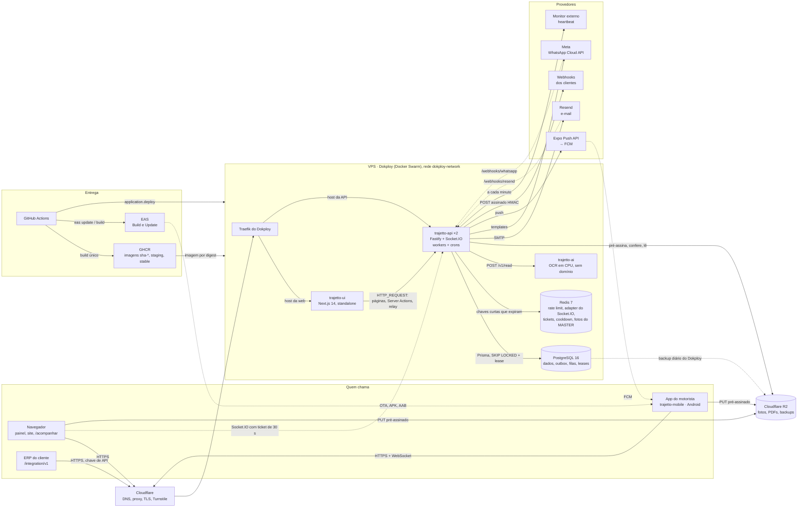
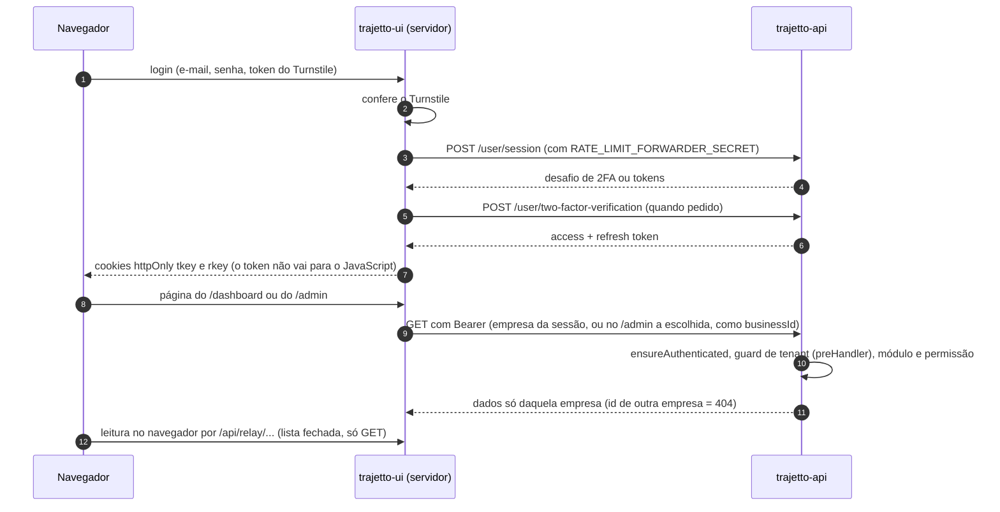
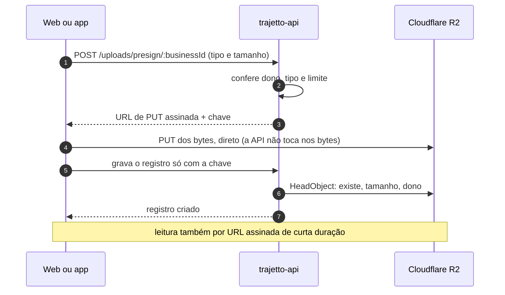
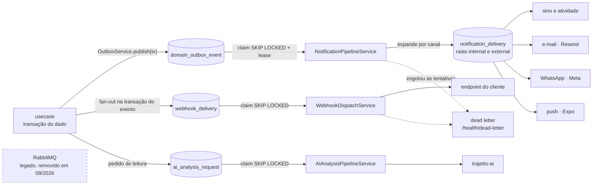
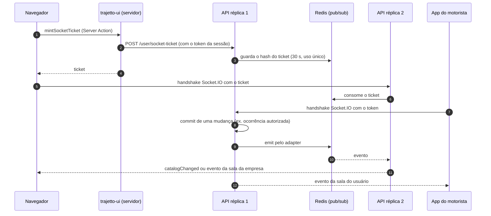
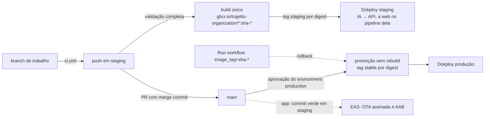

# Arquitetura da API

> Como a API do Trajetto é por dentro: o que ela atende, como o código está
> organizado, os papéis de cada processo, as regras que valem para toda rota e
> as decisões que moldaram o desenho (ADRs). O deploy e a operação estão em
> [`deploy.md`](./deploy.md); as variáveis, em
> [`variaveis-de-ambiente.md`](./variaveis-de-ambiente.md); os testes, em
> [`testes.md`](./testes.md).

## Sumário

- [O produto e os três repositórios](#o-produto-e-os-três-repositórios)
- [Visão de componentes](#visão-de-componentes)
- [Estrutura do código](#estrutura-do-código)
- [Anatomia de um módulo e como criar uma feature](#anatomia-de-um-módulo-e-como-criar-uma-feature)
- [Um processo, vários papéis](#um-processo-vários-papéis)
- [Regras transversais](#regras-transversais)
- [Papéis, permissões e módulos](#papéis-permissões-e-módulos)
- [Acesso do motorista](#acesso-do-motorista)
- [O que o app lê pelo aviso: OS, contas e Kanban](#o-que-o-app-lê-pelo-aviso-os-contas-e-kanban)
- [Gestor e master no app: rotas ao vivo, autorizações e salas sob demanda](#gestor-e-master-no-app-rotas-ao-vivo-autorizações-e-salas-sob-demanda)
- [Configurações da empresa](#configurações-da-empresa)
- [Geocerca e coordenadas do endereço](#geocerca-e-coordenadas-do-endereço)
- [Frota ligada à rota](#frota-ligada-à-rota)
- [Entregas na rota: casos de borda](#entregas-na-rota-casos-de-borda)
- [Rotas esquecidas, a lista e a torre](#rotas-esquecidas-a-lista-e-a-torre)
- [Pausas do motorista](#pausas-do-motorista)
- [Postgres é a fila](#postgres-é-a-fila)
- [Crons](#crons)
- [Redis e tempo real](#redis-e-tempo-real)
- [Arquivos](#arquivos)
- [IA local](#ia-local)
- [Comprovante de entrega](#comprovante-de-entrega)
- [Integrações externas](#integrações-externas)
- [Conexão com o Postgres](#conexão-com-o-postgres)
- [Migrations: expandir e contrair](#migrations-expandir-e-contrair)
- [Compatibilidade com o app do motorista](#compatibilidade-com-o-app-do-motorista)
- [Unicidade por empresa](#unicidade-por-empresa)
- [Saúde e observabilidade](#saúde-e-observabilidade)
- [Decisões (ADRs)](#decisões-adrs)

## O produto e os três repositórios

O Trajetto é uma plataforma B2B (SaaS multiempresa) para transportadoras, com
dois módulos contratados separadamente por empresa:

- **Frotas** (`FLEET`): veículos, motoristas, abastecimentos com foto do
  odômetro, checklists veiculares, ordens de serviço, peças, fornecedores,
  multas, contas a pagar, filiais e um quadro Kanban.
- **Entregas** (`DELIVERIES`): documentos de entrega (manual, planilha ou XML
  de NF-e), embarcadores, rotas, torre de controle, monitoramento, ocorrências
  com formulário e autorização da torre, pausas do motorista, comprovante em
  PDF assinado, atendimento por ticket (chat), mensagens ao cliente final e a
  API pública com webhooks.

| Repositório (GitHub)                  | O que é                                                           | Tecnologia                                                             |
| ------------------------------------- | ----------------------------------------------------------------- | ---------------------------------------------------------------------- |
| `trajetto-api` (este)                 | API HTTP, tempo real, filas, crons, IA local, backup              | Node.js 22, Fastify 5, Prisma 7, PostgreSQL 16, Redis 7, tsyringe, zod |
| `trajetto-ui` (`trajetto-ui`)         | painel web (`/dashboard`, `/admin`), site público, portal `/docs` | Next.js 14 (App Router)                                                |
| `trajetto-mobile` (`trajetto-mobile`) | app de campo do motorista, só Android                             | Expo / React Native                                                    |

A escala alvo usada nas decisões de capacidade: milhares de transportadoras
(cada uma um tenant), dezenas de milhares de motoristas e milhões de entregas
por mês.

## Visão de componentes

O mapa abaixo é navegável no GitHub, no mesmo espírito dos diagramas do README
antigo da `main` (Mermaid renderizado pelo GitHub):

- **Explorar:** o GitHub desenha o diagrama com os controles de zoom, de
  deslocamento (as setas) e de tela cheia sobre ele.
- **Clicar:** cada caixa tem um link (`click` do Mermaid) para a seção que a
  explica, neste documento ou no repositório certo. Se o seu visualizador
  ignorar o clique (fora do GitHub, ou com a interatividade do Mermaid
  desligada), use a tabela [Componentes e relações](#componentes-e-relações),
  que tem os mesmos links.
- **Expandir:** os fluxos principais (sessão, upload, filas, tempo real e
  deploy) ficam recolhidos em [Fluxos em detalhe](#fluxos-em-detalhe); abra o
  que precisar.
- **Avançar passo a passo:** o
  [Tour pela arquitetura](./arquitetura-tour.md) redesenha este mapa em onze
  passos (o caminho de uma requisição, sessão, tenant, arquivos, filas,
  notificações, tempo real, IA, importações, deploy e saúde), acende só as
  peças de cada um e tem links ◀ Anterior · Índice · Próximo ▶. O passo 1 é a
  versão de hoje do diagrama "Fluxo de Dados" do README da `main` antiga, cuja
  "Email Queue" era o RabbitMQ.

Cada relação foi conferida no código (o arquivo está na tabela). Linha cheia é
chamada síncrona; tracejada é assíncrona ou de volta (callback, push, backup).



### Componentes e relações

| Componente                     | O que faz                                                                                   | Relações (conferidas no código)                                                                                                                                                                                                                                                                                                                                                                                                                                                                                                                                                                            | Onde ler mais                                                                       |
| ------------------------------ | ------------------------------------------------------------------------------------------- | ---------------------------------------------------------------------------------------------------------------------------------------------------------------------------------------------------------------------------------------------------------------------------------------------------------------------------------------------------------------------------------------------------------------------------------------------------------------------------------------------------------------------------------------------------------------------------------------------------------- | ----------------------------------------------------------------------------------- |
| Navegador                      | painel (`/dashboard`, `/admin`, `/driver`), site, `/acompanhar`, `/verificar`               | nunca recebe o token: lê pelo relay `/api/relay/...` da web; abre o Socket.IO na API com um ticket de uso único (`POST /user/socket-ticket`, 30 s); envia arquivos direto ao R2 por URL pré-assinada                                                                                                                                                                                                                                                                                                                                                                                                       | `trajetto-ui/docs/arquitetura.md` (Fluxo de dados, Sessão e segurança, Tempo real)  |
| `trajetto-ui`                  | Next.js 14 (App Router), sem banco                                                          | Server Components e Server Actions chamam a API em `HTTP_REQUEST` (`src/lib/api-fetch.ts`); login, 2FA, refresh e rastreio levam `RATE_LIMIT_FORWARDER_SECRET` (`src/lib/api-forwarding.ts`); valida o Turnstile no login                                                                                                                                                                                                                                                                                                                                                                                  | `trajetto-ui/docs/arquitetura.md`                                                   |
| App do motorista               | Expo / React Native, só Android, offline no laço do motorista                               | HTTP em `EXPO_PUBLIC_API_URL` (`utils/api.ts`); Socket.IO na mesma URL com o token (`providers/socket-provider.tsx`); fotos por PUT pré-assinado com upload retomável; registra o token de push na API (`utils/push-token.ts`)                                                                                                                                                                                                                                                                                                                                                                             | `trajetto-mobile/docs/arquitetura.md`                                               |
| ERP do cliente                 | integração por chave de API                                                                 | `/integration/v1/*` com escopos e `Idempotency-Key`; recebe webhooks assinados                                                                                                                                                                                                                                                                                                                                                                                                                                                                                                                             | [Integrações externas](#integrações-externas)                                       |
| Cloudflare                     | DNS, proxy (laranja), TLS de borda, Turnstile                                               | a API só acredita no `CF-Connecting-IP` vindo das faixas da Cloudflare (`RATE_LIMIT_TRUSTED_PROXY=cloudflare`, `src/config/rate-limit.ts`); o formulário público é conferido no Turnstile (`src/shared/security/turnstile.ts`)                                                                                                                                                                                                                                                                                                                                                                             | [`deploy.md`, seção 11](./deploy.md#11-domínios-tls-e-a-borda)                      |
| Traefik do Dokploy             | roteia por host para cada Application                                                       | um roteador por domínio de Application; WebSocket sem cookie sticky                                                                                                                                                                                                                                                                                                                                                                                                                                                                                                                                        | [`infra/traefik/README.md`](../infra/traefik/README.md)                             |
| `trajetto-api`                 | HTTP (Fastify), Socket.IO, workers e crons no mesmo processo, 2 réplicas                    | ver as linhas abaixo; desligamento ordenado em `src/shared/lifecycle/shutdown.ts`                                                                                                                                                                                                                                                                                                                                                                                                                                                                                                                          | [Um processo, vários papéis](#um-processo-vários-papéis)                            |
| PostgreSQL 16                  | dados de todas as empresas, outbox e filas, leases dos crons                                | `domain_outbox_event` gravado na transação do dado (`src/shared/notifications/outbox-service.ts`); `notification_delivery`, `webhook_delivery` e `ai_analysis_request` lidas com `FOR UPDATE SKIP LOCKED` e lease pelos pipelines de `src/workers/index.ts`                                                                                                                                                                                                                                                                                                                                                | [Postgres é a fila](#postgres-é-a-fila)                                             |
| Redis 7                        | descartável, nada é fonte de verdade                                                        | rate limit do HTTP, do handshake do socket e das falhas de chave da API pública (`src/http.ts`, `src/shared/socket/handshake-rate-limit.ts`, `src/shared/integration/integration-rate-guard.ts`); intervalo de 60 s por destinatário do "esqueci minha senha" (`src/shared/security/mail-cooldown.ts`, chave = HMAC do e-mail); pub/sub do adapter (`src/shared/socket/adapter-redis.ts`); tickets de socket de 30 s (`src/shared/socket/socket-ticket.ts`); fotos curtas de leituras da plataforma só do MASTER, com falha aberta (`src/shared/cache/snapshot-cache.ts`). Nenhum dado de empresa em cache | [Redis e tempo real](#redis-e-tempo-real)                                           |
| `trajetto-ai`                  | OCR local (RapidOCR, ONNX, CPU), só transcreve                                              | a API chama `POST /v1/read` com bearer (`src/shared/ai/local/local-ocr-reader.ts`); serviço em `infra/ai-ocr/server.py`; sem domínio público                                                                                                                                                                                                                                                                                                                                                                                                                                                               | [IA local](#ia-local)                                                               |
| Cloudflare R2                  | bucket privado de fotos, assinaturas e PDFs (um por ambiente); outro bucket para os backups | a API pré-assina o PUT e o GET e confere a chave com `HeadObject` (`src/shared/services/upload-service.ts`, rotas em `/uploads`); o backup do Database PostgreSQL vai para o R2 pelo próprio Dokploy                                                                                                                                                                                                                                                                                                                                                                                                       | [Arquivos](#arquivos), [`deploy.md`, seção 18](./deploy.md#18-backup-e-restauração) |
| Resend                         | e-mail                                                                                      | SMTP `smtp.resend.com` via nodemailer (`src/shared/providers/mail-provider/implementations/resend-mail-provider.ts`); recibos em `/webhooks/resend`                                                                                                                                                                                                                                                                                                                                                                                                                                                        | [Integrações externas](#integrações-externas)                                       |
| Meta (WhatsApp Cloud API)      | mensagens por template                                                                      | `src/shared/providers/whatsapp-provider/implementations/meta-cloud-api-provider.ts`; status em `/webhooks/whatsapp`                                                                                                                                                                                                                                                                                                                                                                                                                                                                                        | [Integrações externas](#integrações-externas)                                       |
| Expo Push API → FCM            | push no Android                                                                             | a API envia para `exp.host` (`src/shared/notifications/push-provider.ts`), que repassa ao FCM com a credencial do projeto EAS; o cron `check-push-receipts` desativa aparelhos mortos                                                                                                                                                                                                                                                                                                                                                                                                                      | `trajetto-mobile/docs/arquitetura.md` (Tempo real e push)                           |
| Webhooks dos clientes          | eventos `delivery.*`, `occurrence.*`, `proof.*`, `route.*`                                  | `webhook_delivery` criada na transação do evento e entregue pelo `WebhookDispatchService` (`src/shared/integration/webhook-dispatch-service.ts`), com HMAC, retentativa e disjuntor                                                                                                                                                                                                                                                                                                                                                                                                                        | [Integrações externas](#integrações-externas)                                       |
| Monitor externo                | dead man's switch                                                                           | o cron `ops-heartbeat` avisa `HEALTHCHECK_PING_URL` a cada minuto (`src/jobs/cron/ops-heartbeat-job.ts`)                                                                                                                                                                                                                                                                                                                                                                                                                                                                                                   | [`deploy.md`, seção 20](./deploy.md#20-alertas-e-monitoramento)                     |
| GitHub Actions, GHCR e Dokploy | uma imagem por serviço, promovida por digest                                                | `deploy.yml` constrói `sha-<sha>`, move `staging` e depois `stable` e chama `application.deploy` (`.github/scripts/dokploy-deploy.mjs`); cada serviço é uma Application (provider Docker) ou um Database do Dokploy, nunca Compose                                                                                                                                                                                                                                                                                                                                                                         | [`deploy.md`](./deploy.md)                                                          |
| EAS                            | build e OTA do app                                                                          | o `deploy.yml` do app publica OTA e, se o lado nativo mudou, APK/AAB; promove o commit, não o artefato                                                                                                                                                                                                                                                                                                                                                                                                                                                                                                     | `trajetto-mobile/docs/deploy.md`                                                    |
| ~~RabbitMQ~~                   | **legado, removido em 09/2026**                                                             | servia três filas na `main` antiga: e-mail (`emailQueue`), WhatsApp pela Evolution API (`whatsappQueue`) e verificação de fotos pela Anthropic (`aiVerificationQueue`). Hoje o e-mail e o WhatsApp (Meta) saem pelo pipeline de notificações (o e-mail transacional com segredo, como 2FA e senha, por `src/shared/services/transactional-mail-service.ts`), e a leitura de fotos pela fila `ai_analysis_request` até o `trajetto-ai`, tudo em tabelas do Postgres ([ADR 0001](./adr/0001-filas-e-mensageria.md)). A imagem antiga da `main` ainda exige `RABBITMQ_URL`                                    | [Postgres é a fila](#postgres-é-a-fila)                                             |

### Fluxos em detalhe

<details>
<summary><strong>Sessão no painel web e tenant</strong></summary>



O MASTER não tem empresa: no `/admin` (e no app, na tela `select-business`)
ele escolhe uma, e a API confere que só o MASTER pode pedir outra empresa
(`src/modules/middlewares/tenant-authorization.ts`). Trocar o papel ou a
empresa de um usuário encerra as sessões dele.

</details>

<details>
<summary><strong>Upload por URL pré-assinada</strong></summary>



O app re-encoda a foto antes do PUT (tira EXIF e GPS) e guarda a chave de
cada foto que subiu, para o upload recomeçar de onde parou. Em
desenvolvimento, `UPLOAD_STORAGE_TYPE=local` grava em `./tmp`; produção
recusa `local`.

</details>

<details>
<summary><strong>Outbox, filas e efeitos externos</strong></summary>



O evento só existe se o dado foi gravado
([ADR 0003](./adr/0003-outbox-transacional.md)). Retentativa com backoff,
dead letter com reenvio e idempotência dos efeitos externos
([ADRs 0005](./adr/0005-retentativa-backoff-dead-letter.md) e
[0006](./adr/0006-idempotencia-de-efeitos-externos.md)). Os crons usam um lease no Postgres por horário, então várias réplicas
não repetem um job.

Depois do commit, o `publish` acorda o pipeline da própria réplica (500 ms
depois; numa réplica só HTTP, quem pega é a varredura do worker). Quem
encontra um ciclo do pipeline já rodando (o despertar, a varredura ou um
teste) entra nesse ciclo, e ele faz **mais uma passada** quando termina: uma
só, por mais chamadas que cheguem. Antes, a chamada voltava na hora, e o que
ficava pronto depois do último claim do ciclo esperava a próxima varredura
(30 s em produção) com um ciclo ali do lado (30/10/2026).

</details>

<details>
<summary><strong>Tempo real entre réplicas</strong></summary>



A entrega é _at-most-once_ ([ADR 0007](./adr/0007-tempo-real-at-most-once.md)):
a verdade está no banco, e as telas
refazem a consulta ao reconectar. Sem Redis, o tempo real entre réplicas
degrada e o resto da API continua.

`operationsSubscribe` e `chatSubscribe` (e, desde a onda 4,
`operationsUnsubscribe` e `chatUnsubscribe`) aceitam um _acknowledgement_
opcional: quando o cliente pede um, o servidor responde **vazio** depois de
tratar o pedido, tenha entrado (ou saído) da sala ou recusado. Não diz o veredito (uma
recusa continua silenciosa e não revela se a empresa existe); serve para quem
precisa saber que o pedido já foi tratado, como os testes E2E, que esperam a
sala em vez de dormir um tempo chutado. A web emite sem _acknowledgement_.

</details>

<details>
<summary><strong>Do commit à produção</strong></summary>



Ordem de cada release: API → web → app. Detalhes em
[`deploy.md`](./deploy.md) e na seção "Os três repositórios juntos", igual nos
três repositórios.

</details>

Fora do mapa, por serem opcionais: o provedor de tiles e o de geocodificação
do comprovante e dos endereços das entregas (`PROOF_MAP_TILE_URL`,
`REVERSE_GEOCODER_URL`; sem este, a geocerca só avalia entregas com
coordenadas informadas ou marcadas no mapa). Em
staging e produção cada caixa do grupo "VPS · Dokploy" é um serviço próprio
do Dokploy: a API, a IA e a web como Applications que puxam a imagem do GHCR;
o PostgreSQL e o Redis como Databases do Dokploy. A topologia (nomes,
réplicas, limites) está em [`deploy.md`](./deploy.md#4-a-topologia-no-servidor).

## Estrutura do código

```
src/
  server.ts            boot: HTTP + Socket.IO + workers; desligamento ordenado
  http.ts              a instância Fastify: plugins (helmet, cors, compress, rate limit, swagger), hooks, erros, rotas
  websocket.ts         Socket.IO com o adapter Redis, salas, emissores (sendCatalogChangedEvent…)
  env/index.ts         carrega o .env (dotenv + expand) e valida com o env-schema
  config/              auth, CORS, rate limit e borda confiável, upload, permissões, opções do Redis, servidor HTTP
  routes/              um arquivo de rotas por área (`*-routes.ts`), registrado em routes.ts com o prefixo;
                       documentation/ guarda os schemas de resposta do OpenAPI
  schemas/             schemas zod de entrada (um diretório por schema) e o env-schema
  modules/<domínio>/   dtos/, repositories/ (interface, Prisma, in-memory), usecases/<caso>/ (controller + usecase), errors
  modules/middlewares/ ensure-authenticated, verify-permission, verify-tenant-active, verify-module-enabled…
  shared/              o que atravessa domínios: ai, delivery, route, notifications, integration, health,
                       http (idempotência, versão do cliente, multipart legado), pagination, security, time,
                       lifecycle (startup/shutdown/draining), logging, providers (mail, whatsapp), services
                       (PDF, assinatura, cron), in-memory (gêmeos), errors (AppError, indisponibilidade do banco)
                       e index.ts (registro dos repositórios e serviços no container do tsyringe)
  jobs/cron/           os crons e o registro deles (index.ts)
  workers/index.ts     inicia e para os pipelines e o dispatcher
infra/
  database.ts          o PrismaClient compartilhado
  cache/               conexão Redis
  scripts/             entrypoint da imagem (serve, migrate, release), conferência do rollout, backup/restore manuais,
                       seeds, guard de bootstrap, cobertura E2E
  ai-ocr/              o serviço de IA (Python): server.py, Dockerfile, requisitos com hash, modelos, pytest
  traefik/             referência da configuração estática do Traefik do Dokploy
prisma/
  schema.prisma        o modelo de dados (multiempresa: quase todo modelo tem businessId)
  migrations/          migrations SQL (131 até 07/10/2026), sempre expandir/contrair
  backfills/           SQL de backfill avulso
  vitest-environment-prisma/   o ambiente de teste que cria um banco por arquivo E2E
tests/                 unitaires/, E2E/, contract/, ai-local/, load/, support/ (ver testes.md)
```

Aliases de import (`tsconfig.json`): `@/*` → `src/*` e `infra/*` → `infra/*`.
O build é `tsup` (`tsup.config.ts`), que gera `build/` com o servidor, os
seeds e os scripts do entrypoint.

## Anatomia de um módulo e como criar uma feature

Exemplo real: `src/modules/shipper/`.

```
modules/shipper/
  dtos/shipper-dto.ts                                tipos de entrada/saída
  repositories/IShipper-repository.ts                a interface
  repositories/shipper-repository.ts                 a implementação Prisma
  repositories/in-memory/in-memory-shipper-repository.ts   o gêmeo em memória (mesma semântica)
  usecases/create-shipper/create-shipper-controller.ts     lê params/body com zod, resolve o usecase no container
  usecases/create-shipper/create-shipper-usecase.ts        @injectable(), recebe repositórios por @inject("Nome")
  usecases/errors/shipper-errors.ts                  erros com `code` e mensagem em pt-BR
routes/shipper-routes.ts                             as rotas, com guards e schema OpenAPI
routes/documentation/shipper-documentation.ts        schemas de resposta documentados
schemas/create-shipper-schema/                       o schema zod de entrada
shared/index.ts                                      container.registerSingleton("ShipperRepository", ShipperRepository)
```

Passo a passo para uma feature de ponta a ponta:

1. **Modelo**: altere `prisma/schema.prisma`, gere a migration com
   `yarn prisma:migrate:dev` (só cria, `--create-only`), revise o SQL contra as
   [regras de migration](#migrations-expandir-e-contrair) e aplique com
   `yarn prisma:migrate:deploy`. Todo modelo de tenant leva `businessId` e
   uniques compostos com ele.
2. **Repositório**: método na interface, na implementação Prisma **e** no gêmeo
   in-memory, com a mesma semântica (filtros, ordem, nulos, unicidade,
   empresa). Se o modelo tem teste de contrato (`tests/contract/repositories`),
   acrescente o caso lá: ele roda contra os dois.
3. **Schema de entrada** em `src/schemas/<nome>-schema/` (zod; mensagens em
   pt-BR).
4. **Usecase** `@injectable()` com as regras de negócio; **controller** que só
   faz parse e chama o usecase; **erros** com `code`.
5. **Rota** em `src/routes/<área>-routes.ts`: `onRequest: [ensureAuthenticated]`;
   `preHandler` com `verifyBusinessActive`, `verifyModuleEnabled(...)` quando o
   módulo é contratado, `verifyPermission("<chave>", "read"|"write")`; o guard
   de tenant roda em `preHandler` porque só ali o corpo já foi lido. Declare o
   `schema` completo (`tags`, `summary`, `description` em pt-BR, `params`,
   `body`, `response` com 400/401/403/404/409/429 conforme o caso): o OpenAPI é
   a documentação.
6. **Registro** do repositório no container (`src/shared/index.ts`) e da rota
   em `src/routes/routes.ts` se for um arquivo novo.
7. **Tempo real**: depois do commit, emita o evento (ex.
   `sendCatalogChangedEvent`) — nunca dentro da transação.
8. **Testes** primeiro (vermelho → verde): unitário do usecase com os gêmeos
   in-memory; E2E HTTP contra o Postgres real quando a regra depende de SQL,
   de autorização ou de tenant. Ver [`testes.md`](./testes.md).
9. **Contratos com os clientes**: se a web ou o app chamam a rota, o teste
   `tests/unitaires/contract/client-routes.test.ts` confere as URLs; rotas
   removidas entram em `src/routes/retired-routes.ts`.

## Um processo, vários papéis

Cada réplica sobe, no mesmo processo Node (`src/server.ts`):

1. o HTTP (Fastify, `src/http.ts`), porta `PORT` (3333);
2. o Socket.IO com o adapter Redis (`src/websocket.ts`);
3. os workers (`src/workers/index.ts`), quando `WORKERS_ENABLED=true`:
   - `NotificationPipelineService`: entrega notificações por canal (sino,
     atividade, push via Expo, e-mail via Resend, WhatsApp via Meta), em duas
     raias (`internal` e `external`), para um provedor lento não segurar o
     sino;
   - `AIAnalysisPipelineService`: leituras de odômetro e canhoto no serviço
     `trajetto-ai`;
   - `WebhookDispatchService`: entrega os webhooks dos clientes, assinados,
     com retentativa e disjuntor por endpoint;
   - o agendador de crons;
4. o `apiUsageRecorder` (contadores de uso da API pública), em toda réplica.

O boot (`infra/scripts/docker-entrypoint.sh`, sob `dumb-init`) espera o
Postgres, recusa banco vazio em produção (`database-bootstrap-guard.ts`; a
recusa diz que `ALLOW_EMPTY_DATABASE_BOOTSTRAP` vai na Application
`trajetto-api-migrate`, nunca na API), recusa banco sem todas as migrations
do build (`schema-guard.ts`, contra `build/schema-version.json`, que lista
cada uma; a recusa nomeia as que faltam e manda dar Deploy na
`trajetto-api-migrate` do ambiente) e faz
`exec` do servidor — o Node é filho direto do `dumb-init`, então o SIGTERM
do deploy chega a ele. A imagem da API **nunca migra** (não traz o CLI do
Prisma): quem migra é a imagem `trajetto-api-migrate`, rodando como a
Application `trajetto-api-migrate` do Dokploy, antes do rollout e só quando
o banco ainda não aplicou aquela imagem
([`deploy.md`](./deploy.md#15-migrations)). Os builds anteriores a
31/10/2026 migravam no boot, com `RUN_MIGRATIONS_ON_BOOT` no padrão `true`:
por isso a variável fica `false` nas Applications da API enquanto um deles
puder ser alvo de rollback
([`variaveis-de-ambiente.md`](./variaveis-de-ambiente.md#2-banco-de-dados)).
O comando da `trajetto-api-migrate` (`docker-entrypoint.sh release`) migra,
roda os seeds e fica parado; a importação dos códigos de infração
(`infra/scripts/import-violation-codes.ts`) é tudo ou nada, numa transação
só, e um lote que falha falha a etapa. O `HEALTHCHECK` da imagem só passa
depois disso, e é por ele que o pipeline sabe que a etapa terminou.

O desligamento é ordenado (`src/shared/lifecycle/shutdown.ts`): a readiness
passa a 503, a réplica espera 12 s para sair do balanceamento do serviço,
fecha o tempo real e o HTTP, espera a fila de importações drenar, e então
fecha os workers e o Redis, com teto de 35 s (abaixo dos 40 s do _Stop Grace
Period_ da Application no Dokploy). O dreno das importações começa no
primeiro instante do SIGTERM (ver [Arquivos](#arquivos)).

Separar workers do HTTP é possível com a mesma imagem (`WORKERS_ENABLED=false`
nas réplicas HTTP e uma Application `worker`), só por gatilho medido:
[`deploy.md`](./deploy.md#19-réplicas-workers-e-tempo-real).

## Regras transversais

- **Multiempresa.** Toda leitura e escrita é filtrada pela empresa da sessão
  (ou pela empresa escolhida pelo MASTER no `/admin`). Um id de outra empresa
  recebe o mesmo 404 de um id inexistente, para não revelar o que existe.
  Campos de empresa no corpo que não podem mudar são recusados (não ignorados
  em silêncio). O guard de tenant roda em `preHandler`, porque no `onRequest`
  o Fastify ainda não leu o corpo — não mova de volta.
- **Dia de negócio.** `Business.timezone` (padrão `America/Sao_Paulo`) define
  o "hoje" de cada empresa. Todo "hoje", "últimos N dias" e agrupamento diário
  passa por `src/shared/time/business-day.ts` (um teste varre `src/` atrás de
  conta de dia feita com o relógio do servidor). Datas sem hora
  (`Delivery.scheduled_date`, `Route.scheduled_date`, `Driver.cnh_expires_at`)
  são `@db.Date`: entram como `YYYY-MM-DD` e ficam à meia-noite UTC. O
  contêiner roda em UTC e **não** deve receber `TZ`.
- **Erros com código.** Todo erro tem `code` e mensagem em pt-BR. Permissão
  negada é `403 PERMISSION_DENIED`, módulo não contratado é
  `MODULE_NOT_ENABLED`, empresa inativa é `TENANT_INACTIVE`. Banco
  indisponível vira 503 com `Retry-After`.
- **Idempotência.** Escritas do aplicativo e da API pública aceitam
  `Idempotency-Key` ou `client_submission_id`: reenviar não duplica, e o
  reenvio de um registro que já existe é respondido com ele.
- **Listagens.** As tabelas do painel usam paginação por página (offset) com
  resposta NDJSON: linhas e uma linha final `meta` com `total`, `page`,
  `pageSize` e `searchMeta` (cartões e filtros contados no servidor). Os
  seletores com busca usam cursor.
- **Logs.** JSON (pino), uma linha por requisição com `reqId`, `userId`,
  `businessId` e o cabeçalho de versão do cliente; credenciais censuradas por
  nome.

## Papéis, permissões e módulos

| Papel                     | Quem é                          | O que pode                                                                                                                                                                                                                                          |
| ------------------------- | ------------------------------- | --------------------------------------------------------------------------------------------------------------------------------------------------------------------------------------------------------------------------------------------------- |
| `MASTER`                  | equipe Trajetto                 | todas as empresas, pelo `/admin` da web; cria empresas, usuários master, limites e módulos                                                                                                                                                          |
| `BUSINESS_ADMIN`          | administrador da transportadora | tudo da própria empresa                                                                                                                                                                                                                             |
| `BUSINESS_USER`           | funcionário                     | o que o perfil de acesso libera, chave a chave, em leitura ou escrita                                                                                                                                                                               |
| `BUSINESS_USER` motorista | usuário vinculado a um `Driver` | só o que é dele: entregas, rotas, veículos que dirige, ordens de serviço em que é responsável ou dos veículos que opera (sem valores), contas a pagar em que é responsável, o card do Kanban de que é responsável (leitura) e as próprias conversas |

- Chaves de permissão em `src/config/permissions.ts` (ex. `vehicle_manage`,
  `delivery_manage`, `occurrence_manage`, `integration_manage`); middleware
  `src/modules/middlewares/verify-permission.ts`, com a tabela fixa do
  motorista (`DRIVER_PERMISSIONS`).
- Módulos contratados em `BusinessEntitlement` (`FLEET`, `DELIVERIES`),
  cobrados por `verify-module-enabled.ts`, inclusive para o MASTER. A IA não é
  um módulo: é o limite mensal `Business.ai_analysis_limit` (0 desliga; teto de
  10.000 fotos por mês).
- **O zero dos limites (M2)** quer dizer coisas opostas, de propósito, e está
  escrito num lugar só (`LIMIT_ZERO_MEANING` em
  `src/shared/entitlements/entitlement-rules.ts`): `vehicle_limit` = 0 é **sem
  limite** (não configurado, nunca bloqueia); `ai_analysis_limit` = 0 é **IA
  desligada** (nenhuma foto é lida). Unificar ligaria a IA de quem não comprou
  ou passaria a bloquear frotas sem limite preenchido. Leia um limite só por
  `isVehicleLimitEnforced`/`isAIAnalysisEnabled`, nunca com um `> 0` solto, e
  todo campo publicado que carrega um limite diz o que o 0 significa. Limite
  **novo** não reaproveita o zero: coluna anulável, `NULL` = ilimitado e 0 =
  zero mesmo.
- **Limite de veículos (M8)**: todo veículo que não está `INACTIVE` ocupa uma
  vaga. Cadastrar, reativar e qualquer edição que ponha o veículo numa
  situação que ocupa vaga passam pela mesma trava (`FOR NO KEY UPDATE` na linha
  da empresa) e contam dentro da transação da escrita; se o veículo já ocupa
  uma vaga é lido ali, travado, e não da leitura anterior do caso de uso (um
  desbloqueio que corria com uma inativação e um cadastro novo deixava N+1
  veículos num plano de N). Recusa: 409 `VEHICLE_LIMIT_REACHED` com a contagem.
  A trava está no banco, então vale entre réplicas
  (`tests/E2E/vehicle-limit-http.test.ts`).
- **Limite de IA (M7)**: a cota é reservada com lock da linha do mês em
  `AIUsagePeriod` (`reserveUnits`), no mês civil do fuso da empresa. A foto
  além do limite é aceita sem leitura (pedido `SKIPPED`, "limite atingido" na
  auditoria de comprovantes) e nunca falha para o motorista; baixar o limite
  no meio do mês zera o saldo sem desfazer o que já foi lido.
- Trocar o papel ou a empresa de um usuário encerra as sessões dele
  (`session_version` + refresh tokens revogados) e apaga as notificações
  pessoais; as atividades (auditoria) ficam.

| Área         | Módulos (`src/modules/`)                                                                                                                                                      | Prefixo HTTP                                                                                                        |
| ------------ | ----------------------------------------------------------------------------------------------------------------------------------------------------------------------------- | ------------------------------------------------------------------------------------------------------------------- |
| Acesso       | `user`, `business`, `branch`, `profile-access`, `permission`, `notification`, `activity`                                                                                      | `/user`, `/business`, `/branch`, `/profile-access`, `/permission`, `/notification`, `/activity`                     |
| Frotas       | `vehicle`, `vehicle-type`, `driver`, `fuel`, `fuel-type`, `vehicle-checklist`, `service-order`, `service-order-part`, `part`, `supplier`, `fine`, `account-payable`, `kanban` | `/vehicle`, `/driver`, `/fuel`, `/vehicle-checklist`, `/service-order`, `/fines`, `/account-payable`, `/kanban` …   |
| Entregas     | `delivery`, `route`, `shipper`, `occurrence-type`, `status-change-reason`, `import`, `driver-pause`, `chat`                                                                   | `/delivery`, `/route`, `/shipper`, `/occurrence-type`, `/status-change-reason`, `/import`, `/driver-pause`, `/chat` |
| IA           | `ai-analysis`                                                                                                                                                                 | `/ai-analysis`                                                                                                      |
| Integração   | `integration`                                                                                                                                                                 | `/integration/v1` (API pública, chave de API), `/integrations` (gestão no painel)                                   |
| Painéis      | `dashboard`                                                                                                                                                                   | `/dashboard`                                                                                                        |
| Site público | `quote`                                                                                                                                                                       | `/quote`, `/public`                                                                                                 |
| Provedores   | `whatsapp`                                                                                                                                                                    | `/webhooks` (callbacks da Meta e do Resend)                                                                         |
| Arquivos     | `upload`                                                                                                                                                                      | `/uploads` (URLs pré-assinadas)                                                                                     |

## Acesso do motorista

O motorista entra no app sem depender de e-mail (plano de 02/11/2026, itens
D1 a D8; decisões D01 a D04). Usuário de escritório e MASTER continuam no
fluxo de sempre: e-mail e senha, link de uso único para definir a senha
(decisão 4.9) e segundo fator opcional. A onda 2 (06/11/2026) prendeu o
CPF aos aparelhos que o QR Code liberou e deu a cada pessoa a própria conta:
senha, sessões e segundo fator (detalhes depois da tabela).

| Como entra                    | Rota                                                                         | O que vale                                                                                                                                                                                                                                                                                                                                                           |
| ----------------------------- | ---------------------------------------------------------------------------- | -------------------------------------------------------------------------------------------------------------------------------------------------------------------------------------------------------------------------------------------------------------------------------------------------------------------------------------------------------------------- |
| **QR Code** (principal)       | `POST /user/:userId/enrollment` (gestor) → `POST /user/session/enroll` (app) | uso único, 10 minutos; gerar outro anula o anterior; o banco guarda só o SHA-256 do token e do código de 8 caracteres (`driver_enrollment_token`); consumo atômico (dois aparelhos, uma sessão); recusa por motorista inativo conta tentativa, e 5 gastam o código; o aparelho passa a valer para CPF e senha daquele login (onda 2)                                 |
| **CPF e senha** (alternativa) | `POST /user/session` com `{ cpf, password, deviceId }`                       | só num aparelho que o QR Code liberou para aquele login (onda 2); o CPF é único só por empresa: a senha é conferida em cada login do CPF que conhece o aparelho (índice `driver_cpf_idx`); uma empresa entra direto, mais de uma devolve `businessSelection` com as empresas em que a senha conferiu, e o app repete com `businessId`; nada é listado antes da senha |
| E-mail e senha                | `POST /user/session` com `{ email, password }`                               | o mesmo de sempre (o app N-1 e a web)                                                                                                                                                                                                                                                                                                                                |

- **Senha definida pelo gestor (D2, decisão D04):** só no login de um
  motorista, em `POST /user/create-user` (`password`) e em
  `PATCH /user/:userId/driver-password`. Nenhum e-mail sai, o e-mail cadastrado
  fica confirmado e a atividade registra quem definiu; a senha nunca vai para
  log (o logger censura `password`, `qrToken`, `qrContent` e `accessCode`) nem
  para a atividade. Para usuário de escritório o campo é recusado (400). O
  gestor conhece essa senha, então ela marca `user.must_change_password`
  (onda 2): o motorista cria a própria no próximo login. Quem cobra são os
  clientes (a tela bloqueante do app, o redirecionamento da web): a API não
  recusa nada por isso, para nunca devolver o outbox do app. O campo sai em
  `GET /user/me` (`must_change_password`) e como `mustChangePassword` em
  toda resposta que abre uma sessão (`POST /user/session`, o consumo do QR,
  a verificação do 2FA, a troca e a criação de senha). Toda senha que a
  própria pessoa define desmarca: `PATCH /user/password`,
  `POST /user/me/password` e o link de redefinição por e-mail. A senha atual
  de `PATCH /user/password` é conferida pela regra do login (7 a 100
  caracteres, espaço permitido), não pela da senha nova (sem espaços): a
  senha que o gestor define aceita espaço, e o motorista marcado por ela
  precisa conseguir trocá-la.
- **O link de definir senha confirma o e-mail (D1):** gastar o link de uso
  único grava `email_verified` quando ainda não havia.
- **Sessão do aparelho (D4, decisão D03):** a sessão aberta pelo QR Code, ou
  por CPF e senha com `deviceId`, usa a política `driver_device` de
  `config/auth.ts` (30 dias sem uso, 180 no total) e fica presa ao aparelho: o
  refresh token assinado leva o SHA-256 do `deviceId`, toda rotação leva o
  `device_id` para o próximo token, e uma renovação sem o mesmo `deviceId`
  recebe `401 AUTH_DEVICE_MISMATCH` sem gastar o token. Um cabeçalho nunca
  escolhe essa política.
- **Aparelhos confiáveis (onda 2, decisão do dono):** o CPF é público e o
  `deviceId` é o que o cliente disser, então CPF e senha só valem num
  aparelho que entrou naquele login pelo QR Code do gestor. A confiança mora
  em `driver_trusted_device` (um aparelho por login, pelo SHA-256 do
  identificador normalizado, o mesmo `hashDeviceId` do refresh token preso
  ao aparelho; o identificador nunca é gravado ali). O consumo do QR insere
  (`source` `qr`); a migration confiou nos aparelhos em uso quando saiu
  (`backfill`: as sessões presas ao aparelho ainda vivas e o aparelho do
  último QR lido, menos esse quando o gestor desconectou algum aparelho do
  login depois da leitura). O que a imagem anterior abriu durante o rollout
  se resolve no próprio login por CPF, sem nada à mão: um login que não
  confia no aparelho, mas tem uma sessão viva presa a ele (`refresh_token`
  com aquele `device_id`, sem revogação nem vencimento), passa a confiar
  (`backfill`, linha `info` `auth.device_trust_restored`), numa consulta
  antes de qualquer bcrypt. Nunca pelo QR consumido: a desconexão da imagem
  anterior deixava a linha apontando para o aparelho. Desta release em
  diante toda sessão presa ao aparelho já nasce com a confiança, e toda
  saída da confiança encerra antes essas sessões, então a regra só devolve
  o que o backfill daria. Sai quando o gestor desconecta o aparelho, quando
  a própria pessoa encerra em "Aparelhos conectados" a última sessão dela
  naquele aparelho, quando o motorista é inativado ou tem o acesso revogado
  (D5) e quando o login passa para outro motorista (`update-user`, na
  transação da edição: os aparelhos e o QR eram do motorista anterior). Nas duas desconexões, o
  QR consumido esquece o aparelho (`forgetDevice`), para nada mais apontar
  para ele. E vence sozinha: um aparelho sem login por 210 dias (o teto de
  180 da sessão presa ao aparelho mais os 30 de inatividade,
  `services/trusted-devices.ts`) não conta mais no filtro, e o cron diário
  `cleanup-expired-refresh-tokens` apaga a linha; sem isso, um aparelho
  esquecido depois de um logout valia para sempre e nem aparecia na lista
  do gestor, que mostra só sessões vivas. **Trocar a senha nunca mexe na
  confiança**: ela só diz "este aparelho pode tentar uma senha".
  O login por CPF (`executeByCpf`) filtra os logins do CPF pelos que confiam
  no aparelho logo depois de buscá-los e **antes de qualquer bcrypt**. Sem
  `deviceId`, com um CPF sem login ou num aparelho que nenhum login do CPF
  conhece: `403 AUTH_DEVICE_NOT_TRUSTED`, uma resposta só ("Não foi possível
  entrar com este CPF neste aparelho. Confira o CPF ou peça ao gestor o QR
  Code de acesso."), sem comparar senha nem contar tentativa, com a linha
  `auth.login_failed` de motivo `device_not_trusted` e o CPF só como
  impressão com chave. Os builds do app em campo mostram a frase da API para
  um código que não conhecem (`signInFailureMessage`), e o 403 não encerra
  sessão nenhuma (o login não é autenticado). Um QR lido num aparelho novo
  para o login avisa os administradores da empresa, menos quem gerou o QR
  (`driver-access.new_device`, na transação da confiança; no sino e no push,
  pelas preferências; sem e-mail), e registra a atividade.
- **Bloqueio e limites:** o login por CPF usa o mesmo freio do e-mail
  (`login-lockout-rules.ts`), só nos logins que confiam no aparelho: uma
  senha errada conta contra todos eles e só quando não confere em nenhum; o
  limite por endereço da rota continua (8 por minuto). Um aparelho estranho
  não chega à senha, então não bloqueia mais o motorista de ninguém. Toda
  recusa depois do filtro dura o mesmo que
  `DRIVER_LOGINS_BY_CPF_LIMIT` comparações (`shared/security/refusal-pacing.ts`):
  um bcrypt por login e, para as comparações que faltam, uma espera no
  ritmo medido na própria requisição. Assim o tempo não diz em quantas
  transportadoras o CPF tem login, e a tentativa não gasta mais CPU
  (fazer os bcrypts que faltam encheria o portão de dois do `bcrypt-gate`).
  O login aceito não espera e grava `last_login_at` do aparelho. Com o
  segundo fator ligado (conta com e-mail), o desafio leva o hash do
  aparelho: a verificação só vale com o mesmo `deviceId` e abre a sessão
  presa a ele.
- **Inativar o motorista (D5):** apaga os refresh tokens e os aparelhos de
  push do login (`revokeAllUserRefreshTokens`), o QR Code ainda não usado e os
  aparelhos confiáveis (onda 2), sem
  mexer em `session_version`: a próxima requisição do app ouve
  `403 AUTH_DRIVER_INACTIVE` (o porquê), e não um 401 genérico (D6). Revogar o
  acesso do login também apaga o QR Code ainda não usado e os aparelhos
  confiáveis (restaurar não traz nenhum dos dois de volta). O consumo do QR confere o hash do código lido: um "gerar outro"
  entre a leitura e o consumo deixa o código antigo morto, e as recusas dele
  não contam contra o novo.
- **Aparelhos (D7):** `GET /user/:userId/devices` lista os aparelhos com
  sessão presa a eles; `DELETE /user/:userId/devices/:deviceId` encerra as
  sessões daquele aparelho e os aparelhos de push delas (evento de segurança
  `device_revoked`) e tira a confiança do aparelho, mesmo sem sessão viva
  nele (onda 2). A lista nomeia cada aparelho pelo `deviceHash` (o SHA-256
  do identificador, o mesmo `hashDeviceId`), nunca pelo Android ID: desde a
  onda 2 o identificador é o que o login por CPF confere, e a lista abre
  para quem só tem `user_registration_manage:read`. `deviceId` repete o
  mesmo valor, com o nome anterior do campo. O `DELETE` recebe esse hash (e
  ainda aceita o identificador, que vira hash no schema); as sessões são
  achadas comparando o hash de cada `device_id`, e o QR consumido esquece o
  aparelho quando o hash do `device_id` dele confere.
- **"Aparelhos conectados" (onda 2):** `GET /user/me/sessions` lista as
  sessões vivas da própria pessoa (toda família de refresh token), da
  atividade mais recente para a mais antiga, com `kind` (`aparelho` para a
  sessão presa a um celular, `app` para o app por e-mail, `navegador` para
  a web; a política não fica gravada na linha, então vem dos rastros: o
  `device_id`, a duração do último token e o aparelho de push que só o app
  registra), `current` e `device_label` ("Este aparelho" na desta
  requisição). Nunca o identificador do aparelho. `DELETE
/user/me/sessions/:id` encerra outra sessão (refresh tokens e push dela,
  evento `logout` na sala dela), tira a confiança do aparelho quando ela era
  presa a um e nenhuma outra sessão viva da pessoa continua nele (a desta
  requisição incluída: encerrar a sessão antiga que um logout sem sinal
  deixou no próprio celular não tira o CPF dele), recusa a desta requisição (`409 SESSION_IS_CURRENT`: a saída
  dela é o logout) e responde 204 para uma sessão já encerrada ou de outra
  pessoa, sem tocar em nada.
- **Trocar a senha mantém esta sessão (onda 2, decisão do dono):**
  `PATCH /user/password` ainda sobe `session_version` (o número que todo
  token, renovação e socket confere), então toda outra sessão morre na
  próxima requisição; esta é reemitida na mesma família e na mesma política
  (presa ao mesmo aparelho, quando era; o nascimento da família vem do
  UUIDv7 do seu id, `familyStartedAtOf`, e o teto não anda), tudo na
  transação da senha (`updateUserPasswordKeepingSession`). O token vivo
  desta sessão é apagado, não revogado: uma renovação dela que leu o usuário
  antes do commit e gira depois não acha linha nenhuma (401 comum); uma
  linha revogada sem `replaced_by_jti` seria lida como token gasto
  reapresentado, e o alarme de reuso derrubaria todas as sessões, inclusive
  a que a troca acabou de devolver. A resposta traz
  `token` e `refresh_token`; o `password_changed` vai só para as salas
  `session:<id>` das outras sessões, e os sockets desta adotam a versão nova
  (`adoptSessionVersion`, entre réplicas pelo adapter) em vez de caírem na
  varredura como `user_updated`. Os aparelhos de push das outras sessões (e
  os sem sessão, de antes da coluna) saem; o bloqueio por senhas erradas e o
  `must_change_password` são limpos. Cliente que ignora os tokens sai na
  próxima requisição, como antes; com e-mail, o aviso "senha atualizada"
  continua. A sessão é conferida viva antes, fora da transação (e de um
  bcrypt); se ela terminou nesse meio-tempo (logout, "Revogar este
  aparelho", "Aparelhos conectados", alarme de reuso, reset do gestor), a
  transação não acha token vivo dela, desfaz tudo
  (`KeptSessionEndedError`) e nada a traz de volta: a troca segue como para
  uma sessão que já não vivia (todas as sessões terminam, sem tokens na
  resposta), e a criação depois do QR recusa com
  `403 PASSWORD_CREATE_NOT_ALLOWED`.
- **Criar a senha depois do QR (onda 2):** "esqueci a senha" sem e-mail é um
  QR Code novo do gestor; logo depois, `POST /user/me/password` (`{ password }`,
  a mesma regra da troca) cria a senha sem a atual. Vale só na sessão que o
  QR abriu: o QR foi consumido há até 15 minutos, no aparelho desta sessão, e
  ela começou depois do consumo (o mais antigo entre o nascimento no UUIDv7
  do id e a primeira linha guardada, com 30 s de folga entre o relógio da
  API e o do banco). Fora disso, `403 PASSWORD_CREATE_NOT_ALLOWED`.
  O efeito é o da troca (mantém esta sessão, encerra as outras, limpa o
  bloqueio e o `must_change_password`); a atividade registra e os
  administradores, menos quem gerou o QR, recebem
  `driver-access.password_created` na transação da senha: um código ditado
  por telefone a alguém que se passa pelo motorista termina aqui.
- **Segundo fator explícito (onda 2):** `PATCH /user/twofactor` leva
  `{ enabled, password }`: o mesmo estado de agora responde 200 sem mudar
  nada (uma repetição depois de um timeout não desfaz), senha errada é
  `400 PASSWORD_CURRENT_INCORRECT` (um 401 numa rota autenticada faria os
  dois clientes renovarem a sessão e saírem) e ligar numa conta sem e-mail é
  `409 TWO_FACTOR_REQUIRES_EMAIL`. Sem corpo, ainda inverte como antes, só
  nesta release, para a web da release anterior (linha `warn`
  `auth.twofactor_legacy_toggle`; a remoção está em
  [`deploy.md`](./deploy.md#expansões-que-pedem-a-release-seguinte-plano-de-02112026)).
  O app não oferece 2FA ao motorista.
- **Logout sem rede (A3):** `POST /user/session/revoke` encerra uma sessão só
  com o refresh token (mesmo vencido) e apaga os aparelhos de push dela;
  idempotente (204).
- Todas as rotas de gestão (`/user/:userId/...`) exigem
  `user_registration_manage`, valem só para login de motorista
  (`409 USER_NOT_DRIVER`) e respondem `404 USER_NOT_FOUND` para usuário de outra
  empresa, como para um inexistente.

## O que o app lê pelo aviso: OS, contas e Kanban

Onda 3 (06/11/2026, decisões do dono): o aviso abre no app o item exato, e
o motorista passa a ver as próprias ordens de serviço, contas a pagar e o
card do Kanban, tudo em leitura (editar continua na web, que não mudou).

**O push diz qual item e de quem.** O push e a linha da caixa de avisos são
entregas separadas do mesmo evento, então o push só sabia abrir a tela de
avisos. O `data` de todo push que reaproveita o aviso do sino passou de
`{ url: "/notifications", link, type, deliveryId }` para essas mesmas
chaves mais `entityId` (o item, o mesmo da linha), `businessId` (a empresa
do evento, a mesma da linha) e `userId` (quem recebeu); os pushes próprios
(chat, rota, decisão da torre) mantêm o `data` da política e ganham
`businessId` e `userId` ao lado, sem sobrescrever chave da política
(`src/shared/notifications/push-data.ts`). Só ids: o `data` passa pela Expo
e pelo FCM e chega à tela bloqueada. Aditivo: o build que lê só `url`
continua abrindo os avisos. O `userId` e o `businessId` deixam o app
recusar um aviso antigo de outro login que ficou na bandeja de um celular
compartilhado.

| Rota                                                            | Quem lê                                                                                                                                                                                                     | Resposta                                                                                       |
| --------------------------------------------------------------- | ----------------------------------------------------------------------------------------------------------------------------------------------------------------------------------------------------------- | ---------------------------------------------------------------------------------------------- |
| `GET /service-order/:serviceOrderId`                            | admin da empresa; perfil com `service_order_manage:read`; MASTER com `?businessId=` (sem ele, `400 BUSINESS_NOT_IDENTIFIED`); motorista só na ordem em que é o responsável ou de um veículo que pode operar | `{ view: "driver" ou "full", serviceOrder }`                                                   |
| `GET /service-order/mine?scope=`                                | só login de motorista (`403 DRIVER_ONLY` para os demais)                                                                                                                                                    | NDJSON por cursor, mais novas primeiro, sempre a visão `driver`                                |
| `GET /service-order/search-service-order-by-vehicle/:vehicleId` | admin da empresa; perfil com `service_order_manage:read`; motorista só no veículo que pode operar (`403 VEHICLE_NOT_ASSIGNED_TO_DRIVER`); o MASTER não usa                                                  | NDJSON por cursor, mais novas primeiro: visão `driver` para o motorista, `full` para os demais |
| `GET /account-payable/:accountPayableId`                        | admin; perfil com `account_payable_manage:read`; MASTER com `?businessId=`; os demais (o motorista inclusive) só a conta em que são o responsável                                                           | `{ accountPayable }`, a linha das listagens com a situação pelo dia de negócio                 |
| `GET /kanban/card/:cardId`                                      | o responsável pelo card (o motorista inclusive); quem tem leitura completa do Kanban (admin, MASTER, perfil com `kanban_manage:read`)                                                                       | `{ card }`: título, descrição, prioridade, prazo, concluído, coluna; o responsável só com nome |
| `POST /notification/read-by-entity`                             | a própria pessoa, nas próprias notificações; um `businessId` no corpo é `400 VALIDATION_ERROR`, a trava de tenant de toda edição (decisão 16.100)                                                           | `{ message, count }`                                                                           |

- **Fora do alcance é 404, com o corpo de um id que não existe**
  (`SERVICE_ORDER_NOT_FOUND`, `ACCOUNT_PAYABLE_NOT_FOUND`,
  `KANBAN_CARD_NOT_FOUND`): outra empresa, outro motorista, outro
  responsável. A OS é buscada já dentro da empresa
  (`findServiceOrderDetail(id, businessId)`), nunca comparada depois. Quem
  não é MASTER e nomeia outra empresa em `businessId` recebe
  `403 TENANT_ACCESS_DENIED` do guard de tenant
  (`resolveRequestedCompany`, em `tenant-authorization.ts`, repete a regra
  no caso de uso).
- **"Minhas OS" tem duas seções**, cada uma com o próprio cursor:
  `assigned` são as ordens em que o usuário é o responsável (as que o aviso
  anuncia; a OS de outro caminhão dava 403 no histórico do veículo) e
  `vehicle` as dos veículos que ele pode operar, menos as que já estão em
  `assigned`. "Pode operar" é a regra de `canDriverOperateVehicle`, como
  lista (`findDriverOperableVehicleIds`): o responsável pelo veículo e o
  substituto da rota liberada ou em andamento. Usa os índices que já
  existiam (`responsibleUserId`, `vehicleId`); sem migration.
- **O motorista nunca recebe dinheiro de uma OS.** A visão `driver`
  (`service-order-views.ts`) é uma lista fechada de campos, montada campo a
  campo: sem total, sem preço ou desconto de peça, sem fornecedor; as peças
  só com nome e quantidade (o que foi feito no caminhão que ele dirige é
  assunto dele, o preço não). Coluna nova na OS fica fora até alguém
  decidir. Desde 09/11/2026 o histórico do veículo
  (`search-service-order-by-vehicle`, a página /driver da web) usa as
  mesmas duas visões: login de motorista recebe a `driver`, o escritório a
  `full`. Ele mandava a linha crua, com o preço de cada peça e o
  fornecedor; nenhum build do app chamou essa rota. A visão `full`
  (escritório e MASTER) traz o total, a soma das peças, preço e desconto de
  cada peça, o fornecedor e a localização. O card que a OS cria no Kanban
  para o responsável (`serviceOrderCardDescription`, em
  `kanban-service.ts`) também saiu sem o valor, desde 09/11/2026: o
  motorista lê a descrição inteira em `GET /kanban/card/:cardId` e no
  WhatsApp do card repassado a ele, e um texto livre que troca de mãos não
  se filtra na leitura. A migration
  `20261109120000_kanban_service_order_card_without_amount` tirou a linha
  "Valor:" dos cards já gravados. A prioridade do card ainda vem do total.
- **Conta a pagar**: o motorista vê só a conta em que é responsável, como em
  "minhas contas" (decisão 4.5); quem lê a empresa vê qualquer uma. Valores
  saem como número.
- **Kanban**: o card ainda avisa o responsável, inclusive o motorista, que
  não tem o quadro em nenhum menu (D45). Ele abre esse card, e só ele, pelo
  aviso. O modelo não tem checklist nem anexos no card; a resposta traz o
  que existe.
- **Marcar como lido pelo item**: o push não sabe o id da linha da caixa de
  avisos, então o app, ao abrir o detalhe, manda `{ type, entityId }` e as
  linhas não lidas da própria pessoa com esse tipo e esse item viram lidas.
  Idempotente (`count: 0` na repetição), 30 por minuto. Cada linha que mudou
  é anunciada por `notificationsRead` com o id dela, nunca com o `null` de
  "todas lidas", que os clientes tratam como ler a caixa inteira.
- **Defeito no checklist** (`vehicle-checklist-defect`) continua indo para o
  responsável indicado no evento, motorista ou não, sem mudança: não há tela
  dele no app nesta onda (o app oferece a web, se houver e-mail, ou nada).
- **Módulo**: OS e contas exigem Frota (`403 MODULE_NOT_ENABLED`, inclusive
  para o MASTER na empresa que ele nomeia); o Kanban não tem módulo.

## Gestor e master no app: rotas ao vivo, autorizações e salas sob demanda

Onda 4 (06/11/2026, decisões do dono): o administrador, o perfil com a chave
de leitura e o MASTER (na empresa escolhida no app) acompanham as rotas e
decidem as autorizações de ocorrência pelo celular. Do lado da API são
quatro mudanças, todas aditivas: a web e os builds em campo não mudam.

**`GET /route/live`: a lista da torre sem o custo da torre.** A torre faz
cerca de oito leituras por atualização (funil, pontualidade, eventos,
pausas). O celular do gestor precisa só da lista: as rotas da empresa em
andamento (de qualquer dia; a esquecida aberta entra com `stale`, a regra
D26) e as liberadas para hoje (dia da empresa, no fuso dela) ainda não
iniciadas. Uma linha por rota:

| Campo                                      | O que é                                                                                     |
| ------------------------------------------ | ------------------------------------------------------------------------------------------- |
| `id`, `code`, `name`, `status`             | a rota; `status` é `IN_PROGRESS` ou `RELEASED`                                              |
| `scheduled_date`, `started_at`, `stale`    | o dia (AAAA-MM-DD), a saída e o selo de rota esquecida da torre                             |
| `driverId`, `driver_name`, `vehicle_plate` | o motorista e a placa                                                                       |
| `stops_total`, `stops_resolved`            | o "8 de 12": paradas sem as canceladas e, delas, as entregues ou com insucesso              |
| `pending_authorizations`                   | pedidos vivos da rota, a mesma conta da fila de autorizações                                |
| `position` (`lat`, `lng`, `recorded_at`)   | o último ponto do motorista, só se das últimas 12 h (a janela do mapa da torre); senão null |
| `last_signal_at`                           | o último ponto, por mais antigo; null se o telefone nunca reportou                          |

E `meta`: `day`, `timeZone`, `generatedAt` (o relógio do servidor, para o
"há N min"), `silentAfterMs` (o "Sem sinal" da torre, 10 min,
`POSITION_FRESH_MS`), `limit` (500), `truncated` e `nextCursor`. A ordem é
em andamento primeiro, depois as liberadas, cada grupo pelo número (único
por empresa: a chave do cursor é total, e uma página nunca repete nem pula
rota). Teto de 500 linhas: havendo mais, `truncated: true` e o cursor
(base64url opaco; inválido é `400 INVALID_CURSOR`) abre a próxima. As
guardas são as da torre: módulo Entregas, `delivery_manage` de leitura,
token de motorista recusado (403), MASTER com `?businessId=` (sem ele,
`400 BUSINESS_NOT_IDENTIFIED`) e outra empresa em `businessId` é
`403 TENANT_ACCESS_DENIED`. A mesma lista alimenta o mapa da onda 5, por
isso a posição vem nela.

**Custo medido em consultas, não em milissegundos.** Por chamada: o
usuário (como em toda rota de gestor), o fuso da empresa (chave primária) e
duas consultas de dados:

1. `listLiveRoutes` (`operation-day-repository.ts`), **uma** instrução. A
   CTE `live` lê as rotas por `route_businessId_status_scheduled_date_idx`
   em duas faixas do índice, ambas só de rotas vivas
   (`businessId, 'IN_PROGRESS'` e `businessId, 'RELEASED', hoje`): nunca o
   histórico da empresa. Ordena esse punhado em memória e corta no teto + 1.
   Só então, para as linhas da página: as contagens de paradas num
   `LATERAL` por `route_stop (routeId, ...)` (uma sondagem por rota, sem ler
   entrega), e o motorista, a placa e `driver_last_position` por chave
   primária. O último ponto é casado pelo motorista **e** pela empresa: um
   motorista que mudou de empresa leva a linha dele, e a antiga não a lê.
2. `countPendingByRoute` (`occurrence-authorization-repository.ts`): a
   leitura da própria fila (o índice parcial
   `delivery_occurrence_pending_authorization_idx`, com a mesma regra de
   pedido vivo), agrupada pela rota da parada aberta de cada pedido e
   restrita às rotas da página. Lê os pedidos pendentes da empresa (um
   punhado), não as paradas nem as entregas das rotas. Pulada quando a
   página vem vazia.

Sem migration: os índices já existiam. O plano, com 2.400 rotas e 48.000
paradas por empresa (40 vivas hoje), está em `query-plans.test.ts` ("lists
the live routes from their own index ranges"): nenhuma varredura
sequencial em `route` nem em `route_stop`, menos de 200 rotas e de 1.600
paradas lidas, e nada de `delivery`, `delivery_event`, `driver_position`
ou `delivery_occurrence` nessa instrução. O app consulta a cada 60 s **só
com a tela focada e o app em primeiro plano**: o custo cresce com os
gestores olhando, não com a frota.

**A fila de autorizações para o app.** `GET /delivery/occurrence-authorizations`
(a mesma da web, que consulta a cada 30 s) ganhou dois parâmetros
opcionais e diz a visão em `view`:

- `view=summary`: a linha da lista, montada campo a campo
  (`summaryOf`): o pedido, o tipo, a categoria, a descrição do motorista,
  quem pediu, os horários, a entrega e `photos_count`, `has_receipt_photo`,
  `has_signature`. Sem URL assinada, formulário, respostas nem coordenadas:
  a consulta de 30 s do celular não assina todas as fotos da fila.
- `occurrenceId`: só esse pedido, se ainda aguarda (o detalhe aberto pelo
  aviso), na visão pedida (`full` por padrão, com as fotos assinadas como
  na web). Decidido, encerrado ou de outra empresa: `data` vazio e
  `total` 0, a resposta de um id inexistente.
- Sem os dois, a resposta é a de antes, com `view: "full"` a mais. O
  esquema de resposta é uma união por `view`, e o serializador lê o corpo
  pelo ramo que ele nomeia: a lista do app nunca carrega uma URL assinada.
- Aprovar e negar continuam em
  `POST /delivery/occurrence-authorization/:occurrenceId/business/:businessId`.
  A decisão já tomada por outra pessoa é `409 OCCURRENCE_ALREADY_DECIDED`
  com `decision.authorizedBy.name` (o "Já decidido por <nome>"); um pedido
  encerrado de outro jeito vem com `decision.status: "SUPERSEDED"` e
  `authorizedBy` nulo.

**O aviso de autorização marcado para o app.** O pedido
(`delivery-occurrence.authorization_requested`) e a escalada
(`delivery-occurrence.authorization_escalated`) continuam com
`type: "delivery"` e a entrega em `entityId`: a web, os builds em campo e o
`read-by-entity` leem assim. O push ganha `kind: "occurrence-authorization"`
e `occurrenceId` (o que o endpoint de decisão pede; a empresa é o
`businessId` do próprio push), pelo `pushData` do render (`RenderedInApp`),
que entra antes das chaves do pipeline e nunca as substitui. A linha da
caixa de avisos não tem coluna livre, então fica como era, e o app trata as
linhas antigas como hoje. A caixa do MASTER continua sem esses avisos
(`findDeliveryOperators` filtra pela empresa): para ele o valor está em
navegar pela empresa escolhida.

**Salas do app sob demanda.** O socket de todo administrador ou operador
entrava sozinho, no connect, nas salas `operations:<empresa>` e
`chat-staff:<empresa>`. Na web é a torre e o SAC. No app eram as posições,
os eventos de rota, o chat, a digitação, a presença e os atendimentos da
frota inteira chegando a um celular que descartava tudo (os ouvintes de
Entregas só montam para o motorista). Agora o socket diz quem é
(`src/shared/socket/socket-client.ts`): o cabeçalho
`x-trajetto-client: mobile` (o mesmo de toda chamada HTTP do app, por
`extraHeaders`) ou `client: "mobile"` no `auth` do handshake. O socket do
app:

- **não entra** em `operations:` nem em `chat-staff:` no connect (continua
  em `user:`, `session:` e `business:`, que levam segurança, plano e
  avisos);
- entra com `operationsSubscribe { businessId }` quando a tela de operação
  ganha foco, com as checagens de sempre: outra empresa recusada sem
  consulta, e a condição de equipe de despacho relida do banco
  (administrador ou `delivery_manage` de leitura; motorista nunca; MASTER
  em qualquer empresa, a escolhida no app);
- sai com `operationsUnsubscribe { businessId }` ao perder o foco ou ir
  para o segundo plano, **inclusive da sala da própria empresa** (a trava
  que impede isso vale só para a web). O mesmo vale para `chatUnsubscribe`.

O subscribe espera a leitura do banco antes de entrar; o unsubscribe não
espera nada. Sem cuidado, um unsubscribe que chega durante essa leitura não
acha sala para sair, e o subscribe entra logo depois. É o que o app manda
quando um push abre uma tela por cima da aba Operação (foco e, milissegundos
depois, perda de foco), e o celular ficava recebendo a frota inteira numa
tela que não desenha nada disso. Por isso cada subscribe pega um ticket
antes de esperar e só entra se o ticket ainda for o último pedido do socket
(`src/shared/socket/subscription-intent.ts`). Um unsubscribe da mesma
empresa cancela o ticket, mesmo sem sala ainda. Um subscribe mais novo
também cancela (o MASTER trocando de empresa): vale a última mensagem que o
cliente mandou, em qualquer ordem que as leituras voltem. Perder a condição
de equipe cancela todos. Um unsubscribe barrado pela trava da web não
cancela nada. O ticket fica num `WeakMap` ao lado do socket, fora do
`socket.data` que o `fetchSockets` serializa pelo Redis.

As recusas continuam silenciosas (sem desconectar, sem dizer se a empresa
existe). `operationsUnsubscribe` e `chatUnsubscribe` passaram a aceitar o
mesmo _acknowledgement_ vazio dos subscribes. A web não muda: entra no
connect e mantém a trava. O marcador só tira salas de quem o manda (quem
mente que é o app ouve menos, nunca mais), por isso basta ele ser
declarado. Builds do app anteriores à onda 4 não mandam o marcador e
continuam entrando no connect, como hoje: descartam esses eventos, então
o custo é só o que já existia, e some à medida que o app atualiza pela OTA.
Prova: `tests/E2E/socket-mobile-rooms.test.ts`.

**O mapa de fundo do app (onda 5): `GET /config/map`.** O mapa ao vivo do
app desenha as posições de `GET /route/live` sobre os tiles do mesmo
provedor da web. A web lê `MAP_TILE_URL` no próprio servidor
(`trajetto-ui/src/features/control-tower/lib/map-tiles.ts`); o app sai por
OTA como um pacote JavaScript, e uma URL de provedor embutida nele entrega
a chave a quem abrir o APK e só muda com outro pacote. Por isso a API tem
as mesmas quatro variáveis (`MAP_TILE_URL`, `MAP_TILE_ATTRIBUTION`,
`MAP_TILE_URL_DARK`, `MAP_TILE_ATTRIBUTION_DARK`), que o dono define no
Dokploy com os valores da web, e as entrega a quem tem sessão:

```json
{
  "tiles": {
    "url": "https://{s}.provedor/…/{z}/{x}/{y}.png?key=…",
    "attribution": "© Provedor",
    "dark": {
      "url": "https://…/{z}/{x}/{y}.png?key=…",
      "attribution": "© Provedor"
    }
  }
}
```

As regras são as da web, portadas uma a uma (com duas diferenças, marcadas
abaixo) em `src/shared/map/map-tiles.ts` (função pura, testada em
`tests/unitaires/map/map-tiles.test.ts`):

- **modelo**: https com `{z}`, `{x}` e `{y}` (`{s}`, `{r}` e outras vagas
  minúsculas do Leaflet opcionais); http só com `APP_ENV` de
  desenvolvimento. O env-schema usa a mesma função: modelo inválido derruba
  o boot com o nome da variável, nunca o valor (a URL pode levar a chave),
  e fora de desenvolvimento `tile.openstreetmap.org` é recusado, como no
  mapa do comprovante;
- **modelo que o app aceita** (diferença da web, mais estrita): a
  página do mapa do app só deixa entrar imagens da origem dos tiles, e
  recusa um modelo cujo host o CSP dela não consegue nomear como uma origem
  só (`isTileTemplate` e `TEMPLATE_HEAD` de
  `trajetto-mobile/features/live-map/map-config-rules.ts`). A API recusa o
  mesmo, copiado como está: host curinga, `{s}` sozinho ou direto sobre o
  domínio de topo, outra vaga no host, credenciais, IPv6, `_` ou ponto no
  fim do host, espaço, aspas, `<`, `>`, `\`, crase ou `*` em qualquer
  lugar, e mais de 1024 caracteres. Sem isso, a API subia e servia o
  modelo, e o app mostrava "Mapa de fundo não configurado" com a variável
  definida. A tabela de paridade de `map-tiles.test.ts` roda também contra
  a função do app quando o checkout irmão existe;
- **crédito**: texto simples no ambiente, devolvido escapado para HTML
  (o Leaflet escreve o crédito como HTML; um valor de ambiente nunca vira
  marcação). Sem crédito, "© provedor de mapas" (e o boot de staging e
  produção avisa);
- **sem provedor**: em desenvolvimento, o OpenStreetMap público; em
  staging e produção, `tiles: null`, e o app desenha os marcadores sem
  mapa de fundo e avisa, como o "sem mapa de fundo" da web. Outra
  diferença da web: o crédito do OSM de desenvolvimento é texto, sem o
  link, porque o WebView do app bloqueia a navegação e um crédito que
  nunca é marcação deixa o app recusar qualquer tag;
- **tema escuro**: `dark` só com `MAP_TILE_URL_DARK` válida e com mapa
  claro; sem crédito próprio, repete o do claro. Sem `dark`, o app recolore
  os tiles claros com o filtro CSS da web.

Só a sessão é exigida (`ensureAuthenticated`, sem empresa, módulo nem
permissão): é o provedor da plataforma, o mesmo que a web entrega a todo
navegador, não dado de empresa; o motorista e o MASTER sem empresa leem a
mesma resposta. `Cache-Control: private, max-age=300`: nenhum cache
compartilhado guarda a chave, e o valor só muda com um deploy. As URLs
entram na censura do logger. Prova HTTP:
`tests/E2E/config-map-http.test.ts`.

## Configurações da empresa

O que a própria transportadora decide para a operação (plano de 02/11/2026,
M1), separado do plano que o MASTER vende (módulos e limites). Tabela
`business_settings`, uma linha por empresa no máximo, gravada no primeiro
salvamento; sem linha, valem os padrões de
`src/shared/business/business-settings.ts` (`BUSINESS_SETTINGS_DEFAULTS`),
iguais aos defaults das colunas (o E2E de schema confere os dois).

| Campo                       | Valores                                                   | Padrão     | Vale com             |
| --------------------------- | --------------------------------------------------------- | ---------- | -------------------- |
| `checklist_requirement`     | `NONE`, `ROUTE_START`, `ROUTE_END`, `ROUTE_START_AND_END` | `NONE`     | Frota **e** Entregas |
| `arrival_geofence_mode`     | `DISABLED`, `ALERT`, `BLOCK`                              | `DISABLED` | Entregas             |
| `arrival_geofence_radius_m` | 50 a 5.000 (CHECK no banco e zod)                         | 500        | Entregas             |

- **Quem edita:** o `BUSINESS_ADMIN` da própria empresa e o MASTER (D11), por
  `GET/PUT /business/:businessId/settings`. O guard de tenant recusa o id de
  outra empresa com 403 `TENANT_ACCESS_DENIED`, exista ele ou não. O PUT
  grava só os campos enviados, trava a linha da empresa
  (`FOR NO KEY UPDATE`), publica `business-settings.changed` no outbox na mesma transação
  (antes, depois e autor; política só de atividade, tipo "Configurações da
  empresa") e, depois do commit, emite `catalogChanged` com `settings`.
  Salvar o que já está gravado não grava nem audita nada.
- **Regra dos módulos (M6):** `effectiveBusinessSettings` lê como `NONE` o
  checklist de uma empresa sem Frota e Entregas, e como `DISABLED` a geocerca
  de uma empresa sem Entregas. O valor salvo fica guardado e volta quando o
  módulo é religado. O GET devolve `available` para a web mostrar só as
  seções que valem.
- **Entrega aos clientes:** `/user/me` traz `businessSettings` (nulo para o
  MASTER) e `GET /delivery/my-deliveries/:businessId` traz `settings`, os dois
  já com a regra dos módulos, para o app guardar no cache offline. Em
  `my-deliveries`, cada item de `routes` traz também `vehicle` (`id` e placa;
  nulo sem veículo) e `checklists.route_start`/`route_end`: o checklist de
  saída e o de chegada mais recentes feitos **para aquela rota**
  (`VehicleChecklist.routeId` + `phase`), derivados das linhas e nunca
  guardados na rota, porque um checklist com fotos pode chegar depois do
  início (C4).
- **Geocerca (decisão do dono sobre a D13):** o raio vale para toda ação no
  endereço do cliente — chegada, comprovante e ocorrência. `ALERT` pede
  confirmação ao motorista e sinaliza; `BLOCK` impede chegada e comprovante
  fora do raio, nunca a ocorrência (sinalizada). Precisão ruim ou endereço sem
  coordenada nunca bloqueiam, e o servidor nunca recusa um envio da fila
  offline: só sinaliza. O registro fica em `distance_m`, `accuracy_m` e
  `geofence_outcome` (`INSIDE`, `OUTSIDE`, `NOT_EVALUATED`) de
  `DeliveryEvent` (chegada, comprovante) e de `DeliveryOccurrence`.

Outras colunas e tabelas da mesma expansão, que as regras das próximas
etapas usam: `driver_enrollment_token` (o QR de acesso do motorista, D3: só
hashes, uma linha por login, consumo atômico, repositório
`DriverEnrollmentRepository`), `RefreshToken.device_id` (o aparelho da sessão
do motorista, D4/D7), `Vehicle.responsibleUserId` (F1; nulo = admins),
`Fuel.routeId` (C5/F3), `RouteStop.stop_group_key` (B6),
`OccurrenceType.code` (único por empresa, L8) e `requirements_changed_at`
(K2), e o índice `route (businessId, created_at DESC)` da lista de rotas
(K14). `get-route` devolve `meta.timeZone` (o fuso da empresa, G8).

## Geocerca e coordenadas do endereço

O ponto do endereço da entrega (`Delivery.latitude`/`longitude`) e a
geocerca das ações no cliente (plano de 02/11/2026, itens E1, E2 e E4;
decisões D12 a D15 e as do dono de 03/11/2026).

**De onde vem o ponto (E1).** O dispatcher fixa no mapa ou informa na
criação (`geo_source: MANUAL`, exato) ou o job `geocode-deliveries` acha pelo
endereço (`GEOCODER`).
O job roda a cada minuto, fora de qualquer requisição (a criação, o XML, a
planilha e a API pública não esperam o provedor): pega as
entregas `PENDING`/`IN_TRANSIT` sem ponto e ainda não resolvidas, das mais
novas para as mais velhas, num `UPDATE` sobre um `SELECT … FOR UPDATE SKIP
LOCKED` (índice parcial `delivery_geocode_pending_idx`), e consulta o `/search`
do mesmo provedor Nominatim-compatível da geocodificação reversa
(`REVERSE_GEOCODER_*`, `shared/services/proof-location/address-geocoder.ts`).
Cada execução pega no máximo o lote (20) e nunca passa de
`DELIVERY_GEOCODING_DAILY_BUDGET` no dia, somando as réplicas (contador no
Redis). `tests/E2E/import-geocoding-volume.test.ts` prova isso com uma planilha
de 1.000 linhas e um provedor que aceita a conexão e nunca responde: o import
termina sem chamar o provedor, as 1.000 entregas ficam na fila sem ponto, e o
job drena em lotes até o orçamento.

| Resposta do provedor                         | O que grava                                                                   |
| -------------------------------------------- | ----------------------------------------------------------------------------- |
| número da casa (`ADDRESS`) ou rua (`STREET`) | ponto, `geo_source = GEOCODER`, `geo_precision`, `geocode_status = RESOLVED`  |
| só bairro ou cidade                          | `geo_precision`, `geocode_status = COARSE`, **sem ponto** (não avaliável)     |
| nada                                         | `geocode_status = NOT_FOUND`                                                  |
| erro, 429, 5xx, tempo esgotado               | `geocode_status = FAILED`; tenta de novo depois de 15 min × tentativas, até 5 |

- Nunca sobrescreve `MANUAL`: a escrita exige `geo_source IS NULL`.
- **Ponto informado na criação.** O formulário do painel
  (`POST /delivery/create-delivery`), a planilha (colunas opcionais
  Latitude e Longitude, com vírgula ou ponto) e a API pública
  (`POST /integration/v1/deliveries`) aceitam `latitude` e `longitude`
  opcionais. Uma regra só para as três portas
  (`shared/delivery/address-coordinates.ts`): as duas juntas ou nenhuma, dentro
  da caixa do Brasil que o "Fixar no mapa" já usa (um par trocado cai no
  oceano e é recusado com a dica). O repositório grava o par como ponto do
  endereço com `geo_source = MANUAL` (`manualAddressPoint`), sem
  `geo_precision`; um valor novo de enum exigiria duas releases. A fila do job
  nem pega essa entrega (`latitude IS NULL AND geo_source IS NULL`). A edição
  não recebe as coordenadas: mover o ponto é o "Fixar no mapa". Na API
  pública, o ponto faz parte do corpo comparado na repetição com a mesma
  `Idempotency-Key`, mas só um ponto `MANUAL`: o que o job achou depois não
  conta.
- Editar o endereço limpa o ponto e os quatro campos do job
  (`CLEARED_ADDRESS_POINT`), então o endereço novo é geocodificado de novo, e
  uma resposta do endereço antigo ainda a caminho não grava nada (a escrita
  confere `geocode_attempted_at`, que é o lease da reserva).
- Orçamento: `DELIVERY_GEOCODING_DAILY_BUDGET` consultas por dia (UTC),
  somando as réplicas, num contador de janela fixa no Redis
  (`shared/delivery/geocoding/geocoding-budget.ts`). Ao contrário dos limites
  de requisição, falha **fechado**: sem Redis o job espera o próximo minuto.
  Até 20 consultas por execução, uma a cada 600 ms.
- Não mexe em `updated_at` (não é edição do cliente). Aceitar latitude e
  longitude enviadas na criação (formulário, planilha, API) ainda não existe.

**A regra (E2), igual no servidor e no app.**
`shared/delivery/geofence/geofence-rules.ts`, com os casos em
`tests/unitaires/delivery/fixtures/geofence-verdict-cases.json`; o app roda a
mesma fixture contra a cópia dele. `geofenceVerdict` responde `INSIDE`,
`OUTSIDE` ou `NOT_EVALUATED`, nesta ordem de motivos:

1. modo `DISABLED` → `NOT_EVALUATED` (`DISABLED`), mas a distância é gravada;
2. endereço sem ponto, ou em (0, 0) → `NO_ADDRESS_POINT`;
3. endereço `NEIGHBORHOOD` ou `CITY` (só ponto do geocodificador; ponto
   `MANUAL` é exato) → `COARSE_ADDRESS`, sem distância;
4. posição ausente, fora do globo ou em (0, 0) → `NO_POSITION`;
5. precisão ausente, negativa ou não numérica → `NO_ACCURACY` (todo app
   anterior a este);
6. precisão maior que o raio → `POOR_ACCURACY`;
7. posição de mais de 2 min antes do toque → `STALE_POSITION` (idade
   desconhecida não conta como velha);
8. senão, `OUTSIDE` se `distância − precisão > raio`, `INSIDE` se não.

A distância é a de haversine (raio da Terra 6.371.000 m), arredondada a
0,1 m. `geofenceDecision` diz o que fazer: só `OUTSIDE` importa; `ALERT` →
`CONFIRM` (o app pergunta, o servidor aceita e sinaliza); `BLOCK` → `REFUSE`
para chegada e comprovante **feitos agora**, `CONFIRM` para ocorrência e para
envio da fila offline.

**No servidor (E4).** `GeofenceCheck`
(`shared/delivery/geofence/geofence-check.ts`), chamado num ponto só da
chegada e do relato (comprovante e ocorrência), depois da checagem de reenvio
— um reenvio responde com o que foi decidido e nunca reavalia. O corpo aceita
`accuracy` (metros) e `position_recorded_at` (quando o GPS obteve a posição,
pelo relógio do aparelho; a idade é `occurred_at` − `position_recorded_at`, os
dois do mesmo relógio). "Feito agora" é o toque (`resolveOccurredAt`) de no
máximo 2 min antes da chegada ao servidor. A recusa é
`422 ARRIVAL_OUTSIDE_GEOFENCE` com a distância e o raio na mensagem; o relato
do painel não é avaliado. O resultado fica em `distance_m`, `accuracy_m` e
`geofence_outcome` do evento (ARRIVAL, PROOF, OCCURRENCE) e da ocorrência.

**Onde a web lê (E5).** Os três campos saem com os mesmos nomes no detalhe
da entrega (eventos e ocorrências), nos `events` da torre de controle
(`GET /route/control-tower`; nulos numa movimentação de rota) e nos
`visitedPoints` do detalhe da rota (`GET /route/get-route`). É o selo "Fora
do raio (820 m)" da web (`lib/geofence-flag.ts`). Os schemas de resposta
declaram os campos: sem isso o serializador os descarta. O card da parada
no detalhe da rota lê `data.stopGeofence` do `get-route`: uma linha por
entrega com apontamento fora do raio nesta rota, o registro `OUTSIDE` mais
recente entre chegada, comprovante e ocorrência (`deliveryId`, `type`,
`distance_m`, `accuracy_m`, `recordedAt`). A ocorrência, que sempre passa
sinalizada, não é ponto do mapa e por isso não vem em `visitedPoints`;
antes ela aparecia na torre e na linha do tempo, mas não no card da parada.

## Frota ligada à rota

Checklist e abastecimento como parte da rota e da gestão da frota (plano de
02/11/2026, itens C4, C5, F1 a F4 e K6; decisões D08 a D10 e D44).

- **Checklist da rota (C4/F3):**
  `POST /vehicle-checklist/create-vehicle-checklist/:businessId` aceita
  `routeId` com `phase` (`ROUTE_START` saída, `ROUTE_END` chegada); um sem o
  outro é 400 (`CHECKLIST_ROUTE_PHASE_REQUIRED`/`CHECKLIST_ROUTE_REQUIRED`). A
  rota tem de ser do motorista do checklist e ter o veículo dele
  (`422 ROUTE_LINK_MISMATCH`); rota de outra empresa responde como inexistente
  (`404 DELIVERY_ROUTE_NOT_FOUND`, o código do módulo de rotas; nunca o
  `ROUTE_NOT_FOUND` de endpoint inexistente, que o app lê como versão
  desatualizada e reenvia a cada atualização). Para o vínculo o status da
  rota não importa, e o checklist de saída nunca é recusado por ele no
  servidor: um checklist com fotos feito sem sinal pode chegar depois do
  início (D08). O de chegada do motorista tem regra própria (item abaixo).
  Regra em `shared/vehicle/route-link.ts`. A rota que
  passa nessa regra também vale como a atribuição do veículo ao motorista
  (`canDriverOperateVehicle` só olha rota liberada ou em andamento): sem isso,
  o substituto que levou o caminhão na rota recebia
  `403 VEHICLE_NOT_ASSIGNED_TO_DRIVER` no checklist de chegada, que só abre
  com todas as paradas resolvidas — o que já concluiu a rota. Essa prova tem
  limite (`routeProvesCustody`, mesmo arquivo): vale para rota liberada ou
  em andamento e, numa rota concluída ou cancelada, só se ela chegou a ser
  liberada (ou iniciada) e só para um registro datado do dia da liberação
  até `ENDED_ROUTE_CHECKLIST_WINDOW_MS` (24 h) depois do fim (`completed_at`;
  na cancelada sem ele, o `updated_at`). A data é a do registro, a que o app
  capturou no gesto (K6), então o que foi feito durante a rota entra mesmo
  sincronizado dias depois; uma rota planejada, nunca liberada ou de outra
  época não abre o caminhão de hoje, e vale `canDriverOperateVehicle`.
- **Checklist de chegada só com a rota resolvida (05/11/2026, D08/D09):** o
  checklist de chegada (`ROUTE_END`) do motorista só vale com a rota
  iniciada (`started_at`, ou a rota já em andamento ou encerrada) e **todas**
  as paradas em status final (`COMPLETED`, `FAILED` ou `CANCELLED`; ver
  `isStopOpen` em `shared/route/route-rules.ts`). Todas, e não "a última
  entrega da lista": as paradas se resolvem em qualquer ordem, e o despachante
  pode incluir paradas numa rota em andamento (K12,
  `add-route-stops-usecase.ts`), o que a reabre. Uma rota encerrada não tem
  parada aberta (o cancelamento e o "Encerrar com pendências" cancelam as
  abertas), então a chegada dela abre. Regra pura `arrivalChecklistRefusal`
  em `shared/vehicle/route-link.ts`, chamada pelo caso de uso logo depois do
  vínculo com a rota já carregada. A recusa é
  `409 CHECKLIST_ARRIVAL_ROUTE_OPEN` com a frase "O checklist de chegada só
  pode ser feito depois que todas as entregas da rota forem resolvidas (faltam
  N)." (singular "falta 1"; numa rota que nem saiu e não tem parada aberta,
  "O checklist de chegada só pode ser feito depois que a rota for iniciada e
  todas as entregas forem resolvidas.", a mesma ideia do texto do app) e
  `open_stops` no corpo (enviado por
  `replyChecklistError`, porque o handler global só manda `code` e
  `message`); o app decide só pelo `code` e mostra a mensagem. **Portão de
  contrato:** a recusa só vale para o motorista (`BUSINESS_USER` com
  motorista, o mesmo teste de `record-origin.ts`) cujo app manda `contract`
  5 ou mais em `x-trajetto-client-version` (`enforcesArrivalChecklistRule`;
  o controller passa o `parseClientVersion` do cabeçalho). O build de antes
  (`contract` < 5, ou sem o cabeçalho, como o `main` em produção) deixava o
  motorista fazer a chegada a qualquer hora e o outbox dele falharia uma
  recusa que ele nunca evitou: o checklist é gravado como antes e
  **marcado** — o evento `vehicle-checklist.created` leva `arrivalOpenStops`
  e a linha da atividade ganha "Checklist de chegada feito com N paradas em
  aberto" (ou "feito antes de a rota começar"), antes da "Origem", que segue
  no fim por causa do backfill de `created_from`; uma linha de log `warn`
  ("Early arrival checklist from a build without the arrival rule"), escrita
  só depois que o checklist é gravado, diz quando esses builds pararam de
  mandar: uma por checklist, sem contar o pedido recusado depois da regra
  (custódia, filial, quilometragem), que o outbox reenvia, nem o reenvio do
  que já foi gravado. O checklist do escritório (gestor,
  administrador ligado a motorista, web) nunca passa por essa regra. O reenvio
  de um checklist já gravado é respondido com ele antes de qualquer regra (a
  busca do reenvio continua primeiro), e a recusa de data no futuro continua
  antes do reenvio, como era. A regra de saída (`ROUTE_START`) não muda.
- **Abastecimento da rota (C5/F3):** `POST /fuel/create-fuel/:businessId`
  aceita `routeId`, com a mesma regra de vínculo (inclusive a atribuição do
  veículo); a regra da chegada é só do checklist.
- **A rota nas listas da frota (contrato C3, 03/11/2026):** cada linha de
  `GET /fuel/list-fuel`, do histórico do veículo
  (`GET /fuel/search-fuel-by-vehicle/:vehicleId`) e de
  `GET /vehicle-checklist/list-vehicle-checklist` traz `routeId` (a coluna,
  ou null) e `route: { id, code }` (o número da rota como texto, ou null), e
  o checklist traz `phase` (`ROUTE_START`, `ROUTE_END`, ou null para o
  `STANDALONE`). A rota vem no mesmo `SELECT` (join pela chave estrangeira,
  sem consulta a mais) e `listedRoute` (`shared/vehicle/route-columns.ts`) só
  a nomeia quando é da empresa da linha: a chave estrangeira deixa uma linha
  apontar para a rota de outra empresa (os contratos de repositório semeiam
  uma), e essa linha sai com `route: null`. O gêmeo in-memory faz o mesmo.
- **Horário do envio offline (K6):** os dois aceitam `occurred_at` e o header
  `X-Client-Sent-At`; o toque corrigido pelo relógio do aparelho
  (`resolveOccurredAt`) substitui `checklist_date`/`refueling_date`. A web não
  manda nenhum dos dois e continua com a data escolhida.
- **Origem do checklist e do abastecimento (05/11/2026):** os dois guardam
  `created_from` (`MOBILE_APP` ou `WEB_DASHBOARD`), que é o selo "App"/"Web"
  do painel e a "Origem" da atividade. O checklist só ganhou a coluna em
  `20261105120000` (até ali todo checklist do app aparecia como "Web"), e
  `20261105120100` marcou como `MOBILE_APP` os checklists antigos do app: os
  que a atividade registrou com "Origem: Aplicativo" e os que têm
  `client_submission_id`, que só o app manda. **A origem do registro do
  motorista é decidida pelo servidor:** para um `BUSINESS_USER` com motorista
  ela é sempre `MOBILE_APP`, seja qual for o corpo
  (`shared/vehicle/record-origin.ts`), porque o corpo é a palavra do cliente e
  a área do motorista na web só lê. No abastecimento isso traz as regras do
  app: localização GPS (`400 LOCATION_REQUIRED`) e chave de idempotência
  (`400 VALIDATION_ERROR`, com a mesma frase e o mesmo `issues` do schema).
  Quem não é motorista mantém a origem enviada, e o administrador ligado a um
  motorista continua com a do escritório. No checklist, o único que pode vir
  sem origem, a ausência vale `MOBILE_APP` quando o envio traz a chave de
  idempotência (no corpo ou no header `Idempotency-Key`), o mesmo sinal da
  migration: o build do app em uso (`main`, multipart) não manda a origem e
  também é usado por gestores e usuários de perfil. Sem chave, como no
  formulário da web, vale `WEB_DASHBOARD`. O reenvio de um registro já gravado
  é respondido antes de tudo isso.
- **Linha do tempo do odômetro (abastecimento e checklist, cadastro e
  edição):** a quilometragem é posta na data do registro, antes de qualquer
  mudança no odômetro (`placeReading` em
  `modules/fuel/usecases/fuel-rules.ts`, sobre o que `odometerTimeline` em
  `shared/vehicle/odometer-timeline.ts` lê dentro da transação serializável
  da escrita, com abastecimentos e checklists do veículo na mesma linha do
  tempo, sempre pela empresa e pelo veículo). Entre a leitura anterior e a
  seguinte, estritamente, o registro fica e o odômetro não muda; como o mais
  recente (leituras do mesmo dia civil não contam: a data da web é o dia),
  precisa passar o odômetro, que avança com ele; um registro novo sem
  leitura antes dele é recusado; uma leitura de dia civil posterior sempre o
  limita; a edição do registro que definiu o odômetro o leva à maior leitura
  restante, nunca abaixo da última manutenção. **O odômetro nunca volta, mas
  pode ficar parado um pouco (05/11/2026):** a leitura pode ser **igual** à
  do registro vizinho — o anterior ou o seguinte na linha do tempo,
  abastecimento ou checklist — quando a data dele está a menos de
  `SAME_READING_WINDOW_MINUTES` (30) da data deste, antes ou depois, e
  nenhuma das duas é só um dia (`standsStillWith`, que usa `isDayOnlyDate`:
  dois registros que o escritório digitou para o mesmo dia ficam com a regra
  estrita). São o segundo tanque, completar o tanque ou a bomba que parou
  antes, no mesmo posto (as razões da pergunta do segundo abastecimento); o
  abastecimento na base logo depois do checklist de saída; o checklist de
  chegada logo depois de um abastecimento; e o registro que a fila offline
  entrega depois de outro da mesma quilometragem já enviado (o vizinho
  "seguinte" é igual). Antes o motorista tinha de inventar 1 km a mais. Essa
  saída só vale para o que a regra estrita recusaria: nada que ela aceita
  muda. Como o mais recente, um registro novo (ou levado de outro veículo)
  que repete a leitura anterior também não pode ficar abaixo do odômetro:
  se uma ordem de serviço (`advanceMileageAfterService`) ou um MASTER o
  subiu depois daquela leitura, vale a regra estrita, senão o histórico
  mostraria o odômetro voltando; a edição de um registro que já é do
  veículo fica abaixo dele como toda correção. A leitura igual nunca move o
  odômetro para frente nem o baixa (como registro mais recente com a
  quilometragem do odômetro, nenhum `UPDATE` no veículo); só a correção do
  registro que definiu o odômetro para a leitura igual o leva, como em toda
  correção, à maior leitura restante, que é a igual. Para isso os vizinhos trazem o registro de cada leitura
  (`beforeReading`/`afterReading`: tipo, id e data; de vários com a mesma
  quilometragem, o mais próximo da data): as quatro leituras de
  `odometerNeighbours` deixaram o `MAX`/`MIN` pela primeira linha de cada
  tipo e lado (pela quilometragem e depois pela proximidade da data), sem
  consulta a mais, e `neighboursAmong` escolhe entre elas — a mesma função
  que os gêmeos in-memory usam sobre todas as linhas do veículo (cada gêmeo
  aceita as linhas do outro tipo, `fuels.checklists` e `checklists.fuels`,
  nos testes que cruzam os dois). Um abastecimento aceito assim está, por
  definição, na janela de `RECENT_REFUEL` do outro abastecimento (a janela
  do odômetro nunca é maior que a dele): continua perguntado (`409`) e
  marcado. As mensagens: `VEHICLE_MILEAGE_INVALID` diz "maior que a
  quilometragem atual do veículo, ou igual à de outro registro com menos de
  30 minutos de diferença, os dois com hora (não só o dia)" — a web manda
  só o dia, que nunca conta (a do abastecimento, que explica a linha do
  tempo, ganha "Repetir a leitura de outro registro só vale com menos de 30
  minutos de diferença entre eles, os dois com hora (não só o dia); se for
  o mais recente e novo, sem ficar abaixo da quilometragem atual do
  veículo."); `VEHICLE_MILEAGE_OUT_OF_ORDER`, da edição do checklist,
  acrescenta "Também pode ser igual a X km, de um registro com menos de 30
  minutos de diferença." só quando o vizinho está na janela. O app tem a
  sua cópia do número (`SAME_READING_WINDOW_MINUTES` e
  `RECENT_REFUEL_WINDOW_MINUTES` em trajetto-mobile), presa à da API por
  `tests/unitaires/contract/app-reading-windows.test.ts` quando o
  repositório irmão está ao lado. Prova:
  `tests/unitaires/fuel/fuel-rules.test.ts`,
  `tests/unitaires/vehicle/odometer-timeline.test.ts`,
  `tests/unitaires/vehicle/odometer-standing-still.test.ts` e
  `tests/E2E/odometer-standing-still-http.test.ts`.
- **Segundo abastecimento em menos de 30 minutos (05/11/2026,
  `20261105130000`):** o dono pediu que o motorista não registrasse
  abastecimento "toda hora", mas **não há bloqueio por tempo**: numa viagem
  longa vários abastecimentos por dia são legítimos (é o que Samsara e Geotab
  assumem). Em vez disso o app mostra o último abastecimento do veículo
  (`GET /fuel/get-previous-fuel/:vehicleId`, mais os da fila offline dele) e,
  para um segundo do **mesmo veículo** a menos de
  `RECENT_REFUEL_WINDOW_MINUTES` (30) do outro, pede confirmação e motivo; o
  registro leva o alerta para o escritório. Regras puras em
  `modules/fuel/usecases/fuel-rules.ts`. **"Recente"** é outro abastecimento
  do veículo, na mesma empresa, com `refueling_date` a menos de 30 minutos
  da do registro, **antes ou depois** (a fila offline chega atrasada), sem
  contar o próprio registro: vale a data do registro, nunca a hora em que
  chegou (`findRecentRefuel`, o mais próximo; empate, o mais antigo). Uma
  data que é só um dia — o formulário da web manda o início do dia no fuso
  da empresa, e um cliente de API o "AAAA-MM-DD" (00:00 UTC) — não é um
  momento e não entra na conta, de nenhum dos lados (`isDayOnlyDate`): dois
  abastecimentos que o escritório digitou para o mesmo dia ficariam a zero
  minuto um do outro. **Confirmado** é `confirm_recent: true` com
  `recent_reason` de 3 a 300 caracteres (sem os espaços das pontas;
  `confirmedRecentReason`); os dois campos são opcionais no corpo, então os
  corpos já congelados no outbox continuam passando. **Recusa**
  (`409 FUEL_RECENT_REFUEL`, `FuelRecentRefuelError`): "Este veículo já tem
  um abastecimento registrado às HH:MM. Para registrar outro em menos de 30
  minutos, confirme e informe o motivo." (HH:MM no fuso da empresa), com
  `previous_refuel: { id, refueling_date, liters_amount, current_mileage }`
  no corpo (enviado por `replyFuelWriteError`, porque o handler global só
  manda `code` e `message`). Só quando tudo vale (`asksAboutRecentRefuel`):
  quem chama é motorista (`BUSINESS_USER` com motorista, o teste de
  `record-origin.ts` e da regra da chegada), o app manda `contract` 5 ou mais
  em `x-trajetto-client-version`, **sem** `X-Client-Queued-At` (a fila
  offline: ninguém mais pode ser perguntado), o envio não está confirmado e
  existe o outro abastecimento. Só nesse caso o caso de uso lê a janela
  (`findRefuelsNear`), depois de todas as outras validações e **antes** de
  tocar na foto (as chaves pré-assinadas): o app reenvia o mesmo corpo, a
  mesma chave e a mesma foto com a confirmação, e a foto continua lá. A busca
  do reenvio continua primeiro: o reenvio de um abastecimento já gravado
  nunca recebe 409. **Alerta gravado**, em todo caminho de criação
  (motorista, escritório, fila offline, build antigo, multipart legado):
  `Fuel.alerts` (`FuelAlert[]`, vazio por padrão) recebe `RECENT_REFUEL`,
  `recent_refuel_previous_at` a data do outro e `recent_refuel_reason` o
  motivo, só quando confirmado; sem outro abastecimento, nada (o motivo
  enviado mesmo assim não fica). É decidido dentro da transação serializável
  do cadastro (`recentRefuelAlert` em `createFuelWithMileage`): a leitura da
  janela pelo índice `(vehicleId, refueling_date)` conflita com a inserção
  do outro, uma das duas é refeita e enxerga a primeira, então dois
  abastecimentos enviados juntos ficam marcados. Só o registro que chega por
  último leva o alerta. A **edição** do escritório que muda a data ou o
  veículo mede de novo (`recheckedRecentRefuel` em `updateFuelAndMileage`):
  põe ou tira `RECENT_REFUEL` e a data do outro, mantendo o motivo do
  motorista. **Excluir** o outro abastecimento deixa o alerta como está: é
  um fato histórico (o que a API viu quando o registro chegou). **Sem
  backfill:** os gravados antes desta release não foram marcados. **Leituras:**
  cada linha de `GET /fuel/list-fuel` e do histórico do veículo traz
  `alerts`, `recent_refuel_reason` e `recent_refuel_previous_at`, e também
  os `fuels` do detalhe da rota (`get-route`); a lista filtra por `alerts`
  (valores separados por vírgula: os com qualquer um deles), com a faceta em
  `searchMeta.facets.alerts` (todos os valores de `FuelAlert`, mesmo com 0,
  sem rótulo, como a condição do checklist); a exportação aceita o mesmo
  filtro e ganha as colunas Alertas, Abastecimento Anterior (alerta) e
  Motivo Informado; a atividade do cadastro ganha
  " | Alerta: outro abastecimento do veículo às HH:MM" e, com motivo,
  " (motivo: …)", antes da "Origem", que segue no fim. O motorista lê o
  último abastecimento de todo veículo que pode abastecer na hora do toque:
  `canDriverOperateVehicle` cobre o veículo de que é responsável e o da rota
  liberada ou em andamento, e o app só oferece o abastecimento da rota com
  ela em andamento (a prova da rota encerrada há menos de 24 h vale para o
  registro que a fila entrega depois, não para a pergunta).
- **Rota liberada tem veículo (D10):** liberar já exigia veículo
  (`canReleaseRoute`); agora `PATCH /route/update-route` também recusa
  `vehicleId: null` numa rota `RELEASED` (`400 ROUTE_VEHICLE_REQUIRED`).
- **Filial do checklist e do abastecimento (revisão de 03/11/2026, contrato
  C1):** a filial é opcional no veículo e no motorista, mas os dois registros
  exigem uma. O motorista nunca a escolhe: ela vem do veículo, senão do
  motorista, senão da **única filial ativa** da empresa
  (`IBranchRepository.findSoleActiveBranchId`, que lê no máximo duas linhas
  da própria empresa). O registro do **motorista** passa só por filiais
  **ativas** (`resolveActiveRecordBranchId` em
  `shared/vehicle/record-branch.ts`, onda 3.7): a filial desativada do
  veículo é pulada para a do motorista e depois para a única ativa da
  empresa, em vez de recusar com `BRANCH_INACTIVE`; filial de outra empresa
  nunca conta. O gestor que deixa a filial em branco no formulário recebe a
  resolução de antes (`resolveRecordBranchId`, com `409 BRANCH_INACTIVE`
  para a filial desativada do veículo e `400 BRANCH_REQUIRED` quando nada
  resolve): quem pode corrigir é quem está pedindo. Antes, faltando a filial
  nos dois, o app recebia um 400 (recusa definitiva para a fila) e, com o
  checklist exigido, a rota nunca iniciava.
  Para o despachante descobrir antes do motorista: com `checklist_requirement`
  diferente de `NONE` (e o módulo Frota ligado, M6), liberar a rota
  (`PATCH /route/release-route`), designar entregas pelo atalho que já libera
  (`PATCH /delivery/assign-deliveries`) ou trocar o veículo ou o motorista de
  uma rota `RELEASED` (`PATCH /route/update-route`) responde
  `409 ROUTE_BRANCH_REQUIRED` quando nenhuma filial ativa resolve, com a
  mensagem "O checklist desta empresa exige filial: defina a filial do
  veículo <placa> ou do motorista <nome>." e nada gravado (`RouteBranchGuard`
  em `modules/route/usecases/shared/route-branch-guard.ts`, que faz a mesma
  pergunta do checklist do motorista; empresa sem a exigência só lê a linha
  de configurações). Se nada ativo resolve e o veículo ou o motorista aponta
  para uma filial **inativa** (desativar uma filial só confere as rotas
  abertas dos motoristas dela, então um veículo continua apontando para
  ela), a frase nomeia essa filial: "O checklist desta empresa exige filial
  ativa: a filial <razão social> do veículo <placa> está inativa. Reative a
  filial ou troque a filial do veículo." (do motorista, o mesmo com o nome).
  Uma filial inativa com outra ativa para cair não recusa nada. Uma rota
  `PLANNED` aceita qualquer equipe: a conferência fica para a liberação.
- **Filial que muda depois da liberação (onda 3.7):** a conferência da
  liberação não alcança o que acontece depois dela (a filial do veículo
  desativada ou trocada, uma segunda filial ativa criada). Pelo princípio de
  produto (nunca prender o motorista por uma falta de cadastro do lado do
  gestor; mostrar a falta ao despachante), o checklist da rota (`ROUTE_START`,
  `ROUTE_END`) e o abastecimento da rota do motorista nunca se perdem por
  isso: (1) a resolução por filiais ativas acima registra o checklist na
  filial do motorista ou na única ativa quando a do veículo foi desativada.
  O build instalado (e os itens que ele deixou na fila) manda no corpo a
  filial que leu do veículo; o app atual não manda filial para o motorista
  (trajetto-mobile `checklistBodyOf`/`fuelBodyOf`, ondas 3.7 e 3.9). A
  guarda de filial (`verifyBranchActive`) recusava essa filial com
  `403 BRANCH_INACTIVE` antes do caso de uso; por isso, nas duas criações, a
  `ignoreDriverBranchChoice` descarta a filial do corpo quando quem envia é
  motorista (a do gestor continua passando pela guarda);
  (2) quando nada ativo resolve, a recusa fica (`409 BRANCH_REQUIRED`, um
  conflito com os cadastros da empresa e não com o corpo; o app lê o código,
  deixa a rota seguir e oferece "Tentar de novo"), e quem opera as entregas
  (`findDeliveryOperators`: administradores e operadores da torre) é avisado
  pelo outbox com `route.record_branch_missing` (caixa de entrada,
  obrigatória, com link para a rota, e uma linha "Pendente" na atividade da
  rota): "Checklist de saída do motorista <nome> recusado: a rota <código>
  não tem filial ativa (veículo <placa>)." Essa linha é histórico e continua
  "Pendente" depois do reenvio: a atividade só recebe linhas novas (nenhum
  código altera uma linha, e o catálogo não tem status de resolvido), e o
  reenvio aceito aparece como a linha "Criado" do próprio checklist ou
  abastecimento. O aviso sai **uma vez por rota e
  momento** (`route.record_branch_missing:<rota>:ROUTE_START|ROUTE_END|FUEL`):
  `OutboxService.publishOnce` grava com `ON CONFLICT DO NOTHING` na chave
  única do outbox, fora de transação (a recusa não grava mais nada), então
  os reenvios do app e duas réplicas respondendo ao mesmo tempo deixam uma
  linha só; a chave vale enquanto a linha existir (as `PUBLISHED` são
  apagadas depois de 30 dias). O aviso que falha é registrado no log e a
  recusa sai igual; o próximo reenvio tenta de novo. Checklist sem rota
  (`STANDALONE`) e abastecimento sem rota recebem a mesma recusa, sem aviso:
  não seguram rota nenhuma. Por que não registrar na filial inativa: ela está
  fechada para registros novos (pode estar a caminho da exclusão, que apaga
  em cascata os checklists e abastecimentos dela), e o motorista com a
  própria filial inativa nem tem sessão (`AUTH_BRANCH_INACTIVE`). Guardar a
  filial na rota ao liberar foi descartado: pediria migration e congelaria
  uma filial que o gestor pode corrigir depois. Prova:
  `tests/unitaires/vehicle/record-branch.test.ts`,
  `tests/unitaires/route/route-branch-guard.test.ts`,
  `tests/E2E/route-record-branch-gap-http.test.ts` e
  `tests/E2E/route-branch-required-http.test.ts`.
- **Checklist de chegada pendente no app (C4):** com `ROUTE_END` ou
  `ROUTE_START_AND_END`, `my-deliveries` mantém em `routes` (depois das
  abertas, com `completed_at` preenchido) a rota que terminou nas últimas
  24 h sem o checklist de chegada da própria empresa
  (`listRoutesAwaitingEndChecklist`, até 5). A mesma janela
  (`ENDED_ROUTE_CHECKLIST_WINDOW_MS`, em `shared/vehicle/driver-vehicle-access.ts`)
  deixa o motorista dessa rota **ler** o veículo dela em
  `GET /vehicle/get-vehicle` (`canDriverReadVehicle`): a tela do checklist de
  chegada preenche a quilometragem e a filial com essa leitura, pedida
  justamente quando a rota já está `COMPLETED`. Só a leitura: abastecimento,
  checklist sem rota, a lista de veículos e os históricos continuam em
  `canDriverOperateVehicle` (rota liberada ou em andamento).
- **Responsável pela frota (F1):** `Vehicle.responsibleUserId`, no cadastro e
  na edição do veículo; usuário de outra empresa responde como inexistente
  (`400 RESPONSIBLE_USER_NOT_FOUND`, como os outros vínculos do formulário);
  `null` devolve aos administradores. A lista (`GET /vehicle/list-vehicle`) e
  o detalhe (`GET /vehicle/get-vehicle`) trazem `responsibleUser { name }` e
  `branch { corporate_reason, name }` (null sem um ou outro; `name` da filial
  é a razão social, o rótulo dos seletores): a edição mostra o nome do
  responsável e a OS sugerida (F4) já vem com a filial.
- **Alerta de checklist com defeito (F2):** só com defeito
  (`shared/vehicle/checklist-defects.ts`: os itens que o app e
  `PhotoValidationService` já tratam como defeito com foto, mais os pneus, ou
  situação reprovado ou aprovado com restrições), o checklist publica
  `vehicle-checklist.defects_found` no outbox na mesma transação. Vai ao
  responsável (F1) ou, sem ele (ou se ele saiu da empresa), aos
  administradores; categoria Manutenção (in-app, push e e-mail conforme as
  preferências); sem WhatsApp. Checklist limpo continua só na atividade.
- **OS sugerida (F4):** o link do alerta abre
  `/dashboard/service-order?new=1&vehicleId=…&checklistId=…&description=…`,
  com o veículo e os defeitos já escritos; nada bloqueia o veículo sozinho.

## Entregas na rota: casos de borda

O que a rota e as entregas fazem quando o plano muda com o motorista na rua
(plano de 02/11/2026, itens K2, K7 a K10, K12, K13, K16 e K17; decisões D27 a
D32).

- **Linhas de planejamento na linha do tempo (K8):**
  `PLANNING_TIMELINE_EVENTS_ENABLED` está ligado: incluir e retirar paradas
  grava `ROUTE_ADDED`/`ROUTE_REMOVED` (todos os leitores já conhecem os dois
  tipos; o feed da torre e a API pública os deixam de fora). Cancelar a rota
  grava, na mesma transação, `ROUTE_REMOVED` com a nota "Rota N cancelada:
  motivo" em cada entrega que volta ao pool.
- **Rota com tudo cancelado fica Cancelada (K8, D32):** a rota que fecha sem
  nenhuma parada resolvida (`routeClosingStatus`) vira `CANCELLED` com o
  motivo "Todas as paradas canceladas", sem `completed_at`; o webhook e o
  socket dizem `route.cancelled`, e o veículo volta.
- **Editar entrega de rota planejada ou liberada (K9):** `PATCH
/delivery/update-delivery` trava a rota (`lockRouteOfOpenStop`), sobe o
  `plan_version` e grava o apontamento "Dados alterados no painel: …" na
  mesma transação, e depois avisa as telas e, com a rota liberada, o motorista
  (push de plano alterado). Reenviar os mesmos valores não muda nada.
- **Adicionar à rota em andamento e "Reentregar" (K12, D30):**
  `POST /route/add-stops` aceita rota `IN_PROGRESS` (`APPENDABLE_STATUSES`;
  remover, reordenar e editar seguem só com rota planejada ou liberada). A
  entrega entra no fim, já EM ROTA, com `delivery.dispatched` ao destinatário,
  `plan_version` novo e push ao motorista (`announcePlanChange` também avisa
  rota em andamento). Com `redelivery: { reasonId, note? }`, as entregas com
  INSUCESSO voltam a PENDENTE com a mudança de status citando o motivo e
  entram na rota, numa transação só (rota travada primeiro).
- **Revogar acesso ou desativar filial com rota aberta (K10, D31):** recusado
  com `409 DRIVER_HAS_OPEN_ROUTES`, as contagens e os passos da inativação do
  motorista (`openRoutesRefusal` com o ato). Restaurar o acesso e reativar a
  filial nunca são recusados.
- **Exigência ligada com relato na fila (K2, D29):**
  `OccurrenceType.requirements_changed_at` é gravado quando uma exigência de
  anexo (foto, canhoto, assinatura) muda. O relato do motorista tocado offline
  antes disso é aceito mesmo sem o anexo e ganha um apontamento do sistema
  ("Aceita sem …"); tocado depois, ou sem `occurred_at`, segue recusado.
- **Comprovante depois do cancelamento ou da mudança de status (K7, D27):** o
  comprovante do motorista da rota de onde a entrega saiu
  (`findLostStop`: a última parada dele cancelada ou com insucesso) não é mais
  recusado. Tocado antes disso, com a entrega pendente ou com insucesso, sem
  outro motorista e sem parada aberta em outra rota: ENTREGUE, de volta ao
  motorista e ao veículo da rota. Senão (tocado depois, sem `occurred_at`,
  entrega cancelada, com outro motorista, já planejada de novo em outra rota
  ou tipo que pede autorização): evidência sem efeito (`SUPERSEDED`, com o
  canhoto). A entrega planejada de novo fica com a torre porque o comprovante
  só fecha parada de rota em andamento: aplicado, deixaria a parada da rota
  nova aberta numa entrega entregue, e essa rota nunca concluiria. Nos dois
  casos, apontamento do sistema, atendimento para a torre e `late_proof`
  (`APPLIED`/`EVIDENCE`) na resposta.
- **Chave de envio reutilizada (K13):** chegada e ocorrência respondem
  `409 SUBMISSION_ID_REUSED` quando o `client_submission_id` já está em outro
  registro — outra entrega, outro tipo de evento ou outra empresa (o índice é
  único na tabela inteira e a busca do reenvio só vê a empresa). Antes era 500
  ou o sucesso do registro alheio. Trocar o índice por um por empresa fica
  para uma release de contract.
- **Exclusão em corrida (K16):** o P2003 da FK na exclusão de embarcador,
  motivo de status e tipo de ocorrência vira o mesmo 409 da contagem
  (`isForeignKeyViolation`).
- **Matriz das exigências (K17):** a fixture compartilhada
  `occurrence-requirements-cases.json` (API, web e app) cobre cada exigência
  ligada e desligada em tipos de entrega e de não entrega, e
  `tests/E2E/occurrence-requirements-matrix-http.test.ts` roda cada caso pela
  rota real, mais a autorização (aceita, sem efeito até a decisão) e o K2.

## Rotas esquecidas, a lista e a torre

O detalhe e a lista de rotas, a torre e o relatório de pausas (plano de
02/11/2026, itens F3, G9, H3, H5, H6, J4, K11, K14 e K15; decisões D26, D53 e
D54).

- **Rota esquecida aberta (D26):** uma rota `IN_PROGRESS` que começou antes
  de hoje no fuso da empresa, ou há mais de 16 h
  (`shared/route/route-left-open.ts`, `isRouteLeftOpen`). A mesma regra vale
  na torre (`activeRoutes[].stale`/`openSince` e `inherited`: as paradas
  ainda abertas dessas rotas, que o funil conta como Em rota hoje), no
  Monitoramento por rota (`stale`/`openSince`), no relatório de pausas
  (alerta `ROUTE_LEFT_OPEN` com os dias e a data; o `DRIVING_REST_SHORT` da
  jornada vem com `unreliable: true` e a nota "Estimativa não confiável",
  D54) e no job `alert-routes-left-open`, que avisa os administradores uma
  vez por rota (`route.left_open`, in-app; carimbo `left_open_alerted_at` sob
  `SKIP LOCKED` e chave única no outbox).
- **O que cada número herdou (H3):** `{routes, deliveries, since}`, o
  resumo `inheritedOpenStops`, para a nota "inclui N de rotas abertas desde
  dd/mm". Na torre é `inheritedFromRunningRoutes` sobre as rotas em
  andamento de `listTowerRoutes`; em `GET /delivery/operation-summary`
  (`data.inherited`) é a mesma conta lida só das rotas esquecidas
  (`listRoutesLeftOpen`, as duas leituras de `openStopsOnRoutesLeftOpen`
  abaixo, sem filtro de entrega): os dois números sempre batem (teste de
  paridade em `operation-summary-day.test.ts` e em `query-plans.test.ts`), e
  o resumo deixou de ler o dia inteiro da torre a cada chamada (720 linhas
  de rota e parada contra menos de 160 no plano medido). O painel inicial
  (dashboard) lê só os totais e não paga essa leitura. Na lista de
  entregas (`searchMeta.inherited` da linha `meta`) é a parte do cartão Em
  rota: entregas `IN_TRANSIT` com a busca e os demais filtros (sem o de
  status, como o cartão), cuja parada aberta está numa rota esquecida. A
  consulta escolhe as rotas por um instante (`leftOpenStartedBefore`: o
  maior entre a meia-noite da empresa e agora − 16 h, equivalente a
  `isRouteLeftOpen` e testado instante a instante) e, numa segunda leitura,
  agrupa só as paradas abertas dessas rotas (`route (businessId, status, …)`
  e depois `route_stop (routeId, status)`; o helper compartilhado
  `src/shared/route/routes-left-open-query.ts`); num dia sem rota esquecida ela
  não lê nenhuma parada. Não use um `_count` de relação com filtro aqui: o
  Prisma o escreve como um subselect agrupado sobre todas as paradas abertas
  do banco, de todas as empresas (o plano está em `query-plans.test.ts`).
- **`_count` de relação com filtro em listagens:** o mesmo vale fora da torre.
  A lista de empresas do MASTER (`BusinessRepository.listBusiness`) contava
  a frota ativa de cada empresa com `_count` filtrado, e o Prisma agregava os
  veículos de todas as empresas da plataforma a cada página. Agora são duas
  leituras: a página de empresas e um `vehicle.groupBy(businessId)` restrito
  aos ids da página (`status` diferente de `INACTIVE`), com a mesma resposta
  (`vehicle_count`, 0 sem veículo). O plano, com 400 empresas e 10.000
  veículos, está em `query-plans.test.ts` ("the MASTER's company list").
- **Fuso na lista de rotas:** a linha `meta` de `GET /route/list-routes`
  traz `searchMeta.timeZone` (o fuso da empresa), para Previsto, Saída e
  Conclusão no relógio da empresa, como o detalhe da rota (`meta.timeZone`
  do `get-route`).
- **Período das rotas (09/11/2026):** a lista de rotas e o quadro da Torre
  aceitam o período de Entregas: `period` = `today`, `7d`, `14d`, `30d`
  ou `custom` com `from`/`to` (até 92 dias). Os presets, o teto e os
  textos do 400 vêm de `shared/time/list-period.ts`, o mesmo módulo de
  Entregas, sem o conselho de exportar (rotas não têm exportação).
  - **Qual data conta:** o dia da rota (`scheduled_date`, a coluna Data da
    lista), no fuso da empresa, e não a criação. É o dia que a Torre já lia.
    Pela criação, a rota de terça montada na segunda sairia do Hoje de terça.
  - **A regra** (`shared/route/route-period.ts`, `routePeriodDays` e
    `isRouteInPeriod`): entram as rotas cujo dia está no período e, quando
    o período inclui o hoje da empresa, também toda rota `IN_PROGRESS` de
    outro dia. É a regra do dia da Torre
    (`scheduled_date = dia OR (hoje AND IN_PROGRESS)`), estendida de um dia
    para N. Assim a rota esquecida aberta (D26) nunca some da lista nem do
    quadro, com o selo "Aberta desde". Um período só de dias passados ou
    futuros não traz as rotas em andamento de hoje.
  - **Rota que não saiu (só na lista):** com o hoje da empresa no período,
    a lista (`routeListPeriodDays`, `includesOverdue`) traz também toda rota
    de dia anterior ao período ainda `PLANNED` ou `RELEASED`. As entregas
    dela esperam por ela, e antes do período a lista mostrava todas as
    datas, então essa rota aparecia. No Hoje ela sumiria sem aviso. Na
    tabela ela leva o selo "Não saiu em dd/mm". Cancelada ou concluída não
    entra. O quadro da Torre não a traz e abre como sempre abriu. O custo é
    um braço do `OR` em `route (businessId, status, scheduled_date)`,
    proporcional a quantas rotas estão nesse estado; cancelar ou remarcar a
    rota a tira do Hoje.
  - **Lista:** o período vale para a página, o paginador, os cartões e as
    opções dos filtros (não é faceta: `routeListWhere` o mantém em toda
    variante). Com período e sem `sort`, a página vai pelo dia da rota, o
    mais recente primeiro, e no mesmo dia pela criação
    (`ROUTE_PERIOD_SORT`). No Hoje isso só põe depois das de hoje as rotas
    de outros dias que o período mantém. Sem período continua a criação
    mais recente primeiro. `searchMeta.period` traz `{from, to, applied}`,
    ou `null` sem período. Uma busca que é exatamente o número ("12",
    "Rota 12", "#12") ou o ID inteiro de uma rota da empresa, no escopo de
    quem pede (`exactRouteSearch`, uma leitura pela chave primária ou por
    `(businessId, code)`), ignora o período, como em Entregas, com
    `applied: false`. Sem `period`, todas as datas: os outros chamadores
    (escolher rota aberta, reentrega, contextos do chat, teste de carga)
    continuam iguais.
  - **Quadro da Torre:** `period=today` é o mesmo quadro de sem período. Com
    vários dias, a ordem por grupo de status continua, e dentro de cada grupo
    vem primeiro o dia mais recente. `data.day` passa a ser o hoje da
    empresa, então uma hora de outro dia sai com a data. `data.period` vem
    `{from, to}`, ou `null` sem período. O `day` antigo continua aceito;
    `day` com `period` dá 400.
  - **Índice:** `route (businessId, scheduled_date)`, migration
    `20261109150000_route_business_scheduled_date_idx`, só de expansão. O
    índice `(businessId, status, scheduled_date)` começa pelo status, e o
    Postgres 16 não tem skip scan: um intervalo de dias sem status fixo lia
    todas as rotas da empresa. Os planos estão em `query-plans.test.ts`.
    A página vai pelo dia com período porque, pela criação, o Postgres
    percorria `(businessId, created_at DESC)` a partir de hoje e filtrava o
    intervalo. O planejador estima esse caminho como se as rotas do
    período estivessem espalhadas pelo índice, mas a criação anda com o dia
    e elas ficam todas no fim dele: um Personalizado de março do ano
    passado lia toda rota criada desde então. Uma ordem pedida pela
    criação ou pelo número (`sort=created_at` ou `code`, colunas com índice
    próprio que andam com o dia) ainda pode percorrer esse índice até o
    período. É uma escolha de quem ordena, e o custo fica limitado às rotas
    entre o período e a ponta do índice.
  - **A leitura fica presa aos dias do período:** a rota em andamento ou
    que não saiu pode ser de qualquer dia. Por isso, sem limite, a página
    do Hoje, depois das rotas de hoje, descia o índice do dia da rota pelo
    histórico inteiro da empresa à procura de uma delas, só para fechar a
    ordenação (o `query-plans` pegou: 2.400 rotas lidas para mostrar 10).
    Antes da lista, uma consulta pelo índice de
    status (`routeListUnfinishedWhere`, `MIN`/`MAX` de `scheduled_date`)
    diz até onde essas rotas vão. Toda leitura da lista ganha
    `scheduled_date` entre esse dia e o fim do período (`periodSpan`). Não
    muda o que a lista mostra, só onde a leitura para. Sem rota esquecida,
    a faixa é a do próprio período.
- **Fuso nas abas Ocorrências, Auditoria e Atendimentos (H6, D22):** as três
  listas da torre trazem o fuso da empresa ao lado das linhas, para a web
  mostrar a mesma hora que o detalhe da rota e o Painel (S16, S20):
  `searchMeta.timeZone` na linha `meta` do NDJSON de
  `GET /delivery/list-occurrences` e de `GET /delivery/proof-audits` (o mesmo
  lugar da lista de rotas) e `meta.timeZone` no JSON de `GET /chat/tickets`.
  Aditivo e declarado nos schemas de resposta (sem isso o serializador
  descarta o campo do JSON); sem ele, numa API anterior, a web cai no relógio
  do navegador. Prova: `tests/E2E/tower-tabs-time-zone-http.test.ts`.
- **Fuso no detalhe da entrega:** `GET /delivery/get-delivery` responde
  `{ data, meta: { timeZone } }`, com o fuso da empresa (mesma fonte e mesmo
  padrão de `GET /chat/tickets`, `loadBusinessTimeZone`), lido depois do
  detalhe: uma leitura recusada nunca chega à linha da empresa. O diálogo de
  detalhe da web (`lib/delivery-reads.ts`) mostra nele as datas de
  `messageOptOut` (C2); o app do motorista lê só `data`. Aditivo e declarado
  no schema de resposta; mesma prova E2E das abas.
- **Encerrar com pendências (K11):**
  `POST /route/close-with-pending/:routeId/business/:businessId`, motivo
  obrigatório, só rota em andamento. Sob a trava da rota: as paradas abertas
  viram `CANCELLED`, as entregas `IN_TRANSIT` voltam a `PENDING` (sem
  motorista nem veículo) com `ROUTE_REMOVED` "Rota N encerrada com
  pendências: motivo", a rota fica `COMPLETED` com `closure_reason`, sobe
  `plan_version` e o veículo volta. O motorista recebe `route.plan_changed`
  (push) e `route.stops_changed` (socket); o ERP, `route.completed`. Reenvio:
  200 com `unchanged: true`. Muda a regra de que a rota só termina sozinha.
- **Lista enxuta (K14):** cada linha de `GET /route/list-routes` traz
  `stopCounts` (paradas por status, por `groupBy(routeId, status)`) e nunca
  as entregas; o detalhe (`get-route`) continua completo. `stops` (id e
  status) fica uma versão só, para o painel ainda em uso; a release seguinte
  o tira (patch `_n1/api-k14-route-list-without-stops.patch`). A ordem
  padrão usa `route_businessId_created_at_idx` (plano em
  `query-plans.test.ts`).
- **Consultas da página da rota (G9):** a trilha lê só a janela da rota
  (`findRouteWindow`) e vem afinada no Postgres (`listTrail` com `max`, a
  regra de `downsample`, e `recorded` com o total real); os pontos visitados
  ficam os 400 mais recentes; o seletor "Adicionar entregas" pagina por
  cursor (`cursor`/`meta.nextCursor`, chave (dia previsto sem dia por
  último, criação, id)), com `total` e `facets` só na primeira página; `page`
  continua aceito para o painel em uso.
- **O que aconteceu com o veículo (F3, leitura):** `get-route` traz
  `checklists` (`route_start`/`route_end`, o mais recente de cada momento,
  o formato do `my-deliveries`) e `fuels`; `null` com Gestão de Frotas
  desligada ou num perfil sem a leitura de checklists/abastecimentos.
- **Governança de papéis (H5):** a torre, a trilha, os dois monitoramentos e
  o resumo da operação recusam o motorista já na guarda
  (`allowDriver: false`, 403 `PERMISSION_DENIED`); a recusa dos casos de uso
  (`DRIVER_CANNOT_VIEW_PANELS`) continua atrás, como segunda trava.
- **A fonte de cada número da torre (H6):**

| Aba          | Número                                  | Endpoint                                  | Escopo e janela                                                                                                                                       |
| ------------ | --------------------------------------- | ----------------------------------------- | ----------------------------------------------------------------------------------------------------------------------------------------------------- |
| Painel       | funil, progresso, pontualidade, eventos | `GET /route/control-tower`                | dia da empresa no fuso dela (`operationDay`); funil = documentos ativos no dia, incluindo os herdados de rotas esquecidas (`inherited`)               |
| Painel       | veículos no mapa / rotas em andamento   | `GET /route/control-tower`                | mapa: pontos das últimas 12 h; `activeRoutes`: toda rota `IN_PROGRESS`, com `stale` — por isso "1 em andamento · 0 no mapa" se explica sozinho        |
| Rotas        | quadro por rota                         | `GET /route/monitoring`                   | rotas do dia da empresa mais as em andamento de dias anteriores (com `stale`/`openSince`); paginado; com `period`, os dias escolhidos (`data.period`) |
| Ocorrências  | cartões e lista                         | `GET /delivery/list-occurrences`          | todas as ocorrências da empresa (sem "hoje"); os cartões contam o conjunto filtrado inteiro, com os mesmos filtros da lista, nunca a página           |
| Ocorrências  | fila de autorizações                    | `GET /delivery/occurrence-authorizations` | pedidos pendentes; o aviso aos administradores conta 10 min da chegada ao servidor                                                                    |
| App          | rotas ao vivo do gestor (onda 4)        | `GET /route/live`                         | rotas em andamento (de qualquer dia, com `stale`) e liberadas para hoje no fuso da empresa; 500 por página, com cursor                                |
| Atendimentos | selo e balão                            | `GET /chat/tickets/summary`               | contagens por situação (abertos, sem atendente, meus, aguardando autorização, não lidos), sem janela de data                                          |
| Atendimentos | lista                                   | `GET /chat/tickets`                       | os mesmos tickets, com os filtros da tela                                                                                                             |
| Auditoria    | fila e taxa de concordância             | `GET /delivery/proof-audits`              | fila sem janela; `agreementRate` cobre os últimos 90 dias civis no fuso da empresa                                                                    |

## Pausas do motorista

O motorista registra as próprias pausas pelo app (`/driver-pause`, decisão
6.1; tipos e jornada na decisão 14.4): o início e o fim são dois envios do
outbox, cada um idempotente pela própria chave, e o relatório da Lei
13.103/2015 só sinaliza, nunca bloqueia.

- **Intervalo entre pausas (05/11/2026):** o dono viu o motorista ligar e
  desligar a pausa sem parar e pediu um bloqueio. A lei não deixa bloquear
  descanso: o fim de uma pausa **nunca** é recusado, o descanso de 30 minutos
  da direção pode ser fracionado (CTB, art. 67-C) e a refeição tem pelo menos
  1 h (CLT, art. 71 e art. 235-C). Por isso só o **início de uma pausa nova**
  espera, e pouco: `PAUSE_COOLDOWN_MINUTES` (5, fixo, não é configuração da
  empresa) depois do fim da pausa anterior, o bastante para parar o
  liga-desliga. Regras puras em `modules/driver-pause/rules/pause-rules.ts`;
  o app tem a cópia com o mesmo nome (`features/pauses/pause-rules.ts` em
  trajetto-mobile), presa à da API por
  `tests/unitaires/contract/app-reading-windows.test.ts`. **A pausa
  anterior** é a última encerrada do motorista, da empresa e do motorista
  (`findLastEndedPause`), que começou antes do toque do início novo — pelo
  índice `(driverId, started_at)`, sem migration. **A recusa**
  (`409 PAUSE_COOLDOWN`, `PauseCooldownError`): o toque corrigido
  (`resolveOccurredAt`) menos de 5 minutos **menos 30 s de folga** (a
  correção do relógio do aparelho) depois daquele fim; um toque antes do fim
  também conta. Nada é gravado, e o corpo traz `last_ended_at`,
  `next_pause_allowed_at` (o fim mais 5 minutos, sem folga) e
  `next_pause_in_seconds` (de agora, no relógio do servidor, até lá,
  arredondado para cima e nunca negativo), enviados pelo controller do início
  (o handler global só manda `code` e `message`), e a frase "Você encerrou
  uma pausa às HH:MM. Uma nova pausa fica disponível às HH:MM." no fuso da
  empresa (o fim cortado no minuto, como nas outras telas; o próximo início
  arredondado para cima, o mesmo minuto do botão do app: o início tocado no
  minuto mostrado sempre passa, mesmo sem a folga). O app conta a espera no
  próprio relógio a partir dos segundos, nunca do instante: o relógio do
  aparelho costuma estar errado, e o app nunca pode bloquear mais que o
  servidor. **Só quando tudo vale** (`enforcesPauseCooldown`): quem chama é
  motorista (`assertPauseDriver`, como em todo o módulo), o app manda
  `contract` 5 ou mais em `x-trajetto-client-version` e o envio é direto, sem
  `X-Client-Queued-At` — o início que a fila offline reenvia nunca é recusado
  por uma regra de tempo, e a web e os builds sem o cabeçalho (o `main` em
  produção) também não. Esses são gravados como antes, sem marca que o
  escritório veja (nem coluna, nem alerta, nem texto na atividade): o único
  rastro é uma linha de log `warn` ("Pause started inside the cooldown by a
  queued resend or a build without the rule: recorded", só ids) escrita
  depois da gravação. **Ordem no caso de uso:** o reenvio de uma chave que
  já entrou é respondido antes de tudo (200 com a pausa, mesmo dentro dos 5
  minutos); depois PAUSE_TOO_OLD,
  o tipo e a jornada (PAUSE_REQUIRES_ROUTE); o intervalo por último, logo
  antes do insert, então a recusa mais fundamental vence — e com outra pausa
  ainda aberta a resposta é PAUSE_ALREADY_OPEN, não o intervalo. O fim,
  inclusive o que chega antes do início e cria a pausa já encerrada, nunca
  passa por essa regra. **Leitura:** `GET /driver-pause/current` traz os
  mesmos `last_ended_at` (de qualquer dia; nulo sem pausa encerrada),
  `next_pause_allowed_at` e `next_pause_in_seconds` (0 quando já pode), para o
  app segurar a espera também depois de reinstalar ou trocar de aparelho.
  Prova: `tests/unitaires/driver-pause/pause-cooldown-rules.test.ts`,
  `tests/unitaires/driver-pause/pause-cooldown-usecases.test.ts`,
  `tests/E2E/driver-pause-cooldown-http.test.ts` e o contrato do repositório
  em `tests/E2E/driver-pause-repository-contract.test.ts`.

## Postgres é a fila

Não há broker (o RabbitMQ saiu em 09/2026). As filas são tabelas
(`domain_outbox_event`, `notification_delivery`, `webhook_delivery`,
`ai_analysis_request`) lidas com `FOR UPDATE SKIP LOCKED` e lease. O evento
nasce na mesma transação do dado (outbox transacional,
[ADR 0003](./adr/0003-outbox-transacional.md)), então nada é anunciado sem ter
sido gravado. Retentativa com backoff e dead letter (`/health/dead-letter` e
`/health/dead-letter/events`, cada um com o seu replay) seguem a política do
[ADR 0005](./adr/0005-retentativa-backoff-dead-letter.md); efeitos externos
levam chave de idempotência
([ADR 0006](./adr/0006-idempotencia-de-efeitos-externos.md)). A `main` antiga
usava RabbitMQ para e-mail, WhatsApp e verificação por IA; a revisão de
28/10/2026 e os gatilhos para um dia adotar broker (só por medição) estão no
[ADR 0001](./adr/0001-filas-e-mensageria.md).

## Crons

Registrados em `src/jobs/cron/index.ts`. Horário em UTC (o contêiner não tem
`TZ`). Um lease no Postgres (linha única `(jobName, scheduledFor)`) garante uma
execução por horário com várias réplicas, e um catch-up refaz jobs diários
perdidos.

| Job                                  | Quando (UTC)              | O que faz                                                                                                                              |
| ------------------------------------ | ------------------------- | -------------------------------------------------------------------------------------------------------------------------------------- |
| `ops-heartbeat`                      | a cada minuto             | avalia as regras de operação e avisa o monitor externo (`HEALTHCHECK_PING_URL`)                                                        |
| `escalate-occurrence-authorizations` | a cada minuto             | pedido de autorização sem resposta da torre em 10 min vai aos administradores, uma vez                                                 |
| `repair-unticketed-messages`         | a cada minuto             | arquiva em ticket a mensagem gravada sem ticket por uma imagem antiga                                                                  |
| `geocode-deliveries`                 | a cada minuto             | geocodifica o endereço das entregas abertas sem ponto (as mais novas primeiro), dentro de `DELIVERY_GEOCODING_DAILY_BUDGET` por dia    |
| `close-abandoned-imports`            | a cada 5 min              | fecha importação que ficou `IN_PROGRESS` num processo que morreu                                                                       |
| `alert-routes-left-open`             | de hora em hora (:07)     | avisa os administradores, uma vez, da rota esquecida em andamento (desde antes de hoje no fuso da empresa ou há mais de 16 h)          |
| `reconcile-proof-analysis`           | a cada 10 min             | pede de novo a leitura de IA de um comprovante cujo pedido se perdeu                                                                   |
| `reconcile-record-analysis`          | a cada 10 min (:05, :15…) | o mesmo para abastecimentos e checklists `pending` sem pedido e com foto legível, de 10 min a 2 dias, sem gastar quota com o histórico |
| `check-push-receipts`                | a cada 15 min             | lê os recibos da Expo e desativa aparelhos mortos                                                                                      |
| `cleanup-expired-refresh-tokens`     | 03:17                     | remove refresh tokens vencidos, os push das sessões que sumiram e os aparelhos confiáveis sem login há 210 dias                        |
| `cleanup-notification-pipeline`      | 03:30                     | limpa entregas de notificação antigas                                                                                                  |
| `cleanup-ai-pipeline`                | 03:45                     | limpa pedidos de IA antigos                                                                                                            |
| `cleanup-user-history`               | 04:00                     | limpa histórico antigo do usuário (a trilha de auditoria só com `ACTIVITY_RETENTION_DAYS`, nunca abaixo de 365)                        |
| `driver-position-partitions`         | 04:10                     | cria e remove partições diárias de `driver_position` (90 dias)                                                                         |
| `cleanup-webhook-deliveries`         | 04:20                     | remove entregas de webhook resolvidas fora da janela de reenvio                                                                        |
| `cleanup-api-usage`                  | 04:35                     | remove contadores diários de uso da API pública com mais de 400 dias                                                                   |
| `cleanup-orphan-uploads`             | 04:50                     | conta (ou remove, com `UPLOAD_ORPHAN_GC=delete`) objetos do bucket sem linha                                                           |

O backup diário do Dokploy (03:00 UTC, aba _Backups_ do Database) roda antes do
primeiro job que apaga dados.

## Redis e tempo real

**Redis** ([ADR 0002](./adr/0002-redis-descartavel.md)) tem cinco usos, e
nenhum é fonte de verdade:

- contadores de rate limit (HTTP, handshake do socket e falhas de chave da
  API pública), que falham aberto;
- o intervalo por destinatário do "esqueci minha senha"
  (`src/shared/security/mail-cooldown.ts`): no máximo um e-mail por endereço
  a cada 60 s, venha o pedido de onde vier (`SET NX EX`). A chave é um HMAC
  do e-mail normalizado, nunca o endereço; o pedido repetido recebe a mesma
  resposta e não envia. Sem Redis, o e-mail sai (falha aberta);
- pub/sub do adapter do Socket.IO, para o evento emitido numa réplica chegar
  ao cliente conectado em outra;
- os tickets de socket da web (`src/shared/socket/socket-ticket.ts`): o
  servidor da web troca o token da sessão por um ticket de uso único, que
  vale 30 s e abre um socket só; o Redis guarda só o hash. Sem Redis, a web
  não abre socket novo, e o resto funciona.
- as fotos curtas de leituras **da plataforma** que só o MASTER vê
  (`src/shared/cache/snapshot-cache.ts`): a prontidão dos provedores (30 s, ou 5 s
  quando algum provedor está transitório: o TTL vem do conteúdo) e
  os números do dashboard global do MASTER (60 s). A réplica que recebe o
  próximo pedido serve a foto em vez de chamar a Meta ou contar a plataforma
  de novo. Nunca dado de empresa nem de pessoa (o feed de atividades do
  dashboard é lido a cada visita); leitura e escrita com prazo de 200 ms e
  falha aberta: sem Redis, cada réplica calcula a sua. Uma leitura por vez em
  cada réplica (single-flight).

Não há sessão, lock nem fila no Redis, e cache só o descrito acima. Se ele
cair, o tempo real entre réplicas degrada e o resto funciona. Em produção ele
não persiste nada.

**Tempo real** ([ADR 0007](./adr/0007-tempo-real-at-most-once.md)): Socket.IO
só com WebSocket, salas por usuário,
sessão, empresa (`business:<id>`) e operação (`operations:<id>`). A
autorização é relida do banco a cada inscrição e revalidada periodicamente
(`SOCKET_REVALIDATE_MS`, 3 min com jitter). O socket da web da equipe de
despacho entra nas salas de operação e do SAC da própria empresa no
connect; o do app (cabeçalho `x-trajetto-client: mobile` ou
`auth.client: "mobile"`) só entra com `operationsSubscribe` e sai com
`operationsUnsubscribe`, a própria empresa inclusive (onda 4, ver
[Gestor e master no app](#gestor-e-master-no-app-rotas-ao-vivo-autorizações-e-salas-sob-demanda)).
A entrega é _at-most-once_: a
verdade está no banco e as telas refazem a consulta ao reconectar. Mudanças de
catálogo emitem `catalogChanged` `{ businessId, entity }` depois do commit, e
a web invalida a lista daquela entidade. `SOCKET_ADAPTER_KEY` separa os canais
de dois ambientes que dividam um Redis (Pub/Sub ignora o número do banco).

**Escala horizontal** ([ADR 0008](./adr/0008-escala-horizontal.md)): N
réplicas idênticas atrás do Traefik, sem
cookie sticky; o estado está no Postgres; os crons e as filas não duplicam
trabalho; o adapter Redis leva os eventos. Provado em
`tests/E2E/multi-replica-events.test.ts` e no harness de carga
(`tests/load/`).

## Arquivos

Fotos, assinaturas e PDFs vão para um bucket R2 **privado**. O cliente pede
uma URL pré-assinada (`/uploads`), envia o arquivo direto ao bucket e manda só
a chave para a API, que confere dono, tamanho e existência. A leitura também é
por URL assinada de curta duração (`UPLOAD_SIGNED_URL_TTL_SECONDS`). Em
desenvolvimento, `UPLOAD_STORAGE_TYPE=local` grava em `./tmp`; produção recusa
`local`. Um coletor noturno conta (ou apaga) objetos de 30 a 33 dias que
nenhuma linha referencia; na dúvida, guarda
([ADR 0006](./adr/0006-idempotencia-de-efeitos-externos.md)).

O cliente S3 da API (`createR2Client` em
`src/shared/services/upload-service.ts`) tem prazos desde 28/10/2026: 5 s para
conectar, 15 s por tentativa (com `throwOnRequestTimeout`, sem o qual o
`@smithy/node-http-handler` só registrava um aviso), até 3 tentativas e um
teto por operação que soma todas elas (10 s no `HeadObject`, 30 s para enviar
ou baixar um corpo e para limpezas). Um R2 que não responde vira
`503 STORAGE_UNAVAILABLE`, e `readObject` distingue o objeto que falta (`null`)
do armazenamento que não respondeu (503): antes, um R2 lento imprimia "foto
ausente" num PDF de comprovante guardado para sempre. A pré-assinatura não
muda (é local).

Existe um adaptador multipart temporário para abastecimento e checklist (o
binário antigo do app); ver [compatibilidade](#compatibilidade-com-o-app-do-motorista).

**Importação de planilha** (`POST /import/import-spreadsheet/:businessId`) é
assíncrona: o pedido valida embarcador e arquivo (tamanho inflado, células e
linhas contados no zip antes de carregar o .xlsx; `413` acima disso), abre a
importação e responde `202` com o id; as linhas são processadas depois, numa
fila por réplica (`src/modules/import/services/import-queue.ts`) que roda uma
importação por vez e deixa até três esperando (`429 IMPORT_BUSY` com
`retry-after` além disso). O cliente acompanha por
`GET /import/get-import/:importId/business/:businessId` até `status` sair de
`IN_PROGRESS`. No SIGTERM, a fila drena desde o primeiro instante
(`ImportQueue.drain`, chamado por `src/shared/lifecycle/shutdown.ts`): recusa
planilhas novas com `429 IMPORT_BUSY`, fecha na hora as que esperavam
("não iniciada: envie o arquivo de novo", sem nenhuma entrega), dá até 15 s
à que está rodando (em produção) e depois pede que ela pare entre duas
linhas, com o relatório até ali; se ela não parar em 5 s, a fila a fecha
contando as entregas como a varredura conta, e espera no máximo 2 s por essas
gravações (o que não couber fica para a varredura). Quando é certo que nenhuma
entrega foi criada (ainda lia o arquivo, ou parou sem criar nenhuma), o
relatório manda enviar o arquivo de novo em vez de estornar. Um estorno na
espera tem o lease liberado e retoma no próximo pedido. Tudo termina antes dos
workers, em até 22 s contados do SIGTERM. Uma
réplica que morre sem SIGTERM (OOM, SIGKILL, perda do nó) deixa a importação
sem batimento, e o cron `close-abandoned-imports` a fecha com o que ela fez;
as que esperam na fila mantêm o batimento. Uma
planilha de 20 mil linhas levava mais que os 100 s da borda, e o operador via
erro enquanto as entregas continuavam sendo criadas. A listagem
(`list-imports`) traz só os contadores; o relatório linha a linha vem do
detalhe (ou de `includeReport=true`).

**Estorno de importação** (`POST /import/reverse-import/:importId/business/:businessId`)
roda em lotes de 500 entregas, cada lote numa transação
(`src/modules/import/services/import-reversal.ts`): numa transação só, desfazer
2.000 entregas levava 29 s e estourava os 15 s do Prisma. As rotas são decididas
uma vez, antes das entregas, contra todas as entregas da importação; cada lote
remove, anuncia `delivery.cancelled` e grava o andamento em `import.reversal`
juntos. A importação continua `COMPLETED` até o último lote, que a vira
`REVERSED`. Uma execução por vez: o lease `import.reversal_started_at`, tomado
por `UPDATE` condicional e conferido no começo de cada lote, com o batimento em
`updated_at`; sem batimento por 5 min, a execução é dada como morta e o próximo
pedido continua de onde ela parou. Com até 500 entregas a desfazer, o estorno
roda no pedido e responde `200` com o resultado; acima disso vai para a mesma
fila das importações e responde `202`, e o cliente acompanha `reversal` no
detalhe da importação (`RUNNING`, `INTERRUPTED`, `DONE`).

**Exportações** (CSV e Excel, `src/shared/services/export/`) passam por
`ExportPipeline`, que reserva uma vaga antes do primeiro byte: uma exportação
por empresa e três por réplica ao mesmo tempo (`429 EXPORT_BUSY` com
`retry-after`). As linhas saem do banco em lotes por chave (`created_at`,
`id`); o Excel grava texto em linha (sem a tabela de strings compartilhadas,
que estourava a memória em 250 mil linhas); o cliente que desconecta encerra
a exportação; e uma falha depois que o download começou fecha a conexão em vez
de deixar o navegador esperando.

## IA local

A leitura automática do canhoto (número da NF e data de recebimento) e do
odômetro roda no serviço próprio `trajetto-ai` (`infra/ai-ocr`): RapidOCR
sobre ONNX Runtime, em CPU, sem provedor externo
([ADR 0010](./adr/0010-ia-local.md), decisão 14.1 — o
provedor Anthropic foi removido e `AI_PROVIDER=anthropic` impede o boot).

- O serviço **só transcreve**: `POST /v1/read` com a foto e o perfil, bearer
  `AI_TOKEN`. Quem decide o que a foto diz é a API
  (`src/shared/ai/local/ocr-readings.ts` e `ai-rules.ts`).
- Fila do lado da API: `ai_analysis_request` no Postgres, lease de 300 s (o
  `AI_LOCAL_TIMEOUT_MS` mais a busca da foto precisam caber nele, ou o boot
  para). `AI_LOCAL_MAX_CONCURRENCY` leituras em voo por réplica.
- O serviço lê uma foto por vez, com fila curta (`AI_MAX_QUEUE`); cheio,
  responde 503 `busy` e o pedido volta à fila em 5–15 s sem gastar tentativa
  nem abrir o disjuntor `provider_down`.
- Assinatura, fraude por foto de tela, nível de combustível e pneus seguem para
  conferência humana e **não consomem cota**. Uma foto lida é uma unidade da
  cota, contada uma vez. O app faz uma pré-checagem no aparelho, que é só
  sugestão e nunca consome cota.
- Modelos embutidos na imagem e conferidos por SHA-256 (`models.sha256`),
  sem rede no build: o par PP-OCRv5 fica versionado em `infra/ai-ocr/models`
  e o resto vem na roda do RapidOCR; dependências Python com
  `--require-hashes`. Benchmark em
  `scripts/ai-benchmark/` (p95 de 3,1 s por foto a 2 CPU / 1 GiB).

## Comprovante de entrega

`src/shared/services/proof-pdf-service.ts` gera o PDF no modelo validado
(documento, dados da entrega, protocolo com GPS e mapa, entregador, comprovante
digitalizado com tarja, autenticação com QR). Com o certificado A1 ICP-Brasil
configurado (`PROOF_SIGNING_*`, decisão 14.8), o PDF sai com assinatura PAdES
(perfil AD-RB) verificável no validar.iti.gov.br; sem certificado, sai sem
assinatura e diz isso no próprio documento.

**Cadeia ICP-Brasil (reunião de 14/10/2026).** O texto de validade jurídica
(MP 2.200-2, "Assina-se com Certificado Digital ICP-Brasil", QR do ITI) só sai
quando a cadeia do certificado é verificada por assinaturas até uma raiz
oficial (`src/shared/services/proof-signing/icp-brasil-chain.ts`), usando os
intermediários que vêm no `.pfx`; o nome do emissor (`O=ICP-Brasil`) não basta
mais. Certificado fora da cadeia continua assinando (CMS simples, sem a
política AD-RB), o PDF diz que não pertence à cadeia, o log avisa uma vez
(`proof_signing_not_icp_brasil`) e o documento grava `cert_icp_brasil = false`
(a web e o `/verificar` só dizem "ICP-Brasil" com `true`). As raízes estão em
`assets/icp-brasil/ICP-Brasilv{5,10,11}.crt` (PEM, baixadas do repositório do ITI em 28/10/2026, embutidas
em `icp-brasil-roots.ts`; o teste `icp-brasil-chain.test.ts` confere arquivo e
impressão digital SHA-256 do DER):

| Raiz                   | Uso no ITI                 | Válida até | SHA-256                                                                                           |
| ---------------------- | -------------------------- | ---------- | ------------------------------------------------------------------------------------------------- |
| AC Raiz Brasileira v5  | assinatura (e-CPF, e-CNPJ) | 02/03/2029 | `CA:A5:3F:C6:09:1C:69:51:88:7C:97:6E:37:8F:6E:F8:9A:A6:37:7C:55:D9:7B:64:75:42:2B:71:ED:7E:9B:17` |
| AC Raiz Brasileira v10 | SSL/TLS                    | 01/07/2032 | `6E:0B:FF:06:9A:26:99:4C:15:DE:2C:48:88:CC:54:AF:84:88:2E:54:95:B7:FB:F6:6B:E9:CC:FF:EC:74:89:F6` |
| AC Raiz Brasileira v11 | assinatura de código       | 01/07/2032 | `14:06:71:00:58:18:0F:A4:08:1A:AB:3F:24:6F:17:02:42:9C:55:2A:11:FA:31:43:B8:4C:88:CB:3A:B8:E5:E7` |

Não verificados de propósito: revogação (LCR), OIDs de política e restrições
de nome/caminho — o validador do ITI confere tudo isso no arquivo. **Falta o
carimbo do tempo RFC 3161 (perfil AD-RT)**: exige uma ACT credenciada na
ICP-Brasil (serviço pago); até lá a hora da assinatura é a declarada pelo
servidor, que é o que o AD-RB é. O título do PDF segue o tipo do registro:
`SERVICE_ORDER` sai como "Comprovante de Ordem de Serviço". O link público
`/verificar/<token>` da web confere o documento
([ADR 0009](./adr/0009-comprovante-publico-por-token.md)): o token é uma
capacidade sem login e expira em `PROOF_VERIFICATION_TTL_DAYS` (1825 dias).
Mapa estático (`PROOF_MAP_TILE_URL`) e geocodificação reversa
(`REVERSE_GEOCODER_URL`, o mesmo provedor que dá o ponto do endereço das
entregas à geocerca) são opcionais; em produção os servidores públicos do
OpenStreetMap são recusados.

## Integrações externas

- **API pública** `/integration/v1/*`, autenticada por chave de API com
  escopos (ex. `deliveries:write`). `POST /integration/v1/deliveries` exige
  `Idempotency-Key` e aplica as mesmas regras do cadastro manual. Documentação
  para clientes em `/integration/docs` (Scalar, só o que uma chave alcança) e
  no portal `/docs` da web. A referência interna completa fica em `/docs`
  (aberta fora de produção; em produção, só com `DOCS_USER`/`DOCS_PASSWORD`).
- **Buscadores no host da API**: só o console de produção é indexável
  (`APP_ENV=production`; fora dele, `noindex`). O host responde o próprio
  `/robots.txt`, que libera `/integration/docs` (e o `openapi.json` que o
  console lê) e fecha o resto com `Disallow: /*`, e um `/sitemap.xml` com o
  console na origem `API_HTTP_REQUEST`. Fora de produção, o `robots.txt` fecha
  tudo e o sitemap responde 404. O `/*`, e não `/`, porque a Cloudflare
  antepõe o bloco gerenciado com `Allow: /`: vence a regra mais longa e, no
  empate, a que libera.
- **Webhooks**: até 10 endpoints por empresa, só `https`, assinados com
  `X-Trajetto-Signature: t=<timestamp>,v1=<hex>` (HMAC SHA-256 sobre
  `timestamp.corpo`). Tópicos `delivery.*`, `occurrence.*`, `proof.*` e
  `route.*` (catálogo em `src/shared/integration/webhook-catalogue.ts`). Os
  segredos ficam cifrados em repouso com `WEBHOOK_SECRETS_KEY` (AES-256-GCM;
  `yarn webhooks:seal` cifra os já gravados). Com o módulo Entregas
  **desligado** pelo MASTER (linha de `BusinessEntitlement` desligada; M3,
  D51), o despachante retém os eventos da empresa como retém os de um endpoint
  pausado (sem chamada, sem tentativa contada, até 30 dias) e a volta do
  módulo os libera (`releaseHeldWebhookDeliveriesOfBusiness`, depois do
  commit; salvar o módulo ligado de novo repete a liberação). As rotas em
  andamento não são canceladas, e o diálogo de desligar mostra quantas são e
  quantos webhooks vão pausar (`getDeliveriesImpact`). **Enviar teste** (plano de
  02/11/2026, L1): `POST /integrations/webhook-endpoint/:id/business/:businessId/test`
  (`integration_manage` de escrita, 10/min) põe na fila um evento de tópico
  `ping` só para aquele endpoint, assinado, numerado e registrado em
  `webhook_delivery` como um evento real; `ping` fica fora de `ALL_TOPICS`,
  então nenhuma inscrição nem curinga o alcança. Endpoint pausado ou
  desligado por falhas responde 409 (`WEBHOOK_ENDPOINT_PAUSED`,
  `WEBHOOK_ENDPOINT_DISABLED`).
- **Comprovante para o integrador** (L7, [ADR 0009](./adr/0009-comprovante-publico-por-token.md)):
  `proof_url` na leitura pública da entrega e no `data` dos eventos de
  documento cujo status depois do evento é DELIVERED ou FAILED. É um link de
  portador sem estado: `<API_HTTP_REQUEST>/public/delivery-proof/<id>.<hmac>`,
  HMAC SHA-256 do id e da empresa com chave derivada do `JWT_SECRET` (HKDF,
  rótulo próprio; `src/shared/integration/proof-link.ts`). Abrir confere a
  assinatura contra a empresa dona da entrega, o prazo
  (`PROOF_VERIFICATION_TTL_DAYS`, contado da criação da entrega) e o status,
  gera o PDF na primeira abertura (o mesmo do painel) e redireciona (302)
  para o arquivo. Toda recusa é 404 `PROOF_NOT_FOUND`; 30/min por endereço.
  Trocar o `JWT_SECRET` invalida todos os links já enviados.
- **Código da ocorrência** (L8): `OccurrenceType.code`, opcional e único por
  empresa (409 `OCCURRENCE_TYPE_CODE_TAKEN` pelo índice
  `occurrence_type_businessId_code_key`), sai como `occurrence_code` no
  webhook `occurrence.reported` e no `data` do mesmo evento em
  `/integration/v1/events`.
- **Autenticação da chave** (L5): uma consulta por chamada; a busca da
  credencial traz junto a linha DELIVERIES de `BusinessEntitlement`.
- **WhatsApp (Meta Cloud API)**: cada mensagem tem o seu modelo de
  utilidade em `pt_BR` (plano de 02/11/2026, B1/B2): 17 internos, um por
  evento e público (`src/shared/notifications/whatsapp-templates.ts`), e 4 ao
  cliente final, um por momento, com os botões de URL "Acompanhar entrega" e
  "Parar de receber" (`src/shared/delivery/customer-whatsapp-templates.ts`).
  O render devolve o nome do modelo e os parâmetros crus; o registro achata
  cada um numa linha, corta no limite com "…", põe o valor padrão no lugar do
  vazio e segura o corpo em 1024. O texto livre da transportadora vai só por
  e-mail; no WhatsApp a linha `delivery_message_template` é só o liga/desliga
  do momento (B3). O modelo genérico `trajetto_notification` (Marketing) não
  é mais usado. Pausa (132015) é por modelo e adia só aquele modelo, de hora
  em hora, por até ~8 h; modelo inexistente ou com outra contagem de
  variáveis (13200x) falha sem nova tentativa, com erro no log. Callbacks em
  `/webhooks/whatsapp` com `META_WHATSAPP_APP_SECRET` e
  `META_WHATSAPP_WEBHOOK_VERIFY_TOKEN`: status de mensagem, status de modelo
  (pausa por nome) e `template_category_update` (erro no log quando um dos 21
  sai de UTILITY). Os textos para criar na Meta: [whatsapp-modelos.md](./whatsapp-modelos.md),
  gerado dos registros por `yarn docs:whatsapp` (um teste falha se divergir).
- **Mensagem ao cliente por parada** (B6): as paradas de uma rota com o mesmo
  endereço normalizado e o mesmo destinatário (documento, senão telefone)
  dividem `RouteStop.stop_group_key` (gravada em `createRoute`/`addStops` e
  recalculada ao editar a entrega, `src/shared/delivery/stop-group.ts`). Os
  quatro momentos saem uma vez por parada: `OutboxService.publish` desvia
  para a linha do grupo (`customerStopGroup` em
  `src/shared/delivery/customer-notice.ts`) com um `INSERT ... ON CONFLICT`
  na chave do evento, que junta as entregas em `payload.deliveries` enquanto
  a linha está PENDING. "Saiu" e "a caminho" saem na hora (o "a caminho"
  também marca as paradas irmãs); "entregue" e "insucesso" esperam 90 s para
  juntar as irmãs resolvidas na janela. O link é o da entrega de menor id da
  parada, e a página de acompanhamento lista as outras (`sameStop`).
- **Descadastro por telefone e e-mail na transportadora** (B5, D38): o
  `POST /public/track/:token/opt-out` (o botão "Parar de receber" e as
  páginas `/acompanhar/<token>/parar` e `/parar/<token>` da web) marca o
  `external_recipient` da entrega e, na mesma transação, grava em
  `customer_message_suppression` o telefone e o e-mail desse destinatário
  para a empresa dona da entrega: `channel` `WHATSAPP` com o telefone como
  uma linha só, em E.164 sem o "+" (`normalizeSuppressionPhone` em
  `src/shared/notifications/customer-message-suppression.ts`: os dígitos que
  o remetente da Meta põe no `to`, de `normalizePhoneNumber`, que já tira o
  prefixo de discagem "0"/"00" da frente (nenhum código de país nem DDD
  começa com 0; antes, "011 99123-4567" ia para a Meta como 011991234567, um
  destino inexistente), mais o nono dígito de um celular antigo de 8
  dígitos, aquele que começa com 6 a 9; fixo começa com 2 a 5 e não muda; o
  remetente nunca acrescenta o nono dígito), então "(11) 9123-4567" num
  cadastro antigo e "011 99123-4567" na NF-e seguinte são o mesmo telefone;
  `EMAIL` com o
  endereço sem espaços e em minúsculas, mais a entrega de onde veio o clique
  (`source_delivery_id`, sem chave estrangeira). O porquê: quem recebe muitas
  entregas da mesma transportadora continuava recebendo as mensagens da
  próxima. A gravação é `INSERT ... ON CONFLICT DO NOTHING` na chave única
  (empresa, canal, endereço): repetir o clique, ou duas réplicas ao mesmo
  tempo, não grava de novo. Toda mensagem ao cliente (os 4 modelos de
  WhatsApp, a mensagem por parada do B6 e os e-mails da transportadora)
  confere a supressão na expansão do evento (sem linha de entrega, motivo
  `suppressed_address` no log de canais suprimidos) e de novo na hora do
  envio, a cada tentativa (`loadExternalMessage`): uma mensagem que já estava
  na fila termina `FAILED` sem nova tentativa, com o motivo em `lastError`.
  Outra transportadora continua enviando ao mesmo telefone; notificações
  internas (equipe e motorista) não leem a tabela. Retenção: enquanto a
  empresa existir (`ON DELETE CASCADE`). A resposta do endpoint continua a
  mesma frase com token válido ou não.
- **Estado do descadastro e como desfazer (contrato C2, 03/11/2026):** o
  detalhe da entrega (`GET /delivery/get-delivery/:deliveryId/business/:businessId`)
  traz `messageOptOut: { whatsapp, email }`, a data ISO da supressão do
  telefone e do e-mail **atuais** da entrega nesta empresa (null enquanto
  recebe ou sem endereço naquele canal; uma linha descadastrada antes da
  tabela de supressões vale pela própria `opted_out_at`, `messageOptOutOf`).
  O despachante desfaz com
  `POST /delivery/reactivate-customer-messages/:deliveryId/business/:businessId`
  (permissão `delivery_manage` de escrita; o motorista recebe 403
  `DRIVER_CANNOT_MANAGE_DELIVERIES`; entrega de outra empresa, 404
  `DELIVERY_NOT_FOUND`): numa transação, apaga as supressões da empresa para
  o telefone e o e-mail normalizados do destinatário (os atuais da entrega e
  os que o `external_recipient` guardou, que podem ser de antes de uma
  correção), limpa `opted_out_at` de todo `external_recipient` da empresa com
  o mesmo contato normalizado (a leitura é das linhas descadastradas da
  própria empresa, pelo índice `(businessId, created_at)`; descadastro é
  raro e o botão também) e grava a atividade "Mensagens ao cliente
  reativadas" com quem fez. As próximas mensagens de qualquer entrega dessa
  pessoa voltam a sair (as duas conferências do envio leem exatamente essas
  linhas); as já descartadas não são reenviadas. Outra transportadora não
  muda. Idempotente: sem nada a desfazer, responde 200 com o mesmo estado,
  sem gravar nem registrar atividade. Resposta:
  `{ message, data: { messageOptOut: { whatsapp: null, email: null } } }`.
- **E-mail (Resend)**: `DELIVERED` quer dizer aceito pelo provedor; o que
  acontece depois chega por `/webhooks/resend` (assinado com
  `RESEND_WEBHOOK_SECRET`) e fica em `notification_provider_receipt`.
- **Push**: pela Expo, para o app Android; o cron `check-push-receipts`
  desativa aparelhos mortos. O `data` leva o item, a empresa e quem recebeu
  (`entityId`, `businessId`, `userId`; onda 3, em
  [O que o app lê pelo aviso](#o-que-o-app-lê-pelo-aviso-os-contas-e-kanban)). Cada tópico diz por quanto tempo o push vale
  (`pushTtlSeconds` na política, `ttl` da Expo; D41): rota e decisão da torre
  12 h, chat e IA do canhoto 24 h, os demais o padrão do provedor. Com
  `EXPO_ACCESS_TOKEN`, o envio e os recibos levam `Authorization: Bearer`
  (exigido quando a "segurança reforçada de push" está ligada no projeto da
  Expo). A limpeza diária também apaga o aparelho sem sessão vinculada
  (registrado antes da coluna) sem registro há mais que a maior janela ociosa
  das sessões (A9).
- **Turnstile**: o formulário público de orçamento é verificado pela própria
  API; com `TURNSTILE_SECRET_KEY` definida, pedido sem token é recusado.

## Conexão com o Postgres

A API fala com o Postgres pelo Prisma 7 com o driver adapter
`@prisma/adapter-pg` (o pool é o do `pg`, não mais o do engine em Rust). Todo
`PrismaClient` — o da aplicação, o da readiness, o do `wait-for-postgres` e os
dos testes — nasce em `src/shared/database/database-client.ts`, que monta o
pool a partir da `DATABASE_URL`.

A `DATABASE_URL` da Application `trajetto-api` em staging e produção (só o
servidor; migrations e seeds usam a URL sem tetos, a `DATABASE_URL` da
Application `trajetto-api-migrate`; a URL inteira, para
copiar, está em [`variaveis-de-ambiente.md`](./variaveis-de-ambiente.md#2-banco-de-dados))
não mudou de formato. O `pg` ignora os parâmetros do Prisma 6, então
`src/shared/database/pool-config.ts` lê cada um e os entrega ao pool de forma
explícita:

| Parâmetro                      | Valor                                                                                 | Vira no `pg`                         | Por quê                                                                                                                                                                                   |
| ------------------------------ | ------------------------------------------------------------------------------------- | ------------------------------------ | ----------------------------------------------------------------------------------------------------------------------------------------------------------------------------------------- |
| `connection_limit`             | 10                                                                                    | `max` do Pool                        | pool por réplica; orçamento: réplicas × (10 + 1 da readiness) + migrations (2) + ferramentas < `max_connections`                                                                          |
| `pool_timeout`                 | 20 s                                                                                  | `connectionTimeoutMillis` do Pool    | espera por uma conexão livre; estourou, a requisição falha com 503 + Retry-After em vez de esperar para sempre (sem o parâmetro, 10 s, o padrão do Prisma 6)                              |
| `connect_timeout`              | 5 s                                                                                   | `connectionTimeoutMillis` do Client  | abrir uma conexão nova; o `pg-pool` também limita a abertura pelo `pool_timeout`, então vale o menor dos dois, como no Prisma 6 (o `pool_timeout` cobria a espera e a abertura)           |
| `socket_timeout`               | 60 s                                                                                  | `query_timeout` do Client            | uma query sem resposta falha (503 + Retry-After) e a conexão dela é fechada; acima do `statement_timeout` para um servidor vivo responder antes                                           |
| `max_idle_connection_lifetime` | 300 s                                                                                 | `idleTimeoutMillis` do Pool          | conexão ociosa há 5 min é fechada; o IPVS do Swarm esquece um fluxo ocioso aos 900 s, e escrever num fluxo esquecido trava sem erro (sem o parâmetro, 300 s; o padrão do `pg` seria 10 s) |
| `options`                      | `statement_timeout=30s`, `lock_timeout=5s`, `idle_in_transaction_session_timeout=60s` | enviado na conexão, + `TimeZone=UTC` | tetos do lado do servidor; e a sessão sempre em UTC, que o pool acrescenta no fim (sem `options` na URL, vai só ele), a menos que a própria URL defina `TimeZone` (parágrafo abaixo)      |
| `schema`                       | `public`                                                                              | opção `schema` do adapter            | o schema das queries                                                                                                                                                                      |

O `keepAlive` do TCP fica ligado (com o tempo do sistema), como no driver do
Prisma 6. Provas: `tests/unitaires/database/pool-config.test.ts` (o mapeamento
com a URL de produção do `.env.example`),
`tests/E2E/runtime-database-dead-peer.test.ts` (um proxy "esquece" os fluxos
sem FIN nem RST), `tests/E2E/runtime-database-timeouts.test.ts`,
`tests/E2E/pool-pressure.test.ts` e
`tests/unitaires/lifecycle/database-dead-connection-params.test.ts`.

**A sessão abre sempre em UTC**: as colunas `DateTime` do schema são
`timestamp(3)` sem fuso, gravadas em UTC, e o SQL cru das filas e das
métricas as compara com `now()` (`"availableAt" <= now()`,
`"leaseExpiresAt" < now()`, `now() - MIN("availableAt")`) ou grava `now()`
nelas (`"updated_at" = now()` nos upserts, e o `DEFAULT CURRENT_TIMESTAMP` de
um INSERT cru que omite a coluna). O Postgres converte entre `timestamp` e
`timestamptz` no `TimeZone` da sessão, então tudo isso só acerta com a sessão
em UTC — o que até aqui valia só porque as imagens do Postgres vêm em UTC (no
Prisma 6 também). Com o servidor, o banco ou o papel em `America/Sao_Paulo`,
a fila pegaria com três horas de atraso a linha que o app marcou para agora,
sem erro nenhum. Por isso `pool-config.ts` acrescenta `-c TimeZone=UTC` ao
fim do `options` da URL (ou o cria, se a URL não tiver): é parâmetro de
abertura, sem ida e volta a mais, no mesmo `options` que a URL de produção já
manda, e vale para todo pool que nasce em `database-client.ts` — o da
aplicação, o da readiness, o do `wait-for-postgres`, o dos scripts e o dos
testes. Vai na connection string, e não na config do Pool, porque o `pg` deixa
o `options` da URL substituir o da config. Um `TimeZone` que a própria URL
defina é mantido, e nada é acrescentado: o Postgres aplica o último `-c` de
cada nome, e acrescentar UTC depois desfaria em silêncio uma escolha
deliberada (rodar um cliente em outro fuso para provar que uma query não
depende dele) — quem põe outro fuso na URL tira as filas de UTC junto, e as
URLs de produção não definem `TimeZone`. Um `SET TIME ZONE` na conexão
continua valendo para aquela sessão. Fora do pool ficam o cliente
administrativo do ambiente de testes (só `CREATE`/`DROP DATABASE`) e o
`prisma migrate deploy`, que abre a própria conexão pelo schema engine com a
URL sem tetos da etapa de release e segue o padrão do servidor. Provas:
`tests/unitaires/database/pool-config.test.ts` (o mapeamento, com e sem
`options` na URL) e `tests/E2E/database-session-timezone.test.ts` (num banco
com padrão `America/Sao_Paulo`, uma sessão crua abre em São Paulo e não vê a
linha vencida da outbox; o pool da aplicação e o da readiness abrem em UTC e
veem).

**Erros do banco viram 503 por tipo, não por texto**: o adapter mapeia quatro
erros de socket (`ECONNREFUSED`, `ENOTFOUND`, `ECONNRESET`, `ETIMEDOUT`) e o
SQLSTATE para códigos do Prisma, mas repassa cru o que é do próprio `pg` —
pool cheio (`timeout exceeded when trying to connect`), conexão que morreu
(`Connection terminated unexpectedly`) e query além do `socket_timeout`
(`Query read timeout`) — e os demais errnos de rede (`EHOSTUNREACH`,
`ENETUNREACH`, `EAI_AGAIN`, `EPIPE`…), que o Prisma devolveria com o errno
como código, num 500. O pool da API (`src/shared/database/pg-driver.ts`) tipa
essas falhas como `DatabaseUnavailableError` na saída, com o motivo em
`reason`: `pool-timeout` e `connect-failed` não enviaram nada ao banco;
`connection-lost` e `query-timeout` podem ter enviado (uma conexão que morre
na volta do COMMIT parece igual a uma que morreu antes dele). Por isso a
trilha de auditoria (`NotificationService`) repete uma vez só a escrita que
falhou pelos dois primeiros motivos, ou cuja causa no adapter é a conexão
recusada na abertura — host recusado (`DatabaseNotReachable`, P1001), sem
vaga (`TooManyConnections`/53300, P2037) ou o banco ainda subindo (57P03,
que no Prisma 7 chega como P2039 ou P2010, sem código próprio) —, e nunca a
que pode ter chegado, inclusive o banco indo embora no meio da instrução ou
do COMMIT (57P01, classe 08). O classificador
(`src/shared/errors/database-unavailable.ts`) confia só em classes: além dos
códigos P1001/P1002/P1008/P1017/P2037 e do P2028 de "não conseguiu começar a
transação", aceita P2010/P2039 cuja causa no adapter é o banco indo embora
(`DatabaseNotReachable`, `ConnectionClosed`, SQLSTATE 57P01–57P03, classe
08, 53300) e o erro do Prisma cujo código é um daqueles errnos de rede, caso
algum chegue sem passar pelo pool. Aceita também o `DriverAdapterError` cru
com a mesma causa, que é o que o COMMIT de uma `$transaction` interativa
devolve quando o banco vai embora: backend encerrado durante o COMMIT
(reinício, failover; `postgres`/57P01) ou conexão resetada depois que o
COMMIT rodou (`ConnectionClosed`). No Prisma 6 os dois eram P1017 e 503; sem
isso, viravam 500 sem Retry-After
(`tests/E2E/commit-database-unavailable-http.test.ts`). No segundo caso a
linha **foi gravada**, por isso nenhum dos dois conta como conflito de
serialização para os laços de retentativa. Violação de unicidade (P2002)
agora nomeia o **índice** (`driver_businessId_cpf_key`) em
`meta.driverAdapterError.cause.constraint`, e não mais as colunas em
`meta.target`; os leitores usam `uniqueTargetOf`
(`src/shared/errors/prisma-error-meta.ts`) e casam um trecho do nome — por
isso os índices parciais da rota são lidos por `active_vehicle` e
`active_delivery`.

**Conflito de serialização no COMMIT chega sem classe do Prisma**: quando o
Postgres recusa o COMMIT de uma `$transaction` interativa com 40001 — o caso
comum do isolamento serializável entre duas transações que só leem e inserem,
como dois abastecimentos ou checklists antigos do mesmo veículo —, o Prisma 7
não converte o erro do adapter, e quem chamou recebe o `DriverAdapterError`
cru (`cause.kind` = `TransactionWriteConflict`, `cause.originalCode` =
`40001`), não o P2034 do Prisma 6. Os laços de retentativa serializável
(abastecimento e checklist, criação e edição) perguntam a
`isSerializationFailure` (`src/shared/errors/prisma-error-meta.ts`), que
aceita o P2034, o P2010 de SQL cru com SQLSTATE 40001/40P01 e o erro cru do
adapter. O deadlock (40P01) conta de propósito: o adapter o mapeia para o
mesmo `TransactionWriteConflict` e o próprio P2034 já o incluía, e o Postgres
desfaz a transação inteira da vítima, então rodá-la de novo é seguro (o
orçamento de três tentativas impede laço; deadlock recorrente se corrige na
ordem dos locks). Nunca teste `code === "P2034"` direto. Coberto por
`tests/E2E/serializable-commit-retry.test.ts`, que segura a corrida aberta e
prova que a primeira tentativa falhou no COMMIT e a segunda gravou.

**Parâmetros de SQL cru vão sem tipo**: o Prisma 6 mandava cada parâmetro de
`$queryRaw`/`$executeRaw` já tipado; o `pg` manda sem tipo e o Postgres deduz
pelo contexto. Numa lista `VALUES` solta o parâmetro vira `text`: faça o cast
no SQL (`d.receipt::boolean`, `${valor}::int`) sempre que o contexto não
disser o tipo. A exceção é o instante, no parágrafo seguinte.

**Instante em SQL cru vai como texto ISO**: um `Date` do JavaScript agora
viaja como texto ingênuo em UTC, **sem offset** (`2026-10-28 03:00:00.123`), e
o Postgres lê esse texto na hora local da sessão sempre que o contexto o tipa
como `timestamptz`. Por isso `${data}::timestamptz` com um objeto `Date` — o
padrão antigo do repositório, que o Prisma 6 tipava sozinho — desloca o
instante pelo fuso da sessão. Mande o instante como string ISO, que leva o
`Z`: `${data.toISOString()}::timestamptz`, e, contra as colunas do schema
(`timestamp(3)` sem fuso, gravadas em UTC),
`(${data.toISOString()}::timestamptz AT TIME ZONE 'UTC')` — o padrão que a
integração do Prisma 7 aplicou em todos os pontos que usavam o cast antigo.
Nunca `${data}::timestamptz` com um `Date`.

Numa comparação com `timestamptz` (`now()`, um literal com fuso, um
`AT TIME ZONE` que devolve instante) sob uma sessão fora de UTC, os dois lados
precisam ser instantes: o parâmetro vai em ISO com `::timestamptz` (um
`${data}` solto ali é tipado como `timestamptz` e lido na hora local), e a
coluna vai com `"coluna" AT TIME ZONE 'UTC'` (comparada direto com
`timestamptz`, ela também é lida na hora local) — ou leve o instante a UTC
ingênuo do outro lado, `now() AT TIME ZONE 'UTC'`. Contra a coluna sozinha, um
`${data}` solto (ou `${data}::timestamp`) acerta, porque a coluna o tipa como
`timestamp`. Na volta, não devolva `timestamptz` como coluna de um
`$queryRaw`: o adapter troca o offset do texto por `+00:00` em vez de
converter, e sob uma sessão fora de UTC o instante chega deslocado (o Prisma 6
convertia). Devolva `timestamp` em UTC (`"coluna"` como está, ou
`instante AT TIME ZONE 'UTC'`) ou o valor dentro de JSON (`json_agg` e
`to_json` escrevem o offset, como em `src/shared/health/operational-state.ts`).
Numa sessão em UTC os jeitos certo e errado dão o mesmo resultado, e é por
isso que o erro some nos testes. O pool abre toda sessão em UTC (veja "A
sessão abre sempre em UTC" em [Conexão com o Postgres](#conexão-com-o-postgres)),
então o erro só aparece quando a sessão sai de UTC: um `TimeZone` na própria
URL ou um `SET TIME ZONE` na conexão. Siga a regra mesmo assim — ela é o que
mantém a query certa nesses casos. As filas e as métricas comparam colunas
direto com `now()` (`"availableAt" <= now()`, `"leaseExpiresAt" < now()`) e
gravam `now()` em colunas: isso só acerta com a sessão em UTC (valia desde o
Prisma 6, pelo padrão das imagens do Postgres) e agora é garantido pelo
`-c TimeZone=UTC` do pool, não mais pela configuração do servidor. Prova da
regra dos parâmetros: `tests/E2E/proof-audit-queue.test.ts` (a janela de
concordância com a sessão em `America/Sao_Paulo`).

**A readiness tem conexão própria**: `/health/readiness` faz `SELECT 1` num
`PrismaClient` separado (`max: 1`, 2 s para obter a conexão — esperar por ela
ou abrir uma nova, já que o `pool_timeout` limita as duas coisas — e query em
3 s) e responde em até 3 s, abaixo do timeout de 5 s dos monitores. Um pool
principal cheio não faz a réplica parecer fora do ar; depois de um "não", a
probe fecha o pool dela (`$disconnect()`) e a próxima abre outro no mesmo
client.

**O pool descarta a conexão quebrada sozinho**: no Prisma 6.1 uma conexão que
o Postgres fechou voltava ao pool como saudável (P1017 em toda requisição até
reiniciar a réplica), e `withPoolReset` trocava o pool inteiro. O `pg-pool`
remove a conexão que falhou ou morreu, e o Client da API fecha a que estourou o
`socket_timeout` e a que recebeu do Postgres um erro FATAL ou PANIC (ou
SQLSTATE 57P0x ou classe 08, que valem com a severidade traduzida) — o
Prisma 7 devolve ao pool, sem o erro, a conexão de uma transação depois do
ROLLBACK ou de um COMMIT que falhou. Um backend encerrado no meio do COMMIT
(reinício, failover) responde FATAL 57P01 e fecha o socket, mas o `pg` mantém
a conexão utilizável até ler o fim do socket: sem o fechamento, o pool a
entregava à query seguinte, que falhava com 503 depois da queda (8 de 8 a
0 ms, pools de 1 e 10). `withPoolReset` saiu: com o adapter, um
`$disconnect()` encerraria o pool debaixo de todas as requisições em curso.
Provas: `tests/E2E/database-reconnect.test.ts` (todo backend da réplica
derrubado com `pg_terminate_backend`, e a API volta sozinha) e
`tests/E2E/commit-terminated-connection.test.ts` (o backend encerrado no
COMMIT e a query seguinte, na hora, numa conexão nova; um COMMIT recusado
com ERROR, como unicidade, mantém a conexão).

**Pool observável**: `runtime.prisma_pool` (em `/health/metrics` e na linha de
métricas por minuto) lê `totalCount`, `idleCount` e `waitingCount` do pool do
`pg` (`src/shared/health/pool-metrics.ts`); o preview `metrics` do Prisma foi
removido no 7. Os campos e o significado não mudaram.

**Relação sem chave ainda custa uma query**: o Prisma 7 roda cada relação de
um `include` mesmo quando não há o que buscar — FK nula vira `WHERE "id" =
NULL`, lista vazia vira `IN (NULL)` —, uma query por relação e por nível; o 6
pulava essas. Nas leituras quentes (sessão, lista e detalhe de entregas, lista
do motorista, feed da torre, lista de rotas, API pública de entregas, conversas
do chat, motorista por id e usuário do motorista) as relações opcionais são
lidas por `src/shared/database/related-rows.ts` (`rowsByKey`, `relatedTo`,
`groupedBy`): uma query para as chaves presentes, nenhuma sem chave, com o
mesmo formato e a mesma ordem de chaves do `include`. Leitura nova em caminho
quente, com relação muitas vezes ausente, segue o mesmo padrão. Provas:
`tests/E2E/driver-positions-statement-budget.test.ts` e
`tests/unitaires/database/related-rows.test.ts`.

**Plano com os valores a cada execução**: o `pg` manda statements sem nome, e
o Postgres planeja cada execução com os valores; o Prisma 6 nomeava os
statements e, depois de cinco execuções, caía no plano genérico. Query cara de
planejar ou sensível a estimativa tem de ser boa com os valores: o
`countDayDeliveries` (torre, resumo e painel) carrega motorista e status em
cada braço em vez de juntar de volta com `delivery`, porque a estimativa de
IN_TRANSIT de um tenant grande, feita com o histórico inteiro, levava o plano a
ler todas as entregas da empresa (37 ms contra 1,6 ms na base de carga).

### ORM: Prisma 7, e por que não o 8

Decisão de 28/10/2026:

- **Prisma 7.10.1**, a versão estável atual. O Prisma 6 recebe só correções de
  segurança até 19/11/2026
  ([release status](https://www.prisma.io/docs/orm/release-status)); o 7 tem
  suporte por 18 meses a partir do lançamento do 8.
- **Prisma 8 bloqueado**: em 28/10/2026 o CLI só tem release candidates
  (`8.0.0-rc.*`) e o `@prisma/client` 8 não existe no npm. O guia 7 → 8 exige
  TypeScript 5.9+ e reescreve a API de queries, e a página "Coming from Prisma
  ORM 7" lista como ausentes recursos que a API usa (`$extends`,
  `isolationLevel`/`timeout` de transação, P2002/P2025, `increment`,
  `Prisma.sql`). Os ~87% do `pg` nativo vêm do blog do Prisma (8 contra 7, um
  workload, sem Prisma 6) e não valem para o Trajetto sem medição própria.
- O gerador continua `prisma-client-js` (deprecado no 7, ainda suportado) para
  não mexer nos ~540 imports de `@prisma/client`; migrar para `prisma-client`
  é uma mudança separada.
- O Dependabot move `prisma`, `@prisma/*` e `pg` juntos e não abre PR de major
  do Prisma nem do `pg` e do `@types/pg` (`.github/dependabot.yml`; a regra
  do `pg` é conferida em `tests/unitaires/lifecycle/supply-chain.test.ts`).
- **`pg` fixo em exatamente 8.23.1, sem ir para o 9**: dentro de uma
  transação interativa, o interpretador de queries do Prisma 7 dispara
  queries em paralelo no mesmo client do `pg` (o client checado da
  transação). O `pg` 8 enfileira essas chamadas e só avisa, uma vez por
  processo, com um `DeprecationWarning` ("Calling client.query() when the
  client is already executing a query is deprecated and will be removed in
  pg@9.0"); o `pg` 9 remove esse enfileiramento. Não suba para o 9 antes de
  serializar o `DriverClient.query` em `src/shared/database/pg-driver.ts`
  (uma fila por client) ou de uma correção do Prisma. Até lá o Dependabot
  ignora os majors do `pg` e do `@types/pg`; tire essa regra junto com a
  trava.

**Versão do Prisma**: a API está no Prisma 7.10.1, com `@prisma/adapter-pg`.
A primeira tentativa não passou nos gates (um orçamento de statements estourado
e p95 pior além do ruído); a segunda, com a sessão e as leituras quentes
reescritas, passou, e o 7.10.1 entrou numa publicação própria, depois das
outras correções da rodada. O 8 ainda não saiu. Medições:
[ADR 0011](./adr/0011-orm-prisma-6-7-8.md).

## Migrations: expandir e contrair

Toda migration roda com a versão **anterior** servindo (na etapa de release,
pela Application `trajetto-api-migrate`, logo antes do rollout) e continua aplicada
depois de um rollback automático, que devolve o código velho sobre o schema
novo. O client Prisma da versão anterior nomeia toda coluna escalar nos SELECT
e RETURNING e insere sem as colunas que não conhece. Então:

| Mudança                                               | Como fazer                                                                                                                                                                                                         |
| ----------------------------------------------------- | ------------------------------------------------------------------------------------------------------------------------------------------------------------------------------------------------------------------ |
| Remover coluna ou tabela                              | release N para de ler e gravar (campo `@ignore` no `schema.prisma`, com default do banco se for NOT NULL); release N+1 (com N em produção) faz o DROP, com `-- contract-phase: <release N> não lê mais` no arquivo |
| Renomear coluna ou tabela                             | nunca numa release só: coluna nova, gravação nas duas, backfill, leitura na nova, DROP da antiga depois                                                                                                            |
| Coluna nova NOT NULL                                  | só com `DEFAULT`                                                                                                                                                                                                   |
| Apertar coluna existente (`SET NOT NULL`)             | só quando toda imagem em produção já grava o valor, com `-- contract-phase:`                                                                                                                                       |
| Mudar tipo                                            | coluna nova + backfill; o `TYPE` só em contract                                                                                                                                                                    |
| `DELETE`/`TRUNCATE` de dados que a versão anterior lê | contract                                                                                                                                                                                                           |
| Valor novo de enum                                    | adicione numa release e só grave a partir da seguinte, com `-- enum-expand: <por quê>` (o client antigo lança erro ao ler o valor novo)                                                                            |
| Coluna que vira opcional (`DROP NOT NULL`)            | afrouxe numa release e só grave NULL a partir da seguinte, com `-- nullable-expand: <por quê>`                                                                                                                     |
| Índices                                               | livres, exceto dropar um unique que a versão anterior usa num `upsert`                                                                                                                                             |

Tabelas e tipos criados depois da última migration de produção estão livres.
Em tabelas quentes: `SET lock_timeout = '5s';` no topo, `CREATE INDEX IF NOT
EXISTS`, uma tabela quente por migration; tabela grande → construa o índice à
mão antes com `CREATE INDEX CONCURRENTLY IF NOT EXISTS`, confira `indisvalid`
e deixe a migration com o mesmo `IF NOT EXISTS` (vira no-op). Se o índice lê
colunas que a própria migration cria, o roteiro do comentário cria antes, à
mão, os tipos e as colunas, e a migration tem de aceitar isso: `CREATE TYPE`
dentro de `DO $$ BEGIN ... EXCEPTION WHEN duplicate_object THEN NULL; END $$;`
e `ADD COLUMN IF NOT EXISTS` (sem isso o deploy para em `42710` e trava as
seguintes; `tests/unitaires/lifecycle/migration-prebuild.test.ts` confere as
migrations desta leva). Uma migration nunca é editada depois de aplicada em
algum banco.

O guard `tests/unitaires/lifecycle/migration-safety.test.ts` lê toda migration
posterior a `LAST_MIGRATION_IN_PRODUCTION` e falha em qualquer statement da
tabela acima sobre um objeto que a produção já tem, a menos que o arquivo traga
o marcador com o motivo. Atualize `LAST_MIGRATION_IN_PRODUCTION` depois de
cada release de produção. `tests/E2E/schema-expand-contract.test.ts` prova o
expandir/contrair contra um banco real. Operação (job, P3009, contract
pendente): [`deploy.md`](./deploy.md#15-migrations).

**Coluna que vira opcional, na prática.** Na release N o campo já é opcional
no `schema.prisma` (o client desta release lê NULL sem erro) e todo leitor
trata a ausência; só os escritores continuam sem gravar NULL. É isso que
permite voltar para N depois que N+1 começar a gravar NULL. Do plano de
02/11/2026, uma já passou para a fase seguinte e a outra continua nesse
estado (ver
[`deploy.md`](./deploy.md#expansões-que-pedem-a-release-seguinte-plano-de-02112026)):

- `User.email` (D2), já na fase seguinte: o cadastro do login de motorista
  sem e-mail grava NULL; os outros usuários continuam com e-mail
  obrigatório, e uma edição nunca apaga um e-mail (o `null` vale "não
  enviado"). Quem
  manda e-mail para um usuário passa por `src/modules/user/services/user-mailbox.ts`:
  `withMailbox` pula quem não tem e-mail numa notificação em massa e
  `requireMailbox` recusa com 409 `USER_EMAIL_REQUIRED` um fluxo que não
  existe sem e-mail (código de exclusão, link de senha). O pipeline de
  notificações não cria a linha EMAIL para quem não tem endereço
  (`hasEmail` em `pipeline-rules.ts`, suprimida como `no_contact`), e o
  segundo fator por e-mail não vale para conta sem e-mail.
- `DeliveryMessageTemplate.body` (B3): o WhatsApp ao cliente sai por modelo
  fixo aprovado pela Meta e o `body` de uma linha de WhatsApp nunca é lido.
  Nesta release o save do WhatsApp aceita só `{topic, is_active}` (o resto é
  ignorado, nunca recusado) e mantém o texto anterior ou grava `''`; a
  seguinte grava NULL e zera os textos antigos (patch em `_n1` no workspace).
  O e-mail continua com texto obrigatório (CHECK).

## Compatibilidade com o app do motorista

O app e a API sobem em horários diferentes, um binário fica nos aparelhos
enquanto o motorista não atualiza, e o outbox do app congela cada envio (URL e
corpo) e o entrega dias depois a qualquer API que estiver no ar. Quatro regras:

1. **Os contratos que o outbox alimenta só crescem** (abastecimento,
   checklist, chegada, comprovação, ocorrência): campo novo entra opcional ou
   com default no servidor; formato só alarga; rota renomeada mantém a antiga
   respondendo. `tests/unitaires/contract/outbox-body-contract.test.ts` faz o
   parse dos corpos exatos que o app enfileira (`fixtures/mobile-outbox-v1`; o formato novo fica em `mobile-outbox-v2`, com
   o próprio teste, e a v1 só sai quando nenhum aparelho puder mais ter um item
   dela):
   **se ele falhar, a correção é no servidor, nunca na fixture.**
2. **Cada build diz quem é**: o app manda
   `x-trajetto-client-version: platform=android; version=…; build=…; runtime=…; update=…; contract=N; outbox=N`
   em toda requisição, e a API registra o valor em toda linha de log
   (`req.client`). `contract` é `CLIENT_CONTRACT` em
   `trajetto-mobile/utils/client-version.ts`: suba-o em todo release do app
   que mude o que ele envia. Uma regra nova que o build antigo não sabe
   evitar vale só a partir do `contract` que a segue; o que o build de antes
   manda é gravado como antes e marcado onde o escritório vê (ex.: checklist
   de chegada com a rota aberta e segundo abastecimento em menos de 30
   minutos, os dois de `contract` 5, em "Frota ligada à rota") ou, quando não
   há onde marcar, só registrado numa linha de log `warn` (ex.: o intervalo
   de 5 minutos entre pausas, também de `contract` 5, em "Pausas do
   motorista": sem coluna, alerta nem texto na atividade). A fila offline do
   app manda também `X-Client-Queued-At` (o instante em que o item entrou na
   fila, pelo relógio do aparelho) em todo reenvio de qualquer tipo, nunca no
   envio direto; a API só olha a presença (`isQueuedResend` em
   `shared/http/client-version.ts`): o motorista já tocou antes e não pode
   mais ser perguntado. O valor não data nada (para isso, `occurred_at` com
   `X-Client-Sent-At`).
3. **Gate de atualização** (`MIN_MOBILE_CONTRACT`, desligado por padrão):
   abaixo dele, `426 CLIENT_UPGRADE_REQUIRED` (exceto login, 2FA, refresh e
   logout), com `storeUrl` = `MOBILE_STORE_URL` se definida. Só vale para quem
   manda o cabeçalho. O app abre uma tela bloqueante que tenta o OTA e, sem
   OTA, a loja. Antes de subir o mínimo: publique o OTA (ou o binário) com o
   `CLIENT_CONTRACT` novo, confira nos logs de todas as réplicas que os
   `contract` abaixo pararam de aparecer, e suba fora do turno.
4. **Adaptador multipart temporário** (`src/shared/http/legacy-multipart.ts`):
   abastecimento e checklist voltaram a aceitar multipart para o binário
   antigo; qualquer outra rota responde `415 CLIENT_OUTDATED`. Remover quando a
   linha `Deprecated contract: multipart upload from an outdated client` ficar
   **14 dias** sem aparecer: apague `legacy-multipart.ts`, os escopos
   `acceptLegacyMultipart` em `fuel-routes.ts` e `vehicle-checklist-routes.ts`
   e `tests/E2E/legacy-multipart-uploads.test.ts`.

## Unicidade por empresa

A pergunta não é "este dado é único no Brasil?", e sim "duas transportadoras
podem ter o mesmo registro?". Decisão 8.1 (28/09/2026):

| Campo                                                   | Regra                                                                   | Por quê                                                                                                      |
| ------------------------------------------------------- | ----------------------------------------------------------------------- | ------------------------------------------------------------------------------------------------------------ |
| `User.email`                                            | **global**                                                              | o login, o reset de senha e o 2FA identificam a pessoa só pelo e-mail; o MASTER não tem empresa              |
| `Business.*`                                            | global                                                                  | `Business` é o tenant                                                                                        |
| `Branch.cnpj`                                           | **global**, com 409 neutro (`BRANCH_CNPJ_UNAVAILABLE`) que não diz onde | identidade da Receita                                                                                        |
| `TrafficViolationCode`                                  | global                                                                  | tabela de referência nacional                                                                                |
| tokens, `PushDeviceToken.token`, chaves de idempotência | global                                                                  | ids técnicos de alta entropia                                                                                |
| `Branch.erp_code`                                       | por empresa (`20260924090400_tenant_scoped_uniques`)                    | é o código do ERP do próprio cliente (`001` colidiria entre tenants)                                         |
| `Driver.rg`                                             | sem unique                                                              | RG é estadual; a identidade é o CPF                                                                          |
| `Vehicle.license_plate`, `Vehicle.renavam`              | por empresa (`20260928120500_tenant_scoped_fleet_uniques`)              | o agregado presta serviço para várias transportadoras, cada uma com a sua quilometragem, manutenção e multas |
| `Driver.cpf`, `Driver.cnh`                              | por empresa (mesma migration)                                           | o autônomo pode estar em duas transportadoras, e cada uma só vê o próprio cadastro                           |
| `Branch.corporate_reason`, `Branch.email`               | por empresa (mesma migration)                                           | o e-mail repetido entre filiais da mesma empresa continua recusado                                           |
| `Supplier` (nome, CNPJ, e-mail)                         | por empresa, nos casos de uso (409 `SUPPLIER_*_TAKEN`)                  | a mesma oficina atende várias transportadoras                                                                |

Esta seção substitui o antigo `docs/decisao-uniques-multi-tenant.md`, que os
comentários das migrations `20260924090400` e `20260928120500` ainda citam
(migrations aplicadas não são editadas).

Regras de implementação que vieram dessa análise:

- A rejeição vive no usecase (busca com `businessId`) **e** no índice; a
  corrida que passa pela checagem bate no P2002 e vira o mesmo 409 com `code`,
  nunca 500. Nenhuma mensagem confirma existência em outra empresa ("nesta
  empresa", nunca "em todo o sistema"; teste
  `tests/unitaires/security/uniqueness-messages.test.ts`).
- Buscas sem diferenciar maiúsculas usam `insensitiveEquals`
  (`src/shared/utils/like-pattern.ts`), que escapa `%` e `_`: o Prisma compila
  `{ equals, mode: "insensitive" }` para `ILIKE` sem escapar, e a CNH `"1%"`
  casava com qualquer CNH de qualquer tenant
  (`tests/E2E/like-wildcard-lookups.test.ts`).
- Os gêmeos in-memory replicam a semântica por empresa (senão a suíte valida a
  regra antiga).
- Ir de global para composto é sempre um relaxamento seguro para os dados; o
  caminho de volta exige limpeza manual.
- Pendências: `findDriverByDriverLicense(cnh)` global, usado só pela
  importação de planilha; índices únicos de `Supplier` no banco
  (`(businessId, lower(btrim(name)))` e `(businessId, cnpj)`).

## Saúde e observabilidade

| Rota                                                                                                                                          | Para quê                                                                                                                                                                                                                                                                                                                                     |
| --------------------------------------------------------------------------------------------------------------------------------------------- | -------------------------------------------------------------------------------------------------------------------------------------------------------------------------------------------------------------------------------------------------------------------------------------------------------------------------------------------- |
| `GET /health`                                                                                                                                 | banco e Redis com a latência: `healthy`; `degraded` (Redis fora, ainda 200); `unhealthy` (banco fora, 503)                                                                                                                                                                                                                                   |
| `GET /health/liveness`                                                                                                                        | o processo está vivo (`alive`, com `version` e `commit` do build); não toca dependências; é a sonda do Swarm                                                                                                                                                                                                                                 |
| `GET /health/readiness`                                                                                                                       | pode receber tráfego: `ready`, `not ready` (banco inacessível, 503) ou `draining` (desligando, 503); conexão própria, sem o Redis; a sonda dos monitores externos                                                                                                                                                                            |
| `GET /health/metrics` (MASTER)                                                                                                                | conexões do Postgres, filas e atraso do outbox, backlog de IA e de notificações, workers e crons de cada réplica, partições, provedores (latência e erro), sockets, Redis, pool, contratos antigos do app ainda em uso, estado do certificado. Quatro consultas em sequência (as filas são uma só), servidas de uma foto de 10 s por réplica |
| `GET /health/providers` (MASTER)                                                                                                              | prontidão de Resend, Meta, Expo, R2, trajetto-ai, certificado e heartbeat, sem enviar nada. Sondas em paralelo (3,5 s por tentativa; uma segunda só depois de falha passageira, dentro de 5 s por provedor), foto de 30 s (5 s com provedor `transient`) compartilhada pelas réplicas; `refresh=true` no máximo a cada 5 s                   |
| `GET /health/dead-letter`, `/health/dead-letter/events`, `POST /health/dead-letter/replay`, `POST /health/dead-letter/events/replay` (MASTER) | o que esgotou as tentativas, e o reenvio por id (entregas e, desde 28/10/2026, eventos do outbox)                                                                                                                                                                                                                                            |

A aba _Sistema_ do `/admin` na web mostra esses números. O heartbeat de
operações (cron `ops-heartbeat`) empurra o estado para um monitor externo a
cada minuto; regras, limiares e o que fazer em cada alerta estão em
[`deploy.md`](./deploy.md#20-alertas-e-monitoramento).

## Decisões (ADRs)

Os ADRs ficam em [`docs/adr/`](./adr/README.md), um arquivo por decisão, com
o índice. Os textos de 0002 a 0010 ficavam na pasta `docs/` da raiz do
workspace, que não é versionada e está vazia; foram reconstruídos em
28/10/2026 a partir deste documento, sem decisão nova. As decisões numeradas
da fase final que não viraram ADR seguem resumidas aqui. A decisão sobre o
Next.js 14 da web está em
[`trajetto-ui/docs/arquitetura.md`](https://github.com/Trajetto-Organization/trajetto-ui/blob/staging/docs/arquitetura.md#nextjs-14-versão-e-avisos-de-segurança).

| ADR / decisão                                              | O que fixou                                                                                                                                                                                                                                  |
| ---------------------------------------------------------- | -------------------------------------------------------------------------------------------------------------------------------------------------------------------------------------------------------------------------------------------- |
| [ADR 0001](./adr/0001-filas-e-mensageria.md)               | Postgres como fila única; broker só por gatilho medido                                                                                                                                                                                       |
| [ADR 0002](./adr/0002-redis-descartavel.md)                | Redis descartável: só rate limit (fail-open) e pub/sub do Socket.IO; os tickets de socket de 30 s, o intervalo de 60 s do "esqueci minha senha" e as fotos de 5–60 s das leituras da plataforma do MASTER vieram depois, também descartáveis |
| [ADR 0003](./adr/0003-outbox-transacional.md)              | outbox transacional: o evento nasce na transação do dado                                                                                                                                                                                     |
| [ADR 0004](./adr/0004-workers-no-mesmo-processo.md)        | workers no mesmo processo da API, separáveis por flag com a mesma imagem                                                                                                                                                                     |
| [ADR 0005](./adr/0005-retentativa-backoff-dead-letter.md)  | política de retentativa, backoff e dead letter                                                                                                                                                                                               |
| [ADR 0006](./adr/0006-idempotencia-de-efeitos-externos.md) | idempotência de efeitos externos; na dúvida, guardar o objeto                                                                                                                                                                                |
| [ADR 0007](./adr/0007-tempo-real-at-most-once.md)          | tempo real distribuído at-most-once; a verdade está no banco                                                                                                                                                                                 |
| [ADR 0008](./adr/0008-escala-horizontal.md)                | escala horizontal com réplicas idênticas                                                                                                                                                                                                     |
| [ADR 0009](./adr/0009-comprovante-publico-por-token.md)    | comprovante público por token com prazo                                                                                                                                                                                                      |
| [ADR 0010](./adr/0010-ia-local.md)                         | IA local (OCR em CPU, serviço `trajetto-ai`); o provedor externo saiu                                                                                                                                                                        |
| [ADR 0011](./adr/0011-orm-prisma-6-7-8.md)                 | ORM: Prisma 7.10.1 com `@prisma/adapter-pg` (no-go na 1ª tentativa, go na 2ª, publicado à parte); o 8 ainda não saiu                                                                                                                         |
| Decisão 8.1                                                | unicidade por empresa (tabela acima)                                                                                                                                                                                                         |
| Decisão 12.2                                               | uma imagem por serviço, promovida por digest de staging para produção; staging não fala com cliente real                                                                                                                                     |
| Decisão 13.1                                               | cobertura medida honestamente, com piso no CI                                                                                                                                                                                                |
| Decisão 13.5                                               | teste de mutação nas regras críticas                                                                                                                                                                                                         |
| Decisão 14.1                                               | leitura de fotos sem provedor externo                                                                                                                                                                                                        |
| Decisão 14.8                                               | comprovante assinado com o A1 ICP-Brasil                                                                                                                                                                                                     |
