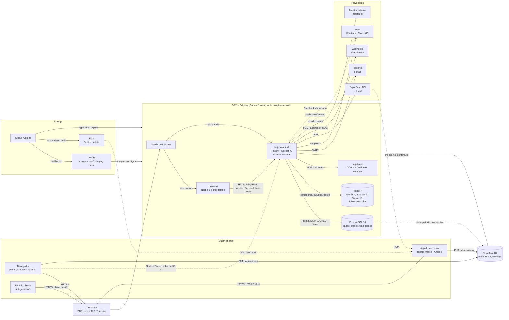
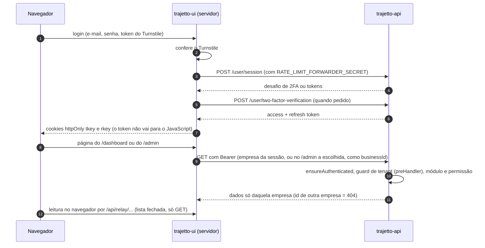
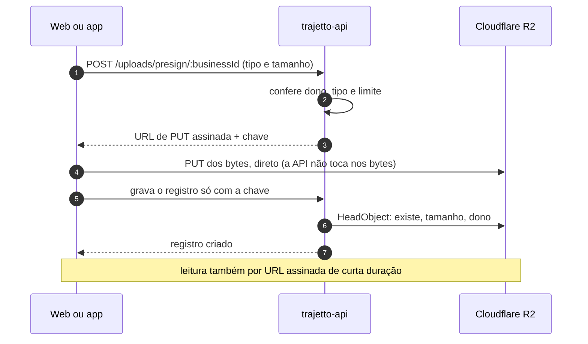
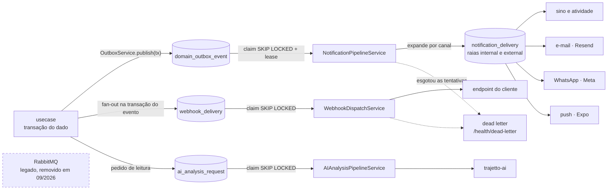
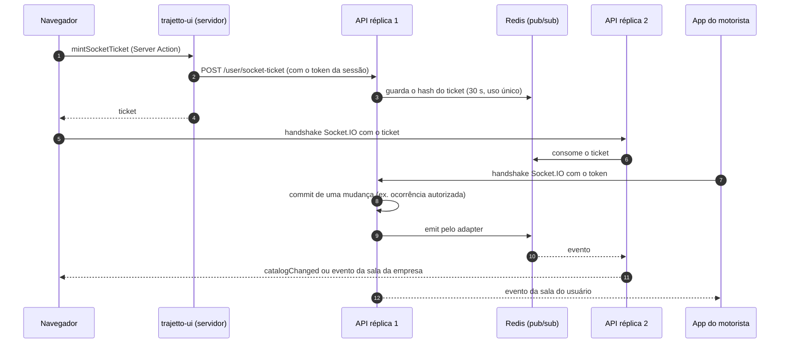
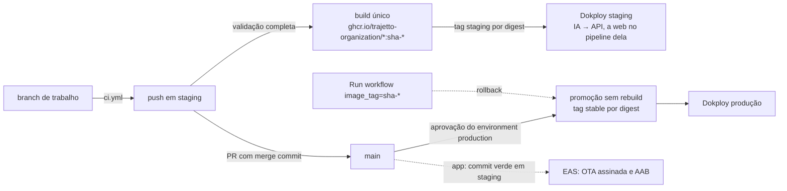

# Arquitetura da API

> Como a API do Trajetto é por dentro: o que ela atende, como o código está
> organizado, os papéis de cada processo, as regras que valem para toda rota e
> as decisões que moldaram o desenho (ADRs). O deploy e a operação estão em
> [`deploy.md`](./deploy.md); as variáveis, em
> [`variaveis-de-ambiente.md`](./variaveis-de-ambiente.md); os testes, em
> [`testes.md`](./testes.md).

## Sumário

- [O produto e os três repositórios](#o-produto-e-os-três-repositórios)
- [Visão de componentes](#visão-de-componentes)
- [Estrutura do código](#estrutura-do-código)
- [Anatomia de um módulo e como criar uma feature](#anatomia-de-um-módulo-e-como-criar-uma-feature)
- [Um processo, vários papéis](#um-processo-vários-papéis)
- [Regras transversais](#regras-transversais)
- [Papéis, permissões e módulos](#papéis-permissões-e-módulos)
- [Postgres é a fila](#postgres-é-a-fila)
- [Crons](#crons)
- [Redis e tempo real](#redis-e-tempo-real)
- [Arquivos](#arquivos)
- [IA local](#ia-local)
- [Comprovante de entrega](#comprovante-de-entrega)
- [Integrações externas](#integrações-externas)
- [Conexão com o Postgres](#conexão-com-o-postgres)
- [Migrations: expandir e contrair](#migrations-expandir-e-contrair)
- [Compatibilidade com o app do motorista](#compatibilidade-com-o-app-do-motorista)
- [Unicidade por empresa](#unicidade-por-empresa)
- [Saúde e observabilidade](#saúde-e-observabilidade)
- [Decisões (ADRs)](#decisões-adrs)

## O produto e os três repositórios

O Trajetto é uma plataforma B2B (SaaS multiempresa) para transportadoras, com
dois módulos contratados separadamente por empresa:

- **Frotas** (`FLEET`): veículos, motoristas, abastecimentos com foto do
  odômetro, checklists veiculares, ordens de serviço, peças, fornecedores,
  multas, contas a pagar, filiais e um quadro Kanban.
- **Entregas** (`DELIVERIES`): documentos de entrega (manual, planilha ou XML
  de NF-e), embarcadores, rotas, torre de controle, monitoramento, ocorrências
  com formulário e autorização da torre, pausas do motorista, comprovante em
  PDF assinado, atendimento por ticket (chat), mensagens ao cliente final e a
  API pública com webhooks.

| Repositório (GitHub)                  | O que é                                                           | Tecnologia                                                             |
| ------------------------------------- | ----------------------------------------------------------------- | ---------------------------------------------------------------------- |
| `trajetto-api` (este)                 | API HTTP, tempo real, filas, crons, IA local, backup              | Node.js 22, Fastify 5, Prisma 6, PostgreSQL 16, Redis 7, tsyringe, zod |
| `trajetto-ui` (`trajetto-ui`)         | painel web (`/dashboard`, `/admin`), site público, portal `/docs` | Next.js 14 (App Router)                                                |
| `trajetto-mobile` (`trajetto-mobile`) | app de campo do motorista, só Android                             | Expo / React Native                                                    |

A escala alvo usada nas decisões de capacidade: milhares de transportadoras
(cada uma um tenant), dezenas de milhares de motoristas e milhões de entregas
por mês.

## Visão de componentes

O mapa abaixo é navegável no GitHub, no mesmo espírito dos diagramas do README
antigo da `main` (Mermaid renderizado pelo GitHub):

- **Explorar:** o GitHub desenha o diagrama com os controles de zoom, de
  deslocamento (as setas) e de tela cheia sobre ele.
- **Clicar:** cada caixa tem um link (`click` do Mermaid) para a seção que a
  explica, neste documento ou no repositório certo. Se o seu visualizador
  ignorar o clique (fora do GitHub, ou com a interatividade do Mermaid
  desligada), use a tabela [Componentes e relações](#componentes-e-relações),
  que tem os mesmos links.
- **Expandir:** os fluxos principais (sessão, upload, filas, tempo real e
  deploy) ficam recolhidos em [Fluxos em detalhe](#fluxos-em-detalhe); abra o
  que precisar.

Cada relação foi conferida no código (o arquivo está na tabela). Linha cheia é
chamada síncrona; tracejada é assíncrona ou de volta (callback, push, backup).



### Componentes e relações

| Componente                     | O que faz                                                                                   | Relações (conferidas no código)                                                                                                                                                                                                                                                                                                                                                                                                                                                                                                                                                                            | Onde ler mais                                                                       |
| ------------------------------ | ------------------------------------------------------------------------------------------- | ---------------------------------------------------------------------------------------------------------------------------------------------------------------------------------------------------------------------------------------------------------------------------------------------------------------------------------------------------------------------------------------------------------------------------------------------------------------------------------------------------------------------------------------------------------------------------------------------------------- | ----------------------------------------------------------------------------------- |
| Navegador                      | painel (`/dashboard`, `/admin`, `/driver`), site, `/acompanhar`, `/verificar`               | nunca recebe o token: lê pelo relay `/api/relay/...` da web; abre o Socket.IO na API com um ticket de uso único (`POST /user/socket-ticket`, 30 s); envia arquivos direto ao R2 por URL pré-assinada                                                                                                                                                                                                                                                                                                                                                                                                       | `trajetto-ui/docs/arquitetura.md` (Fluxo de dados, Sessão e segurança, Tempo real)  |
| `trajetto-ui`                  | Next.js 14 (App Router), sem banco                                                          | Server Components e Server Actions chamam a API em `HTTP_REQUEST` (`src/lib/api-fetch.ts`); login, 2FA, refresh e rastreio levam `RATE_LIMIT_FORWARDER_SECRET` (`src/lib/api-forwarding.ts`); valida o Turnstile no login                                                                                                                                                                                                                                                                                                                                                                                  | `trajetto-ui/docs/arquitetura.md`                                                   |
| App do motorista               | Expo / React Native, só Android, offline no laço do motorista                               | HTTP em `EXPO_PUBLIC_API_URL` (`utils/api.ts`); Socket.IO na mesma URL com o token (`providers/socket-provider.tsx`); fotos por PUT pré-assinado com upload retomável; registra o token de push na API (`utils/push-token.ts`)                                                                                                                                                                                                                                                                                                                                                                             | `trajetto-mobile/docs/arquitetura.md`                                               |
| ERP do cliente                 | integração por chave de API                                                                 | `/integration/v1/*` com escopos e `Idempotency-Key`; recebe webhooks assinados                                                                                                                                                                                                                                                                                                                                                                                                                                                                                                                             | [Integrações externas](#integrações-externas)                                       |
| Cloudflare                     | DNS, proxy (laranja), TLS de borda, Turnstile                                               | a API só acredita no `CF-Connecting-IP` vindo das faixas da Cloudflare (`RATE_LIMIT_TRUSTED_PROXY=cloudflare`, `src/config/rate-limit.ts`); o formulário público é conferido no Turnstile (`src/shared/security/turnstile.ts`)                                                                                                                                                                                                                                                                                                                                                                             | [`deploy.md`, seção 11](./deploy.md#11-domínios-tls-e-a-borda)                      |
| Traefik do Dokploy             | roteia por host para cada Application                                                       | um roteador por domínio de Application; WebSocket sem cookie sticky                                                                                                                                                                                                                                                                                                                                                                                                                                                                                                                                        | [`infra/traefik/README.md`](../infra/traefik/README.md)                             |
| `trajetto-api`                 | HTTP (Fastify), Socket.IO, workers e crons no mesmo processo, 2 réplicas                    | ver as linhas abaixo; desligamento ordenado em `src/shared/lifecycle/shutdown.ts`                                                                                                                                                                                                                                                                                                                                                                                                                                                                                                                          | [Um processo, vários papéis](#um-processo-vários-papéis)                            |
| PostgreSQL 16                  | dados de todas as empresas, outbox e filas, leases dos crons                                | `domain_outbox_event` gravado na transação do dado (`src/shared/notifications/outbox-service.ts`); `notification_delivery`, `webhook_delivery` e `ai_analysis_request` lidas com `FOR UPDATE SKIP LOCKED` e lease pelos pipelines de `src/workers/index.ts`                                                                                                                                                                                                                                                                                                                                                | [Postgres é a fila](#postgres-é-a-fila)                                             |
| Redis 7                        | descartável, nada é fonte de verdade                                                        | rate limit do HTTP, do handshake do socket e das falhas de chave da API pública (`src/http.ts`, `src/shared/socket/handshake-rate-limit.ts`, `src/shared/integration/integration-rate-guard.ts`); intervalo de 60 s por destinatário do "esqueci minha senha" (`src/shared/security/mail-cooldown.ts`, chave = HMAC do e-mail); pub/sub do adapter (`src/shared/socket/adapter-redis.ts`); tickets de socket de 30 s (`src/shared/socket/socket-ticket.ts`); fotos curtas de leituras da plataforma só do MASTER, com falha aberta (`src/shared/cache/snapshot-cache.ts`). Nenhum dado de empresa em cache | [Redis e tempo real](#redis-e-tempo-real)                                           |
| `trajetto-ai`                  | OCR local (RapidOCR, ONNX, CPU), só transcreve                                              | a API chama `POST /v1/read` com bearer (`src/shared/ai/local/local-ocr-reader.ts`); serviço em `infra/ai-ocr/server.py`; sem domínio público                                                                                                                                                                                                                                                                                                                                                                                                                                                               | [IA local](#ia-local)                                                               |
| Cloudflare R2                  | bucket privado de fotos, assinaturas e PDFs (um por ambiente); outro bucket para os backups | a API pré-assina o PUT e o GET e confere a chave com `HeadObject` (`src/shared/services/upload-service.ts`, rotas em `/uploads`); o backup do Database PostgreSQL vai para o R2 pelo próprio Dokploy                                                                                                                                                                                                                                                                                                                                                                                                       | [Arquivos](#arquivos), [`deploy.md`, seção 18](./deploy.md#18-backup-e-restauração) |
| Resend                         | e-mail                                                                                      | SMTP `smtp.resend.com` via nodemailer (`src/shared/providers/mail-provider/implementations/resend-mail-provider.ts`); recibos em `/webhooks/resend`                                                                                                                                                                                                                                                                                                                                                                                                                                                        | [Integrações externas](#integrações-externas)                                       |
| Meta (WhatsApp Cloud API)      | mensagens por template                                                                      | `src/shared/providers/whatsapp-provider/implementations/meta-cloud-api-provider.ts`; status em `/webhooks/whatsapp`                                                                                                                                                                                                                                                                                                                                                                                                                                                                                        | [Integrações externas](#integrações-externas)                                       |
| Expo Push API → FCM            | push no Android                                                                             | a API envia para `exp.host` (`src/shared/notifications/push-provider.ts`), que repassa ao FCM com a credencial do projeto EAS; o cron `check-push-receipts` desativa aparelhos mortos                                                                                                                                                                                                                                                                                                                                                                                                                      | `trajetto-mobile/docs/arquitetura.md` (Tempo real e push)                           |
| Webhooks dos clientes          | eventos `delivery.*`, `occurrence.*`, `proof.*`, `route.*`                                  | `webhook_delivery` criada na transação do evento e entregue pelo `WebhookDispatchService` (`src/shared/integration/webhook-dispatch-service.ts`), com HMAC, retentativa e disjuntor                                                                                                                                                                                                                                                                                                                                                                                                                        | [Integrações externas](#integrações-externas)                                       |
| Monitor externo                | dead man's switch                                                                           | o cron `ops-heartbeat` avisa `HEALTHCHECK_PING_URL` a cada minuto (`src/jobs/cron/ops-heartbeat-job.ts`)                                                                                                                                                                                                                                                                                                                                                                                                                                                                                                   | [`deploy.md`, seção 20](./deploy.md#20-alertas-e-monitoramento)                     |
| GitHub Actions, GHCR e Dokploy | uma imagem por serviço, promovida por digest                                                | `deploy.yml` constrói `sha-<sha>`, move `staging` e depois `stable` e chama `application.deploy` (`.github/scripts/dokploy-deploy.mjs`); cada serviço é uma Application (provider Docker) ou um Database do Dokploy, nunca Compose                                                                                                                                                                                                                                                                                                                                                                         | [`deploy.md`](./deploy.md)                                                          |
| EAS                            | build e OTA do app                                                                          | o `deploy.yml` do app publica OTA e, se o lado nativo mudou, APK/AAB; promove o commit, não o artefato                                                                                                                                                                                                                                                                                                                                                                                                                                                                                                     | `trajetto-mobile/docs/deploy.md`                                                    |
| ~~RabbitMQ~~                   | **legado, removido em 09/2026**                                                             | servia só o e-mail; hoje o e-mail sai pelo pipeline de notificações (e o transacional com segredo, como 2FA e senha, por `src/shared/services/transactional-mail-service.ts`). A imagem antiga da `main` ainda exige `RABBITMQ_URL`                                                                                                                                                                                                                                                                                                                                                                        | [Postgres é a fila](#postgres-é-a-fila)                                             |

### Fluxos em detalhe

<details>
<summary><strong>Sessão no painel web e tenant</strong></summary>



O MASTER não tem empresa: no `/admin` (e no app, na tela `select-business`)
ele escolhe uma, e a API confere que só o MASTER pode pedir outra empresa
(`src/modules/middlewares/tenant-authorization.ts`). Trocar o papel ou a
empresa de um usuário encerra as sessões dele.

</details>

<details>
<summary><strong>Upload por URL pré-assinada</strong></summary>



O app re-encoda a foto antes do PUT (tira EXIF e GPS) e guarda a chave de
cada foto que subiu, para o upload recomeçar de onde parou. Em
desenvolvimento, `UPLOAD_STORAGE_TYPE=local` grava em `./tmp`; produção
recusa `local`.

</details>

<details>
<summary><strong>Outbox, filas e efeitos externos</strong></summary>



O evento só existe se o dado foi gravado (ADR 0003). Retentativa com backoff,
dead letter com reenvio e idempotência dos efeitos externos (ADRs 0005 e
0006). Os crons usam um lease no Postgres por horário, então várias réplicas
não repetem um job.

</details>

<details>
<summary><strong>Tempo real entre réplicas</strong></summary>



A entrega é _at-most-once_ (ADR 0007): a verdade está no banco, e as telas
refazem a consulta ao reconectar. Sem Redis, o tempo real entre réplicas
degrada e o resto da API continua.

</details>

<details>
<summary><strong>Do commit à produção</strong></summary>



Ordem de cada release: API → web → app. Detalhes em
[`deploy.md`](./deploy.md) e na seção "Os três repositórios juntos", igual nos
três repositórios.

</details>

Fora do mapa, por serem opcionais: o provedor de tiles e o de geocodificação
reversa do comprovante (`PROOF_MAP_TILE_URL`, `REVERSE_GEOCODER_URL`). Em
staging e produção cada caixa do grupo "VPS · Dokploy" é um serviço próprio
do Dokploy: a API, a IA e a web como Applications que puxam a imagem do GHCR;
o PostgreSQL e o Redis como Databases do Dokploy. A topologia (nomes,
réplicas, limites) está em [`deploy.md`](./deploy.md#4-a-topologia-no-servidor).

## Estrutura do código

```
src/
  server.ts            boot: HTTP + Socket.IO + workers; desligamento ordenado
  http.ts              a instância Fastify: plugins (helmet, cors, compress, rate limit, swagger), hooks, erros, rotas
  websocket.ts         Socket.IO com o adapter Redis, salas, emissores (sendCatalogChangedEvent…)
  env/index.ts         carrega o .env (dotenv + expand) e valida com o env-schema
  config/              auth, CORS, rate limit e borda confiável, upload, permissões, opções do Redis, servidor HTTP
  routes/              um arquivo de rotas por área (`*-routes.ts`), registrado em routes.ts com o prefixo;
                       documentation/ guarda os schemas de resposta do OpenAPI
  schemas/             schemas zod de entrada (um diretório por schema) e o env-schema
  modules/<domínio>/   dtos/, repositories/ (interface, Prisma, in-memory), usecases/<caso>/ (controller + usecase), errors
  modules/middlewares/ ensure-authenticated, verify-permission, verify-tenant-active, verify-module-enabled…
  shared/              o que atravessa domínios: ai, delivery, route, notifications, integration, health,
                       http (idempotência, versão do cliente, multipart legado), pagination, security, time,
                       lifecycle (startup/shutdown/draining), logging, providers (mail, whatsapp), services
                       (PDF, assinatura, cron), in-memory (gêmeos), errors (AppError, indisponibilidade do banco)
                       e index.ts (registro dos repositórios e serviços no container do tsyringe)
  jobs/cron/           os crons e o registro deles (index.ts)
  workers/index.ts     inicia e para os pipelines e o dispatcher
infra/
  database.ts          o PrismaClient compartilhado
  cache/               conexão Redis
  scripts/             entrypoint da imagem, migrations como job, conferência do rollout, backup/restore manuais,
                       seeds, guard de bootstrap, cobertura E2E
  ai-ocr/              o serviço de IA (Python): server.py, Dockerfile, requisitos com hash, modelos, pytest
  traefik/             referência da configuração estática do Traefik do Dokploy
prisma/
  schema.prisma        o modelo de dados (multiempresa: quase todo modelo tem businessId)
  migrations/          migrations SQL (131 até 07/10/2026), sempre expandir/contrair
  backfills/           SQL de backfill avulso
  vitest-environment-prisma/   o ambiente de teste que cria um banco por arquivo E2E
tests/                 unitaires/, E2E/, contract/, ai-local/, load/, support/ (ver testes.md)
```

Aliases de import (`tsconfig.json`): `@/*` → `src/*` e `infra/*` → `infra/*`.
O build é `tsup` (`tsup.config.ts`), que gera `build/` com o servidor, os
seeds e os scripts do entrypoint.

## Anatomia de um módulo e como criar uma feature

Exemplo real: `src/modules/shipper/`.

```
modules/shipper/
  dtos/shipper-dto.ts                                tipos de entrada/saída
  repositories/IShipper-repository.ts                a interface
  repositories/shipper-repository.ts                 a implementação Prisma
  repositories/in-memory/in-memory-shipper-repository.ts   o gêmeo em memória (mesma semântica)
  usecases/create-shipper/create-shipper-controller.ts     lê params/body com zod, resolve o usecase no container
  usecases/create-shipper/create-shipper-usecase.ts        @injectable(), recebe repositórios por @inject("Nome")
  usecases/errors/shipper-errors.ts                  erros com `code` e mensagem em pt-BR
routes/shipper-routes.ts                             as rotas, com guards e schema OpenAPI
routes/documentation/shipper-documentation.ts        schemas de resposta documentados
schemas/create-shipper-schema/                       o schema zod de entrada
shared/index.ts                                      container.registerSingleton("ShipperRepository", ShipperRepository)
```

Passo a passo para uma feature de ponta a ponta:

1. **Modelo**: altere `prisma/schema.prisma`, gere a migration com
   `yarn prisma:migrate:dev` (só cria, `--create-only`), revise o SQL contra as
   [regras de migration](#migrations-expandir-e-contrair) e aplique com
   `yarn prisma:migrate:deploy`. Todo modelo de tenant leva `businessId` e
   uniques compostos com ele.
2. **Repositório**: método na interface, na implementação Prisma **e** no gêmeo
   in-memory, com a mesma semântica (filtros, ordem, nulos, unicidade,
   empresa). Se o modelo tem teste de contrato (`tests/contract/repositories`),
   acrescente o caso lá: ele roda contra os dois.
3. **Schema de entrada** em `src/schemas/<nome>-schema/` (zod; mensagens em
   pt-BR).
4. **Usecase** `@injectable()` com as regras de negócio; **controller** que só
   faz parse e chama o usecase; **erros** com `code`.
5. **Rota** em `src/routes/<área>-routes.ts`: `onRequest: [ensureAuthenticated]`;
   `preHandler` com `verifyBusinessActive`, `verifyModuleEnabled(...)` quando o
   módulo é contratado, `verifyPermission("<chave>", "read"|"write")`; o guard
   de tenant roda em `preHandler` porque só ali o corpo já foi lido. Declare o
   `schema` completo (`tags`, `summary`, `description` em pt-BR, `params`,
   `body`, `response` com 400/401/403/404/409/429 conforme o caso): o OpenAPI é
   a documentação.
6. **Registro** do repositório no container (`src/shared/index.ts`) e da rota
   em `src/routes/routes.ts` se for um arquivo novo.
7. **Tempo real**: depois do commit, emita o evento (ex.
   `sendCatalogChangedEvent`) — nunca dentro da transação.
8. **Testes** primeiro (vermelho → verde): unitário do usecase com os gêmeos
   in-memory; E2E HTTP contra o Postgres real quando a regra depende de SQL,
   de autorização ou de tenant. Ver [`testes.md`](./testes.md).
9. **Contratos com os clientes**: se a web ou o app chamam a rota, o teste
   `tests/unitaires/contract/client-routes.test.ts` confere as URLs; rotas
   removidas entram em `src/routes/retired-routes.ts`.

## Um processo, vários papéis

Cada réplica sobe, no mesmo processo Node (`src/server.ts`):

1. o HTTP (Fastify, `src/http.ts`), porta `PORT` (3333);
2. o Socket.IO com o adapter Redis (`src/websocket.ts`);
3. os workers (`src/workers/index.ts`), quando `WORKERS_ENABLED=true`:
   - `NotificationPipelineService`: entrega notificações por canal (sino,
     atividade, push via Expo, e-mail via Resend, WhatsApp via Meta), em duas
     raias (`internal` e `external`), para um provedor lento não segurar o
     sino;
   - `AIAnalysisPipelineService`: leituras de odômetro e canhoto no serviço
     `trajetto-ai`;
   - `WebhookDispatchService`: entrega os webhooks dos clientes, assinados,
     com retentativa e disjuntor por endpoint;
   - o agendador de crons;
4. o `apiUsageRecorder` (contadores de uso da API pública), em toda réplica.

O boot (`infra/scripts/docker-entrypoint.sh`, sob `dumb-init`) espera o
Postgres, recusa banco vazio em produção (`database-bootstrap-guard.ts`),
migra e semeia se `RUN_MIGRATIONS_ON_BOOT=true`, e faz `exec` do servidor —
o Node é filho direto do `dumb-init`, então o SIGTERM do deploy chega a ele.

O desligamento é ordenado (`src/shared/lifecycle/shutdown.ts`): a readiness
passa a 503, a réplica espera 12 s para sair do balanceamento do serviço,
fecha o tempo real, o HTTP, os workers e o Redis, com teto de 35 s (abaixo dos
40 s do _Stop Grace Period_ da Application no Dokploy).

Separar workers do HTTP é possível com a mesma imagem (`WORKERS_ENABLED=false`
nas réplicas HTTP e uma Application `worker`), só por gatilho medido:
[`deploy.md`](./deploy.md#19-réplicas-workers-e-tempo-real).

## Regras transversais

- **Multiempresa.** Toda leitura e escrita é filtrada pela empresa da sessão
  (ou pela empresa escolhida pelo MASTER no `/admin`). Um id de outra empresa
  recebe o mesmo 404 de um id inexistente, para não revelar o que existe.
  Campos de empresa no corpo que não podem mudar são recusados (não ignorados
  em silêncio). O guard de tenant roda em `preHandler`, porque no `onRequest`
  o Fastify ainda não leu o corpo — não mova de volta.
- **Dia de negócio.** `Business.timezone` (padrão `America/Sao_Paulo`) define
  o "hoje" de cada empresa. Todo "hoje", "últimos N dias" e agrupamento diário
  passa por `src/shared/time/business-day.ts` (um teste varre `src/` atrás de
  conta de dia feita com o relógio do servidor). Datas sem hora
  (`Delivery.scheduled_date`, `Route.scheduled_date`, `Driver.cnh_expires_at`)
  são `@db.Date`: entram como `YYYY-MM-DD` e ficam à meia-noite UTC. O
  contêiner roda em UTC e **não** deve receber `TZ`.
- **Erros com código.** Todo erro tem `code` e mensagem em pt-BR. Permissão
  negada é `403 PERMISSION_DENIED`, módulo não contratado é
  `MODULE_NOT_ENABLED`, empresa inativa é `TENANT_INACTIVE`. Banco
  indisponível vira 503 com `Retry-After`.
- **Idempotência.** Escritas do aplicativo e da API pública aceitam
  `Idempotency-Key` ou `client_submission_id`: reenviar não duplica, e o
  reenvio de um registro que já existe é respondido com ele.
- **Listagens.** As tabelas do painel usam paginação por página (offset) com
  resposta NDJSON: linhas e uma linha final `meta` com `total`, `page`,
  `pageSize` e `searchMeta` (cartões e filtros contados no servidor). Os
  seletores com busca usam cursor.
- **Logs.** JSON (pino), uma linha por requisição com `reqId`, `userId`,
  `businessId` e o cabeçalho de versão do cliente; credenciais censuradas por
  nome.

## Papéis, permissões e módulos

| Papel                     | Quem é                          | O que pode                                                                                                         |
| ------------------------- | ------------------------------- | ------------------------------------------------------------------------------------------------------------------ |
| `MASTER`                  | equipe Trajetto                 | todas as empresas, pelo `/admin` da web; cria empresas, usuários master, limites e módulos                         |
| `BUSINESS_ADMIN`          | administrador da transportadora | tudo da própria empresa                                                                                            |
| `BUSINESS_USER`           | funcionário                     | o que o perfil de acesso libera, chave a chave, em leitura ou escrita                                              |
| `BUSINESS_USER` motorista | usuário vinculado a um `Driver` | só o que é dele: entregas, rotas, veículos que dirige, contas a pagar em que é responsável e as próprias conversas |

- Chaves de permissão em `src/config/permissions.ts` (ex. `vehicle_manage`,
  `delivery_manage`, `occurrence_manage`, `integration_manage`); middleware
  `src/modules/middlewares/verify-permission.ts`, com a tabela fixa do
  motorista (`DRIVER_PERMISSIONS`).
- Módulos contratados em `BusinessEntitlement` (`FLEET`, `DELIVERIES`),
  cobrados por `verify-module-enabled.ts`, inclusive para o MASTER. A IA não é
  um módulo: é o limite mensal `Business.ai_analysis_limit` (0 desliga; teto de
  10.000 fotos por mês).
- Trocar o papel ou a empresa de um usuário encerra as sessões dele
  (`session_version` + refresh tokens revogados) e apaga as notificações
  pessoais; as atividades (auditoria) ficam.

| Área         | Módulos (`src/modules/`)                                                                                                                                                      | Prefixo HTTP                                                                                                        |
| ------------ | ----------------------------------------------------------------------------------------------------------------------------------------------------------------------------- | ------------------------------------------------------------------------------------------------------------------- |
| Acesso       | `user`, `business`, `branch`, `profile-access`, `permission`, `notification`, `activity`                                                                                      | `/user`, `/business`, `/branch`, `/profile-access`, `/permission`, `/notification`, `/activity`                     |
| Frotas       | `vehicle`, `vehicle-type`, `driver`, `fuel`, `fuel-type`, `vehicle-checklist`, `service-order`, `service-order-part`, `part`, `supplier`, `fine`, `account-payable`, `kanban` | `/vehicle`, `/driver`, `/fuel`, `/vehicle-checklist`, `/service-order`, `/fines`, `/account-payable`, `/kanban` …   |
| Entregas     | `delivery`, `route`, `shipper`, `occurrence-type`, `status-change-reason`, `import`, `driver-pause`, `chat`                                                                   | `/delivery`, `/route`, `/shipper`, `/occurrence-type`, `/status-change-reason`, `/import`, `/driver-pause`, `/chat` |
| IA           | `ai-analysis`                                                                                                                                                                 | `/ai-analysis`                                                                                                      |
| Integração   | `integration`                                                                                                                                                                 | `/integration/v1` (API pública, chave de API), `/integrations` (gestão no painel)                                   |
| Painéis      | `dashboard`                                                                                                                                                                   | `/dashboard`                                                                                                        |
| Site público | `quote`                                                                                                                                                                       | `/quote`, `/public`                                                                                                 |
| Provedores   | `whatsapp`                                                                                                                                                                    | `/webhooks` (callbacks da Meta e do Resend)                                                                         |
| Arquivos     | `upload`                                                                                                                                                                      | `/uploads` (URLs pré-assinadas)                                                                                     |

## Postgres é a fila

Não há broker (o RabbitMQ saiu em 09/2026). As filas são tabelas
(`domain_outbox_event`, `notification_delivery`, `webhook_delivery`,
`ai_analysis_request`) lidas com `FOR UPDATE SKIP LOCKED` e lease. O evento
nasce na mesma transação do dado (outbox transacional, ADR 0003), então nada é
anunciado sem ter sido gravado. Retentativa com backoff e dead letter
(`/health/dead-letter`, com replay) seguem a política do ADR 0005; efeitos
externos levam chave de idempotência (ADR 0006). Os gatilhos para um dia
adotar broker estão no ADR 0001 (só por medição).

## Crons

Registrados em `src/jobs/cron/index.ts`. Horário em UTC (o contêiner não tem
`TZ`). Um lease no Postgres (linha única `(jobName, scheduledFor)`) garante uma
execução por horário com várias réplicas, e um catch-up refaz jobs diários
perdidos.

| Job                                  | Quando (UTC)  | O que faz                                                                                                       |
| ------------------------------------ | ------------- | --------------------------------------------------------------------------------------------------------------- |
| `ops-heartbeat`                      | a cada minuto | avalia as regras de operação e avisa o monitor externo (`HEALTHCHECK_PING_URL`)                                 |
| `escalate-occurrence-authorizations` | a cada minuto | pedido de autorização sem resposta da torre em 10 min vai aos administradores, uma vez                          |
| `repair-unticketed-messages`         | a cada minuto | arquiva em ticket a mensagem gravada sem ticket por uma imagem antiga                                           |
| `close-abandoned-imports`            | a cada 5 min  | fecha importação que ficou `IN_PROGRESS` num processo que morreu                                                |
| `reconcile-proof-analysis`           | a cada 10 min | pede de novo a leitura de IA de um comprovante cujo pedido se perdeu                                            |
| `check-push-receipts`                | a cada 15 min | lê os recibos da Expo e desativa aparelhos mortos                                                               |
| `cleanup-expired-refresh-tokens`     | 03:17         | remove refresh tokens vencidos                                                                                  |
| `cleanup-notification-pipeline`      | 03:30         | limpa entregas de notificação antigas                                                                           |
| `cleanup-ai-pipeline`                | 03:45         | limpa pedidos de IA antigos                                                                                     |
| `cleanup-user-history`               | 04:00         | limpa histórico antigo do usuário (a trilha de auditoria só com `ACTIVITY_RETENTION_DAYS`, nunca abaixo de 365) |
| `driver-position-partitions`         | 04:10         | cria e remove partições diárias de `driver_position` (90 dias)                                                  |
| `cleanup-webhook-deliveries`         | 04:20         | remove entregas de webhook resolvidas fora da janela de reenvio                                                 |
| `cleanup-orphan-uploads`             | 04:50         | conta (ou remove, com `UPLOAD_ORPHAN_GC=delete`) objetos do bucket sem linha                                    |

O backup diário do Dokploy (03:00 UTC, aba _Backups_ do Database) roda antes do
primeiro job que apaga dados.

## Redis e tempo real

**Redis** (ADR 0002) tem três usos, e nenhum é fonte de verdade:

- contadores de rate limit (HTTP, handshake do socket e falhas de chave da
  API pública), que falham aberto;
- o intervalo por destinatário do "esqueci minha senha"
  (`src/shared/security/mail-cooldown.ts`): no máximo um e-mail por endereço
  a cada 60 s, venha o pedido de onde vier (`SET NX EX`). A chave é um HMAC
  do e-mail normalizado, nunca o endereço; o pedido repetido recebe a mesma
  resposta e não envia. Sem Redis, o e-mail sai (falha aberta);
- pub/sub do adapter do Socket.IO, para o evento emitido numa réplica chegar
  ao cliente conectado em outra;
- os tickets de socket da web (`src/shared/socket/socket-ticket.ts`): o
  servidor da web troca o token da sessão por um ticket de uso único, que
  vale 30 s e abre um socket só; o Redis guarda só o hash. Sem Redis, a web
  não abre socket novo, e o resto funciona.
- as fotos curtas de leituras **da plataforma** que só o MASTER vê
  (`src/shared/cache/snapshot-cache.ts`): a prontidão dos provedores (30 s) e
  os números do dashboard global do MASTER (60 s). A réplica que recebe o
  próximo pedido serve a foto em vez de chamar a Meta ou contar a plataforma
  de novo. Nunca dado de empresa nem de pessoa (o feed de atividades do
  dashboard é lido a cada visita); leitura e escrita com prazo de 200 ms e
  falha aberta: sem Redis, cada réplica calcula a sua. Uma leitura por vez em
  cada réplica (single-flight).

Não há sessão, lock nem fila no Redis, e cache só o descrito acima. Se ele
cair, o tempo real entre réplicas degrada e o resto funciona. Em produção ele
não persiste nada.

**Tempo real** (ADR 0007): Socket.IO só com WebSocket, salas por usuário,
sessão, empresa (`business:<id>`) e operação (`operations:<id>`). A
autorização é relida do banco a cada inscrição e revalidada periodicamente
(`SOCKET_REVALIDATE_MS`, 3 min com jitter). A entrega é _at-most-once_: a
verdade está no banco e as telas refazem a consulta ao reconectar. Mudanças de
catálogo emitem `catalogChanged` `{ businessId, entity }` depois do commit, e
a web invalida a lista daquela entidade. `SOCKET_ADAPTER_KEY` separa os canais
de dois ambientes que dividam um Redis (Pub/Sub ignora o número do banco).

**Escala horizontal** (ADR 0008): N réplicas idênticas atrás do Traefik, sem
cookie sticky; o estado está no Postgres; os crons e as filas não duplicam
trabalho; o adapter Redis leva os eventos. Provado em
`tests/E2E/multi-replica-events.test.ts` e no harness de carga
(`tests/load/`).

## Arquivos

Fotos, assinaturas e PDFs vão para um bucket R2 **privado**. O cliente pede
uma URL pré-assinada (`/uploads`), envia o arquivo direto ao bucket e manda só
a chave para a API, que confere dono, tamanho e existência. A leitura também é
por URL assinada de curta duração (`UPLOAD_SIGNED_URL_TTL_SECONDS`). Em
desenvolvimento, `UPLOAD_STORAGE_TYPE=local` grava em `./tmp`; produção recusa
`local`. Um coletor noturno conta (ou apaga) objetos de 30 a 33 dias que
nenhuma linha referencia; na dúvida, guarda (ADR 0006).

Existe um adaptador multipart temporário para abastecimento e checklist (o
binário antigo do app); ver [compatibilidade](#compatibilidade-com-o-app-do-motorista).

**Importação de planilha** (`POST /import/import-spreadsheet/:businessId`) é
assíncrona: o pedido valida embarcador e arquivo (tamanho inflado, células e
linhas contados no zip antes de carregar o .xlsx; `413` acima disso), abre a
importação e responde `202` com o id; as linhas são processadas depois, numa
fila por réplica (`src/modules/import/services/import-queue.ts`) que roda uma
importação por vez e deixa até três esperando (`429 IMPORT_BUSY` com
`retry-after` além disso). O cliente acompanha por
`GET /import/get-import/:importId/business/:businessId` até `status` sair de
`IN_PROGRESS`. Nada da fila sobrevive ao processo: a importação que morre
junto com a réplica fica sem batimento e o cron `close-abandoned-imports` a
fecha com o que ela fez; as que esperam na fila mantêm o batimento. Uma
planilha de 20 mil linhas levava mais que os 100 s da borda, e o operador via
erro enquanto as entregas continuavam sendo criadas. A listagem
(`list-imports`) traz só os contadores; o relatório linha a linha vem do
detalhe (ou de `includeReport=true`).

**Estorno de importação** (`POST /import/reverse-import/:importId/business/:businessId`)
roda em lotes de 500 entregas, cada lote numa transação
(`src/modules/import/services/import-reversal.ts`): numa transação só, desfazer
2.000 entregas levava 29 s e estourava os 15 s do Prisma. As rotas são decididas
uma vez, antes das entregas, contra todas as entregas da importação; cada lote
remove, anuncia `delivery.cancelled` e grava o andamento em `import.reversal`
juntos. A importação continua `COMPLETED` até o último lote, que a vira
`REVERSED`. Uma execução por vez: o lease `import.reversal_started_at`, tomado
por `UPDATE` condicional e conferido no começo de cada lote, com o batimento em
`updated_at`; sem batimento por 5 min, a execução é dada como morta e o próximo
pedido continua de onde ela parou. Com até 500 entregas a desfazer, o estorno
roda no pedido e responde `200` com o resultado; acima disso vai para a mesma
fila das importações e responde `202`, e o cliente acompanha `reversal` no
detalhe da importação (`RUNNING`, `INTERRUPTED`, `DONE`).

**Exportações** (CSV e Excel, `src/shared/services/export/`) passam por
`ExportPipeline`, que reserva uma vaga antes do primeiro byte: uma exportação
por empresa e três por réplica ao mesmo tempo (`429 EXPORT_BUSY` com
`retry-after`). As linhas saem do banco em lotes por chave (`created_at`,
`id`); o Excel grava texto em linha (sem a tabela de strings compartilhadas,
que estourava a memória em 250 mil linhas); o cliente que desconecta encerra
a exportação; e uma falha depois que o download começou fecha a conexão em vez
de deixar o navegador esperando.

## IA local

A leitura automática do canhoto (número da NF e data de recebimento) e do
odômetro roda no serviço próprio `trajetto-ai` (`infra/ai-ocr`): RapidOCR
sobre ONNX Runtime, em CPU, sem provedor externo (ADR 0010, decisão 14.1 — o
provedor Anthropic foi removido e `AI_PROVIDER=anthropic` impede o boot).

- O serviço **só transcreve**: `POST /v1/read` com a foto e o perfil, bearer
  `AI_TOKEN`. Quem decide o que a foto diz é a API
  (`src/shared/ai/local/ocr-readings.ts` e `ai-rules.ts`).
- Fila do lado da API: `ai_analysis_request` no Postgres, lease de 300 s (o
  `AI_LOCAL_TIMEOUT_MS` mais a busca da foto precisam caber nele, ou o boot
  para). `AI_LOCAL_MAX_CONCURRENCY` leituras em voo por réplica.
- O serviço lê uma foto por vez, com fila curta (`AI_MAX_QUEUE`); cheio,
  responde 503 `busy` e o pedido volta à fila em 5–15 s sem gastar tentativa
  nem abrir o disjuntor `provider_down`.
- Assinatura, fraude por foto de tela, nível de combustível e pneus seguem para
  conferência humana e **não consomem cota**. Uma foto lida é uma unidade da
  cota, contada uma vez. O app faz uma pré-checagem no aparelho, que é só
  sugestão e nunca consome cota.
- Modelos embutidos na imagem e conferidos por SHA-256 (`models.sha256`);
  dependências Python com `--require-hashes`. Benchmark em
  `scripts/ai-benchmark/` (p95 de 3,1 s por foto a 2 CPU / 1 GiB).

## Comprovante de entrega

`src/shared/services/proof-pdf-service.ts` gera o PDF no modelo validado
(documento, dados da entrega, protocolo com GPS e mapa, entregador, comprovante
digitalizado com tarja, autenticação com QR). Com o certificado A1 ICP-Brasil
configurado (`PROOF_SIGNING_*`, decisão 14.8), o PDF sai com assinatura PAdES
(perfil AD-RB) verificável no validar.iti.gov.br; sem certificado, sai sem
assinatura e diz isso no próprio documento.

**Cadeia ICP-Brasil (reunião de 14/10/2026).** O texto de validade jurídica
(MP 2.200-2, "Assina-se com Certificado Digital ICP-Brasil", QR do ITI) só sai
quando a cadeia do certificado é verificada por assinaturas até uma raiz
oficial (`src/shared/services/proof-signing/icp-brasil-chain.ts`), usando os
intermediários que vêm no `.pfx`; o nome do emissor (`O=ICP-Brasil`) não basta
mais. Certificado fora da cadeia continua assinando (CMS simples, sem a
política AD-RB), o PDF diz que não pertence à cadeia, o log avisa uma vez
(`proof_signing_not_icp_brasil`) e o documento grava `cert_icp_brasil = false`
(a web e o `/verificar` só dizem "ICP-Brasil" com `true`). As raízes estão em
`assets/icp-brasil/ICP-Brasilv{5,10,11}.crt` (PEM, baixadas do repositório do ITI em 28/10/2026, embutidas
em `icp-brasil-roots.ts`; o teste `icp-brasil-chain.test.ts` confere arquivo e
impressão digital SHA-256 do DER):

| Raiz                   | Uso no ITI                 | Válida até | SHA-256                                                                                           |
| ---------------------- | -------------------------- | ---------- | ------------------------------------------------------------------------------------------------- |
| AC Raiz Brasileira v5  | assinatura (e-CPF, e-CNPJ) | 02/03/2029 | `CA:A5:3F:C6:09:1C:69:51:88:7C:97:6E:37:8F:6E:F8:9A:A6:37:7C:55:D9:7B:64:75:42:2B:71:ED:7E:9B:17` |
| AC Raiz Brasileira v10 | SSL/TLS                    | 01/07/2032 | `6E:0B:FF:06:9A:26:99:4C:15:DE:2C:48:88:CC:54:AF:84:88:2E:54:95:B7:FB:F6:6B:E9:CC:FF:EC:74:89:F6` |
| AC Raiz Brasileira v11 | assinatura de código       | 01/07/2032 | `14:06:71:00:58:18:0F:A4:08:1A:AB:3F:24:6F:17:02:42:9C:55:2A:11:FA:31:43:B8:4C:88:CB:3A:B8:E5:E7` |

Não verificados de propósito: revogação (LCR), OIDs de política e restrições
de nome/caminho — o validador do ITI confere tudo isso no arquivo. **Falta o
carimbo do tempo RFC 3161 (perfil AD-RT)**: exige uma ACT credenciada na
ICP-Brasil (serviço pago); até lá a hora da assinatura é a declarada pelo
servidor, que é o que o AD-RB é. O título do PDF segue o tipo do registro:
`SERVICE_ORDER` sai como "Comprovante de Ordem de Serviço". O link público
`/verificar/<token>` da web confere o documento (ADR 0009): o token é uma
capacidade sem login e expira em `PROOF_VERIFICATION_TTL_DAYS` (1825 dias).
Mapa estático (`PROOF_MAP_TILE_URL`) e geocodificação reversa
(`REVERSE_GEOCODER_URL`) são opcionais; em produção os servidores públicos do
OpenStreetMap são recusados.

## Integrações externas

- **API pública** `/integration/v1/*`, autenticada por chave de API com
  escopos (ex. `deliveries:write`). `POST /integration/v1/deliveries` exige
  `Idempotency-Key` e aplica as mesmas regras do cadastro manual. Documentação
  para clientes em `/integration/docs` (Scalar, só o que uma chave alcança) e
  no portal `/docs` da web. A referência interna completa fica em `/docs`
  (aberta fora de produção; em produção, só com `DOCS_USER`/`DOCS_PASSWORD`).
- **Webhooks**: até 10 endpoints por empresa, só `https`, assinados com
  `X-Trajetto-Signature: t=<timestamp>,v1=<hex>` (HMAC SHA-256 sobre
  `timestamp.corpo`). Tópicos `delivery.*`, `occurrence.*`, `proof.*` e
  `route.*` (catálogo em `src/shared/integration/webhook-catalogue.ts`). Os
  segredos ficam cifrados em repouso com `WEBHOOK_SECRETS_KEY` (AES-256-GCM;
  `yarn webhooks:seal` cifra os já gravados).
- **WhatsApp (Meta Cloud API)**: toda notificação usa um template de
  utilidade em `pt_BR` com uma única variável (`META_WHATSAPP_TEMPLATE_NAME`);
  mensagens de uma transportadora ao cliente final usam um template separado
  (`META_WHATSAPP_CUSTOMER_TEMPLATE_NAME`), para uma denúncia de spam pausar só
  ele. Template pausado (132015) adia os envios de hora em hora por até ~8 h.
  Callbacks de status em `/webhooks/whatsapp` com `META_WHATSAPP_APP_SECRET` e
  `META_WHATSAPP_WEBHOOK_VERIFY_TOKEN`.
- **E-mail (Resend)**: `DELIVERED` quer dizer aceito pelo provedor; o que
  acontece depois chega por `/webhooks/resend` (assinado com
  `RESEND_WEBHOOK_SECRET`) e fica em `notification_provider_receipt`.
- **Push**: pela Expo, para o app Android; o cron `check-push-receipts`
  desativa aparelhos mortos.
- **Turnstile**: o formulário público de orçamento é verificado pela própria
  API; com `TURNSTILE_SECRET_KEY` definida, pedido sem token é recusado.

## Conexão com o Postgres

A `DATABASE_URL` da Application `trajetto-api` em staging e produção (só o
servidor; migrations e seeds usam `MIGRATION_DATABASE_URL`; a URL inteira, para
copiar, está em [`variaveis-de-ambiente.md`](./variaveis-de-ambiente.md#2-banco-de-dados)):

| Parâmetro                      | Valor                                                                                 | Por quê                                                                                                                                                                                                                         |
| ------------------------------ | ------------------------------------------------------------------------------------- | ------------------------------------------------------------------------------------------------------------------------------------------------------------------------------------------------------------------------------- |
| `connection_limit`             | 10                                                                                    | pool por réplica; orçamento: réplicas × (10 + 1 da readiness) + migrations (2) + ferramentas < `max_connections`                                                                                                                |
| `pool_timeout`                 | 20 s                                                                                  | espera por uma conexão livre antes de P2024                                                                                                                                                                                     |
| `connect_timeout`              | 5 s                                                                                   | explícito (padrão do Prisma)                                                                                                                                                                                                    |
| `socket_timeout`               | 60 s                                                                                  | uma query sem resposta falha (P1008 → 503 + Retry-After; P2010 sem SQLSTATE também vira 503 pelo classificador `src/shared/errors/database-unavailable.ts`); acima do `statement_timeout` para um servidor vivo responder antes |
| `max_idle_connection_lifetime` | 300 s                                                                                 | conexão ociosa há 5 min é trocada no próximo uso; o IPVS do Swarm esquece um fluxo ocioso aos 900 s, e escrever num fluxo esquecido trava sem erro                                                                              |
| `options`                      | `statement_timeout=30s`, `lock_timeout=5s`, `idle_in_transaction_session_timeout=60s` | tetos do lado do servidor                                                                                                                                                                                                       |

Provas: `tests/E2E/runtime-database-dead-peer.test.ts` (um proxy "esquece"
os fluxos sem FIN nem RST), `tests/E2E/runtime-database-timeouts.test.ts` e
`tests/unitaires/lifecycle/database-dead-connection-params.test.ts`.

**A readiness tem conexão própria**: `/health/readiness` faz `SELECT 1` num
`PrismaClient` separado (`connection_limit=1`, timeouts de 2–3 s) e responde
em até 3 s, abaixo do timeout de 5 s dos monitores. Um pool principal cheio
não faz a réplica parecer fora do ar; depois de um "não", a probe fecha a conexão
(`$disconnect()`) e a próxima abre outra no mesmo client (um client novo por
"não" retinha ~2,3 MB de memória nativa cada).

**Conexão fechada pelo Postgres troca o pool inteiro**: no Prisma 6.1 uma
conexão do pool só é marcada como quebrada quando falha um statement que ela
já tinha preparado. Preparar um statement novo numa conexão cujo backend
morreu (restart, failover, `pg_terminate_backend`) falha com P1017 e devolve a
conexão ao pool como saudável — e ela voltava a ser entregue para sempre, com
503 em toda requisição até reiniciar a réplica (falha do CI em
`tests/E2E/database-reconnect.test.ts`, `503 × 25`). O client de
`infra/database.ts` passa por `withPoolReset`
(`src/shared/resilience/database-pool-reset.ts`): o primeiro P1017 faz um
`$disconnect()` (uma vez por rajada) e a query seguinte abre conexões novas.
Custo: uma transação interativa aberta numa conexão saudável da mesma réplica
naquele instante se perde.

**Limite conhecido**: no Prisma 6.1, `socket_timeout` limita a execução de um
statement já preparado; preparar um statement novo numa conexão cujo par
morreu espera o kernel (`net.ipv4.tcp_retries2=15` ≈ 15 min). O caso comum (o
IPVS esquecendo um fluxo ocioso) já é coberto por
`max_idle_connection_lifetime`. Baixar `net.ipv4.tcp_retries2` para `8`
(~100 s) só na API exigiria um sysctl por contêiner, que a Application do
Dokploy não expõe; no host inteiro (`sysctl -w net.ipv4.tcp_retries2=8` e
`/etc/sysctl.d/`) vale para tudo, inclusive o Postgres — decisão a medir antes.

## Migrations: expandir e contrair

Toda migration roda com a versão **anterior** servindo (no boot da task nova
de um rollout start-first, ou no job logo antes dele) e continua aplicada
depois de um rollback automático, que devolve o código velho sobre o schema
novo. O client Prisma da versão anterior nomeia toda coluna escalar nos SELECT
e RETURNING e insere sem as colunas que não conhece. Então:

| Mudança                                               | Como fazer                                                                                                                                                                                                         |
| ----------------------------------------------------- | ------------------------------------------------------------------------------------------------------------------------------------------------------------------------------------------------------------------ |
| Remover coluna ou tabela                              | release N para de ler e gravar (campo `@ignore` no `schema.prisma`, com default do banco se for NOT NULL); release N+1 (com N em produção) faz o DROP, com `-- contract-phase: <release N> não lê mais` no arquivo |
| Renomear coluna ou tabela                             | nunca numa release só: coluna nova, gravação nas duas, backfill, leitura na nova, DROP da antiga depois                                                                                                            |
| Coluna nova NOT NULL                                  | só com `DEFAULT`                                                                                                                                                                                                   |
| Apertar coluna existente (`SET NOT NULL`)             | só quando toda imagem em produção já grava o valor, com `-- contract-phase:`                                                                                                                                       |
| Mudar tipo                                            | coluna nova + backfill; o `TYPE` só em contract                                                                                                                                                                    |
| `DELETE`/`TRUNCATE` de dados que a versão anterior lê | contract                                                                                                                                                                                                           |
| Valor novo de enum                                    | adicione numa release e só grave a partir da seguinte, com `-- enum-expand: <por quê>` (o client antigo lança erro ao ler o valor novo)                                                                            |
| Coluna que vira opcional (`DROP NOT NULL`)            | afrouxe numa release e só grave NULL a partir da seguinte, com `-- nullable-expand: <por quê>`                                                                                                                     |
| Índices                                               | livres, exceto dropar um unique que a versão anterior usa num `upsert`                                                                                                                                             |

Tabelas e tipos criados depois da última migration de produção estão livres.
Em tabelas quentes: `SET lock_timeout = '5s';` no topo, `CREATE INDEX IF NOT
EXISTS`, uma tabela quente por migration; tabela grande → construa o índice à
mão antes com `CREATE INDEX CONCURRENTLY IF NOT EXISTS`, confira `indisvalid`
e deixe a migration com o mesmo `IF NOT EXISTS` (vira no-op). Uma migration
nunca é editada depois de aplicada em algum banco.

O guard `tests/unitaires/lifecycle/migration-safety.test.ts` lê toda migration
posterior a `LAST_MIGRATION_IN_PRODUCTION` e falha em qualquer statement da
tabela acima sobre um objeto que a produção já tem, a menos que o arquivo traga
o marcador com o motivo. Atualize `LAST_MIGRATION_IN_PRODUCTION` depois de
cada release de produção. `tests/E2E/schema-expand-contract.test.ts` prova o
expandir/contrair contra um banco real. Operação (job, P3009, contract
pendente): [`deploy.md`](./deploy.md#15-migrations).

## Compatibilidade com o app do motorista

O app e a API sobem em horários diferentes, um binário fica nos aparelhos
enquanto o motorista não atualiza, e o outbox do app congela cada envio (URL e
corpo) e o entrega dias depois a qualquer API que estiver no ar. Quatro regras:

1. **Os contratos que o outbox alimenta só crescem** (abastecimento,
   checklist, chegada, comprovação, ocorrência): campo novo entra opcional ou
   com default no servidor; formato só alarga; rota renomeada mantém a antiga
   respondendo. `tests/unitaires/contract/outbox-body-contract.test.ts` faz o
   parse dos corpos exatos que o app enfileira (`fixtures/mobile-outbox-v1`; o formato novo fica em `mobile-outbox-v2`, com
   o próprio teste, e a v1 só sai quando nenhum aparelho puder mais ter um item
   dela):
   **se ele falhar, a correção é no servidor, nunca na fixture.**
2. **Cada build diz quem é**: o app manda
   `x-trajetto-client-version: platform=android; version=…; build=…; runtime=…; update=…; contract=N; outbox=N`
   em toda requisição, e a API registra o valor em toda linha de log
   (`req.client`). `contract` é `CLIENT_CONTRACT` em
   `trajetto-mobile/utils/client-version.ts`: suba-o em todo release do app
   que mude o que ele envia.
3. **Gate de atualização** (`MIN_MOBILE_CONTRACT`, desligado por padrão):
   abaixo dele, `426 CLIENT_UPGRADE_REQUIRED` (exceto login, 2FA, refresh e
   logout), com `storeUrl` = `MOBILE_STORE_URL` se definida. Só vale para quem
   manda o cabeçalho. O app abre uma tela bloqueante que tenta o OTA e, sem
   OTA, a loja. Antes de subir o mínimo: publique o OTA (ou o binário) com o
   `CLIENT_CONTRACT` novo, confira nos logs de todas as réplicas que os
   `contract` abaixo pararam de aparecer, e suba fora do turno.
4. **Adaptador multipart temporário** (`src/shared/http/legacy-multipart.ts`):
   abastecimento e checklist voltaram a aceitar multipart para o binário
   antigo; qualquer outra rota responde `415 CLIENT_OUTDATED`. Remover quando a
   linha `Deprecated contract: multipart upload from an outdated client` ficar
   **14 dias** sem aparecer: apague `legacy-multipart.ts`, os escopos
   `acceptLegacyMultipart` em `fuel-routes.ts` e `vehicle-checklist-routes.ts`
   e `tests/E2E/legacy-multipart-uploads.test.ts`.

## Unicidade por empresa

A pergunta não é "este dado é único no Brasil?", e sim "duas transportadoras
podem ter o mesmo registro?". Decisão 8.1 (28/09/2026):

| Campo                                                   | Regra                                                                   | Por quê                                                                                                      |
| ------------------------------------------------------- | ----------------------------------------------------------------------- | ------------------------------------------------------------------------------------------------------------ |
| `User.email`                                            | **global**                                                              | o login, o reset de senha e o 2FA identificam a pessoa só pelo e-mail; o MASTER não tem empresa              |
| `Business.*`                                            | global                                                                  | `Business` é o tenant                                                                                        |
| `Branch.cnpj`                                           | **global**, com 409 neutro (`BRANCH_CNPJ_UNAVAILABLE`) que não diz onde | identidade da Receita                                                                                        |
| `TrafficViolationCode`                                  | global                                                                  | tabela de referência nacional                                                                                |
| tokens, `PushDeviceToken.token`, chaves de idempotência | global                                                                  | ids técnicos de alta entropia                                                                                |
| `Branch.erp_code`                                       | por empresa (`20260924090400_tenant_scoped_uniques`)                    | é o código do ERP do próprio cliente (`001` colidiria entre tenants)                                         |
| `Driver.rg`                                             | sem unique                                                              | RG é estadual; a identidade é o CPF                                                                          |
| `Vehicle.license_plate`, `Vehicle.renavam`              | por empresa (`20260928120500_tenant_scoped_fleet_uniques`)              | o agregado presta serviço para várias transportadoras, cada uma com a sua quilometragem, manutenção e multas |
| `Driver.cpf`, `Driver.cnh`                              | por empresa (mesma migration)                                           | o autônomo pode estar em duas transportadoras, e cada uma só vê o próprio cadastro                           |
| `Branch.corporate_reason`, `Branch.email`               | por empresa (mesma migration)                                           | o e-mail repetido entre filiais da mesma empresa continua recusado                                           |
| `Supplier` (nome, CNPJ, e-mail)                         | por empresa, nos casos de uso (409 `SUPPLIER_*_TAKEN`)                  | a mesma oficina atende várias transportadoras                                                                |

Esta seção substitui o antigo `docs/decisao-uniques-multi-tenant.md`, que os
comentários das migrations `20260924090400` e `20260928120500` ainda citam
(migrations aplicadas não são editadas).

Regras de implementação que vieram dessa análise:

- A rejeição vive no usecase (busca com `businessId`) **e** no índice; a
  corrida que passa pela checagem bate no P2002 e vira o mesmo 409 com `code`,
  nunca 500. Nenhuma mensagem confirma existência em outra empresa ("nesta
  empresa", nunca "em todo o sistema"; teste
  `tests/unitaires/security/uniqueness-messages.test.ts`).
- Buscas sem diferenciar maiúsculas usam `insensitiveEquals`
  (`src/shared/utils/like-pattern.ts`), que escapa `%` e `_`: o Prisma compila
  `{ equals, mode: "insensitive" }` para `ILIKE` sem escapar, e a CNH `"1%"`
  casava com qualquer CNH de qualquer tenant
  (`tests/E2E/like-wildcard-lookups.test.ts`).
- Os gêmeos in-memory replicam a semântica por empresa (senão a suíte valida a
  regra antiga).
- Ir de global para composto é sempre um relaxamento seguro para os dados; o
  caminho de volta exige limpeza manual.
- Pendências: `findDriverByDriverLicense(cnh)` global, usado só pela
  importação de planilha; índices únicos de `Supplier` no banco
  (`(businessId, lower(btrim(name)))` e `(businessId, cnpj)`).

## Saúde e observabilidade

| Rota                                                                                       | Para quê                                                                                                                                                                                                                                                                                                                                     |
| ------------------------------------------------------------------------------------------ | -------------------------------------------------------------------------------------------------------------------------------------------------------------------------------------------------------------------------------------------------------------------------------------------------------------------------------------------- |
| `GET /health/liveness`                                                                     | o processo está vivo (não toca dependências; é a sonda do Swarm)                                                                                                                                                                                                                                                                             |
| `GET /health/readiness`                                                                    | pode receber tráfego (a sonda dos monitores externos; 503 no desligamento)                                                                                                                                                                                                                                                                   |
| `GET /health/metrics` (MASTER)                                                             | conexões do Postgres, filas e atraso do outbox, backlog de IA e de notificações, workers e crons de cada réplica, partições, provedores (latência e erro), sockets, Redis, pool, contratos antigos do app ainda em uso, estado do certificado. Quatro consultas em sequência (as filas são uma só), servidas de uma foto de 10 s por réplica |
| `GET /health/providers` (MASTER)                                                           | prontidão de Resend, Meta, Expo, R2, trajetto-ai, certificado e heartbeat, sem enviar nada. Sondas em paralelo (2,5 s cada), foto de 30 s compartilhada pelas réplicas; `refresh=true` no máximo a cada 5 s                                                                                                                                  |
| `GET /health/dead-letter`, `/health/dead-letter/events`, `POST /health/dead-letter/replay` | o que esgotou as tentativas, e o reenvio                                                                                                                                                                                                                                                                                                     |

A aba _Sistema_ do `/admin` na web mostra esses números. O heartbeat de
operações (cron `ops-heartbeat`) empurra o estado para um monitor externo a
cada minuto; regras, limiares e o que fazer em cada alerta estão em
[`deploy.md`](./deploy.md#20-alertas-e-monitoramento).

## Decisões (ADRs)

Os ADRs e o documento de decisões da fase final vivem na pasta `docs/` da raiz
do workspace (fora de qualquer repositório). O resumo do que cada um fixou,
para quem só tem este repositório:

| ADR / decisão | O que fixou                                                                                                                                                                                     |
| ------------- | ----------------------------------------------------------------------------------------------------------------------------------------------------------------------------------------------- |
| ADR 0001      | Postgres como fila única; broker só por gatilho medido                                                                                                                                          |
| ADR 0002      | Redis descartável: só rate limit (fail-open) e pub/sub do Socket.IO; os tickets de socket de 30 s e as fotos de 30–60 s das leituras da plataforma do MASTER vieram depois, também descartáveis |
| ADR 0003      | outbox transacional: o evento nasce na transação do dado                                                                                                                                        |
| ADR 0004      | workers no mesmo processo da API, separáveis por flag com a mesma imagem                                                                                                                        |
| ADR 0005      | política de retentativa, backoff e dead letter                                                                                                                                                  |
| ADR 0006      | idempotência de efeitos externos; na dúvida, guardar o objeto                                                                                                                                   |
| ADR 0007      | tempo real distribuído at-most-once; a verdade está no banco                                                                                                                                    |
| ADR 0008      | escala horizontal com réplicas idênticas                                                                                                                                                        |
| ADR 0009      | comprovante público por token com prazo                                                                                                                                                         |
| ADR 0010      | IA local (OCR em CPU, serviço `trajetto-ai`); o provedor externo saiu                                                                                                                           |
| Decisão 8.1   | unicidade por empresa (tabela acima)                                                                                                                                                            |
| Decisão 12.2  | uma imagem por serviço, promovida por digest de staging para produção; staging não fala com cliente real                                                                                        |
| Decisão 13.1  | cobertura medida honestamente, com piso no CI                                                                                                                                                   |
| Decisão 13.5  | teste de mutação nas regras críticas                                                                                                                                                            |
| Decisão 14.1  | leitura de fotos sem provedor externo                                                                                                                                                           |
| Decisão 14.8  | comprovante assinado com o A1 ICP-Brasil                                                                                                                                                        |
